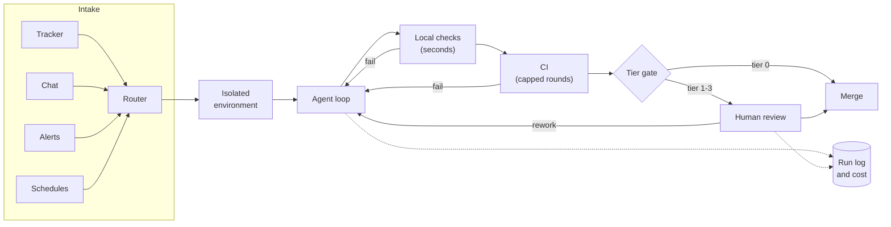

# Factory Infrastructure

Read the large public write-ups of agent-heavy engineering side by side and something odd stands out. They say surprisingly little about models. Stripe's two-part description of its coding agents spends most of its words on developer environments that start in ten seconds, rule files scoped to directories, an internal tool server and a CI policy. Spotify's engineering posts are about verifiers, containers and a fleet-management system that predates agents. OpenAI's infrastructure lead, describing the company's agentic workflow, talks about CI and version control struggling to keep up.

The agents are the easy part. What makes them reliable at volume is the plumbing around them: where work comes from, where it runs, how it is checked, how you see what happened, what it costs, and what it is allowed to touch. A factory is an infrastructure project, not a tool rollout.

!!! tip "The one-liner"
    What is good for human engineers is good for agents — and the teams furthest ahead are mostly cashing in years of developer-platform investment.

---

## What problem this solves

Personal agent use runs on a laptop with a human watching. Factory workflows run unattended, in parallel, at volume. That exposes everything laptops hide: shared CI capacity, environment setup time, credential handling, cost, and the inability to reconstruct what happened in a run nobody watched.

Teams usually discover this in a predictable order. First, a background workflow running on one engineer's machine stops when the laptop closes. Then parallel runs collide in the same working directory. Then CI queues grow. Then someone asks what a particular change was based on and nobody can say. Then the bill arrives. Each is an infrastructure problem with a known shape, and each is cheaper to solve before the volume arrives.

---

## When to use this

**Use it when:** you are moving any workflow from interactive use to triggered, unattended runs, or planning to run several agents in parallel on shared infrastructure.

**Skip it when:** agents are used only interactively with an engineer at the keyboard. Laptop-scale isolation (a worktree, a container) and your existing CI are enough until something runs unattended.

---

## The pipeline at a glance

Every box is somewhere the factory can stall, and every dotted line is something you will want when a run goes wrong. The rest of this page goes through them.

---

## The components

### 1. Intake

Work should arrive where it already arrives: issue trackers, chat, alerts, schedules, dependency bots. Stripe's engineers most frequently start its agents from Slack; they can also be launched from inside other internal applications, such as the tickets its CI systems create automatically for flaky tests. Ramp's internal agent, as InfoQ reported in January 2026, is reachable from a Slack bot, a web interface and a browser extension. Spotify's background agent takes both large migrations and ad hoc tasks triggered from Slack or its GitHub instance, and its engineers describe "a nice symbiosis" between the two kinds of use.

**Design for:** context travelling with the request (the thread, the linked issue, the alert payload) and a clear owner for each triggered run. A run started by a bot on behalf of nobody is a run nobody will review carefully.

### 2. Isolated environments

Each run needs its own place to work: a Git worktree, a container, a virtual machine or a cloud development environment.

- **Fast start:** Stripe pre-warms a pool of developer machines with repositories cloned and build caches warm, aiming for a usable environment in about ten seconds. If setup takes minutes, parallel agents spend most of their time waiting.
- **The same environment engineers use:** Stripe's agents run on the standard developer environment, so the agent's checks mean the same thing as a person's. The write-up's summary is that "what's good for humans is good for agents".
- **Disposable:** environments that can be thrown away after each run limit the blast radius of an agent's mistakes to that one environment.
- **Isolated from production and, where possible, the network:** Stripe's environments run without real user data, production access or arbitrary network egress. Spotify runs its agent in a container with "limited permissions, few binaries, and virtually no access to surrounding systems". Isolation is what lets agents run without a human approving each action.

### 3. Feedback infrastructure

Agents are only as good as what tells them they are wrong.

- **Fast local checks:** Stripe reports lint feedback in well under a second via pre-push hooks and a cached lint daemon, and has its agents run linters in a loop before pushing.
- **Verifiers the agent cannot game:** Spotify's deterministic verifiers for formatting, builds and tests activate based on what a component contains. The agent can call the verification loop as a tool, and in some cases must, but it cannot inspect or choose the individual verifiers — "the agent doesn't know what the verification does and how" — and they all run before a pull request is opened. After them, an LLM judge compares the diff against the original prompt; across thousands of sessions it vetoes about a quarter, mostly for the agent going beyond its instructions, and the agent recovers about half the time.
- **CI capacity sized for agent volume:** OpenAI's infrastructure lead describes roughly a tenfold increase in load on some systems within about six months.
- **A cap on CI rounds:** Stripe allows at most two, because returns diminish quickly against cost and time.
- **Flaky-test management:** flaky tests are an annoyance for people and a disaster for agents, which will try to "fix" them or loop on them.
- **The app runnable per environment:** with its own logs and metrics, so agents can verify behaviour, not just compile. OpenAI's harness engineering team gave each Git worktree its own startable copy of the app and an ephemeral observability stack, deleted when the task finishes.

### 4. Observability of the factory itself

You need to see what agents did, not only what they produced:

- **Run transcripts or traces:** retained for a sensible period.
- **Tools, skills and hooks:** which ones fired, and which failed.
- **Intervention points:** where a person stepped in, and why.
- **Outcome:** merged, reworked, abandoned, reverted.

Many coding agents and agent platforms can export run telemetry; check what yours offers before building your own. Start simple: a run log per workflow, with outcome and cost, is enough to begin with, and is what the promotion decisions in [Risk Tiers & Autonomy](risk-tiers-and-autonomy.md) depend on.

### 5. Cost controls

- **Budgets:** per workflow and per run.
- **Alerts:** on unusual spend, before month end.
- **Cost per merged change:** as a standing metric, including the human time spent reviewing and reworking.

StrongDM's suggestion that a mature factory should spend at least $1,000 in tokens per engineer per day reads as seriousness to some people and as a bill most teams will never justify to others. Your number should come from your own cost per outcome. See [Cost & Token Economics](../team/cost-and-token-economics.md).

### 6. Security boundaries

Sandboxes, scoped credentials, network policy and an audit trail. Stripe adds a control layer that blocks destructive tool actions, and gives each agent a small curated subset of the nearly 500 tools on its internal tool server rather than all of them. Its write-up observes that agents "perform best when given a 'smaller box' with a tastefully curated set of tools" — a security property and a quality property at once. See [Security](../security/index.md) and [Sandboxing & Permissions](../security/sandboxing-and-permissions.md).

---

## Worked example: from laptop to shared infrastructure

Consider a hypothetical team whose first factory workflow, flaky-test fixes, has been running from one engineer's machine for a month. It works. It is also fragile in exactly the ways above, and the team plans the move over two sprints.

**Week 1: inventory the hidden dependencies.** The engineer lists what the workflow silently relies on: her personal GitHub token, a local `.env` with a staging database password, a cron entry on her laptop, and a Docker image built by hand three weeks ago. Two of those are security problems. The staging password, in particular, means the agent can reach data a sandbox should not.

**Week 2: move intake and environment.** The trigger becomes a label on the CI system's automatically created flaky-test tickets. Runs move to the team's existing cloud development environments, using a pre-built image rebuilt nightly. A dedicated service identity replaces the personal token, with permission to push branches and open pull requests and nothing else. Staging access is removed entirely; the agent uses the same local service fakes the test suite uses.

**Week 3: what went wrong.** The first day on shared infrastructure, eleven runs start at once after a flaky-test spike, each running the full test suite. CI queue time for everyone on the team triples. Two fixes: a concurrency limit of three runs for the workflow, and a requirement that the agent run only the affected test file locally, repeatedly, before pushing. CI rounds are capped at two.

**Week 4: make it observable.** Each run writes a single line to a shared log: ticket, start and end, outcome, rounds of CI, tokens, and whether a human intervened. A short weekly summary goes to the team channel. In the first summary, the team notices that a third of runs end with the agent adding a retry to the test rather than fixing the cause. That becomes an instruction and a check, not an anecdote.

**The result.** The workflow is slower to start than it was on the laptop and considerably more trustworthy. More to the point, anyone on the team can now see it, pause it or improve it, which is the difference between a personal tool and a piece of the factory.

---

## Build or buy?

Most major coding agents now offer background or cloud execution triggered from issues and chat, and several platforms specialise in orchestration. For most teams, the right answer is to **buy the execution and build the harness**: use a vendor's environments and triggers, and keep your instructions, skills, checks and gates in open formats you control, so the harness survives a change of vendor.

Build your own when you have unusual constraints: a large custom stack, strict data residency, or scale that makes vendor pricing unworkable. Stripe built its own on a fork of Block's open-source goose agent and is explicit that its backend — mostly Ruby, not Rails, with Sorbet typing — is "a relatively uncommon stack". Spotify built an internal command-line layer that lets it switch agents and models underneath, and reports having swapped pieces out several times. Both are examples of building the parts that are specific to them and keeping the model replaceable.

!!! info "What we know / what we don't"
    **We know** that the most detailed public reports — Stripe, Spotify, OpenAI — credit pre-existing developer infrastructure (standard environments, fast feedback, fleet-wide change tooling) for much of their success with agents. **We know** CI and review capacity are the first shared resources to strain. **We don't know** what a typical cost per merged change looks like across organisations; published figures are company-specific and rarely include human review time. **We don't know** how well these patterns transfer to teams without a platform group; most write-ups come from companies that have one.

---

## Roles and ownership

| Role                | Responsibility                                               |
| ------------------- | ------------------------------------------------------------ |
| **Platform team**   | Environments, CI capacity, observability, cost controls      |
| **Harness owner**   | Instructions, skills, checks and gates that run inside       |
| **Security**        | Sandbox boundaries, credentials, network policy, audit trail |
| **Workflow owners** | Intake configuration and outcomes for their workflows        |

---

## What good looks like

| Signal                            | What you observe                                    |
| --------------------------------- | --------------------------------------------------- |
| **Environments start in seconds** | Agents do not wait on setup                         |
| **CI keeps up**                   | Queue times stay stable as agent volume grows       |
| **Runs are observable**           | You can answer "what did the agent do?" for any run |
| **Costs are attributed**          | Spend per workflow and per merged change is known   |
| **Intake is natural**             | Work starts where it already arrives                |
| **Boundaries are boring**         | No production credentials anywhere an agent runs    |

---

## Failure modes and mitigations

Infrastructure failures in a factory tend to surface as somebody else's problem. The agent workflow looks fine; it is the rest of the team who notice that CI is slow, the staging database has odd rows in it, or the monthly invoice has a new line. By then the workflow has users, and changing it feels like taking something away.

| Failure mode                      | What it looks like                                        | Mitigation                                                           |
| --------------------------------- | --------------------------------------------------------- | -------------------------------------------------------------------- |
| **Laptop factories**              | Background workflows running on someone's machine         | Shared, isolated environments with service identities                |
| **CI collapse**                   | Agent volume saturates CI                                 | Capacity planning; fast local checks; concurrency limits; round caps |
| **Invisible runs**                | Nobody can reconstruct what an agent did                  | Transcripts and a run log per workflow                               |
| **Surprise bills**                | Spend discovered at month end                             | Budgets and alerts per workflow                                      |
| **Production-adjacent sandboxes** | Agent environments with production or staging credentials | Strict isolation; fakes instead of shared data                       |
| **Every tool for every agent**    | Agents given the whole tool catalogue                     | A small, curated set per workflow                                    |

!!! warning "The personal-token trap"
    A workflow that runs on an engineer's own credentials inherits everything that engineer can do, and leaves an audit trail that says they did it. Give each workflow its own identity with the narrowest permissions that work.

---

## Further reading

- **[Minions: Stripe's one-shot, end-to-end coding agents](https://stripe.dev/blog/minions-stripes-one-shot-end-to-end-coding-agents)** by Alistair Gray (Stripe) — Intake, devboxes, deterministic steps and the CI cap.
- **[Minions, Part 2](https://stripe.dev/blog/minions-stripes-one-shot-end-to-end-coding-agents-part-2)** by Alistair Gray (Stripe) — Blueprints, the tool server, security controls and the "smaller box" lesson.
- **[Background Coding Agents: Predictable Results Through Strong Feedback Loops](https://engineering.atspotify.com/2025/12/feedback-loops-background-coding-agents-part-3)** by Max Charas and Marc Bruggmann (Spotify) — Verifiers the agent can call but not inspect, an LLM judge and its veto rate. Spotify sells Fleetshift and Honk as part of Spotify Portal for Backstage.
- **[Inside OpenAI's agentic software factory](https://newsletter.pragmaticengineer.com/p/openai-software-factory)** by Gergely Orosz (The Pragmatic Engineer) — Infrastructure strain at agent volume. Partly paywalled.
- **[OpenAI Introduces Harness Engineering](https://www.infoq.com/news/2026/02/openai-harness-engineering-codex/)** by Leela Kumili (InfoQ) — A secondary summary of OpenAI's own write-up.
- **[Harness engineering](https://openai.com/index/harness-engineering/)** by Ryan Lopopolo (OpenAI) — The original account. (Vendor post.)
- **[Ramp Builds Internal Coding Agent That Powers 30% of Engineering Pull Requests](https://www.infoq.com/news/2026/01/ramp-coding-agent-platform/)** by Claudio Masolo (InfoQ) — Sandboxed environments and intake surfaces for an internal agent.
- **[Harness engineering for coding agent users](https://martinfowler.com/articles/harness-engineering.html)** by Birgitta Böckeler (martinfowler.com) — The guides-and-sensors view of what runs inside the environment.

---

## Related pages

- [Sandboxing & Permissions](../security/sandboxing-and-permissions.md) — Isolation and credentials in detail.
- [Cost & Token Economics](../team/cost-and-token-economics.md) — Budgets and cost per outcome.
- [Accountability & Audit Trail](../security/accountability-and-audit.md) — What to record so runs can be reconstructed.
- [The Bottleneck Moves](the-bottleneck-moves.md) — Why CI and review strain first.
