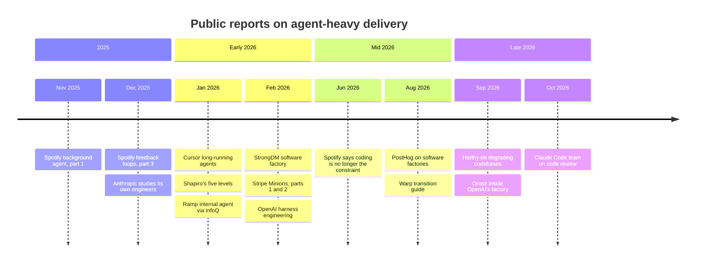

# Field Reports

!!! note "Last reviewed"
    October 2026. These reports are mostly written by the teams themselves, often by companies that sell related products or depend on a model vendor. They are valuable as descriptions of what is possible. They are not neutral evidence of what is typical. Figures are as published; none has been independently audited.

Read enough of this year's write-ups about agent-heavy engineering and a pattern appears. The headline is always a number — a thousand pull requests a week, a million lines, 70% of all pull requests — and the useful part is almost never the number. It is a paragraph halfway down about the developer environment that took years to build, the verifier the agent is not allowed to see, the codebase that had to be archived, or the review queue that grew by exactly as much as the output did.

This page collects the reports I find most instructive and reads them for that paragraph. For each one: what they said, what was unusual about their situation, what I would take, and what I would not.

!!! tip "The one-liner"
    The transferable part of a field report is what the team had to build before the agents worked, not how much the agents produced afterwards.

---

## What problem this solves

Field reports are the closest thing this field has to case studies, and they are read the way case studies usually are: as targets. A team reads that Stripe merges over a thousand agent-written pull requests a week, or that StrongDM does not let humans review code, and quietly adjusts its sense of what normal is. The reports themselves are usually more careful than their reception. This page is an attempt to read them the way their authors would want: in context, with the caveats in front.

---

## When to use this

**Use it when:** someone proposes copying another company's setup, when a headline number starts shaping your team's expectations, or when you want to know what the teams furthest along had to build first.

**Skip it when:** you need a plan for your own team. Start with [Your First Factory Workflow](first-factory-workflow.md) and come back here for context.

---

## A timeline of the reports

The shape of the year is visible in the sequence. The winter brought the boldest claims — lights-off factories, million-line codebases, browsers built by agent swarms. By late summer more of the writing was about transitions, review load, and a team walking back from "nobody reads the code". That is not a retreat. It is what happens when experiments start meeting maintenance.

---

## At a glance

| Report                                  | Kind of source                                             | Headline                                                                                        | Human review                                                                | Most transferable idea                                                        |
| --------------------------------------- | ---------------------------------------------------------- | ----------------------------------------------------------------------------------------------- | --------------------------------------------------------------------------- | ----------------------------------------------------------------------------- |
| **OpenAI — harness engineering**        | First-party engineering post                               | ~1M lines, ~1,500 PRs, no hand-written code, ~5 months                                          | Optional; almost all review effort moved to agent-to-agent                  | Short instructions, mechanical enforcement, cleanup agents                    |
| **OpenAI — agentic workflow**           | Journalist (Orosz), partly paywalled                       | PRs per engineer "like a hockey stick"                                                          | Risk-tiered                                                                 | Risk-based gating; infrastructure strain                                      |
| **Stripe — Minions**                    | First-party engineering blog                               | >1,300 merged agent-written PRs/week                                                            | Every PR                                                                    | Developer infrastructure first                                                |
| **Spotify — Fleet Management and Honk** | First-party engineering blog; Spotify sells both           | >2.5M fleet maintenance PRs merged, mostly from pre-agent scripts; >1,500 agent PRs by Nov 2025 | Mostly auto-merged for maintenance                                          | Verifiers the agent can call but not inspect; an existing fleet-change system |
| **StrongDM**                            | First-party; read with Willison                            | Two rules: no human writing, no human review                                                    | None, by design                                                             | Scenarios as holdout sets; digital twins                                      |
| **Ramp**                                | Journalist (InfoQ)                                         | ~30% of merged PRs, not mandated                                                                | Not stated                                                                  | Agents with the same access as engineers                                      |
| **Cursor**                              | Vendor research                                            | Hundreds of agents, >1M-line browser in a week                                                  | Not the point of the experiment                                             | Coordination structure beats concurrency                                      |
| **PostHog**                             | Newsletter; sells product analytics                        | Agents write ~70% of PRs; humans skim ≥80%                                                      | Skimmed                                                                     | Product context as harness input                                              |
| **Warp**                                | Vendor guide                                               | 20–30% of PRs via factories                                                                     | One named gate                                                              | The four-step transition                                                      |
| **HumanLayer**                          | Secondary reporting; HumanLayer sells an agent IDE         | Lightly supervised factory archived after months                                                | Keep reading the code, or front-load human effort in planning (per PostHog) | Review as the guard against slow decay                                        |
| **Anthropic**                           | First-party research                                       | Self-reported gains rising; delegation still limited                                            | Yes                                                                         | The people-side costs                                                         |
| **Anthropic — Claude Code review**      | First-party engineering post; Anthropic sells the reviewer | Merged PRs more than doubled Jun–Sep; revert share down >40%                                    | At most one human in the loop for most PRs; more by risk                    | Layered review; review loops that converge; incidents as the reviewer's eval  |

---

## OpenAI — the agent-written product

**What was reported:** in February 2026, OpenAI's Ryan Lopopolo described an internal experiment in building a beta product with no manually written source code. The first commit landed in late August 2025. Five months later the repository held roughly a million lines of code, and about 1,500 pull requests had been opened and merged by a team of three engineers steering Codex, an average of 3.5 pull requests per engineer per day, with throughput rising as the team grew to seven. The team estimates it took about a tenth of the time hand-writing would have. People may review pull requests but are not required to; over time, almost all review effort moved to agent-to-agent review.

**What made it work, by their account:** a short `AGENTS.md` of about 100 lines that works as a map to a structured `docs/` directory, after a single large instruction file failed; a rigid layered architecture enforced by custom linters and structural tests, with lint messages written to tell the agent how to fix the problem; an application startable per Git worktree, with Chrome DevTools wired into the agent's runtime and an ephemeral logs-metrics-traces stack per worktree; and a recurring clean-up process, compared to garbage collection, plus a doc-gardening agent. Birgitta Böckeler's analysis on martinfowler.com is the best independent reading of it. Their conclusion: "Our most difficult challenges now center on designing environments, feedback loops, and control systems."

**Unusual context:** a new product, built for agents from the first commit, by the people who build the model.

**Take:** the harness practices — short instructions, executable rules, observable environments, continuous gardening. They apply to any team.
**Don't take:** the conclusion that every team should stop writing code, or the velocity figure as a benchmark for a legacy codebase.

---

## OpenAI — the broader agentic workflow

**What was reported:** Gergely Orosz's September 2026 look inside OpenAI's wider engineering workflow, much of it in the words of Venkat Venkataramani, VP of Engineering for Applied Infra. Pull requests per engineer are "growing like a hockey stick"; some systems saw roughly a tenfold increase in load in about six months. Changes are classified by risk: high-risk ones get stricter review that may include a person, and low-risk areas can opt in to automatic approval. Multiple specialist review agents — security, cloud infrastructure — look at each change. After human approval, an agent can shepherd a change through rollout and watch production signals; an incident agent suggests mitigations but executes only those an engineer approves. Documentation was moved into the source tree so agents can read it.

**Unusual context:** the organisation that builds the model, with very high internal adoption and an infrastructure team scaling at a pace few companies face. The second half of the article is paywalled.

**Take:** the bottleneck moves to infrastructure and review; risk tiers are how autonomy becomes manageable; agents can carry work after merge as well as before.
**Don't take:** the scale as a target. Most teams will hit review and CI limits far earlier, and will hit them as people problems before they hit them as infrastructure ones.

---

## Stripe — Minions

**What was reported:** "one-shot, end-to-end" coding agents producing over a thousand merged pull requests per week in February 2026, and over 1,300 by the second post ten days later, all reviewed by a person and containing no human-written code. Engineers most frequently start runs from Slack; they can also be invoked from inside other internal applications, such as tickets for flaky tests. They execute on Stripe's standard developer environments, pre-warmed to start in about ten seconds and isolated from production data and arbitrary network access. Workflows interleave agent steps with deterministic ones for Git, linting and tests; agents get a curated subset of an internal tool server's nearly 500 tools; and CI is capped at two rounds. The agent itself is a fork of Block's open-source goose.

**Their lessons, in their words:** "if it's good for humans, it's good for LLMs, too"; agents "perform best when given a 'smaller box' with a tastefully curated set of tools"; and "our investments in human developer productivity over time have returned to pay dividends in the world of agents".

**Unusual context:** years of developer-platform investment, over three million tests, an uncommon backend stack (Ruby with Sorbet), and a vast number of homegrown libraries that, in Stripe's words, are "natively unfamiliar to LLMs".

**Take:** almost everything. Stripe's write-up is the most transferable large-scale report available: high autonomy in execution, humans still reviewing, heavy investment in developer infrastructure.
**Don't take:** the volume as a benchmark.

---

## Spotify — Fleet Management and Honk

**What was reported:** a series of engineering posts from November 2025 onwards. Spotify's background agent grew out of Fleet Management, a system that already applied automated changes across its repositories and accounted for around half of its pull requests from mid-2024. The agent replaced deterministic transformation scripts for changes too complex to express as code; Spotify reports 60–90% time savings on migrations compared with writing the code by hand. Part 1 counted more than 1,500 agent-written pull requests merged by November 2025. Its third post is the most instructive: deterministic verifiers the agent can call but not inspect or choose, activated by what a component contains, and an LLM judge that compares the diff to the original prompt and vetoes about a quarter of sessions, most often because the agent went beyond its instructions. By June 2026, in its write-up of Niklas Gustavsson's talk at Anthropic's Code with Claude event, Spotify reported over 2.5 million automated maintenance pull requests merged through Fleet Management, most auto-merged — the large majority from the fleet system's deterministic scripts, which predate the agent — and pull request frequency up 76%. The write-up puts the consequence as "the bottleneck moves from coding to decision-making".

**Unusual context:** years of standardisation (Backstage, golden-state standards, fleet-wide change tooling) before agents arrived. Honk runs Claude through Anthropic's Agent SDK, the June figures were presented at Anthropic's event, and they are company-reported. Spotify also has a commercial interest: the June post states that "Fleetshift and Honk are available as part of Spotify Portal for Backstage."

**Take:** verifiers the agent cannot game; narrow agents in tight containers; and the observation, in the June post, that agents do better on consistent codebases — "if Claude has a lot of other code to look at, and that code looks roughly consistent, Claude will do a better job."
**Don't take:** the auto-merge rate as applicable to feature work, or as an agent figure. Those millions are mostly scripted maintenance changes running through a system built for exactly that.

---

## StrongDM — the lights-off factory

**What was reported:** in February 2026, StrongDM's CTO Justin McCarthy described the approach of a team he founded with two colleagues in July 2025, working on two rules: code must not be written by humans, and code must not be reviewed by humans. Validation replaces review: end-to-end scenarios stored outside the codebase, like a holdout set the agents cannot see; a probabilistic measure of "satisfaction" across observed runs; and a "Digital Twin Universe" of behavioural clones of services such as Okta, Jira, Slack and Google Docs, letting them test at volumes and failure modes live services would not allow. Their suggested benchmark of at least $1,000 in tokens per engineer per day became one of the year's most debated numbers. Simon Willison, who saw the team's work in person, posed the obvious question — how could no human review be sensible, given models' "inhuman mistakes"? — and found their answer — scenarios treated as holdout sets — "fascinating".

**Unusual context:** a small, new team building new software, with the explicit aim of testing the limit.

**Take:** the thought experiment. Asking "what would have to be true for us not to read this code?" is a powerful way to find gaps in your verification. Holdout scenarios and service twins are good ideas at any autonomy level.
**Don't take:** the rules as a goal, or the token figure as a budget.

---

## Ramp — an internal agent nobody was told to use

**What was reported:** InfoQ reported in January 2026 that Ramp's internal coding agent had reached about 30% of merged pull requests across its frontend and backend repositories, without being mandated. It runs in sandboxed virtual machines on Modal and connects to the same systems engineers use: databases, CI, Sentry, Datadog, feature flags, Slack and GitHub. Higher figures for later in 2026 circulate in podcast summaries and commentary without a primary source, so I do not repeat them.

**Take:** adoption without a mandate is a signal worth more than a higher number with one. Giving the agent the same access engineers have — inside a sandbox — is what makes its output checkable.
**Don't take:** share of pull requests as a measure of share of work. A pull request is a unit of review, not of value.

---

## Cursor — many agents, one browser

**What was reported:** Cursor's January 2026 research post describes running hundreds of concurrent agents on single projects for weeks, including building a web browser from scratch (over a million lines across a thousand files in close to a week). The engineering lessons are the valuable part: lock-based coordination collapsed, with twenty agents slowing "to the effective throughput of two or three"; flat structures made agents risk-averse; a planner, worker and judge structure worked better; and "the harness and models matter, but the prompts matter more". The author is candid that the system is "nowhere near optimal" and that a large migration it produced "still needs careful review".

**Unusual context:** a vendor demonstrating its own capability, on greenfield projects.

**Take:** coordination structure matters more than agent count, and periodic fresh starts beat endless runs.
**Don't take:** the line count as evidence of maintainable software. The post itself does not claim it.

---

## PostHog — the middle of the spectrum

**What was reported:** in an August 2026 newsletter, agents writing around 70% of PostHog's pull requests, with people still skimming at least 80% of them. The argument: agents need the same product inputs good engineers use — how the product is used, who the customers are, what users complain about — and the usual factory design fails by enforcing "a clean separation between 'deciding what to build' and 'building it'". They also note that 63% of changed lines are in files that already exist and that fixes are their largest commit type, at 40%: most work is maintenance of something real.

**Unusual context:** PostHog sells product analytics and describes itself as "your product's context layer", so the argument aligns with its product. That does not make it wrong.

**Take:** product context is part of the harness. A factory that only sees the repository makes repository-shaped decisions.
**Don't take:** "skim" as a review standard for high-risk areas.

---

## Warp — the transition guide

**What was reported:** an August 2026 guide describing four steps from coding agents to a factory — mirror one workflow with a human approving every output, move intake to where work arrives, chain triage and review around it, then measure and improve — with "accepted without rework more often than not" as the bar for moving past the first. Warp's own team automates 20–30% of its pull requests through factory workflows. It is explicit that adoption metrics are the wrong measure, recommending cost, cycle time, acceptance rate and intervention rate.

**Take:** the sequence and the metrics. It is the most practical published roadmap, and [Your First Factory Workflow](first-factory-workflow.md) follows its shape.
**Don't take:** the tooling assumptions uncritically. Warp sells the platform; the sequence is sound regardless of what you run it on.

---

## HumanLayer — coming back from "nobody reads the code"

**What was reported:** Dex Horthy of HumanLayer has described in talks, interviews and a three-part series his team's experiment with a lightly supervised factory. As reported by the Agentic AI Foundation in September 2026, in a post promoting his talk at its AGNTCon conference, they ran it for three or four months, let questionable code stay, and ended with a 30,000–40,000-line codebase containing an "insanely complicated state machine" that they archived. His summary: "Each slop pattern in your codebase increases the chance that more code is also going to be sloppy." He has also pointed to early benchmark work in which every model tested accumulated defects as requirements changed — while noting the sample was small and the differences within error bars. PostHog's newsletter summarises his recommendation until better benchmarks exist: "either keep reading the code, or front-load human effort in the planning phase."

**Take:** the honesty, and the mechanism. Unreviewed code does not fail all at once; it lowers the quality of the context the next run learns from. This is what learning in public looks like.
**Don't take:** a single team's experience as proof that higher autonomy can never work. It is one well-described data point, and HumanLayer sells an IDE and cloud platform for working with coding agents on large codebases, so it has a stake in the argument.

---

## Anthropic — studying its own engineers

**What was reported:** a study of Anthropic's own engineers, published December 2025 (fieldwork August 2025), combining a survey of 132 people, 53 interviews and Claude Code usage data. Self-reported productivity gains rose from about 20% to about 50% over a year; merged pull requests per engineer per day rose 67% after Claude Code was adopted; and about 27% of AI-assisted work was work that would not have been done otherwise. The study itself cautions that self-reports may be affected by social desirability and recency bias. But more than half of engineers said they could fully delegate only 0–20% of their work, and many worried about skill atrophy, mentorship, and collaborating less with colleagues.

**Unusual context:** a model vendor studying its own staff using its own product. Much of the data is self-reported.

**Take:** the concerns, as much as the gains. They are the clearest early signal of the people-side costs. See [Growing Judgment](../team/growing-judgment.md).
**Don't take:** the gains as typical. Data from DX's customer sample in mid-2026 (vendor, early look) shows most organisations' throughput gains closer to 10–15%.

---

## Anthropic — how the Claude Code team reviews code

**What was reported:** an October 2026 post by Addy Osmani, Morgan Westlee Lunt and Qing Wang on how the Claude Code team reviews code when, by its own account, Claude writes about 90% of it. Changes landing per day in Anthropic's monorepo went from about 2,500 in May to more than 30,000 in September. On the Claude Code repositories, merged pull requests more than doubled between June and September while the share that had to be reverted fell by more than 40%. The team's stated goal is that most pull requests merge with at most one human in the loop, who can be the author, without any rise in reverts or incidents. It measures human effort through approvals per pull request (median and 95th percentile), human comments and time waiting on a person, with revert and incident rates as guardrails.

**What made it work, by their account:** six layers of checks with rollback underneath (pre-PR verification, AI review, a blocking security review, required CI, human approval scaled by risk, and merge queue with flags and staged rollouts); approval rules in which the tier is set by the change rather than the author and an agent's approval never counts as a person's; a `REVIEW.md` in which code owners tell the reviewer what matters; past incident-causing pull requests as the reviewer's evaluation set; and a deliberate fix for review loops that did not converge — one pull request went through more than fifty rounds overnight. When someone needs to understand part of the codebase, they ask Claude for an explainer of that exact slice rather than reading old diffs.

**Unusual context:** a model vendor describing a team that builds an agent product, uses it all day, and sells the reviewer it describes (Code Review for Claude Code). Heavy internal use means regressions are often caught by employees before customers. The team says no member holds a full mental model of the codebase, and that it has no formal mechanism yet for building one.

**Take:** the reframe from "did someone read the code?" to "which check should catch this?"; counting human time on both sides, review and rework; the approval rules; and the convergence fixes. They apply to any team with an AI reviewer. See [Review at Agent Speed](../workflow/review-at-agent-speed.md).
**Don't take:** the volumes, or the assumption that on-demand explainers replace what people used to learn by reading each other's code. That part is untested. See [Growing Judgment](../team/growing-judgment.md).

---

## Worked example: reading a report before borrowing from it

Consider a hypothetical engineering manager who reads the Stripe write-up and wants to propose "Minions for us" at the next leadership meeting. Before writing the proposal, she runs it through four questions.

**1. Who wrote it, and what do they sell?** Stripe's engineering team, writing on its developer blog. Stripe does not sell coding agents. Low conflict, but a recruiting incentive to look impressive.

**2. What is unusual about their context?** Years of developer-platform investment, standard cloud development environments, three million tests, an internal tool server. Her company has a CI pipeline that takes forty minutes and development environments that take half a day to set up.

**3. What did they have to build before the agents worked?** Nearly everything the post describes is infrastructure for humans that agents inherited. That is the transferable part, and it reframes her proposal.

**4. What did they say went wrong, or limit?** The CI cap exists because extra rounds stopped paying off. Human review stayed. Their uncommon stack made off-the-shelf tools less effective.

**The proposal she writes instead:** cut environment setup from half a day to minutes, get the critical CI path under ten minutes, and run one bounded agent workflow on the result. It is less exciting than "Minions for us". It is also the part of Stripe's story most likely to be true for her company.

**What went wrong on the first draft.** Her first version quoted the 1,300-pull-requests figure in the opening line. A peer pointed out that leadership would remember the number and forget the caveat, and measure the pilot against it. She moved it to the appendix.

---

## Reading field reports well

- **Who wrote it, and what do they sell?** Vendors, model providers and companies hiring all have reasons to look good. That does not make them wrong; it tells you where to look harder.
- **What is unusual about their context?** New codebase? Large platform team? Builds the models?
- **What did they have to build before agents worked?** That is usually the transferable part.
- **What did they measure, and how?** Self-reported, company-reported or independently measured? Pull requests, lines or outcomes?
- **What did they say went wrong?** The most useful sentences are often near the end.

!!! info "What we know / what we don't"
    **We know** that several large organisations run agent workflows at very high volume, and that their own accounts credit infrastructure and verification more than models. **We know** most public reports keep people reviewing, at least for anything beyond maintenance. **We don't know** how typical any of this is: there is almost no independent, longitudinal measurement of agent-heavy codebases, and the most candid long-term report available (HumanLayer's) is a single team. **We don't know** the full cost: few reports publish spend, and none publish the human review time behind their numbers.

---

## Roles and ownership

| Role                          | Responsibility                                                       |
| ----------------------------- | -------------------------------------------------------------------- |
| **Engineering leadership**    | Reads reports for context and caveats, not targets                   |
| **Tech leads**                | Extract the transferable infrastructure and practices                |
| **Whoever proposes a change** | Names the source, its interests and what is different about the team |

---

## What good looks like

| Signal                                 | What you observe                                          |
| -------------------------------------- | --------------------------------------------------------- |
| **Sources named with their interests** | Proposals say who wrote the report and what they sell     |
| **Prerequisites borrowed first**       | The plan copies the infrastructure, not the volume        |
| **Numbers kept in context**            | Headline figures appear with their caveats, or not at all |

---

## Failure modes and mitigations

| Failure mode                        | What it looks like                            | Mitigation                                   |
| ----------------------------------- | --------------------------------------------- | -------------------------------------------- |
| **Benchmarking against a headline** | "Stripe does 1,300 a week; why don't we?"     | Compare prerequisites, not output            |
| **Vendor content as evidence**      | A guide from a tool seller treated as neutral | Note the interest; look for independent data |
| **Ignoring the end of the post**    | Limits and failures skipped                   | Read for what went wrong first               |

---

## Further reading

- **[OpenAI Introduces Harness Engineering](https://www.infoq.com/news/2026/02/openai-harness-engineering-codex/)** by Leela Kumili (InfoQ) — Secondary summary of OpenAI's experiment.
- **[Harness engineering](https://openai.com/index/harness-engineering/)** by Ryan Lopopolo (OpenAI) — The original account. (Vendor post.)
- **[Harness engineering for coding agent users](https://martinfowler.com/articles/harness-engineering.html)** by Birgitta Böckeler (martinfowler.com) — Places OpenAI's practices in a broader framework.
- **[The State of AI Harness Engineering 2026](https://marmelab.com/blog/2026/09/24/the-state-of-ai-harness-engineering-2026.html)** by marmelab — Survey of harness practice, including OpenAI's short `AGENTS.md`.
- **[Inside OpenAI's agentic software factory](https://newsletter.pragmaticengineer.com/p/openai-software-factory)** by Gergely Orosz (The Pragmatic Engineer) — Risk tiers, infrastructure strain and agents after merge. Partly paywalled.
- **[Minions: Stripe's one-shot, end-to-end coding agents](https://stripe.dev/blog/minions-stripes-one-shot-end-to-end-coding-agents)** and **[Part 2](https://stripe.dev/blog/minions-stripes-one-shot-end-to-end-coding-agents-part-2)** by Alistair Gray (Stripe) — The most transferable large-scale report.
- **[1,500+ PRs Later: Spotify's Journey with Our Background Coding Agent](https://engineering.atspotify.com/2025/11/spotifys-background-coding-agent-part-1)** by Max Charas and Marc Bruggmann (Spotify) — Where the agent came from.
- **[Background Coding Agents: Predictable Results Through Strong Feedback Loops](https://engineering.atspotify.com/2025/12/feedback-loops-background-coding-agents-part-3)** by Max Charas and Marc Bruggmann (Spotify) — Verifiers and an LLM judge, with its veto rate.
- **[Coding Is No Longer the Constraint](https://engineering.atspotify.com/2026/6/code-with-claude-coding-is-no-longer-the-constraint)** by Spotify Engineering — Scale figures and the moved bottleneck. Presented at an Anthropic event; Spotify sells Fleetshift and Honk.
- **[Software Factories and the Agentic Moment](https://factory.strongdm.ai/)** by Justin McCarthy (StrongDM) — The lights-off factory in its authors' words.
- **[How StrongDM's AI team build serious software without even looking at the code](https://simonwillison.net/2026/Feb/7/software-factory/)** by Simon Willison — An outside reading that asks the obvious question and takes the answer seriously.
- **[Ramp Builds Internal Coding Agent That Powers 30% of Engineering Pull Requests](https://www.infoq.com/news/2026/01/ramp-coding-agent-platform/)** by Claudio Masolo (InfoQ) — Ramp's agent and its unmandated adoption.
- **[Scaling long-running autonomous coding](https://cursor.com/blog/scaling-agents)** by Wilson Lin (Cursor) — Coordination lessons from hundreds of agents. (Vendor research.)
- **[How the Claude Code team does code review](https://claude.dev/blog/solving-code-review-at-anthropic/)** by Addy Osmani, Morgan Westlee Lunt and Qing Wang (Anthropic) — Review at agent volume, with numbers. (Vendor post.)
- **[Can software factories actually work?](https://posthog.com/newsletter/software-factories)** by Jina Yoon (PostHog) — The middle of the spectrum and the case for product context.
- **[How do you move from coding agents to a software factory?](https://www.warp.dev/articles/coding-agents-to-software-factory)** by Warp — The four-step transition. (Vendor guide.)
- **[Dex Still Thinks Long-Running Coding Agents Stink](https://aaif.io/blog/dex-still-thinks-long-running-coding-agents-stink)** by Alex Salkever (Agentic AI Foundation) — Reporting on HumanLayer's archived factory and early benchmark work; written to promote Horthy's conference talk.
- **[How AI is transforming work at Anthropic](https://www.anthropic.com/research/how-ai-is-transforming-work-at-anthropic)** by Anthropic — A model vendor studying its own engineers, concerns included.
- **[The current impact of AI on engineering velocity](https://newsletter.getdx.com/p/the-current-impact-of-ai-on-engineering)** by Justin Reock (DX) — Customer-sample context for the headline numbers. DX sells developer analytics.

---

## Related pages

- [The State of the Evidence](../principles/state-of-the-evidence.md) — How to weigh studies, surveys and self-reports.
- [Experiments in the Field](../frontier/experiments-in-the-field.md) — The more speculative end of current practice.
- [Migrations at Scale](../frontier/migrations-at-scale.md) — Where fleet-wide agent changes are most proven.
- [What a Factory Is (and Isn't)](what-a-factory-is.md) — The spectrum these reports sit on.
