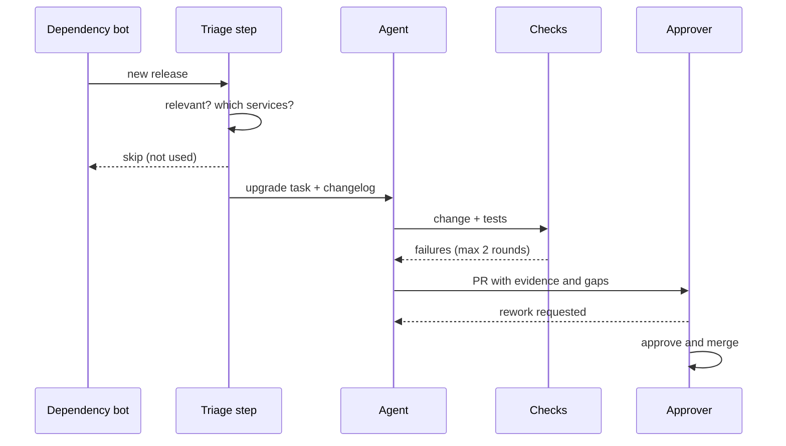

# Your First Factory Workflow

It helps to picture something deliberately unglamorous, such as keeping dependencies up to date. In many teams one engineer handles it when they find the time: reads the changelog, makes the change, runs the tests, opens a pull request and hopes someone reviews it before it goes stale. When that engineer is busy, nobody does it, and six months later an upgrade that would have been a patch is a migration.

Nobody would put that work on a conference slide. That is exactly why it makes a good first factory workflow. It already happens, it has a checkable definition of done, mistakes are cheap to reverse, and the team will notice if it stops being a chore.

The transitions that seem to hold up start small and stay reversible for a while. Not a transformation programme. One workflow, on one repository, with a person approving every output until the evidence says otherwise.

!!! tip "The one-liner"
    A team forms an opinion about factories from watching one workflow succeed, fail and get fixed in front of it — not from an announcement.

---

## What problem this solves

Teams that try to build a whole factory at once tend to stall: too many decisions, too many unknowns, too much change for people to absorb at the same time. Worse, a big launch gives the team nothing concrete to form an opinion about. People argue from the demo they saw or the incident they fear.

A single workflow fixes both. It is small enough to finish, and it produces evidence: which runs came back clean, which needed rework, what it cost, and where people had to step in. That evidence is what justifies the next step, or the decision not to take one.

---

## When to use this

**Use it when:** your team has working individual agent use and a shared harness of some kind, and you want to move one piece of recurring work from personal habit into the team's system.

**Skip it when:** the team has no shared instructions or checks yet (start with [Designing a Team Harness](../harness/designing-a-team-harness.md)), or when the only candidate work requires product judgment on every run. That work should stay interactive.

---

## Choosing the workflow

A good first workflow has four properties:

- **A clear trigger:** something that already happens, like a release, an alert or a label.
- **A checkable definition of done:** tests pass, the build is green, a specific output exists.
- **A limited blast radius:** easy to revert, low user impact.
- **Real, recurring cost today:** something people actually spend time on, or skip.

**Good candidates:** dependency upgrades, flaky-test quarantine, documentation drift, small well-specified bug fixes from a labelled backlog, lint-rule migrations.

**Poor candidates:** novel architecture, exploratory debugging, anything requiring product judgment, and anything in a [tier 3](risk-tiers-and-autonomy.md) area. Those stay interactive.

The large public examples started in the same place. Spotify's background agent grew out of Fleet Management, a system built before coding agents to open automated pull requests for dependency bumps, configuration updates and simple refactors; since mid-2024, around half of Spotify's pull requests have come from it. The agent replaced the deterministic scripts for changes that were too complex to express as code transformations, but the trigger, the target repositories and the review path were already there. Stripe's engineers most frequently start its agents from Slack, but they can also be launched from inside internal applications — including the tickets its CI systems create automatically for flaky tests. Neither started with "agents build features from tickets".

---

## The four stages

Warp's published guide describes a four-step path that matches what I would recommend, and is worth reading even knowing that Warp sells the tooling. In my words:

```text
Mirror one workflow → Move the intake → Chain the loop → Measure and decide
  (human approves      (starts where      (triage before,    (promote, hold
   every output)        work arrives)      check after)       or demote)
```

### Stage 1: mirror the workflow

The agent does what the engineer used to do, on one repository, with a person approving every output. For a dependency upgrade it:

1. Reads the changelog and identifies breaking changes.
2. Makes the change.
3. Runs the checks the team agreed matter for that area.
4. Writes down what it changed, why, and **what it could not verify**.
5. Opens a pull request and assigns a person.

Someone still says yes. What moves is that person's attention, from doing the upgrade to judging whether the evidence in front of them is enough. The first version does not change who is accountable. Warp's threshold for leaving this stage is that the agent's output "is accepted without rework more often than not".

### Stage 2: move the intake

Instead of someone prompting the agent, the workflow triggers from where the work already arrives: the dependency bot's notification, a scheduled job, a label on an issue. This is where a workflow stops being someone's personal tool and becomes part of the team's system, which is why it is worth treating as its own step.

### Stage 3: chain the loop

Add triage before (is this upgrade relevant? which services use it?) and an independent check after (does the change address every breaking change in the changelog?). Keep one named human gate before merge.



### Stage 4: measure and decide

After a few weeks, the team knows which upgrades come back clean and which need rework. That record is what justifies the next step. Perhaps automatic approval for patch releases in low-risk services. Perhaps nothing at all.

---

## Worked example: six weeks of dependency upgrades

The following is hypothetical, but built from the shape of real pilots. A team of six owns four services in a TypeScript monorepo. Dependency upgrades are handled ad hoc; the backlog has 41 open bot pull requests, some older than three months. Before starting, they fill in a [Factory Pilot Canvas](../templates/factory-pilot-canvas.md) and agree two things in writing: the workflow owner (one engineer, Priya) and the promotion threshold (thirty consecutive patch upgrades in the two internal services accepted without rework and no escaped defects moves those patches from shadow to sampled approval; auto-merge is a separate, later decision).

### Weeks 1–2: shadow

Priya runs the agent by hand on each new bot pull request. Every output is reviewed in full.

| Metric                      | Week 1   | Week 2   |
| --------------------------- | -------- | -------- |
| **Runs**                    | 9        | 12       |
| **Accepted without rework** | 4 (44%)  | 7 (58%)  |
| **Interventions mid-run**   | 3        | 2        |
| **Escaped defects**         | 0        | 0        |
| **Median trigger → merge**  | 2.5 days | 1.8 days |

**What went wrong.** Three of the week 1 rejections share a cause: the agent "fixed" type errors from a major upgrade by loosening types to `any`. Nobody had written down that this was unacceptable. Priya adds a rule to the repository instructions and a lint rule that fails on new `any` in the affected packages. A fourth rejection was a flaky integration test the agent tried to fix by adding retries. The team adds that pattern to the instructions too: report flaky tests, do not modify them.

### Weeks 3–4: move the intake and chain the loop

The workflow now starts automatically from the bot's pull requests. A triage step skips upgrades to packages only used in a deprecated service and groups related packages. A second check compares the changelog's listed breaking changes against the diff and flags any that were not addressed.

| Metric                      | Week 3   | Week 4   |
| --------------------------- | -------- | -------- |
| **Runs**                    | 18       | 16       |
| **Accepted without rework** | 12 (67%) | 13 (81%) |
| **Interventions mid-run**   | 1        | 1        |
| **Escaped defects**         | 1        | 0        |
| **Median trigger → merge**  | 9 hours  | 6 hours  |

The team also starts recording cost per merged change in week 3, once runs are automatic and comparable.

**What went wrong.** The week 3 escaped defect was a minor-version upgrade of a date library that changed default time-zone handling. Tests passed; a customer-facing report showed the wrong day for users in one region. The changelog did mention it. The agent's pull request listed it under "could not verify", and the approver missed it in a long description. Two changes follow: the evidence section now leads with unverified items in a separate block, and date and money libraries move into a "always full review" list regardless of version bump.

### Weeks 5–6: measure and decide

The backlog of 41 is down to 6, all majors needing real design work. The team reviews the record at a regular meeting.

| Metric                      | Week 5   | Week 6   |
| --------------------------- | -------- | -------- |
| **Runs**                    | 14       | 13       |
| **Accepted without rework** | 12 (86%) | 12 (92%) |
| **Interventions mid-run**   | 0        | 1        |
| **Escaped defects**         | 0        | 0        |
| **Median trigger → merge**  | 5 hours  | 4 hours  |

**The decision.** Patch upgrades in the two internal services have 34 consecutive clean runs, past the threshold. They move one step, from shadow to sampled approval: a person now reviews one run in four, chosen at random, and any escaped defect or revert moves the workflow straight back to shadow. Auto-merge for lockfile-only patches will be discussed only after another threshold, agreed now, is met under sampling. Everything else stays human-approved. One engineer who had been openly sceptical, and who had designed the changelog check, proposes the next workflow: flaky-test quarantine.

**What the numbers do not show.** Priya spent more time in weeks 1–2 than doing the upgrades herself would have taken. The team counted that as an investment, not a failure, and it is the main reason the pilot needs a named owner with protected time.

---

## What to measure

| Metric                        | Why                                                            |
| ----------------------------- | -------------------------------------------------------------- |
| **Acceptance without rework** | The core signal: is the output usable as it is?                |
| **Intervention rate**         | How often a person had to step in mid-run                      |
| **Escaped defects**           | Problems found after merge; the metric that justifies demotion |
| **Cost per merged change**    | Tokens, compute and human time, not just tokens                |
| **Cycle time**                | From trigger to merge                                          |

Not adoption. A count of agent pull requests only tells you the factory is running. Warp's guide makes the same point about seats, sessions and lines suggested, and recommends cost, cycle time, acceptance rate and intervention rate instead. See [Measuring Impact Honestly](../team/measuring-impact.md) for why output counts mislead.

---

## The habits around it

The sequence matters, and so do the habits:

- **Write down the decisions that stay human** before anything is automated, somewhere the agents can read them too.
- **Hand the verification gates to the people who worry most.** A sceptic who designs the check has far less reason to block it, and is usually the person best placed to design it.
- **Make it visible.** Share the results, good and bad, with the team regularly.
- **Fix failures in the open.** What moves people, if anything does, is watching one workflow succeed, fail and get fixed in front of them, with the doubters holding some of the controls.

Resistance to factories tends to take three shapes, and only one of them is loud. There is the engineer who argues in planning. There is the one who agrees and then keeps doing the work by hand, because they do not trust what comes out the other end. And there is the one who goes along completely, approving whatever is green — which looks like adoption from the outside and is probably the riskiest of the three. A single visible workflow helps with all three: the first gets a gate to design, the second gets evidence, and the third gets a record that shows what approving whatever is green actually costs. More on this in [Adoption Without Mandates](../team/adoption-without-mandates.md).

---

## Roles and ownership

| Role               | Responsibility                                                              |
| ------------------ | --------------------------------------------------------------------------- |
| **Workflow owner** | One named person, with protected time; accountable for outcomes and metrics |
| **Approvers**      | Review outputs during shadow and early stages; record rework reasons        |
| **Harness owner**  | Provides the environment, checks and telemetry                              |
| **The team**       | Agrees thresholds in advance; decides promotions on the evidence            |

---

## What good looks like

| Signal                          | What you observe                                        |
| ------------------------------- | ------------------------------------------------------- |
| **Small and boring**            | The first workflow is deliberately unglamorous          |
| **Shadow before switch**        | Every output approved at first                          |
| **Thresholds set in advance**   | Promotion criteria written before the evidence arrives  |
| **Failures change the harness** | Each rework reason becomes a rule, check or instruction |
| **A second workflow follows**   | Lessons from the first shape the next                   |

---

## Failure modes and mitigations

First workflows rarely fail dramatically. They fade. The owner gets pulled onto a deadline, rework stops being recorded, the weekly look at the numbers is skipped twice, and three months later the workflow is either still in shadow mode with nobody looking or quietly auto-merging with nobody having decided it should.

| Failure mode                       | What it looks like                                     | Mitigation                                      |
| ---------------------------------- | ------------------------------------------------------ | ----------------------------------------------- |
| **Starting with the exciting one** | First workflow is "agents build features from tickets" | Start with bounded, checkable, reversible work  |
| **Skipping shadow mode**           | Auto-merge from day one                                | Human approves every output until the threshold |
| **Moving goalposts**               | Promotion criteria decided after the fact              | Set thresholds before you start                 |
| **Silent rework**                  | Rework happens but is not counted                      | Approvers record a reason for every rejection   |
| **Owner-less workflow**            | "The bot" did it                                       | Named workflow owner with protected time        |
| **Buried caveats**                 | "Could not verify" lost in a long description          | Put unverified items first, in their own block  |

!!! warning "The pilot-forever trap"
    A shadow-mode workflow that never gets a decision costs review time without returning any. Put a date on the first promotion review when you start.

---

## Copy this

Use the [Factory Pilot Canvas](../templates/factory-pilot-canvas.md) to plan your first workflow.

---

## Further reading

- **[How do you move from coding agents to a software factory?](https://www.warp.dev/articles/coding-agents-to-software-factory)** by Warp — The four-step path and the metrics that matter. (Vendor guide.)
- **[1,500+ PRs Later: Spotify's Journey with Our Background Coding Agent](https://engineering.atspotify.com/2025/11/spotifys-background-coding-agent-part-1)** by Max Charas and Marc Bruggmann (Spotify) — An agent grafted onto an existing automated-change system, starting with migrations.
- **[Minions: Stripe's one-shot, end-to-end coding agents](https://stripe.dev/blog/minions-stripes-one-shot-end-to-end-coding-agents)** by Alistair Gray (Stripe) — Including runs launched from inside internal tools, such as flaky-test tickets.
- **[From coding agents to software factories](https://dreamingecho.es/blog/coding-agents-to-software-factories)** by Iván González Sáiz — The dependency-upgrade example and the three kinds of resistance.

---

## Related pages

- [Risk Tiers & Autonomy](risk-tiers-and-autonomy.md) — The promotion and demotion rules this workflow follows.
- [Factory Infrastructure](factory-infrastructure.md) — What the workflow needs underneath it.
- [Adoption Without Mandates](../team/adoption-without-mandates.md) — Bringing a sceptical team along.
- [Factory Pilot Canvas](../templates/factory-pilot-canvas.md) — The template for planning the pilot.
