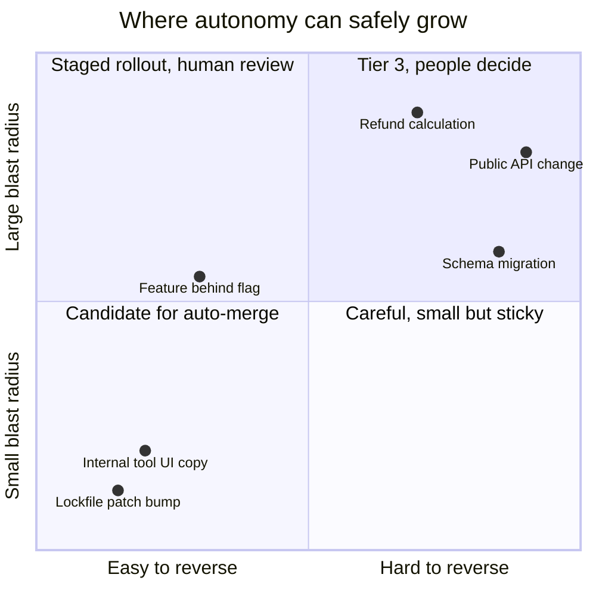
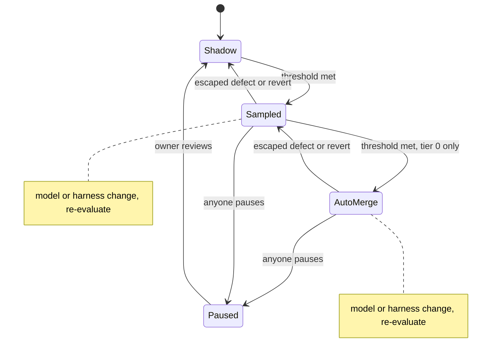

# Risk Tiers & Autonomy

Not every change needs the same scrutiny. A lockfile bump in an internal tool and a change to how refunds are calculated should not pass through the same process. Treating them the same either slows the trivial work to a crawl or lets the dangerous work through on autopilot, and in practice teams usually manage both at once: senior engineers spend their attention on formatting diffs while the refund change gets the same tired approval at five in the afternoon.

Risk tiers are how a team decides, in advance and on purpose, how much autonomy each kind of change gets. Deciding where those lines sit is a decision about people as much as about code, because every line answers the same question: whose judgment is required before this reaches users, and who stands behind it if it goes wrong?

!!! tip "The one-liner"
    Autonomy is not a setting for the whole team. It is earned per workflow and per area, on evidence, and it can be taken back.

---

## What problem this solves

Without explicit tiers, autonomy is decided implicitly, change by change, by whoever is reviewing — usually under time pressure. Some people approve everything; others approve nothing without a full read. Neither scales, and neither is a decision the team actually made.

The problem sharpens as agent volume rises. When a team produces three times as many changes, a uniform review process either triples the review load or quietly lowers its standard everywhere. Tiers let the team spend scarce human attention where it matters and remove it, deliberately and reversibly, where it does not.

The organisations furthest along have converged on this shape. In Gergely Orosz's account of OpenAI's workflow, changes are classified by risk: high-risk changes get stricter review that may include a human, while low-risk areas can opt in to an agent that approves pull requests automatically. Spotify's write-up of a 2026 talk says it is learning where to apply human judgment: "auto-merging what's safe, focusing review where it matters most". Most of the more than 2.5 million maintenance pull requests merged through its Fleet Management system — the majority produced by deterministic scripts that predate its coding agent — were auto-merged with no human in the loop. Stripe, at the other end, keeps a person reviewing every agent-written change. All three are tiering decisions. They simply draw the lines in different places.

---

## When to use this

**Use it when:** agent-authored changes are frequent enough that review is a visible constraint, when you are about to let any workflow merge without a person, or when reviewers disagree about how closely to read agent output.

**Skip it when:** agents are used only interactively, with an engineer driving every change. The engineer is the tier. Formal tiers before there is volume add ceremony without benefit.

---

## Two dimensions of risk

Risk has two parts that are easy to merge and worth keeping apart. **Blast radius** is how much damage a wrong change can do. **Reversibility** is how cheaply you can undo it. A bad change to an internal dashboard is small and reversible. A bad data migration may be small in code and irreversible in effect.

| Dimension         | Low                                       | High                                                                   |
| ----------------- | ----------------------------------------- | ---------------------------------------------------------------------- |
| **Blast radius**  | Internal tool, one service, behind a flag | Customer-facing, money, data, auth, shared platforms                   |
| **Reversibility** | Revert in minutes, no lasting effect      | Data migrations, external communications, published APIs, deleted data |



Combine both with [harnessability](../harness/harnessability.md): how well an area's checks can catch problems. A well-tested, typed service with good observability can safely get more autonomy than an untested module with the same blast radius, because mistakes there are more likely to be caught before anyone is hurt. Harnessability is the dimension a team can change. You cannot make payments less important, but you can make the payments code more checkable.

---

## A starting tier model

| Tier               | Definition                                     | Examples                                                                                     | Autonomy                                                                                                                                                       |
| ------------------ | ---------------------------------------------- | -------------------------------------------------------------------------------------------- | -------------------------------------------------------------------------------------------------------------------------------------------------------------- |
| **0 — Mechanical** | No behaviour change; fully checked by machines | Formatting, generated files, lockfile-only patch upgrades in low-risk services               | Automated checks; auto-merge only after a track record                                                                                                         |
| **1 — Low**        | Limited blast radius, easy to revert           | Internal tools, tests, docs, isolated UI copy, small fixes behind flags                      | Agent implements; AI review plus a light human skim                                                                                                            |
| **2 — Standard**   | Normal feature work in well-harnessed areas    | Most product features                                                                        | Implement after an approved plan (approach review for larger changes, roughly 200+ lines); independent acceptance checks; human reviews evidence and key logic |
| **3 — High**       | Large blast radius or hard to reverse          | Money, auth, personal data, migrations, public APIs, infrastructure, security-sensitive code | Approach review before build; full review by the area owner; staged rollout                                                                                    |

Assign tiers **mechanically where you can**: by path (`services/billing/**` is tier 3), by change type (anything touching `migrations/` is tier 3), by label. Paths no rule matches default to tier 2, and when several rules match, the highest tier wins. Reserve judgment for the edge cases, and when the edge cases repeat, turn them into rules. Classification should happen outside the agent. An agent asked to classify its own change has every incentive, in the loose sense in which models have incentives, to find it low-risk.

The mechanism matters less than the fact that it is deterministic and visible. A `CODEOWNERS`-style file, a small script in CI that labels the pull request, or a policy in your agent platform all work. What does not work is a tier that lives in a document nobody's tooling reads.

---

## How autonomy is earned

Autonomy is promoted per workflow, on evidence. Warp's guidance for factory workflows is a sensible model: start with a person approving every output, and move on only once "the agent's output is accepted without rework more often than not". That is a floor, not a ceiling; for anything above tier 1, I would want a stricter bar.

A promotion process:

1. **Shadow.** The agent proposes; a person approves every output.
2. **Measure.** Acceptance without rework, intervention rate, defects found later, cost.
3. **Define the threshold in advance.** For example: "30 consecutive runs accepted without rework, no escaped defects, and the workflow owner agrees."
4. **Promote one notch.** From "approve every output" to "approve by sampling", or from "human merge" to "auto-merge in tier 0".
5. **Keep watching.** Autonomy is not permanent.

Writing the threshold down before the evidence arrives is the most important step and the most often skipped. Thresholds decided after the fact tend to be whatever the current numbers happen to meet.

---

## How autonomy is taken back

Just as important, and rarely designed:

- **Automatic demotion triggers:** any escaped defect or revert moves the workflow back one step immediately, without a meeting. A drop in acceptance rate prompts the owner to review whether to do the same.
- **Model or major harness change triggers re-evaluation of every automated step:** a new model may be better, or different in ways that matter. Cursor's January 2026 write-up found that models differed markedly in how they handled long autonomous runs, with one that "tends to stop earlier and take shortcuts when convenient". A track record earned on one model is evidence about that model.
- **Anyone can pull the cord:** an engineer who sees something wrong can pause a workflow without needing permission, and the pause is treated as information, not insubordination.



The state machine is deliberately asymmetric. Promotion moves one step at a time and needs evidence. Demotion is immediate and needs only a trigger. That asymmetry is what makes promotion safe to try.

The Claude Code team's advice for teams adopting its review process says the same thing in a few words: start strict, then relax progressively as the evidence comes in. In October 2026 its own owners were deciding which low-risk changes could merge automatically once the checks pass, and the team was open that it did not yet have circuit breakers that tighten approval automatically when revert or incident rates move. Most teams will not have them either. Until they do, demotion is a human decision triggered by a dashboard someone has to watch, which is one more reason to name who watches it.

---

## Worked example: assigning tiers to a real-looking repository

Consider a hypothetical team that owns a subscription billing service and its admin console. They want to let a background agent handle more of their maintenance work and need to decide what it may merge.

**Step 1: list change types and paths.** In one session, the team lists what actually changes in the repository over a typical month: dependency bumps, admin console UI, test fixes, API handlers for the public billing API, the proration calculator, database migrations, feature-flag configuration, and documentation.

**Step 2: score blast radius and reversibility.** They go row by row. Admin console UI: internal users only, revert in minutes. Proration calculator: customer money, and a wrong invoice cannot be unsent. Feature-flag configuration surprises them: it looks trivial, but a wrong flag can expose an unfinished feature to every customer instantly. They score it higher than expected.

**Step 3: adjust for harnessability.** The admin console has almost no tests. Despite a small blast radius, it lands in tier 2 rather than 1 until someone adds coverage. The proration calculator has excellent property-based tests, but that does not move it below tier 3; good tests reduce the chance of a mistake, not the cost of one.

**Step 4: write it down mechanically.**

```text
docs/**, *.md                         → tier 1
admin-console/**                      → tier 2  (tier 1 once coverage > agreed bar)
package-lock.json (patch bumps only)  → tier 0 candidate
api/public/**                         → tier 3
billing/proration/**, migrations/**   → tier 3
config/flags/**                       → tier 2  (prod flags: tier 3)
```

A short CI script applies the matching label; the highest tier touched wins.

**Step 5: run it and find the hole.** Two weeks in, an agent fixing a flaky test in `admin-console/` also "tidied" a shared date utility under `billing/common/`, which no rule covered. It landed as tier 2 and a reviewer caught that the change altered how billing periods were rounded. Nobody was harmed. The default of tier 2 for unmatched paths had done its job — a person did look — but the team added `billing/common/**` to tier 3 and checked that the CI script really applied the highest matching tier when a change touched several areas. It had not; it applied the first match. That bug was worse than the missing rule.

**Step 6: start the clock.** Only the patch-bump workflow is a candidate for tier 0. It starts in shadow, with thresholds agreed in the same session: thirty consecutive clean runs to move to sampled approval, then a further thirty sampled runs with no escaped defects before anyone discusses auto-merge. Nobody argues about whether the admin console should be auto-merged; the table already says what would have to change first.

The outcome is not an elaborate policy. It is a page and a script that turn most tiering decisions into lookups, so that the arguments the team does have are about the cases that deserve them.

---

## Roles and ownership

| Role                          | Responsibility                                                            |
| ----------------------------- | ------------------------------------------------------------------------- |
| **Tech lead and area owners** | Assign tiers to areas and change types; own tier 3 review                 |
| **The team**                  | Agrees the tier model and promotion thresholds before evidence arrives    |
| **Harness owner**             | Implements tier detection outside the agent; reports per-workflow metrics |
| **Workflow owner**            | Accountable for outcomes at every tier, including auto-merged ones        |
| **Engineering manager**       | Makes sure accountability is named at each tier and review load is fair   |

---

## What good looks like

| Signal                                  | What you observe                                                                |
| --------------------------------------- | ------------------------------------------------------------------------------- |
| **Tiers are written down**              | Everyone knows which tier a change is in, and why                               |
| **Classification is mostly mechanical** | Paths and change types, not debates                                             |
| **Promotions have evidence**            | Each autonomy increase links to its track record and a threshold set in advance |
| **Demotions happen**                    | The system visibly moves backwards when it should                               |
| **Accountability per tier**             | Named owners even for auto-merged changes                                       |

---

## Failure modes and mitigations

Tier models usually fail quietly. The first version is sensible. Then a deadline arrives and a borderline change gets classified down to unblock it. A promotion happens because the numbers "looked fine" without anyone having said in advance what fine meant. Six months later, nobody remembers why a workflow is allowed to merge, and nobody owns it when it breaks.

| Failure mode             | What it looks like                             | Mitigation                                                        |
| ------------------------ | ---------------------------------------------- | ----------------------------------------------------------------- |
| **Everything is tier 2** | No real differentiation                        | Push clearly mechanical work to tier 0; protect tier 3 explicitly |
| **Self-classification**  | The agent decides its own tier                 | Classification by path and type, outside the agent                |
| **One-way ratchet**      | Autonomy only increases                        | Automatic demotion triggers                                       |
| **Tier creep**           | High-risk changes split into "low-risk" pieces | Classify by what the pieces touch, not their size                 |
| **Unclassified paths**   | New directories default to low risk            | Unmatched paths default to tier 2, never lower                    |
| **Orphaned auto-merges** | Tier 0 changes belong to "the bot"             | A named workflow owner is accountable                             |

!!! warning "The green-means-safe trap"
    Passing checks tell you the change did not break what you test. In Spotify's experience the most serious failure mode for a background agent is a change that passes CI but is functionally wrong, because it "erodes trust in our automation". Auto-merge decisions should rest on how well an area is checked, not on the colour of one run.

---

## Copy this

Use the [Risk Tier Matrix](../templates/risk-tier-matrix.md) template to define tiers for your codebase.

---

## Further reading

- **[How the Claude Code team does code review](https://claude.dev/blog/solving-code-review-at-anthropic/)** by Addy Osmani, Morgan Westlee Lunt and Qing Wang (Anthropic) — Start strict, relax on evidence, and the approval rules that make tiers hold. (Vendor post.)
- **[Inside OpenAI's agentic software factory](https://newsletter.pragmaticengineer.com/p/openai-software-factory)** by Gergely Orosz (The Pragmatic Engineer) — Risk-based gating and opt-in auto-approval at OpenAI. Partly paywalled.
- **[Coding Is No Longer the Constraint](https://engineering.atspotify.com/2026/6/code-with-claude-coding-is-no-longer-the-constraint)** by Spotify Engineering — Auto-merging safe changes at very large scale, and where human review stays. Spotify offers Fleetshift and Honk as part of Spotify Portal for Backstage.
- **[Background Coding Agents: Predictable Results Through Strong Feedback Loops](https://engineering.atspotify.com/2025/12/feedback-loops-background-coding-agents-part-3)** by Max Charas and Marc Bruggmann (Spotify) — Why "passes CI but wrong" is the failure that matters most.
- **[How do you move from coding agents to a software factory?](https://www.warp.dev/articles/coding-agents-to-software-factory)** by Warp — A practical promotion threshold for the first step. (Vendor guide.)
- **[Scaling long-running autonomous coding](https://cursor.com/blog/scaling-agents)** by Wilson Lin (Cursor) — Evidence that model choice changes autonomous behaviour. (Vendor research.)
- **[From coding agents to software factories](https://dreamingecho.es/blog/coding-agents-to-software-factories)** by Iván González Sáiz — Why drawing these lines is a decision about people as much as code.

---

## Related pages

- [Review at Agent Speed](../workflow/review-at-agent-speed.md) — What review looks like inside each tier.
- [Human Gates](../harness/human-gates.md) — Designing the points where a person must decide.
- [Harnessability](../harness/harnessability.md) — The dimension of risk a team can actually improve.
- [Your First Factory Workflow](first-factory-workflow.md) — The promotion process applied to one workflow.
