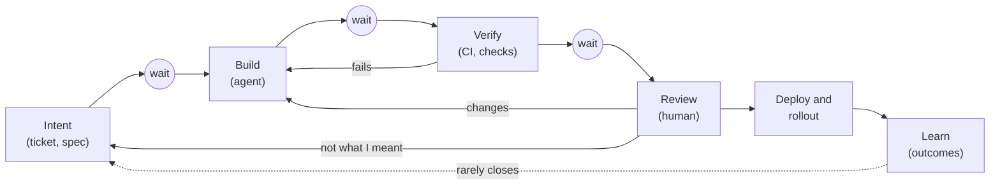

# The Bottleneck Moves

A ticket could be two lines long because whoever picked it up would wander over and ask what you meant, and the question doubled as a design conversation. An agent does not wander over. It fills the gap with something plausible and keeps going.

At the other end, review used to be a person reading a diff they could hold in their head, written by a colleague who would be around to explain it during the next incident. Now the diffs are larger and more frequent, and the author will never be paged.

So the middle gets fast, the ends get buried, and a team can reasonably conclude that this way of working does not suit it. Often the agents were fine. Nobody had redesigned the two places where people decide: what is worth building, and what is safe to trust.

!!! tip "The one-liner"
    When writing code stops being the slow part, the constraint moves to wherever people decide — and speeding up anything else just makes the queue in front of them longer.

---

## What problem this solves

A team adopts agents. Throughput rises. A few weeks later, everything feels worse: review queues are long, CI is slow, planning cannot keep up, and incidents are harder to diagnose because fewer people read the code that caused them. The reasonable-sounding conclusion is that the agents are not ready.

Sometimes that is true. More often the team has done something older and more predictable: it optimised one step of a system without looking at the rest. This page explains why that happens, where the pressure usually lands, and how to find the real constraint on your own team instead of guessing.

---

## When to use this

**Use it when:** agent adoption has raised output but delivery does not feel faster, review or CI queues are growing, or the team is debating whether agents "work for us".

**Skip it when:** agents are used only occasionally and nothing downstream has changed yet. Come back when throughput rises.

---

## An old idea that still applies

The theory of constraints, which Eliyahu Goldratt developed for manufacturing, starts from a simple observation: a system's throughput is limited by its slowest step, and improving any other step does not improve the system. Goldratt's prescription is a loop the TOC Institute summarises as the five focusing steps: **identify** the constraint, **exploit** it (get the most out of it as it is), **subordinate** everything else to it, **elevate** it (add capacity), and then **prevent inertia from becoming the constraint**, because once elevated, the weak link "may not remain weakest".

That last step is the one software teams forget. For most of the history of the profession, implementation was the constraint, or at least a convenient thing to believe was the constraint. Everything around it — two-line tickets, review by reading diffs, weekly planning, CI sized for human commit rates — was subordinated to it, sensibly. Agents elevated the constraint dramatically. The surrounding process did not change. Inertia became the constraint.

DX's June 2026 early look at its customer data makes the same point. Across most organisations in its sample, pull request throughput rose about 10 to 15%, with a median closer to 8%, far below the headline claims. Developers, DX notes, spend only about 14% of their time writing code, and "planning, reviews, testing, documentation, and coordination still consume the majority of engineering time". Faster code generation "can increase pressure on reviews, QA, and technical oversight". If you speed up a step that takes a seventh of the time, the rest of the week does not care.

The organisations that have elevated implementation the furthest describe the move most directly. Niklas Gustavsson, Spotify's Chief Architect, spoke about it at Anthropic's Code with Claude event in 2026, and Spotify's write-up of his talk puts it as "the bottleneck moves from coding to decision-making": pull request frequency up 76%, and therefore 76% more pull requests to review. At OpenAI, Gergely Orosz reports, the VP of Engineering for Applied Infra describes pull requests per engineer "growing like a hockey stick" and roughly a tenfold increase in load on some systems within about six months — "every month, we wake up to a new set of infrastructure scaling challenges to solve."

---

## A picture of where work waits

Read the diagram as a value stream. Agents shrink the box labelled *Build*. They do nothing for the circles, which are the places work sits waiting for something else. Two arrows matter more than they look. The loop from *Review* back to *Intent* is rework caused by under-specified intent, and it gets more frequent when the builder no longer asks questions. The dotted line from *Learn* back to *Intent* is how production outcomes reach the next piece of work, and in most teams it barely exists.

---

## Where the pressure goes

### 1. Intent

The two-line ticket was missing more than a description. It was missing the conversation it used to trigger. Dex Horthy's team at HumanLayer ran a lightly supervised factory for three or four months before archiving the codebase it had produced. Horthy came back from it arguing for settling product behaviour, architecture contracts and the shape of the program before a patch exists, so that review afterwards is short; PostHog's newsletter summarises his recommendation as "either keep reading the code, or front-load human effort in the planning phase." PostHog's own argument is that agents need the same inputs good engineers use: how the product is used, who the customers are, what users complain about. My conclusion from both is that a factory that only sees the repository makes repository-shaped decisions.

**Symptom:** rework; "that's not what I meant" in review; features that technically work and miss the point.
**Prepare:** [Intent Before Code](../workflow/intent-before-code.md); product context fed into framing; approach review before the build.

### 2. Review and verification

This is where most teams feel it first. In Qodo's 2026 survey of 500 US developers and 300 US engineering leaders — Qodo sells AI code review — both groups named reviewing and validating AI-generated code as their primary delivery constraint, at identical rates of 26%, and only 3.7% of leaders said their existing processes were sufficient. Survey data, from a vendor, but consistent with what Spotify and OpenAI describe from the inside.

The deeper problem is that review was also how understanding spread. When a reviewer approves a change they could not have written and do not fully understand, the team's collective knowledge of its own system shrinks a little.

**Symptom:** growing review queues; reflexive approvals; reviewers who feel they understand less of what they approve.
**Prepare:** [Verification](../workflow/verification.md) independent of the code's author; [risk-tiered review](../workflow/review-at-agent-speed.md); smaller slices; evidence attached to the change.

### 3. Integration and CI

More changes mean more merges, more conflicts and more CI runs. Flaky tests that a human shrugs at become loops for an agent. Stripe caps its agents at two rounds of CI explicitly because of diminishing returns on cost and time.

**Symptom:** CI queues; flaky tests becoming blockers; merge conflicts between parallel agents.
**Prepare:** [Factory Infrastructure](factory-infrastructure.md); fast local checks; flaky-test quarantine; partitioned parallel work.

### 4. Operations and incidents

More change means more surface for incidents, and incidents in code that fewer people have read closely. OpenAI's response, per Orosz, includes agents that shepherd a change through rollout after human approval and an incident agent that proposes mitigations but executes only the ones an engineer approves. Most teams will not build that. All teams need someone who can answer "who understands this module?" at three in the morning.

**Symptom:** longer diagnosis times; nobody able to explain a recent change during an incident.
**Prepare:** staged rollouts; ownership per area; observability that agents and humans can both use; walkthroughs for significant changes.

### 5. Learning

The team ships more and learns at the same rate as before, or slower, because nobody has time to look back. If what happened in production, what had to be reverted and which instructions keep producing rework do not reach the next iteration, the factory repeats its mistakes at speed.

**Symptom:** throughput up, product understanding flat; features nobody revisits.
**Prepare:** [Rollout & Learning](../workflow/rollout-and-learning.md); impact reviews; harness changes driven by rework patterns.

### 6. People

I have called the time it takes people to understand, trust and integrate change *human latency*. AI compresses delivery; it does not compress how fast a team absorbs what it is shipping. Those pauses in the old process were not empty. They were processing time. Agents remove the container that held the thinking without removing the need for it.

**Symptom:** fatigue; the feeling of running to stand still; quiet disengagement; seniors absorbing review load until they burn out.
**Prepare:** [Human Latency & Sustainable Intensity](../team/human-latency.md); protected time for understanding; review load treated as a capacity limit, not a virtue.

---

## Worked example: diagnosing the moved bottleneck

Consider a hypothetical team of seven running a customer-facing web app. Three months after rolling out a background agent, they have a familiar complaint: "we are merging more, but nothing feels faster, and review is miserable."

**Step 1: measure where work waits, not how long it takes.** The tech lead pulls thirty recent agent-authored changes and records timestamps for each stage: ticket ready, agent run started, first green CI, first review comment, approval, merge, deployed. It takes an afternoon with the tracker and the Git host's API. The result:

| Stage                           | Median time | Of which waiting             |
| ------------------------------- | ----------- | ---------------------------- |
| **Ticket ready → agent starts** | 6 hours     | 6 hours (nobody picks it up) |
| **Agent run → first green CI**  | 55 minutes  | 30 minutes (CI queue)        |
| **Green CI → first review**     | 26 hours    | 26 hours                     |
| **First review → approval**     | 31 hours    | ~24 hours between rounds     |
| **Approval → deployed**         | 3 hours     | 3 hours (batched deploys)    |

The agent's own time is the smallest number in the table. The two review rows together account for well over half the elapsed time.

**Step 2: look inside the constraint.** Review rounds are long because a third of changes go back with "this isn't what the ticket meant". The tickets are short. Reviewers are reconstructing intent from code, which is the slowest and most draining way to do it. Two seniors are doing most of the reviews.

**Step 3: exploit before elevating.** Instead of adding reviewers, the team stops sending reviewers work that is not ready to be reviewed. For any change touching user-facing behaviour, a ten-minute approach check happens before the agent runs: problem, expected behaviour, what done means. The agent's pull request must include what it verified and what it could not.

**Step 4: subordinate.** They stop optimising the agent. A proposal to run three agents per ticket and pick the best result is shelved: it would triple the review queue's inputs.

**Step 5: watch for the next constraint.** Six weeks later, the "not what I meant" rate has fallen sharply and review rounds have shortened. Now the CI queue is the longest wait, because more changes are getting through review and the shared runners were sized for human commit rates. The constraint has moved again, which is exactly what the theory predicts and what the team now knows how to look for.

**What went wrong along the way.** The first fix someone proposed was an AI reviewer to "take load off the seniors". It produced a flood of comments, many correct and mostly about style, and made rounds longer. The team kept it only for mechanical checks and moved its findings into lint rules where possible. The lesson they wrote down: a tool that adds work in front of the constraint is not help.

---

## None of this is new

Good teams have always cared about clear intent, independent verification, healthy CI and learning from production. What the agents take away is the slack that let the rest of us get by without it. The fix is not to slow the middle. It is to invest in the ends in proportion to the speed of the middle, and to keep looking for where work waits, because it will not wait in the same place for long.

!!! info "What we know / what we don't"
    **We know** from DX's customer data (vendor, early look) that most organisations' throughput gains are far smaller than gains in coding speed, and that review, QA and coordination absorb the difference. **We know** that the companies furthest along — Spotify, OpenAI, Stripe — describe review, CI and decision-making as the new limits. **We don't know** how much of the review burden can safely move to automated checks; the evidence on AI reviewers is mixed and mostly vendor-produced. **We don't know** the long-term cost of approving code nobody fully understands, because the codebases that would tell us are only months old.

---

## Roles and ownership

| Role                    | Responsibility                                                   |
| ----------------------- | ---------------------------------------------------------------- |
| **Tech lead**           | Measures where work waits; names the current constraint          |
| **Engineering manager** | Protects review and understanding as capacity, not overtime      |
| **Platform team**       | CI and environment capacity sized to agent volume                |
| **Product partner**     | Owns intent quality: the problem, the behaviour, what done means |
| **The team**            | Agrees what not to optimise while the constraint is elsewhere    |

---

## What good looks like

| Signal                                   | What you observe                                             |
| ---------------------------------------- | ------------------------------------------------------------ |
| **Bottlenecks watched**                  | The team tracks wait times at intent, review, CI and rollout |
| **Investment follows the constraint**    | Effort shifts to wherever work waits longest                 |
| **Throughput and quality move together** | More changes without more rework or incidents                |
| **Review is sustainable**                | Load is spread; nobody is the permanent gate                 |
| **Learning closes the loop**             | Production outcomes change the next piece of work            |

---

## Failure modes and mitigations

The common pattern is a rough month followed by a reasonable-sounding conclusion. Review queues grow, two seniors quietly work evenings to keep up, someone proposes more agents to "clear the backlog", and by the time anyone looks at the numbers the team has decided the experiment failed. The data that would have shown a moved bottleneck was never collected.

| Failure mode                      | What it looks like                                 | Mitigation                                               |
| --------------------------------- | -------------------------------------------------- | -------------------------------------------------------- |
| **Optimising the non-constraint** | More agents when review is the bottleneck          | Measure where work waits before adding capacity anywhere |
| **Blaming the agents**            | "This doesn't work for us" after a rough month     | Look for the moved bottleneck first                      |
| **Heroic absorption**             | Seniors absorb the review load until they burn out | Redesign review; protect capacity; spread the load       |
| **Review theatre**                | Approvals without understanding                    | Evidence with every change; risk-tiered review           |
| **Counting output**               | Success measured by PR volume                      | Track rework, wait time and escaped defects              |

!!! warning "The more-agents trap"
    When review is the constraint, adding agents adds inventory in front of it. Every extra parallel run is another change somebody has to judge.

---

## Further reading

- **[The Five Focusing Steps](https://www.tocinstitute.org/five-focusing-steps.html)** by the TOC Institute — Goldratt's loop for finding and managing a constraint, including the step teams forget.
- **[The current impact of AI on engineering velocity](https://newsletter.getdx.com/p/the-current-impact-of-ai-on-engineering)** by Justin Reock (DX) — Customer-sample data on throughput gains and where the time goes. DX sells developer analytics.
- **[Coding Is No Longer the Constraint](https://engineering.atspotify.com/2026/6/code-with-claude-coding-is-no-longer-the-constraint)** by Spotify Engineering — The bottleneck moving to decision-making, from an organisation that elevated implementation early. Talk given at an Anthropic event.
- **[Inside OpenAI's agentic software factory](https://newsletter.pragmaticengineer.com/p/openai-software-factory)** by Gergely Orosz (The Pragmatic Engineer) — Infrastructure strain and risk-based gating at OpenAI. Partly paywalled.
- **[The 2026 State of AI Code Quality](https://www.qodo.ai/blog/state-of-ai-code-quality-report-2026/)** by Qodo — Survey of 800 US developers and leaders on review as the constraint. (Vendor report.)
- **[AI Shrinks Cycle Time. Humans Don't.](https://dreamingecho.es/blog/ai-shrinks-cycle-time-humans-dont)** by Iván González Sáiz — Human latency and why processing time does not compress.
- **[From coding agents to software factories](https://dreamingecho.es/blog/coding-agents-to-software-factories)** by Iván González Sáiz — The essay this section grows from.

---

## Related pages

- [Review at Agent Speed](../workflow/review-at-agent-speed.md) — How to redesign review once it becomes the constraint.
- [Intent Before Code](../workflow/intent-before-code.md) — Fixing the front end of the value stream.
- [Factory Infrastructure](factory-infrastructure.md) — CI, environments and capacity for agent volume.
- [Human Latency & Sustainable Intensity](../team/human-latency.md) — The constraint that is made of people.
