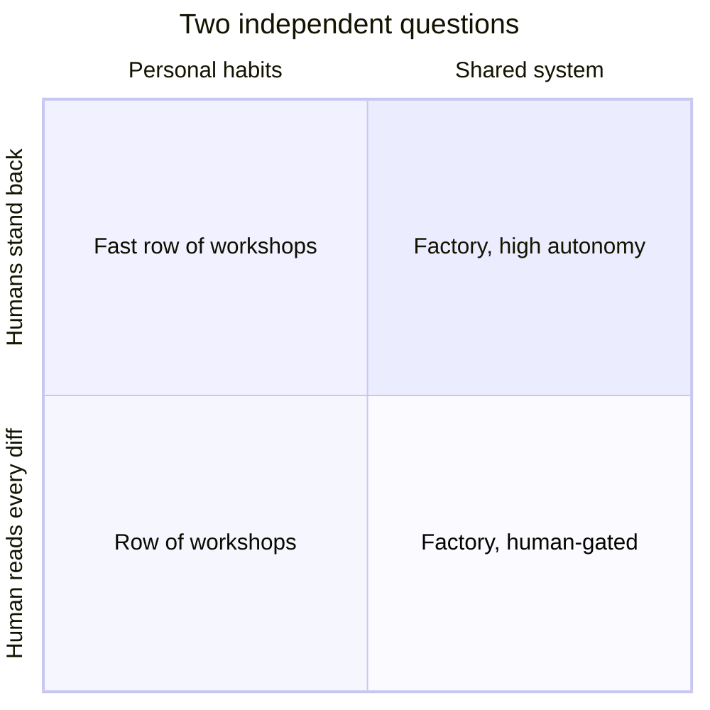

# What a Factory Is (and Isn't)

!!! note "Last reviewed"
    October 2026. The examples and figures on this page describe a fast-moving field and will date quickly.

Picture two teams of eight engineers, both of whom would tell you they "use agents heavily".

On the first team, every engineer has a setup they are proud of. One has a folder of prompts refined over months. Another runs three agents in parallel worktrees and has a private skill for writing migrations. A third has wired a background agent to their own GitHub notifications. Output is up. Ask how the team works with agents, though, and you get eight different answers. Nobody can tell you what the agents cost last month, how often their output was thrown away, or why the payments service keeps getting changes that ignore its idempotency rules. When the engineer with the migration skill goes on holiday, so does the skill.

On the second team, the setups are individually less impressive. But the instructions live in the repository, the checks that gate agent work are agreed and run the same way for everyone, dependency upgrades and flaky-test fixes start from the tracker without anyone typing a prompt, and every Friday someone looks at a short report: how many agent changes merged, how many needed rework, what they cost, and where a person had to step in. When a review catches the same mistake twice, the fix goes into the shared harness, and the next run for everyone is a little better.

Both teams use agents. Only one of them has started building a factory. The difference has very little to do with how autonomous the agents are.

!!! tip "The one-liner"
    A software factory is what grows around the agents once the way of working stops belonging to individual engineers and starts belonging to the team.

---

## What problem this solves

"We're building a software factory" can mean very different investments, risks and expectations. Depending on who says it, the phrase covers anything from a team with good shared agent habits to a building with the lights off. Teams that do not define it end up arguing past each other: one person imagines agents merging their own code, another imagines a shared skills library, a third hears a headcount plan. Worse, a team can adopt the vocabulary of the most extreme public examples without any of the infrastructure that made those examples possible.

This page separates two questions that are usually blurred together. The first is **how much autonomy** agents have — how far from the code the humans stand. The second is **who owns the way of working** — whether it is a set of personal habits or a shared system. The industry talks mostly about the first. I think the second matters more, and it is the one most teams can actually do something about this quarter.

---

## The autonomy spectrum

In January 2026, Dan Shapiro published what became the most-cited vocabulary for the first question: five levels of AI-assisted programming, explicitly borrowing the shape of the levels of driving automation. His post does not give each level a formal name, so the labels below are paraphrases. The descriptions follow his.

| Level                | What it looks like                                                                                | Where the human is                   |
| -------------------- | ------------------------------------------------------------------------------------------------- | ------------------------------------ |
| **0 — Manual**       | You write the code; AI is at most a search engine or an occasional accepted suggestion            | Writing everything                   |
| **1 — Offloading**   | You hand small, discrete tasks to AI: a unit test, a docstring                                    | Writing most things, at typing speed |
| **2 — Pairing**      | You pair with AI like a colleague and get into flow                                               | Driving, still finishing the work    |
| **3 — Managing**     | AI writes a constant stream of code and you review it; in Shapiro's words, "your life is diffs"   | Reviewing everything                 |
| **4 — Delegating**   | You write specs, craft skills, review plans, then let agents run and check whether the tests pass | Specifying and checking outcomes     |
| **5 — Dark factory** | Your process becomes "a black box that turns specs into software"                                 | Outside the process                  |

The name of level 5 comes from lights-out manufacturing: a factory where machines work in the dark because no people are on the floor. Shapiro's own observations are the useful part. He writes that "almost everyone tops out" at level 3, where a person still reads what the agents produce, and that he knows only "a handful of people" working at level 5.

```text
Level 0 → Level 1 → Level 2 → Level 3 → Level 4 → Level 5
 manual   offload    pair     review    specify   dark factory
                                ▲
                       where most people top out
```

The levels are a good shared language and a poor goal. They describe an individual's relationship with an agent, and they flatten something that varies inside a single team: the same engineer can sensibly work at level 4 on a well-tested internal tool in the morning and level 2 on the billing ledger in the afternoon. Treating a level as a destination ("we must reach level 4 by Q2") turns a per-workflow judgment into a slogan.

### Where real teams sit

A few teams have described the far end in public. In February 2026, StrongDM's CTO Justin McCarthy described a team he had founded with two colleagues in July 2025, running on two rules — "code must not be written by humans" and "code must not be reviewed by humans" — with end-to-end scenarios held outside the codebase, like a holdout set in model training, and behavioural clones of third-party services such as Okta, Jira and Slack to test against. Simon Willison, who had seen the team's demos, posed the obvious question — how could no human review be sensible, given models' "inhuman mistakes"? — found their answer — scenarios treated as holdout sets — "fascinating", and called the whole thing "a glimpse of one potential future". That is one end of the range, and an experiment rather than a destination anyone is obliged to reach.

Most teams using the word sit somewhere far more ordinary. PostHog's August 2026 newsletter describes software factories as a spectrum defined by how much code agents produce and how closely humans read it. By its account agents write about 70% of PostHog's pull requests while people "still skim at least 80% of those", and it places Ramp, Cursor and Uber near the middle of the same spectrum. Warp, which sells factory tooling, reports routing 20–30% of its own pull requests through factory workflows. Stripe, one of the most-cited large-scale examples, reports over 1,300 merged pull requests a week containing no human-written code — and every one of them is reviewed by a person.

That last detail is worth sitting with. The most transferable large-scale report published this year describes a company operating at level 3 for review and something closer to level 4 for execution. Whether a Stripe engineer reads every diff closely is a separate question that the write-up does not answer, but the review gate is there.

---

## The other axis: workshops or factory

What I find more interesting than the level of autonomy is a different shift: **from individual engineers running their own agents, with their own prompts and habits, to a delivery system the whole team can share, inspect and improve.**

If every engineer on your team has an excellent personal agent workflow, what you have is a row of separate workshops. Each one may be productive. They do not add up to a factory on their own, for the same reason eight excellent craftspeople in adjoining rooms are not a production line: nothing connects them, nothing they learn reaches the room next door, and nobody can see the whole.

| Dimension                                | Row of workshops                                | Factory                                                       |
| ---------------------------------------- | ----------------------------------------------- | ------------------------------------------------------------- |
| **Instructions and skills**              | Each engineer's own prompts and habits          | Shared harness the team maintains, in the repository          |
| **Where work starts**                    | A manual prompt from whoever is at the keyboard | Where work already arrives — tracker, chat, alerts, schedules |
| **What quality depends on**              | Who is driving                                  | Agreed checks and gates that run the same way for everyone    |
| **Where lessons go**                     | They stay with the person who learned them      | They become harness changes everyone gets                     |
| **What is known about cost and outcome** | Nothing, or anecdotes                           | Acceptance, rework, intervention and cost, per workflow       |
| **Who can change it**                    | Its owner                                       | Anyone on the team, through review                            |

Warp's guide puts the failure mode plainly: teams that "run it as a tool rollout instead of an infrastructure project" find that "nothing compounds". Compounding is the right test. A workshop gets better when its owner gets better. A factory gets better every time anyone on the team turns a mistake into a check, which is close to what Mitchell Hashimoto means by harness engineering: when an agent makes a mistake, engineer the environment so it does not happen again.

The two axes are independent, which is the main thing this page wants you to take away.



A team where every agent change is still reviewed by a person — but intake, harness, verification and learning are shared and measured — has a factory, in the bottom-right quadrant. A team where agents merge their own code but every engineer runs their own setup has a very fast row of workshops in the top-left, and it is the most dangerous place on the chart: high autonomy with nobody able to say how the system behaves as a whole.

---

## What a factory isn't

A few misreadings come up often enough to name.

**It isn't a number of agents.** More agents running in parallel is more throughput at the middle of the process, not more factory. Cursor's January 2026 experiment with hundreds of concurrent agents building a browser found that, with naive coordination, twenty agents slowed "to the effective throughput of two or three" because they spent most of their time waiting on each other. Concurrency without structure is a queue.

**It isn't the absence of people.** Every credible example keeps people at the ends: deciding what to build, and judging what is safe to trust. Even StrongDM's lights-off rules move the humans rather than remove them — into writing scenarios and designing the validation that replaces review.

**It isn't one tool.** Factories are built from tools; no tool is a factory. Stripe's agents run on a fork of Block's open-source goose agent, but what the write-up spends its words on is devboxes, rule files, an internal tool server and CI — infrastructure built for human engineers years earlier.

**It isn't a destination level.** The right autonomy differs by workflow, codebase area and risk, and it moves as models improve and as the team learns what it can trust. [Risk Tiers & Autonomy](risk-tiers-and-autonomy.md) is about drawing that line on purpose.

**It isn't new work for its own sake.** The parts of a factory that matter — clear intent, independent checks, healthy CI, learning from production — are things good teams always cared about. What the agents take away is the slack that let the rest of us get by without them.

---

## When to use this

**Use it when:** your team or leadership is starting to use the word "factory", you are deciding what to invest in next, or people disagree about how much autonomy agents should have and you suspect they are answering different questions.

**Skip it when:** the team has not yet got individual agent use working reliably. A factory is built from working parts. If engineers are still learning what agents are good at, start with [Building with Agents](../workflow/building-with-agents.md) and the [AI Harness](../harness/index.md) section.

---

## Worked example: locating a team on both axes

Consider a hypothetical product team of six working on a B2B scheduling app. Their engineering manager has been asked by leadership whether the team "is a software factory yet". Rather than answering yes or no, the team spends forty minutes mapping its current workflows.

**Step 1: list the recurring workflows that touch agents.** They come up with five: feature work from tickets, bug fixes from support escalations, dependency upgrades, flaky-test fixes, and documentation updates after API changes.

**Step 2: place each on the autonomy axis.** Feature work is level 3 (agents write most of it; a person reviews every diff). Bug fixes vary from 2 to 3 depending on who picks them up. Dependency upgrades are level 1: one engineer does them by hand when they remember, sometimes with an agent's help. Flaky tests are level 0 in practice, because nobody owns them. Documentation updates are level 3, but only for the one engineer who built a personal skill for it.

**Step 3: place each on the ownership axis.** This is where it gets uncomfortable. Only feature work has anything shared: an `AGENTS.md` that was last edited four months ago. Everything else lives in individual habits. Nobody knows the rework rate on agent-written bug fixes. The documentation skill is on one laptop.

**Step 4: decide what "more factory" means for them.** The honest answer is not "raise the autonomy level". It is three smaller moves: put the documentation skill in the repository so everyone gets it; make dependency upgrades the team's [first factory workflow](first-factory-workflow.md), starting from the tracker with a person approving every output; and start counting rework on agent-written changes so that, in two months, the conversation about autonomy has evidence behind it.

**What went wrong on the first try.** The first version of the map put feature work in the "factory" column because "everyone uses the same agent". A senior engineer pointed out that using the same tool is not sharing a system: the instructions were stale, checks differed by person, and lessons from review never made it back. They moved it. That correction was the most useful thing the exercise produced.

The answer to leadership became a one-paragraph note: where each workflow sits on both axes, what will change next, and what evidence will decide the step after. That is a better answer than a level.

---

## Where should your team be?

Probably closer to the light end than the keynotes suggest, at least for now. The parts of the process that matter most are made of people, and people change how they work at a different pace from their tools.

A reasonable target for most product teams in late 2026:

- **A shared team harness:** instructions, skills and checks in the repository, owned and reviewed like code.
- **A handful of bounded factory workflows:** dependency upgrades, flaky tests, documentation drift, small well-specified fixes, running from real intake with measured acceptance.
- **Agent-implemented feature work:** a person reviewing evidence and risky logic, with intent settled before the build.
- **Auto-approval in narrow tiers only:** low-risk areas with a track record, and a way to take it back.

!!! info "What we know / what we don't"
    **We know** that a small number of organisations with heavy platform investment — Stripe, Spotify, OpenAI — run agent workflows at very high volume, and that their write-ups credit years of developer infrastructure more than any single model. **We know** the most common public position is human-reviewed, not lights-off. **We don't know** what happens to a codebase that few people read closely over a period of years; the most candid report so far, HumanLayer's, describes a lightly supervised codebase archived after three or four months. **We don't know** where most teams will settle. Most of what has been written comes from companies selling related products or describing young systems of their own.

---

## Roles and ownership

| Role                            | Responsibility                                                                         |
| ------------------------------- | -------------------------------------------------------------------------------------- |
| **Engineering leadership**      | Decides how far and how fast; funds the infrastructure; does not set levels as targets |
| **Tech leads**                  | Decide autonomy per area, based on harnessability and risk                             |
| **Harness and platform owners** | Build and maintain the shared system                                                   |
| **The team**                    | Owns the agreements and the line between what the system does and what people decide   |

---

## What good looks like

| Signal                      | What you observe                                                   |
| --------------------------- | ------------------------------------------------------------------ |
| **Shared vocabulary**       | The team can say where each workflow sits on both axes, and why    |
| **Autonomy varies by area** | Different areas have different, explicit autonomy                  |
| **Shared harness**          | An improvement made by one person reaches everyone on the next run |
| **Measured**                | Acceptance, rework, intervention and cost are known per workflow   |
| **People named**            | Every workflow has an owner who stands behind what it ships        |

---

## Failure modes and mitigations

These failures rarely arrive as a decision. They arrive as drift: a conference talk, an enthusiastic message in a channel, a quarterly goal written in someone else's vocabulary, and six weeks later the team is measured against a level it never chose.

| Failure mode                   | What it looks like                                    | Mitigation                                                            |
| ------------------------------ | ----------------------------------------------------- | --------------------------------------------------------------------- |
| **Keynote envy**               | Copying dark-factory rules without the infrastructure | Start where you are; earn each step with evidence                     |
| **Level as goal**              | "We must reach level 4 by Q2"                         | Autonomy is a per-workflow outcome, not a target                      |
| **Workshops called a factory** | Great individual setups, nothing shared               | Shared harness first; measure per workflow                            |
| **Same tool, no system**       | "We all use the same agent", so it must be shared     | Ask where the instructions, checks and lessons live                   |
| **Ignoring the people**        | The transition planned as a tooling change            | See [Adoption Without Mandates](../team/adoption-without-mandates.md) |

!!! warning "The fast-workshop trap"
    High autonomy on top of personal setups is the riskiest combination: agents merging their own work, with nobody able to describe how the system behaves as a whole. If you must choose, share the system before you raise the autonomy.

---

## Further reading

- **[The Five Levels: from Spicy Autocomplete to the Dark Factory](https://www.danshapiro.com/blog/2026/01/the-five-levels-from-spicy-autocomplete-to-the-software-factory/)** by Dan Shapiro — The autonomy vocabulary most of this year's conversation borrows.
- **[Software Factories and the Agentic Moment](https://factory.strongdm.ai/)** by Justin McCarthy (StrongDM) — The lights-off end of the spectrum, in the team's own words: rules, scenarios, digital twins.
- **[How StrongDM's AI team build serious software without even looking at the code](https://simonwillison.net/2026/Feb/7/software-factory/)** by Simon Willison — An outside reading that asks the obvious question and takes StrongDM's answer seriously.
- **[Can software factories actually work?](https://posthog.com/newsletter/software-factories)** by Jina Yoon (PostHog) — The spectrum view and the case for product context. PostHog sells product analytics.
- **[How do you move from coding agents to a software factory?](https://www.warp.dev/articles/coding-agents-to-software-factory)** by Warp — The "tool rollout versus infrastructure project" distinction. (Vendor guide.)
- **[Minions: Stripe's one-shot, end-to-end coding agents](https://stripe.dev/blog/minions-stripes-one-shot-end-to-end-coding-agents)** by Alistair Gray (Stripe) — High-volume agent work with every change still reviewed by a person.
- **[Scaling long-running autonomous coding](https://cursor.com/blog/scaling-agents)** by Wilson Lin (Cursor) — What happens to throughput when many agents run without structure. (Vendor research.)
- **[My AI Adoption Journey](https://mitchellh.com/writing/my-ai-adoption-journey)** by Mitchell Hashimoto — Where the "engineer the mistake away" definition of harness engineering comes from.
- **[From coding agents to software factories](https://dreamingecho.es/blog/coding-agents-to-software-factories)** by Iván González Sáiz — The essay this section grows from.

---

## Related pages

- [The Bottleneck Moves](the-bottleneck-moves.md) — Where the pressure goes once writing code stops being the slow part.
- [Risk Tiers & Autonomy](risk-tiers-and-autonomy.md) — How to decide, per area, how far the humans stand back.
- [Field Reports](field-reports.md) — The public write-ups behind the examples on this page, compared.
- [What a Harness Is](../harness/what-a-harness-is.md) — The shared system a factory is built on.
