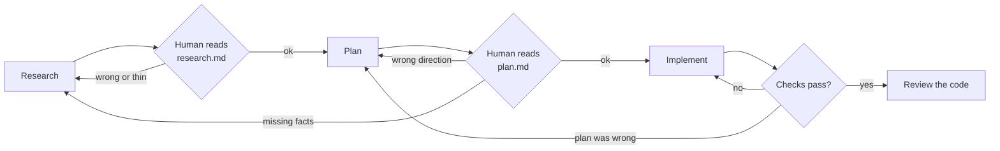

# Context Engineering

Prompt engineering was about finding the right words for a single exchange. Context engineering is about deciding what an agent can see across hundreds of exchanges — what to put in, in what shape, when, and above all what to leave out.

It is the lever you fully control. You cannot change the model's weights. You cannot change how the vendor's harness was built. You can change, completely, what the model reads before every step. Anthropic's definition is a useful target to keep in mind: find "the smallest possible set of high-signal tokens" that makes the outcome you want most likely. Smallest, and high-signal. Most teams get the second half and miss the first.

!!! tip "The one-liner"
    Every token in the window should earn its place against what it displaces. Curate what goes in, compact deliberately between phases, and keep anything that must survive in files rather than in the conversation.

!!! note "Last reviewed"
    October 2026. Model context sizes and automatic compaction behaviour change with each release; the principles do not.

---

## What problem this solves

Agents degrade as their context fills. They lose track of constraints, repeat dead ends, and treat stale information as true. On small tasks you never notice. On real work in real codebases — the kind with ten years of history and three half-finished migrations — context management is often the difference between an agent that helps and one that produces confident rework.

The degradation is not a bug in one product. It is a property of how these models work, and the evidence is consistent across very different kinds of test:

- **Chroma's *Context Rot* report** (July 2025) tested 18 models, including GPT-4.1, Claude 4, Gemini 2.5 and Qwen3, on deliberately simple tasks and found performance grows less reliable as input length increases. On a conversational memory benchmark, models did notably better with a focused prompt of around 300 tokens than with the full 113k-token version that contained the same answer surrounded by irrelevant material.
- **Distractors compound the effect of length.** In the same report, one plausible-but-wrong passage lowered accuracy, and four lowered it further.
- **Position matters.** *Lost in the Middle* (Liu et al., TACL) found models use information at the start and end of a long input better than in the middle.
- **Bigger windows do not make this go away.** HumanLayer reported in March 2026 that after trying Claude Opus 4.6, with its 1M-token window, as their default, they saw instruction adherence degrade — "not just at longer context lengths" — and switched back. That is one team's practitioner report rather than a controlled study, but it matches what the research would predict.

!!! info "What we know / what we don't"
    We know that more tokens in the window make a model less reliable at using any particular one, and that wrong or distracting content is worse than absent content. We do not know precise thresholds for a given model on a given codebase. HumanLayer's rule of thumb is to keep utilization around 40–60% for complex work; treat numbers like that as a starting point to measure against, not a law.

---

## When to use this

**Invest deliberately when:**

- **Tasks span many files or several hours.**
- **The codebase is large, old or inconsistent.**
- **You are running agents unattended or in parallel**, where nobody is watching the window fill.
- **The same kinds of failure keep recurring**, especially "it forgot" and "it got worse the longer it ran".

**Skip it when:**

- **The change is small** and the agent can see everything it needs.
- **You are prototyping** something you will throw away.

---

## Roles and ownership

| Role               | Responsibility                                                                                                |
| ------------------ | ------------------------------------------------------------------------------------------------------------- |
| **Every engineer** | Manages context in their own sessions: scoping, compacting, starting fresh                                    |
| **Harness owner**  | Designs the defaults — instruction size, skill boundaries, subagent use, phase artifacts, trimmed tool output |
| **Tech lead**      | Keeps the sources of truth (docs, ADRs, specs) accurate enough to be loaded                                   |

---

## The core ideas

### 1. Context is a budget, not a container

Every token in the window has a cost: attention, latency, money. The question is never "could this be useful?" but "is this worth more than what it displaces?" Anthropic grounds this in the architecture itself: attention relates every token to every other, so each new token "depletes this budget by some amount".

Practical consequences:

- **Keep always-on instructions short.** See [Instructions & AGENTS.md](instructions-and-agents-md.md).
- **Prefer pointers over copies.** "The API conventions are in `docs/api.md`" instead of pasting them.
- **Trim tool output.** A test runner that prints only failures is a context-engineering decision. HumanLayer's pattern is a small wrapper that swallows output when a stage passes and prints it in full only when it fails.
- **Remove tools you are not using in this task.** In many agents, tool definitions are loaded before the agent reads anything, and every tool is one more option to weigh on each step.

### 2. Accuracy beats volume

Wrong information is worse than missing information. A missing fact produces a question or a search. A wrong fact produces a confident mistake. Dex Horthy's ranking is worth memorizing: incorrect information is the worst thing in a context window, then missing information, then noise.

This makes **documentation hygiene a harness concern**. Stale READMEs, abandoned ADRs and commented-out code are not just untidy; they are actively misleading the agents reading them. A superseded ADR that still reads as authoritative is a distractor in exactly the sense Chroma measured.

### 3. Retrieve just in time, not just in case

There are two broad ways to get knowledge into the window. You can load it up front, before the agent knows what it needs. Or you can give the agent cheap ways to look things up and let it pull in what the task requires. Anthropic describes Claude Code as doing both: instruction files are loaded at the start, and everything else is retrieved "just in time" with glob and grep. The source-code study of eleven agent harnesses found that none of them uses vector-embedding retrieval over code. They search the repository with tools, much as an engineer would.

The lesson for your own harness: invest in making things *findable* — clear file names, a short index of where things live, docs next to the code they describe — rather than in loading more of them by default.

### 4. Separate the phases, and compact between them

The most widely adopted pattern for complex work is to split it into phases, each with its own session and its own output artifact:

```text
Research ──research.md──▶ Plan ──plan.md──▶ Implement ──code + progress notes──▶ Verify
```

- **Research:** understand the relevant parts of the system. Output: a concise document of how things work, with file and line references. No code changes.
- **Plan:** decide what to change, in what order, and how each step will be verified. Output: a plan a human can review in minutes.
- **Implement:** execute the plan step by step, updating progress notes as it goes.

Each phase starts with a fresh or compacted context containing only the previous phase's artifact. Dex Horthy and HumanLayer popularized this as Research → Plan → Implement, and call the practice *frequent intentional compaction*: deliberately condensing state into a file at phase boundaries, instead of letting the tool compact automatically when the window overflows.

The argument for reviewing the early artifacts is about leverage. In Horthy's framing, a bad line of code is a bad line of code, but a bad line of a plan can become hundreds of bad lines of code, and a wrong conclusion in research can become thousands. Reviewing a 200-line plan is far cheaper than reviewing a 2,000-line diff — and catching a wrong assumption in research is cheaper still.



!!! warning "The plan theatre trap"
    Plans are a review surface, not a substitute for reviewing code. Implementation drifts from plans, plans that grow to a thousand lines stop being reviewable, and the code is what ships. Review the plan to catch the wrong direction early. Still review what actually changed.

### 5. Isolate noisy work in subagents

Exploration is context-expensive. Searching a codebase, reading twenty files to find the three that matter, running a flaky test five times — all of that fills the window with material the main task will never need again.

Subagents have their own context windows. Delegate the exploration, receive a condensed answer, keep the main context clean. Anthropic describes subagents returning "a condensed, distilled summary of its work (often 1,000-2,000 tokens)" from explorations that may have consumed far more. HumanLayer calls them a "context firewall". See [Subagents & Orchestration](subagents-and-orchestration.md).

### 6. Write state to files, not to memory

Agents have no memory between sessions. Anything that must survive a session — progress, decisions, open questions — belongs in a file the next session will read. Anthropic's guidance for long-running agents uses exactly this: a progress file, a JSON feature list whose only mutable field is whether each feature passes, an `init.sh` that starts the environment, and Git history as the bridge between sessions. They chose JSON for the feature list because the model was less likely to rewrite it inappropriately than Markdown. See [Memory & Continuity](../harness/memory-and-continuity.md).

### 7. Load knowledge progressively

Not every piece of knowledge is needed on every task. The skills model — a short description always loaded, the full instructions only when relevant — is the general solution. See [Skills](skills.md).

---

## How the tools compact for you, and why that is not enough

Most agents compact automatically. The source-code study found threshold compaction — summarize the history when the window reaches some fraction of its limit — in seven of the eleven harnesses it examined. Anthropic lists lighter techniques too, such as clearing the raw results of old tool calls once they have been used.

Automatic compaction is a safety net, not a strategy. It happens when the window is fullest, which is exactly when the model is least reliable at deciding what matters. It happens at an arbitrary point mid-task rather than at a natural boundary. And it is lossy in ways you cannot see: a constraint you stated once, early, is precisely the kind of detail a summary drops. Intentional compaction moves the same operation to a moment you choose, into a format you can read, and makes the summary itself something a human can review.

---

## Worked example: one feature, three sessions

An illustrative example. A team needs to add per-tenant rate limits to an API in a seven-year-old service. The percentages are hypothetical but typical in proportion.

**Session 1 — research.** The engineer runs the research prompt below. The agent spawns two subagents: one to find every place requests are authenticated and attributed to a tenant, one to read the existing rate-limiting middleware and its tests. Each returns a page. The main session reaches about 35% of its window. The output, `research.md`, is 120 lines: the request path with file and line references, the existing global limiter, the Redis client already in use, and an *Open questions* section with two entries — "Are limits per API key or per tenant?" and "Is there a contractual minimum for enterprise tenants?"

**The human step.** The engineer reads `research.md` in ten minutes and does not know the answer to the second question. Product does: two enterprise customers have contracts guaranteeing a higher ceiling. That single fact, which exists nowhere in the repository, goes into `research.md`. Without this step, the plan would have picked a sensible default and been wrong.

**Session 2 — plan.** A fresh session reads only `research.md` and produces `plan.md`: four steps, each with the files to touch and how it will be verified. Window peaks at about 30%. The engineer catches one problem — the plan puts the limit lookup in the hot path without caching — and asks for a revision. Cost: one more short session.

**Session 3 — implement.** A fresh session reads `plan.md`, implements step by step, and after each step appends a line to `progress.md`. Halfway through, the window hits 55% because a migration test printed a large fixture diff. Rather than push on, the engineer asks the agent to update `progress.md` with what is done and what is next, ends the session, and starts session 4 from `plan.md` and `progress.md`. Session 4 finishes at 40%.

**What went wrong and how it was corrected.** The implementation drifted once: the agent added a configuration flag the plan did not mention. Review of the diff, not the plan, caught it. The plan was a good guide; it was not the thing that shipped.

The total cost was four short sessions instead of one long one, plus about twenty minutes of human reading. The two human interventions — a contractual fact and a caching concern — were the two places the outcome actually changed.

---

## What good looks like

| Signal                        | What you observe                                                                     |
| ----------------------------- | ------------------------------------------------------------------------------------ |
| **Phase-scoped sessions**     | Long tasks produce a trail of small artifacts rather than one sprawling conversation |
| **Deliberate restarts**       | Engineers notice a "heavy" session and restart from a summary rather than pushing on |
| **Grounded artifacts**        | Research and plan documents cite files and lines, not vague descriptions             |
| **Docs maintained like code** | Superseded docs are marked; agents are not misled by stale truth                     |
| **Trimmed output**            | Test runners, linters and tools report failures, not pages of success                |

---

## Failure modes and mitigations

The pattern behind most of these is gradual. A team adopts agents for small tasks, where context never matters. They start giving bigger tasks. Sessions get longer, results get patchier, and the explanation offered is that "the model has bad days". The window, which nobody is looking at, is the actual variable.

| Failure mode                       | What it looks like                                          | Mitigation                                               |
| ---------------------------------- | ----------------------------------------------------------- | -------------------------------------------------------- |
| **Kitchen-sink context**           | Every doc in the repo referenced from the root instructions | Pointers to specific docs, loaded on demand              |
| **Stale truth**                    | Agents follow an ADR that was superseded a year ago         | Mark superseded docs; garden docs regularly              |
| **Auto-compaction surprise**       | The tool compacted mid-task and dropped a key constraint    | Compact intentionally at phase boundaries                |
| **Plan theatre**                   | A 1,000-line plan nobody reads                              | Plans short enough to review in minutes; review code too |
| **Exploration in the main thread** | The main session read 40 files and is now confused          | Delegate search to subagents                             |
| **Noisy sensors**                  | Every test run adds thousands of tokens of passing output   | Print failures only; fail fast                           |

---

## Copy this: a research-phase prompt

```text
Research only. Do not change any code.

Goal: understand how <area> works so we can <intended change>.

Produce research.md with:
1. A short summary of how the relevant flow works today (max 20 lines).
2. The files and functions involved, with paths and line numbers.
3. Existing patterns we should follow, with one example each.
4. Constraints and gotchas you found (tests, feature flags, migrations, callers).
5. Open questions you could not answer from the code. Do not guess — list them.

Use subagents for broad searches. Keep research.md under 150 lines.
```

## Copy this: an intentional compaction prompt

```text
We are going to end this session and continue in a fresh one.
Update progress.md so that a new session with no memory of this one can continue:

1. What the task is (one line) and which plan step we are on.
2. What is done, with file paths.
3. What was tried and abandoned, and why (one line each).
4. What is next, as concrete actions.
5. Anything you learned that is not written down anywhere else.

Do not include code that is already committed. Keep it under 60 lines.
```

---

## Further reading

- **[Effective context engineering for AI agents](https://www.anthropic.com/engineering/effective-context-engineering-for-ai-agents)** by Anthropic — The attention-budget framing, just-in-time retrieval, compaction, note-taking and subagents. (Vendor engineering post.)
- **[Effective harnesses for long-running agents](https://www.anthropic.com/engineering/effective-harnesses-for-long-running-agents)** by Anthropic — Progress files, feature lists and Git as the bridge between sessions. (Vendor engineering post.)
- **[Advanced context engineering for coding agents](https://www.humanlayer.dev/blog/advanced-context-engineering)** by Dex Horthy (HumanLayer) — The original write-up of research, plan, implement and frequent intentional compaction, including what did not work.
- **[Context-efficient backpressure for coding agents](https://www.humanlayer.dev/blog/context-efficient-backpressure)** by Dex Horthy (HumanLayer) — A ten-line wrapper that keeps passing test output out of the window.
- **[Long-context isn't the answer](https://www.humanlayer.dev/blog/long-context-isnt-the-answer)** by HumanLayer — A practitioner report on instruction adherence with a 1M-token window.
- **[Context Rot](https://www.trychroma.com/research/context-rot)** by Kelly Hong, Anton Troynikov and Jeff Huber (Chroma) — How 18 models degrade with input length on simple tasks. (Vendor technical report.)
- **[Lost in the Middle](https://arxiv.org/abs/2307.03172)** by Nelson F. Liu et al. (TACL) — Position effects in long contexts.

---

## Related pages

- [How a Coding Agent Works](how-a-coding-agent-works.md) — The loop that context engineering shapes.
- [Research & Planning](../workflow/research-and-planning.md) — The workflow version of research, plan, implement.
- [Memory & Continuity](../harness/memory-and-continuity.md) — Carrying state across sessions in files.
