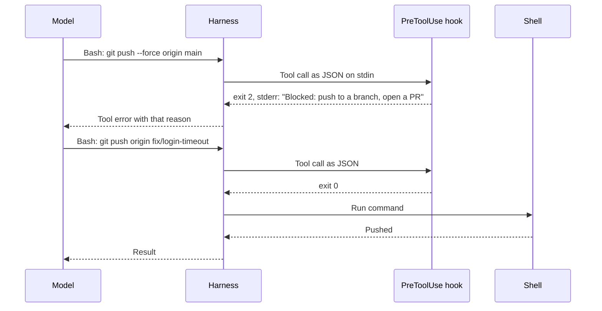

# Hooks & Deterministic Guards

An instruction is a request. A hook is a guarantee.

That distinction is the most underused idea in most harnesses. Teams write "never run destructive commands against production" in an instruction file and feel protected. They are not. The agent will follow that instruction most of the time — which is a very different thing from all of the time. Claude Code's own documentation is explicit about it: instruction files are treated "as context, not enforced configuration", and if you need to block an action regardless of what the model decides, you need a hook.

!!! tip "The one-liner"
    If a rule must hold every time, take it out of the model's judgment and put it in code that runs whether or not the model agrees.

!!! note "Last reviewed"
    October 2026. Hook events, payload fields and options such as `onFailure` are version-specific; `onFailure` needs Claude Code v2.1.295 or later.

---

## What problem this solves

Some rules must hold every time: do not commit secrets, do not force-push to `main`, do not run migrations against production, always format before committing, never add a forbidden trailer to commit messages. Models are probabilistic. Instructions improve the odds; they do not guarantee the outcome. And the longer a session runs, the further back in a crowded window that instruction sits — the [mechanics of the loop](how-a-coding-agent-works.md) work against prose rules exactly when you most need them.

The human backstop is weaker than it looks, too. Anthropic reported in March 2026 that Claude Code users accept 93% of manual permission prompts. A person approving dozens of prompts an hour is not reviewing them, and Anthropic's own sandboxing write-up names the effect: approval fatigue. Hooks and deterministic guards move the rules that matter out of both the model's judgment and the tired human's, and into code.

---

## What hooks are

Most coding agents now let you run your own code at defined points in the loop. The source-code study of eleven agent harnesses found hooks and event buses had become the common extension substrate, and noted that Codex adopted Claude Code's hook vocabulary verbatim. Names differ by tool; the events are broadly the same:

| Event                      | Typical use                                                                                    |
| -------------------------- | ---------------------------------------------------------------------------------------------- |
| **Session start**          | Load context from a memory store; print the current branch and task; warn if on `main`         |
| **Before a tool call**     | Block dangerous commands; require confirmation for certain paths; enforce commit message rules |
| **After a tool call**      | Format edited files; run a fast linter; log what happened                                      |
| **Before the agent stops** | Check that tests ran; refuse to finish if the definition of done is not met                    |
| **On notification**        | Alert a human when the agent is waiting                                                        |

Claude Code's reference lists many more — around prompts, subagents, compaction, configuration changes and worktrees — but these five carry most of the value.

### Anatomy of a hook, concretely

Claude Code is a good example to learn the shape from, because its interface is documented in detail and, per the study above, at least one other major agent copied it. A hook is registered in settings, for an event and a matcher:

```json
{
  "hooks": {
    "PreToolUse": [
      {
        "matcher": "Bash",
        "hooks": [
          {
            "type": "command",
            "command": "${CLAUDE_PROJECT_DIR}/.claude/hooks/guard-bash.sh",
            "args": [],
            "onFailure": "block"
          }
        ]
      }
    ]
  }
}
```

Two details in that snippet are easy to miss. `"args": []` runs the script directly rather than through a shell, so the path placeholder needs no quoting. `"onFailure": "block"` (Claude Code v2.1.295 or later) makes the tool call fail *closed* if the hook itself crashes, times out or cannot be found; without it, a broken policy hook quietly lets everything through.

When the agent proposes a matching tool call, the harness runs the command and passes the proposed call as JSON on standard input:

```json
{
  "session_id": "abc123",
  "cwd": "/home/user/my-project",
  "permission_mode": "default",
  "hook_event_name": "PreToolUse",
  "tool_name": "Bash",
  "tool_input": {
    "command": "git push --force origin main",
    "description": "Push the rebased branch"
  },
  "tool_use_id": "toolu_01ABC123"
}
```

The hook answers through its exit code:

- **Exit 0** — the action proceeds. If the hook printed a JSON object, the harness applies it.
- **Exit 2** — the action is blocked, and whatever the hook wrote to standard error is fed back to the model as the reason. This is the important one.
- **Any other code** — a non-blocking error, unless the hook is configured to block on failure. The action *proceeds* and the transcript shows a hook error. The docs warn about this explicitly: exit code 1 is a non-blocking error "even though 1 is the conventional Unix failure code". A guard that exits 1, or crashes, enforces nothing — a subtle bug in many hand-written guards.

For finer control, a `PreToolUse` hook can instead exit 0 and print a decision — `allow`, `deny` or `ask` — with a reason. (A fourth value, `defer`, ends the turn so the call can be resumed later, and only works in non-interactive `-p` runs.) Whatever the hook returns, the permission system's deny and ask rules are still evaluated, so a hook's `allow` cannot override a configured deny:

```json
{
  "hookSpecificOutput": {
    "hookEventName": "PreToolUse",
    "permissionDecision": "deny",
    "permissionDecisionReason": "Force-pushing to main is not allowed. Push to a feature branch and open a pull request."
  }
}
```

A `Stop` hook can return `{"decision": "block", "reason": "..."}` to keep the agent working instead of letting it finish — the mechanism behind "you may not declare done until the tests pass". Two safeguards matter here. The hook's input includes `stop_hook_active`, which is `true` when the agent is already continuing because of a stop hook; check it, or a condition that can never be met will loop. And Claude Code caps the loop itself: after eight consecutive continuations with no tool call in between, it overrides the block and ends the turn.

That reason text matters more than it looks. A blocked action with a clear explanation is a small piece of guidance at exactly the moment it matters. Birgitta Böckeler describes linter messages that include instructions for self-correction as "a positive kind of prompt injection"; a good hook message is the same thing.



---

## The wider family of deterministic guards

Hooks are one member of a family. All of them share the property that the agent cannot talk its way past them, and a good harness layers several:

```text
Permissions  →  Hooks  →  Sandbox  →  Git hooks  →  CI and branch protection
(allow/ask/deny  (code that   (the OS makes   (apply to humans   (the last gate
 before any run)  inspects     the action      and agents         before anything
                  each call)   impossible)     alike)             is shared)
```

- **Permissions and allowlists** in the agent's configuration. In Claude Code, rules are evaluated deny first, then ask, then allow, and "an allow rule can't carve an exception out of a deny rule".
- **Sandboxes** that make certain actions physically impossible: filesystem writes outside the project, network access outside an allowlist. Anthropic reports that sandboxing cut permission prompts by 84% in internal use — fewer prompts, each one more likely to be read. See [Sandboxing & Permissions](../security/sandboxing-and-permissions.md).
- **Git hooks** — pre-commit and pre-push — which apply to humans and agents alike.
- **Linters, type checkers, structural tests and fitness functions.**
- **Branch protection and required CI checks.**
- **Custom lint rules with remediation text**, so the error tells the agent how to fix it.

The layering matters because each layer has blind spots. Claude Code's permission docs give a precise example: a deny rule for `Bash(git push *)` does not match `git -C . push`, because the rule matches the command's text. A hook doing string matching has the same weakness. A branch protection rule on the server does not care how the push was spelled.

---

## Evidence: prose rules are not controls

marmelab's September 2026 audit looked at 391 repositories — 246 open-source repositories with agent harnesses, plus 145 large open-source projects for comparison — and found that only 12 of them committed any deny rule at all in their Claude Code settings, and 22 declared a `PreToolUse` hook.

A separate August 2026 preprint by Ting Yan asks a sharper question. It analysed 481 public `CLAUDE.md` files and checked, for each security rule written there, whether one of Claude Code's built-in controls — deny, allow and ask rules, permission modes, the sandbox, managed settings — could express it at all. Only about 4–16% of the security rules written there (4.4% under the strictest standard) could be expressed by one of Claude Code's built-in controls; the rest need added code such as hooks, scanners or CI checks, or are left to the model's judgment. The extraction method captured about two-thirds of eligible rules, so treat the figures as indicative. The author calls the instruction file a "write-only channel": developers get no feedback on whether anything enforces what they wrote.

In other words, most of the security rules teams write for agents cannot be switched on with a setting. Promoting a rule to code is often a hook or CI check, not a settings toggle.

### What happens when the guards themselves fail

Guards are code, and code has bugs. Two 2025–2026 advisories are worth knowing because they show where the boundaries are thin:

- **Cursor, CVE-2026-22708 (January 2026).** In Auto-Run mode with an allowlist, certain shell built-ins could run without being on the allowlist or asking the user. Through prompt injection, an attacker could change environment variables that trusted, allowlisted commands depend on — in some configurations bypassing the allowlist entirely. Fixed in Cursor 2.3.
- **Codex CLI, CVE-2025-59532 (September 2025).** A bug in sandbox path configuration let a working directory *generated by the model* be treated as the sandbox's writable root, so writes and commands could happen outside the folder the user started in. Network restrictions were unaffected. Fixed in Codex CLI 0.39.0.

The common lesson: an allowlist that trusts command names, or a boundary derived from something the model chose, is only as strong as its parsing. Keep tools updated, allowlist narrowly, and do not rely on a single layer.

---

## When to use this

**Use a deterministic guard when:**

- **Violating the rule is costly or irreversible.**
- **The rule can be checked mechanically.**
- **An instruction has been violated more than once.**

**Skip it when:**

- **The rule requires judgment** ("is this abstraction appropriate?") — that is a job for review.
- **The check is slow enough to make every step painful** — move it later in the pipeline.

---

## Designing good guards

**Fail with instructions.** "Blocked: force-push to `main` is not allowed. Push to a feature branch and open a pull request." The agent will usually do exactly that.

**Use the blocking exit code.** In Claude Code, only exit 2 (or a `deny` decision) blocks. A guard that exits 1 logs an error and lets the action through.

**Test both directions.** A guard should fire when it should and stay silent when it should not. A guard that blocks legitimate work trains people to disable it.

**Keep them fast.** A pre-tool hook runs on every matching action. Hundreds of milliseconds add up.

**Write the reason next to the rule.** The person who wants to remove it next year needs to know why it exists.

**Be careful with allowlists.** Allowlisting "safe" commands is convenient, but the Cursor advisory above shows how an allowlisted command can become a vehicle. Allowlist narrowly and specifically, and prefer denying the dangerous thing over allowing a broad family.

**Review hooks you did not write.** Claude Code's documentation is blunt: "Command hooks execute shell commands with your full user permissions. … Review and test all hook commands before adding them to your configuration." Interactive sessions hold back hooks until you trust the folder, but in `-p` and SDK sessions there is no trust dialog, so hooks committed in a repository's `.claude/settings.json` run in a folder you have never trusted. Before scripting an agent over a repository you did not write, read its settings files or turn hooks off for that run. Administrators can also restrict hooks to managed ones.

**Fail closed.** A guard that crashes should block, not allow. Set the hook to block on failure, check its dependencies at the top of the script, and trap unexpected errors.

---

## Worked example: a block, a recovery, and a guard that was wrong

An illustrative example. A team has had two incidents where an agent, asked to "clean up the branch", force-pushed over shared history. They promote the rule from `AGENTS.md` to a guard.

**1. The guard.** They add a server-side branch protection rule on `main` (the real control), a `Bash(git push --force *)` deny rule in shared settings (fast feedback), and the `PreToolUse` hook below for the variants the deny rule cannot see, with a clear message.

**2. The block.** A week later an agent finishes a rebase and proposes `git push -f origin main`. The hook exits 2. The model receives: *"Blocked: force-pushing to main is not allowed. Push to a feature branch and open a pull request."* Its next action is `git push origin fix/login-timeout`, followed by opening a pull request. Nobody had to be there.

**3. The false positive.** Two days later, an engineer complains that the guard blocked `git push --force-with-lease origin feature/search && git switch main` — a legitimate push to their own branch, followed by switching back. The first version of the hook matched `--force` anywhere and `main` anywhere in the whole command string. The harness owner adds two test cases — one that must block, one that must pass — changes the hook to split command chains and to look for `main` only as the push target, and reruns both.

**4. The bypasses they found by testing.** While writing those tests, they try `git -C . push --force origin main`, `git push origin +main` and `git push --force origin HEAD:main`. The deny rule catches none of them, as the permission docs warned; the improved hook catches all three, because it now reads the arguments after `push` rather than matching a prefix. They also find that the hook failed *open* when `jq` was missing on one machine, and add the fail-closed checks shown below. Branch protection would have caught every push anyway. That is the point of layers.

**5. The stop check.** Encouraged, they add a `Stop` hook that blocks the agent from finishing if the test command has not run since the last edit, returning *"Run `make test` and fix failures before finishing."* It exits early when `stop_hook_active` is true, so a broken test environment cannot trap the agent in a loop. False "all tests pass" claims become rare. The hook stays fast — tens of milliseconds, for example — because it checks a timestamp file rather than running the suite.

Each step took minutes. The instruction they replaced had taken two incidents to prove insufficient.

---

## Roles and ownership

| Role                    | Responsibility                                                                        |
| ----------------------- | ------------------------------------------------------------------------------------- |
| **Harness owner**       | Maintains shared hooks and guards; tests them in both directions                      |
| **Security / platform** | Defines the non-negotiable rules, the sandbox boundaries and managed settings         |
| **Engineers**           | Propose new guards when an instruction is violated repeatedly; report false positives |

---

## What good looks like

| Signal                                | What you observe                                                          |
| ------------------------------------- | ------------------------------------------------------------------------- |
| **Critical rules enforced in code**   | Secrets, destructive commands, protected branches                         |
| **Guards explain themselves**         | Blocked actions include the next step                                     |
| **Guards are tested**                 | Each has cases for firing and not firing                                  |
| **Layered**                           | Permissions, hooks, sandbox and server-side checks, not one of them alone |
| **Same guards for humans and agents** | Git hooks and CI apply to everyone                                        |
| **Reasons recorded**                  | Every guard says why it exists                                            |

---

## Failure modes and mitigations

Guard failures tend to come in a familiar order. First there are none, and a rule lives only in prose until it is broken in a way that hurts. Then a guard goes in hastily, blocks something legitimate, and someone disables it "for now". The durable state — narrow, tested, explained guards in several layers — usually arrives only after both.

| Failure mode                    | What it looks like                                                 | Mitigation                                                |
| ------------------------------- | ------------------------------------------------------------------ | --------------------------------------------------------- |
| **Paragraph security**          | Critical rules exist only as instructions                          | Promote to hooks, permissions or CI                       |
| **Silent blocks**               | Guard blocks with no explanation; agent retries variations         | Always return the reason and the alternative              |
| **The wrong exit code**         | Guard exits 1, logs an error, and the action runs                  | Use the blocking code or a `deny` decision; test it       |
| **Failing open**                | Guard crashes or its dependency is missing, and every command runs | `onFailure: "block"`, dependency checks and an error trap |
| **Over-blocking**               | Guard fires on legitimate work; people disable it                  | Test the negative cases                                   |
| **Broad allowlists**            | `git *` auto-approved                                              | Allowlist specific, safe subcommands                      |
| **String-matching blind spots** | `git -C . push` slips past a `git push` rule                       | Parse arguments; add a server-side control                |
| **Slow hooks**                  | Every edit waits for a full test suite                             | Fast checks in hooks; slow checks in CI                   |

---

## Copy this: a pre-tool guard (shell)

```bash
#!/usr/bin/env bash
# Pre-tool guard for Bash tool calls: blocks a few irreversible commands.
# Why: an instruction alone was ignored twice (link the incident or harness
# change record here). Branch protection is the real control; this hook gives
# the agent fast, explained feedback before the push is even attempted.
# Requires jq. Make it executable: chmod +x .claude/hooks/guard-bash.sh
set -euo pipefail

# Fail closed: if anything in this script errors, block rather than allow.
# Without this, a crash exits with a non-blocking code and the command runs.
trap 'echo "guard: internal error; blocking to be safe" >&2; exit 2' ERR
command -v jq >/dev/null 2>&1 || { echo "guard: jq is not installed; blocking" >&2; exit 2; }

block() {
  # Exit code 2 blocks the call and feeds stderr back to the model.
  # Exit 1 would NOT block: it is reported as a non-blocking hook error.
  printf 'Blocked: %s\n' "$1" >&2
  exit 2
}

# Claude Code passes the proposed tool call as JSON on stdin. Malformed JSON
# makes jq fail, which the ERR trap turns into a block.
cmd="$(jq -r '.tool_input.command // ""')"

check_push() {
  local seg="$1" args positional=0 force=0 tok
  # Everything after the "push" subcommand; global options such as
  # -C "<dir>" or -c key=value come before it and are ignored.
  args="${seg#*push}"
  read -r -a toks <<<"$args"
  for tok in "${toks[@]}"; do
    case "$tok" in
      --force*) force=1 ;;                  # includes --force-with-lease
      --*) ;;
      -*f*) force=1 ;;                      # -f, -uf, -fu ...
      -*) ;;
      +*) force=1; positional=$((positional + 1)) ;;  # +main refspec
      *) positional=$((positional + 1)) ;;
    esac
  done
  [ "$force" -eq 1 ] || return 0
  if [ "$positional" -le 1 ]; then
    # "git push --force" or "git push --force origin": the target branch
    # depends on the current checkout, which this hook cannot see.
    block "force-push without an explicit branch. Name the branch, e.g. git push --force-with-lease origin <branch>."
  fi
  if [[ " $args " =~ [[:space:]:+](refs/heads/)?(main|master)[[:space:]] ]]; then
    block "force-pushing to main is not allowed. Push to a feature branch and open a PR."
  fi
}

check_rm() {
  local seg="$1" tok recursive=0 danger=0
  read -r -a toks <<<"$seg"
  for tok in "${toks[@]}"; do
    tok="${tok//\"/}"; tok="${tok//\'/}"
    case "$tok" in
      --recursive|-*[rR]*) recursive=1 ;;
    esac
    # shellcheck disable=SC2016,SC2088 # match ~ and $HOME literally, as typed by the agent
    case "$tok" in
      /|/\*|'~'|'~/'|'~/*'|'$HOME'|'$HOME/'|'$HOME/*'|'${HOME}'|'${HOME}/') danger=1 ;;
    esac
  done
  if [ "$recursive" -eq 1 ] && [ "$danger" -eq 1 ]; then
    block "recursive delete of root or home. Delete specific paths instead."
  fi
}

# Check each command in a chain separately, so "git push ... && git checkout
# main" is judged as two commands rather than one string.
while IFS= read -r seg; do
  if [[ "$seg" =~ (^|[[:space:]])git[[:space:]].*push([[:space:]]|$) ]]; then
    check_push "$seg"
  fi
  if [[ "$seg" =~ (^|[[:space:]])rm[[:space:]] ]]; then
    check_rm "$seg"
  fi
done < <(printf '%s\n' "$cmd" | sed -E 's/(&&|\|\||;|\|)/\n/g')

exit 0
```

Pair it with a deny rule, `"onFailure": "block"` in the hook's settings, and a test file of commands that must block and commands that must pass. The script needs `jq` and must be executable (`chmod +x`). It treats `--force-with-lease` to `main` as a force-push too, and blocks a force-push that names no branch, because the target then depends on the current checkout, which the hook cannot see. Adapt the input format to your agent's hook interface; the shape is the same everywhere.

This is a teaching example, not a complete policy. It was tested with bash on macOS against the cases in the worked example, not on Linux. String checks can always be evaded by a determined enough command, which is why the server-side control comes first.

---

## Further reading

- **[Hooks reference](https://code.claude.com/docs/en/hooks)** by Anthropic — Events, payloads, exit codes and decision control for Claude Code hooks. (Vendor docs.)
- **[Configure permissions](https://code.claude.com/docs/en/permissions)** by Anthropic — Rule precedence and exactly what a Bash rule does and does not match. (Vendor docs.)
- **[When "Do Not" Is Not Deny](https://arxiv.org/abs/2608.23550)** by Ting Yan — How rarely security rules in `CLAUDE.md` files are backed by real controls. (Preprint.)
- **[Harness engineering for coding agent users](https://martinfowler.com/articles/harness-engineering.html)** by Birgitta Böckeler (martinfowler.com) — Guides and sensors, and why sensor messages should be written for the model.
- **[The state of AI harness engineering 2026](https://marmelab.com/blog/2026/09/24/the-state-of-ai-harness-engineering-2026.html)** by marmelab — How few open-source harnesses commit hooks or deny rules.
- **[Making Claude Code safer with sandboxing](https://www.anthropic.com/engineering/claude-code-sandboxing)** by Anthropic — Filesystem and network isolation, and approval fatigue. (Vendor engineering post.)
- **[How we built Claude Code auto mode](https://anthropic.com/engineering/claude-code-auto-mode)** by Anthropic — The 93% approval figure and a classifier-based alternative, with its error rates. (Vendor engineering post.)
- **[Terminal tool allowlist bypass via environment variables (CVE-2026-22708)](https://github.com/cursor/cursor/security/advisories/GHSA-82wg-qcm4-fp2w)** by Cursor — The allowlist advisory. (Vendor advisory.)
- **[Sandbox bypass due to bug in path configuration logic (CVE-2025-59532)](https://github.com/openai/codex/security/advisories/GHSA-w5fx-fh39-j5rw)** by OpenAI — The Codex sandbox advisory. (Vendor advisory.)

---

## Related pages

- [Guides & Sensors](../harness/guides-and-sensors.md) — Hooks as sensors in the wider harness.
- [Sandboxing & Permissions](../security/sandboxing-and-permissions.md) — The OS-level layer beneath hooks.
- [Instructions & AGENTS.md](instructions-and-agents-md.md) — What stays in prose, and what moves here.
