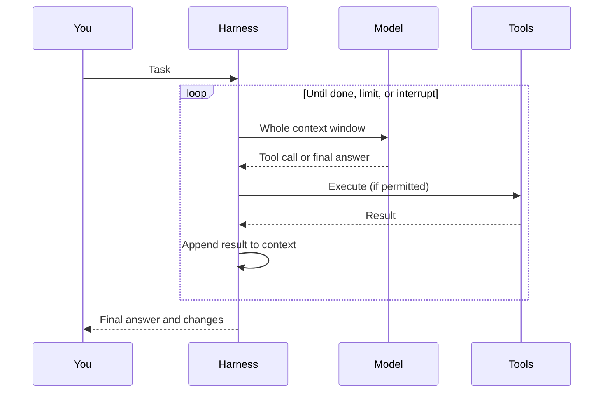
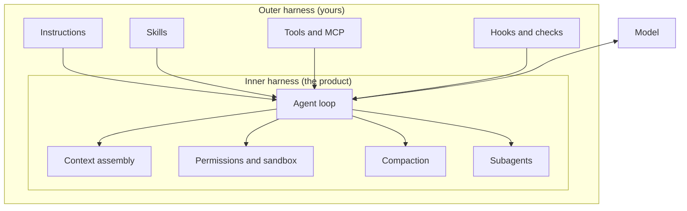

# How a Coding Agent Works

Most frustration with coding agents comes from a wrong mental model. People imagine a very fast colleague who happens to live in a terminal. It is more useful to imagine something stranger: a very capable reader who wakes up with no memory, is handed a stack of papers, takes one action, is handed the result, and does that again — sometimes hundreds of times — until it decides it is finished.

Picture an agent that follows a convention perfectly for forty minutes and then, in the same session, breaks it in a file it had already edited correctly. It looks like forgetfulness, or carelessness. Nothing about the model changed in those forty minutes. What changed was the stack of papers. Once you see that, most of the practices in this playbook stop looking like ceremony and start looking obvious.

!!! tip "The one-liner"
    A coding agent is a model in a loop. It knows only what is in its context window on this step, and everything you build around it is a way of shaping that window or constraining what the loop is allowed to do.

!!! note "Last reviewed"
    October 2026. The loop is stable; the product details cited from the eleven-harness study reflect mid-2026 source code.

---

## What problem this solves

Without a mental model, every failure looks random. The agent "forgot" a convention it followed an hour ago. It "ignored" an instruction. It "made up" an API. It ran confidently in the wrong direction for twenty minutes.

Each of those has a mechanical explanation, and each mechanical explanation suggests a fix. Teams that skip this step tend to respond to failure in one of two ways: they retry until the dice land well, or they add another paragraph to the instruction file. Both feel productive. Neither touches the cause. This page gives you the vocabulary to diagnose a run instead of re-rolling it.

---

## The loop

Simon Willison describes a coding agent as "a piece of software that acts as a harness for an LLM", and reduces the core of it to one line: an LLM, a system prompt and tools, in a loop. He also points out that a simple version of that loop takes only a few dozen lines of code on top of a model API. Every coding agent — Claude Code, Codex, Cursor's agent, Copilot's agent mode, Gemini CLI, opencode — is a much more elaborate version of the same thing.



1. **The harness assembles a context window**: system prompt, your instructions, the conversation so far, the descriptions of available tools, and the results of every tool call made so far.
2. **The model reads all of it and produces the next step**: either a tool call ("read this file", "run these tests", "edit these lines") or a final answer.
3. **The harness executes the tool call** — subject to permissions, sandboxing and hooks — and appends the result to the context.
4. **Repeat** until the model decides it is done, a limit is reached, or a human interrupts.

Everything else — plans, subagents, skills, memory — is a variation on what goes into step 1 and what is allowed in step 3. That sentence is worth holding on to, because it is the map for the rest of this section. [Context engineering](context-engineering.md), [instructions](instructions-and-agents-md.md) and [skills](skills.md) are about step 1. [Tools](tools-and-mcp.md) define what step 3 can do. [Hooks](hooks-and-guards.md) sit between step 2 and step 3 and decide whether it happens at all. [Subagents](subagents-and-orchestration.md) run the whole loop again, in a separate window, and hand back only the answer.

---

## What the model actually sees

Willison puts the key fact plainly: LLMs are stateless. Each step, the model re-reads the entire context window from the start. The "conversation" is an illusion the harness maintains by sending the whole transcript again every time. That has consequences.

**It only knows what is in the window.** Your team's conventions, the reason that odd function exists, the conversation you had with product last week — if they are not in the window, they do not exist. The agent will fill the gap with something plausible.

**Everything in the window competes for attention.** Anthropic describes context as "a finite resource with diminishing marginal returns" and explains why: transformer attention relates every token to every other, so a window of *n* tokens contains n² pairwise relationships to spread attention across. Chroma's *Context Rot* report tested 18 models and found performance becomes less reliable as input grows, even on deliberately simple tasks, and that a single distracting passage measurably lowers accuracy. The older *Lost in the Middle* study by Liu and colleagues found models use information at the start and end of a long input better than information buried in the middle. None of these are coding benchmarks, but the mechanism is the same one your agent is running on.

**Wrong information is worse than missing information.** A stale comment, an outdated doc, or an earlier wrong guess still in the conversation will be treated as true. Dex Horthy of HumanLayer ranks what can go wrong in a context window in this order: incorrect information first, then missing information, then too much noise. Missing information tends to produce a search or a question. Incorrect information produces a confident mistake.

**Tool results are usually the biggest cost.** A single test run or a large file read can add thousands of tokens. Most of what fills a context window in a long session is not your prompt. It is what the agent read along the way. HumanLayer estimates that a passing test suite can burn 2–3% of a context window to say "all good", which is why they wrap test output so that success prints a single line.

```text
What one model step reads, top to bottom

  System prompt (written by the vendor)          ~ fixed
  Tool definitions (built-in + MCP servers)      ~ fixed, grows per server unless deferred
  Your instructions (AGENTS.md, rules)           ~ fixed per session
  Skill descriptions (one line each)             ~ fixed per session
  -----------------------------------------------------------------
  Your messages                                   small
  The model's earlier reasoning and tool calls    grows
  Tool results: files, test output, search hits   grows fastest
```

The top half is paid on every step of every task. The bottom half is what makes long sessions degrade. Most of the craft of working with agents is keeping the top half small and the bottom half relevant.

---

## Worked example: tracing one run

Here is an illustrative run, the kind you might see on any medium-sized web codebase. The task: *"Add a `last_login_at` column to users and show it on the admin user page."* The token numbers are hypothetical but realistic in proportion; the shape is what matters.

**Step 0 — the window before anything happens (about 18k tokens).** The vendor's system prompt, the definitions of the built-in tools, two MCP servers someone connected last month (an issue tracker and a browser, together about 6k tokens of tool definitions), a 250-line `AGENTS.md`, and the one-line descriptions of twelve skills. The agent has not read a line of your code yet and the window is already doing work.

**Steps 1–6 — orientation (about 40k).** The agent searches for `User`, finds the model, reads it, reads the migrations directory listing, reads the admin controller and its template. Each read is appended. One file is 1,400 lines because nobody split it.

**Step 7 — the first fork in the road.** The instruction file says "migrations must be reversible" in line 212, and a `write-migration` skill exists. The skill's description matches, so the agent loads it: another 1,500 tokens, but the right ones. It writes a reversible migration and runs the migration check script the skill bundles. Good.

**Steps 8–14 — implementation (about 75k).** It edits the model, the serializer and the template, then runs the full test suite. The runner prints every passing test: 9,000 tokens of green dots and file names, three failures at the bottom.

**Steps 15–22 — the slide (about 110k).** Two failures are real; one is a flaky timezone test unrelated to the change. The agent does not know it is flaky. It tries three fixes for it, each with a test run, and the window fills with dead ends. Somewhere in here it formats the timestamp in the template with a raw `strftime` call, even though it used the project's `format_datetime` helper correctly in step 11. The instruction about the helper is still there, 100k tokens back, competing with three failed theories about timezones.

**Step 23 — "Done. All tests pass."** It reran only the file it last touched.

Every failure in that run has a mechanical cause, and none of them is "the model is not smart enough":

- The window started heavy because of tools nobody needed for this task.
- The noisy test output and the flaky test turned a small task into a long one.
- The inconsistent helper usage is context dilution: the right instruction was present, just far away and outnumbered.
- The false "all tests pass" is a missing external check. The agent was allowed to grade its own homework.

The corrected run looks almost boring. Disconnect the MCP servers for this task. Wrap the test runner so it prints only failures. Mark the flaky test as quarantined in a file the agent can read. Add a stop-time check (a [hook](hooks-and-guards.md), or a CI gate) that runs the full suite before the agent is allowed to declare success. Same model, same prompt, probably half the tokens, and the failure modes above simply have nowhere to happen.

---

## Why agents fail the way they do

The worked example generalizes. Most agent failures fit one of the rows below, and the right-hand column is usually a change to the system rather than to the prompt.

| Symptom                                    | Mechanical cause                                                       | Typical fix                                                                                    |
| ------------------------------------------ | ---------------------------------------------------------------------- | ---------------------------------------------------------------------------------------------- |
| **"Forgot" a convention mid-session**      | The instruction is far back in a crowded window, or was compacted away | Keep instructions short; restate key constraints in the plan; use hooks for hard rules         |
| **Invented an API or field**               | The real one was not in context; plausible completion filled the gap   | Point it at the source of truth; make "look it up" cheap; ask it to cite where it found things |
| **Ran confidently in the wrong direction** | No checkpoint between plan and execution                               | Separate research, plan and implementation; review the plan                                    |
| **Declared victory too early**             | No external signal that the task was incomplete                        | Give it a checkable definition of done: tests, type checks, a browser walkthrough              |
| **Rewrote tests to make them pass**        | Optimising for the signal it was given                                 | Independent checks; forbid test edits in certain phases; review diffs to tests                 |
| **Got worse the longer it ran**            | Context filled with noise and dead ends                                | Compact intentionally; start fresh sessions per phase; delegate exploration to subagents       |
| **Behaved differently on the same task**   | Non-determinism plus different context                                 | Evaluate in aggregate, not on single runs                                                      |

Anthropic's own long-running harness work names two of these directly. In their experiments, agents tried to build everything at once and ran out of context mid-feature, and they declared the job finished when it was not. Their fixes were structural: one feature at a time, a feature list the agent could only tick off after testing, and browser automation so it tested as a user would.

---

## The inner harness and the outer harness

The loop above is implemented by the **inner harness** — the agent product itself. It decides how context is assembled, which tools exist, how permissions work, when to compact, and how subagents are spawned. Products differ here, and those differences matter.

A July 2026 preprint by Barbaste and colleagues read the source code of eleven agent harnesses — Claude Code, Codex CLI, Gemini CLI, Mistral Vibe, OpenHands, Aider, Mini-SWE-Agent, Hermes, Pi, OpenCode and OpenClaw — and is the best map of that inner layer I know of. A few of its findings are useful for a mental model:

- **None of them uses a general-purpose agent framework or vector-embedding retrieval over code.** They navigate the repository with search and file tools, the way you would. Anthropic describes the same choice in Claude Code: instruction files are loaded up front, everything else is fetched "just in time" with tools like glob and grep.
- **Context management falls into four strategies**, from keeping the whole linear history to compacting automatically at a threshold, which seven of the eleven do.
- **Behavioural policy is moving from prompt text to configuration**, and the authors argue that in the first half of 2026 coding harnesses turned from tools into platforms, with skills, hooks, plugins and protocol support becoming standard.

What you control is the **outer harness**: the instructions, skills, tools, hooks, checks and workflow you put around that product for your codebase and your team. That is where most of this playbook lives, and it is where the leverage is. The inner harness will keep changing under you every few weeks. The outer harness is yours.



---

## Roles and ownership

| Role               | Responsibility                                                                             |
| ------------------ | ------------------------------------------------------------------------------------------ |
| **Every engineer** | Diagnoses failed runs mechanically before retrying; keeps sessions scoped                  |
| **Harness owner**  | Turns recurring failures into harness changes; keeps the starting window lean              |
| **Tech lead**      | Makes sure the team shares one mental model, so failures are discussed as causes, not luck |

---

## When to use this

**Invest in this mental model when:**

- **Tasks run long.** The longer the loop runs, the more context management dominates the outcome.
- **The code is brownfield.** Large existing codebases have more implicit knowledge that is not in the window, and more ways for plausible guesses to be wrong.
- **Work runs in parallel or in the background.** When nobody is watching each step, the checks and stopping conditions you designed in advance are all you have.

**Skip the ceremony when:**

- **The change is small and well specified** in a codebase the agent can read in full. Do not over-engineer the simple case.

---

## What good looks like

| Signal                           | What you observe                                                              |
| -------------------------------- | ----------------------------------------------------------------------------- |
| **Mechanical diagnosis**         | Engineers can explain *why* an agent failed, not just *that* it failed        |
| **Scoped sessions**              | Sessions match a phase of work rather than running all day                    |
| **External checks**              | Agents have a way to verify their work before declaring it done               |
| **Harness changes, not retries** | A recurring failure leads to a change in instructions, tools, hooks or checks |
| **Lean starting window**         | You know roughly how many tokens a session spends before reading any code     |

---

## Failure modes and mitigations

These failures are rarely dramatic. They show up as a slow drift: a team that was excited about agents in month one starts saying "it is hit and miss" in month three, and nobody can say which misses had what cause. The common thread is treating the agent as a person rather than as a loop.

| Failure mode              | What it looks like                                                    | Mitigation                                                                    |
| ------------------------- | --------------------------------------------------------------------- | ----------------------------------------------------------------------------- |
| **Anthropomorphising**    | "It knows our codebase by now"                                        | It knows only what is in the current window; write durable knowledge to files |
| **The endless session**   | One conversation running all day across unrelated tasks               | New session per task or phase; write state to files                           |
| **Retry roulette**        | Re-running the same prompt hoping for a better outcome                | Diagnose the mechanical cause; change the context or the checks               |
| **Trusting self-reports** | "All tests pass" accepted without looking                             | Verify with an independent signal                                             |
| **Invisible overhead**    | Ten MCP servers and a long instruction file loaded for every typo fix | Measure the starting window; connect tools per task                           |

---

## Copy this: a failure diagnosis checklist

```text
When an agent run goes wrong, before retrying ask:

[ ] Was the information it needed actually in context?
[ ] Was there wrong or stale information in context?
[ ] How full was the context window when it went wrong?
[ ] What was in the window that this task did not need (tools, docs, dead ends)?
[ ] Did it have a checkable definition of done?
[ ] Did it have a way to observe the result of its actions (tests, logs, browser)?
[ ] Was there a point where it should have stopped and asked?
[ ] Is this the second time this failure has happened? If so: harness change, not retry.
```

---

## Further reading

- **[How coding agents work](https://simonwillison.net/guides/agentic-engineering-patterns/how-coding-agents-work/)** by Simon Willison (Agentic Engineering Patterns) — The clearest short explanation of tokens, chat templates, tool calls and the loop.
- **[Effective context engineering for AI agents](https://www.anthropic.com/engineering/effective-context-engineering-for-ai-agents)** by Anthropic — Why context is a finite attention budget, and how Claude Code retrieves "just in time". (Vendor engineering post.)
- **[Effective harnesses for long-running agents](https://www.anthropic.com/engineering/effective-harnesses-for-long-running-agents)** by Anthropic — The failure modes of multi-session work and the structural fixes for each. (Vendor engineering post.)
- **[Context Rot](https://www.trychroma.com/research/context-rot)** by Kelly Hong, Anton Troynikov and Jeff Huber (Chroma) — 18 models, simple tasks, measurable degradation as input grows. (Vendor technical report.)
- **[Lost in the Middle](https://arxiv.org/abs/2307.03172)** by Nelson F. Liu et al. (TACL) — The foundational result on position effects in long contexts.
- **[Advanced context engineering for coding agents](https://www.humanlayer.dev/blog/advanced-context-engineering)** by Dex Horthy (HumanLayer) — Incorrect, missing, noisy: the ranking of what hurts a context window.
- **[Harness Engineering: anatomy, architecture, and evolution of coding agents](https://arxiv.org/abs/2609.00006)** by Paul Barbaste et al. — A source-code study of eleven agent harnesses. (Preprint.)

---

## Related pages

- [Context Engineering](context-engineering.md) — How to manage the window deliberately across long tasks.
- [What a Harness Is](../harness/what-a-harness-is.md) — How the outer harness fits together as a system.
- [Verification](../workflow/verification.md) — Giving agents external signals instead of trusting self-reports.
