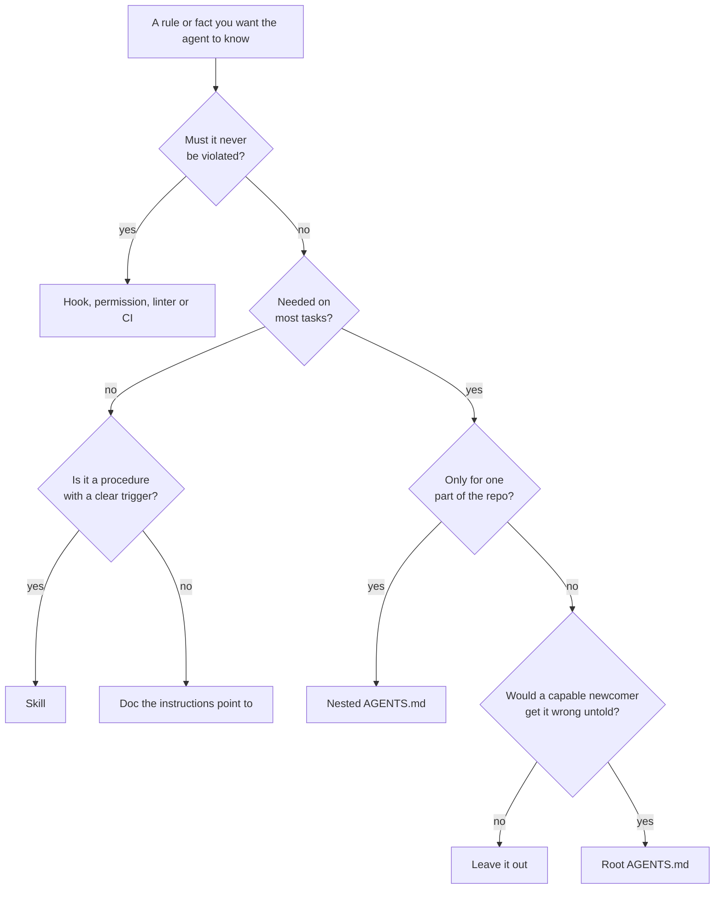

# Instructions & AGENTS.md

Instructions are the oldest primitive and the most abused. Almost every team that adopts coding agents writes an instruction file in the first week, keeps adding to it every time something goes wrong, and six months later has a document nobody has read end to end — including, in any meaningful sense, the agent.

The pattern is understandable. An instruction file is the one place where writing a sentence visibly changes the agent's behaviour, so every incident ends with a new sentence. Nothing ends with a deleted one. The research and the field reports now point firmly the same way: **short, human-written and reactive** beats long, generated and comprehensive.

!!! tip "The one-liner"
    An instruction file is the agent's onboarding page, read on every task. Put in it only what a capable newcomer would get wrong on most tasks without being told — and move everything else somewhere it loads when needed or is enforced in code.

!!! note "Last reviewed"
    October 2026. Discovery rules, file-size limits and version numbers for Codex, Claude Code and Gemini CLI change often; check your agent's current documentation.

---

## What problem this solves

An agent starts every session knowing nothing about your project. Instructions give it the handful of facts it needs on nearly every task: how to build and test, where things live, which conventions are non-negotiable, and what it must never do.

Without them, every session rediscovers the basics — or guesses. With too much of them, every session pays for knowledge it does not need, and the important lines are lost among the unimportant. HumanLayer's guidance puts the constraint in terms of an *instruction budget*: citing research on instruction following, they suggest frontier models follow roughly 150–200 instructions reliably — by their own account a lightly studied estimate — and, by their analysis, Claude Code's system prompt already contains about 50 instructions before your file is read.

---

## How agents find and load instructions

The format is the easy part. `AGENTS.md` is plain Markdown with no required fields. The agents.md site calls it "a README for agents" and reports use in more than 60,000 open-source projects. OpenAI donated the convention to the Agentic AI Foundation under the Linux Foundation when the foundation launched in December 2025, alongside Anthropic's Model Context Protocol and Block's goose, so it now has vendor-neutral stewardship.

What differs between tools is *discovery* — which files are read, in what order, and when. That is worth understanding precisely, because it decides whether a rule in a nested file is ever seen.

**Codex** builds an instruction chain once per run. It reads a global file from `~/.codex` (an `AGENTS.override.md` if present, otherwise `AGENTS.md`), then walks from the project root down to the current directory, taking at most one file per directory. Files are concatenated root first, so files closer to where you are working appear later and take precedence. It stops adding files once the combined size reaches `project_doc_max_bytes`, 32 KiB by default — a hard reason to keep files short.

**Claude Code** has its own `CLAUDE.md` files and, from v2.1.277, reads `AGENTS.md` directly when there is no `CLAUDE.md` in the working directory or above it; otherwise a `CLAUDE.md` can import `AGENTS.md`. One trap: a personal `CLAUDE.local.md` counts as a `CLAUDE.md` for that check, so adding one quietly stops `AGENTS.md` from loading. Files above the working directory load at launch; files in subdirectories load on demand, when the agent first reads or edits something in that directory. Its documentation recommends keeping each file under 200 lines and states the important caveat plainly: these files are treated "as context, not enforced configuration". To block an action regardless of what the model decides, it points you to a hook.

**Gemini CLI** reads `GEMINI.md` files from a global location, the workspace and its parents, and loads subdirectory files just in time when a tool touches that location. Its context file name is configurable, and the documentation's own example includes `AGENTS.md`. Note that Google replaced Gemini CLI with Antigravity CLI for unpaid-tier and Google One users on 18 June 2026; Gemini CLI remains documented for other users.

```text
Codex, working in services/billing/:

  ~/.codex/AGENTS.md               global, personal defaults
  AGENTS.md                        repo root: commands, layout, boundaries
  services/AGENTS.md               (none: skipped)
  services/billing/AGENTS.md       domain rules, read last, wins on conflict

  → concatenated in that order, until 32 KiB
```

The convergence is real but not complete. The agents.md FAQ states the general rule — "the closest AGENTS.md to the edited file wins; explicit user chat prompts override everything" — and most tools behave roughly that way. The details of when a nested file loads still differ, which is one more reason to test your instructions in each agent your team uses. See [Portability](../tools/portability.md).

---

## When to use this

**Put it in always-on instructions when:**

- **The agent needs it on most tasks** in this repository.
- **It is short and stable.**
- **Getting it wrong is common and costly.**

**Put it somewhere else when:**

- **It is a procedure for a specific kind of task** → a [skill](skills.md).
- **It must never be violated** → a [hook](hooks-and-guards.md), linter or permission rule.
- **It is reference material needed occasionally** → a doc the instructions point to.
- **It only applies to one directory** → a nested `AGENTS.md` in that directory.



---

## Roles and ownership

| Role                          | Responsibility                                                                     |
| ----------------------------- | ---------------------------------------------------------------------------------- |
| **Harness owner / tech lead** | Owns the root instruction file; reviews changes; prunes regularly                  |
| **Area owners**               | Own nested instruction files for their directories                                 |
| **Every engineer**            | Proposes additions when they see a recurring failure, with the failure as evidence |

---

## What the evidence says

ETH Zurich's *Evaluating AGENTS.md* (Gloaguen et al., first published February 2026 and revised through September) is one of the few controlled experiments in this area, and its findings are more sobering than most summaries suggest. The authors tested Claude Code, Codex and Qwen Code with four models, on SWE-bench Lite and on a new benchmark of 138 tasks from twelve repositories whose developers had committed their own context files.

- **LLM-generated context files did not help.** Success fell slightly — about half a point on SWE-bench and about two points on the new benchmark — though neither drop was statistically significant. Cost rose by about 20% and 23%, and that increase was significant.
- **Developer-written files did a little better**, improving success by 2.4% on average, but that gain was not statistically significant either (p = 0.21), and it held for every agent tested except Claude Code. They did beat the generated files significantly, and they also raised cost, by up to 19%. Version 1 of the paper had reported a 4% gain for developer-written files; v3 revised that to 2.4%, not significant.
- **Agents do what they are told.** When a file mentioned a tool such as `uv`, agents used it about 1.6 times per task; when it did not, almost never. Context files made agents run more tests and read more files.
- **Repository overviews did not help agents find the right files faster**, even though nearly every generated file included one.

The headline of the current (v3, September 2026) version is that context files do not generally improve task success while raising inference cost by over 20% on average, and that this holds for both generated and developer-committed files. The authors' conclusion is still narrower than "instruction files are useless": they are useful for specifying non-standard practices the agent would not otherwise follow, and anything beyond that should be measured before you trust it.

Field reports converge on the same shape. marmelab's September 2026 audit of open-source agent harnesses counted 189 repositories with an `AGENTS.md` at the root against 155 with a `CLAUDE.md`, and in large projects 36 of 53 `CLAUDE.md` files were a symlink or short redirect to `AGENTS.md`. OpenAI's harness engineering team describes the same move in its own write-up: after trying one large instruction file, it settled on an `AGENTS.md` of about 100 lines that works as a map to a structured `docs/` directory.

!!! info "What we know / what we don't"
    We know generated instruction files are a poor default and that the measurable benefit of human-written ones is small; their clearest value is in stating non-obvious, non-standard practices. We do not yet know the optimal size or structure for large, messy codebases, which are under-represented in benchmarks. Measure on your own tasks, with and without the file.

---

## What belongs in a good root file

A useful root `AGENTS.md` usually fits on one screen. Read the ETH findings into this list: every item is either a non-obvious fact, or a command the agent would otherwise have to discover.

1. **One-paragraph orientation.** What this system is and the shape of the repository — briefly, since long overviews did not measurably help.
2. **Commands.** How to install, build, run, test and lint — the exact commands, including how to run a single test.
3. **Where to find things.** Pointers to architecture docs, ADRs, API conventions, the design system.
4. **Non-obvious conventions.** Only the ones an agent would get wrong without being told.
5. **Boundaries.** What the agent must not do, and when it must stop and ask.
6. **Definition of done.** What has to be true before the agent says it has finished.

What does **not** belong: general programming advice the model already follows, long style guides your linter already enforces, every edge case anyone has ever hit, or instructions written for a model two generations ago.

The size guidance you will find is not one number. Claude Code's documentation says under 200 lines per file; OpenAI's team settled on about 100 lines for the root file; this page suggests around 150 as a ceiling for the root. They agree on the important part: a root file you can read in a couple of minutes, with everything else one pointer away.

---

## Nested instructions

Most agents read instruction files in subdirectories when they work there. Use that:

```text
AGENTS.md                    # repo-wide: commands, layout, boundaries
apps/web/AGENTS.md           # frontend conventions, component patterns
services/billing/AGENTS.md   # domain rules, "always ask before changing pricing logic"
```

Stripe's Minions apply agent rules conditionally by subdirectory — the post notes it "would be impractical for Stripe to have many unconditional rules" — and the agents.md site points out that OpenAI's main repository has 88 `AGENTS.md` files. Nested files are how instruction systems scale without bloating every session.

A related file is starting to appear for one specific reader: the AI code reviewer. The Claude Code team keeps a `REVIEW.md` in which code owners tell the reviewer what matters in their part of the code: what counts as a failure, what not to nitpick, which paths to ignore, and that every finding needs a file and line reference. It follows the same rules as everything on this page: short, written by the people who own the code, and checked, because the team verifies separately whether the reviewer actually follows it. See [Review at Agent Speed](../workflow/review-at-agent-speed.md).

---

## Writing instructions that work

**Write the why.** "Use `Money` objects, never floats, for amounts — floats caused rounding bugs in invoicing" gives the model something to generalize from. "Use `Money` objects" gives it a rule to pattern-match.

**Be specific about stopping.** "If a migration is needed, stop and ask" is actionable. "Be careful with migrations" is not.

**State commands exactly.** `pnpm test -- path/to/file.test.ts` beats "run the tests".

**Prefer positive instructions with a reason.** "Put new endpoints in `routes/v2/` because v1 is frozen" works better than a list of prohibitions.

**Mention tools deliberately.** The ETH study's clearest finding is that agents use what you mention. Name a tool only if you want it used.

**Grow it from failures.** Every new line should be traceable to a mistake that happened, ideally more than once.

**Keep one source of truth across tools.** If your team uses several agents, have one `AGENTS.md` and point tool-specific files at it. See [Portability](../tools/portability.md).

---

## Worked example: from 400 lines to 70

An illustrative example. A team's `CLAUDE.md` started as `/init` output and grew to 400 lines over eight months: a generated architecture overview, a restatement of the ESLint config, eleven paragraphs added after incidents, and a section on a deployment process that was replaced in the spring. Two of the team use Codex, which never reads the file.

**Step 1 — inventory.** The harness owner lists every rule and tags each one: *command*, *pointer*, *convention*, *boundary*, *procedure*, *must-never*, or *stale*. The tags are the decision: commands, pointers, conventions and boundaries stay candidates; procedures become skills; must-nevers become guards; stale lines go.

**Step 2 — move the must-nevers.** Three rules ("never commit `.env` files", "never push to `main`", "never run migrations against production") move into a pre-tool hook and branch protection. They stay in the file as one line — "these are enforced by hooks; if one blocks you, read its message" — so the agent understands the block when it happens.

**Step 3 — move the procedures.** The release checklist and the migration conventions become two [skills](skills.md). The deployment section is deleted outright; it described a process that no longer exists, which made it worse than nothing.

**Step 4 — delete what the linter enforces.** Formatting and import-order rules go. The file gains one line: "run `pnpm lint --fix` before committing".

**Step 5 — rename and point.** The result, about 70 lines, becomes `AGENTS.md`. `CLAUDE.md` becomes a one-line import of it.

**What went wrong.** Within a week, an agent added a new endpoint to the frozen v1 routes. The reason was in the old file in a paragraph the inventory had tagged as stale. The fix was one line in the new file, with its reason. The team kept a habit from it: before deleting a line, ask whether its failure would be visible quickly. If not, keep it until you have checked.

**How they knew it worked.** They replayed five recent tasks with the old and new files. Results were similar and the new sessions used noticeably fewer tokens. That is the realistic win — similar quality, lower cost, one file both agents read — and it is consistent with what the ETH study would predict.

---

## What good looks like

| Signal                        | What you observe                                                   |
| ----------------------------- | ------------------------------------------------------------------ |
| **Short root file**           | Under ~150 lines, mostly pointers, commands and boundaries         |
| **Every rule has a reason**   | You can tell why each line exists                                  |
| **Regular pruning**           | Lines are removed when models or the code change                   |
| **Hard rules live elsewhere** | Things that must never happen are enforced by hooks or permissions |
| **One source of truth**       | Tool-specific files reference the shared file                      |

---

## Failure modes and mitigations

The failure usually starts with a good intention. Someone runs the agent's init command to "get started quickly", commits the result, and the file acquires authority it never earned. Then each incident adds a paragraph, no paragraph is ever removed, and the file drifts into a historical record of past mistakes — some of which describe a codebase that no longer exists.

| Failure mode             | What it looks like                                                     | Mitigation                                             |
| ------------------------ | ---------------------------------------------------------------------- | ------------------------------------------------------ |
| **Generated on day one** | `/init` output committed and never edited                              | Write it yourself; start with commands and boundaries  |
| **The append-only file** | Every incident adds a paragraph; nothing is removed                    | Quarterly pruning; re-test after model upgrades        |
| **The style guide dump** | Linter rules restated in prose                                         | Let the linter enforce them; tell the agent to run it  |
| **Contradictions**       | Root says one thing, a nested file another                             | Nested files refine, never contradict; review together |
| **Prose security**       | "Never commit secrets" as the only control                             | Secret scanning in hooks and CI                        |
| **Silent truncation**    | A long file chain exceeds the tool's size limit and the end is dropped | Keep files short; split by directory                   |

---

## Copy this

A starting skeleton is in [AGENTS.md Skeleton](../templates/agents-md-skeleton.md).

---

## Further reading

- **[AGENTS.md](https://agents.md)** by the Agentic AI Foundation — The open convention, its FAQ on nesting and precedence, and the list of supporting agents.
- **[Evaluating AGENTS.md](https://arxiv.org/abs/2602.11988)** by Thibaud Gloaguen et al. (ETH Zurich) — The controlled study behind most of this page's evidence. (Preprint.)
- **[Custom instructions with AGENTS.md](https://learn.chatgpt.com/docs/agent-configuration/agents-md)** by OpenAI — Exactly how Codex discovers, orders and caps instruction files. (Vendor docs.)
- **[How Claude remembers your project](https://code.claude.com/docs/en/memory)** by Anthropic — `CLAUDE.md`, `AGENTS.md` support, on-demand loading and the 200-line guidance. (Vendor docs.)
- **[Writing a good CLAUDE.md](https://www.humanlayer.dev/blog/writing-a-good-claude-md)** by HumanLayer — The instruction budget, and why not to generate the file.
- **[The state of AI harness engineering 2026](https://marmelab.com/blog/2026/09/24/the-state-of-ai-harness-engineering-2026.html)** by marmelab — What 246 open-source agent harnesses (and 145 comparison projects) actually contain.
- **[Linux Foundation announces the Agentic AI Foundation](https://www.linuxfoundation.org/press/linux-foundation-announces-the-formation-of-the-agentic-ai-foundation)** by the Linux Foundation — The December 2025 launch with MCP, goose and AGENTS.md.

---

## Related pages

- [Skills](skills.md) — Where procedures go when they leave the instruction file.
- [Hooks & Deterministic Guards](hooks-and-guards.md) — Where must-never rules go.
- [Guides & Sensors](../harness/guides-and-sensors.md) — Instructions as one kind of guide in a wider harness.
- [AGENTS.md Skeleton](../templates/agents-md-skeleton.md) — A starting file to adapt.
