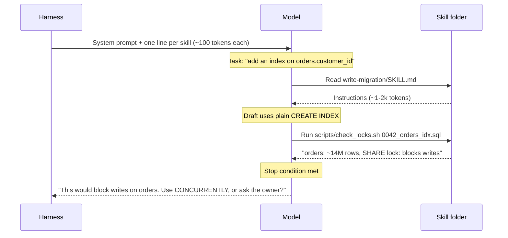

# Skills

If I had to name the most important primitive of the last year, it would be skills. Not because they are clever — a skill is a folder with a Markdown file in it — but because they solved the problem instruction files never could: giving an agent a lot of procedural knowledge without paying for all of it on every task.

Think about how a good engineer joins a team. They do not memorize the incident runbook, the release checklist and the migration conventions on day one. They learn that those documents exist and roughly what each is for, and they open the right one when the situation calls for it. Skills give agents the same shape of knowledge: a table of contents always in mind, the chapter only when needed.

!!! tip "The one-liner"
    A skill is a procedure with a trigger. The agent always sees the trigger; it reads the procedure only when the task matches.

!!! note "Last reviewed"
    October 2026. The Agent Skills spec is stable, but each agent's skill locations, budgets and extensions change between releases.

---

## What problem this solves

Teams accumulate procedures: how we write a migration, how we prepare a release note, how we investigate a production error, how we review an approach before implementation. Putting all of them in always-on instructions bloats every session — and, as the [instructions page](instructions-and-agents-md.md) shows, longer instruction files cost more without measurably helping. Leaving them out means the agent improvises.

Skills give you a third option. The agent sees a short description of every available skill. When a task matches, it loads the full instructions — and any scripts or reference files bundled with them — only then.

---

## How skills work

A skill is a directory containing a `SKILL.md` file. The [Agent Skills specification](https://agentskills.io/specification) defines the rest:

```text
write-migration/
├── SKILL.md              # required: frontmatter + instructions
├── references/
│   └── locking.md        # optional: read only when SKILL.md points to it
└── scripts/
    └── check_locks.sh    # optional: code the agent runs
```

```markdown
---
name: write-migration
description: Use when creating or changing a database migration, adding or
  dropping an index, adding a column, or backfilling data in Postgres. Covers
  locking, backfills and the review evidence for schema changes. Not for
  query tuning without schema changes or for seed data.
metadata:
  owner: billing-team
  version: "2"
---

# Writing a migration

1. Read `docs/database.md` for naming and rollback conventions.
2. Write the migration. Indexes on existing tables use
   `CREATE INDEX CONCURRENTLY` in a migration with transactions disabled.
3. Run `scripts/check_locks.sh <migration-file>` and keep its full output.
4. If a backfill is needed, write it as a separate batched job.
   See `references/locking.md` for batch sizes.
5. Stop and ask the billing area owner if the script reports a lock that
   blocks writes (SHARE or stronger) on a table over 1M rows.
```

This is a shortened version of the fully worked example in the [Skill Template](../templates/skill-template.md), which adds the evidence section, the rest of the stop conditions and a checkable definition of done.

The spec is deliberately small. Only `name` and `description` are required. The `name` is 1–64 characters of lowercase letters, digits and hyphens, must not start or end with a hyphen or contain two in a row, and must match the directory name. The `description` is up to 1,024 characters and "should describe both what the skill does and when to use it". Optional fields are `license`, `compatibility` (environment requirements, rarely needed), `metadata` (free-form string key-value pairs) and an experimental `allowed-tools` field, a space-separated string of pre-approved tools such as `Bash(git:*) Read`. A reference validator, `skills-ref validate ./my-skill`, checks the frontmatter.

Loading is progressive, in three levels the spec spells out:

1. **Metadata, at start-up** — the `name` and `description` of every skill, roughly 100 tokens each.
2. **Instructions, on activation** — the full `SKILL.md` body when the agent decides the skill applies. The spec recommends keeping it under 5,000 tokens and 500 lines.
3. **Resources, as needed** — files in `scripts/`, `references/` or `assets/`, only when the instructions send the agent to them. The spec recommends keeping references one level deep.



### Where the standard came from, and where it runs

Anthropic introduced Agent Skills in October 2025 and published them as an open standard in December 2025, now maintained at [agentskills.io](https://agentskills.io). The July 2026 source-code study of eleven agent harnesses found `SKILL.md` skills in nine of the eleven, against eight for MCP — skills had overtaken the older protocol in adoption across the systems it examined.

The locations differ by tool, which matters when you want one set of skills to work for a whole team:

- **Codex** scans `.agents/skills` in every directory from where you launch it up to the repository root, plus `$HOME/.agents/skills` for personal skills. By default the initial skill list may use at most 2% of the context window; with many skills installed, Codex shortens descriptions first and may omit some. You can invoke a skill explicitly by typing `$` and its name, or let Codex choose one implicitly from its description.
- **Claude Code** reads `.claude/skills/<name>/SKILL.md` in the project, `~/.claude/skills/` for personal skills, and skills shipped in plugins. It follows the open standard and extends it: `disable-model-invocation: true` makes a skill something only a human can trigger (useful for `/deploy`), `context: fork` runs the skill in a subagent, and the combined description text is truncated at 1,536 characters in the listing. Those extra fields are Claude Code-specific; outside it, only the spec fields are valid.
- **Gemini CLI**'s documentation also has an Agent Skills section. (Google replaced Gemini CLI with Antigravity CLI for unpaid-tier and Google One users in June 2026.)

The practical upshot: write to the spec, put the key use case first in the description, and use tool-specific extensions only where you accept that the skill is no longer portable.

---

## When to use this

**Write a skill when:**

- **A procedure recurs and has a clear trigger** ("when writing a migration", "when investigating a production error").
- **It needs more than a few lines of instruction.**
- **It benefits from bundled scripts** that produce evidence.
- **You want consistency** across engineers and agents.

**Do not write a skill when:**

- **The rule must always apply** → instruction or hook. A skill may never load.
- **The knowledge is a live capability** (query an API, read a dashboard) → a [tool or MCP server](tools-and-mcp.md).
- **It is a one-off task** → just prompt it.

---

## Roles and ownership

| Role              | Responsibility                                                                |
| ----------------- | ----------------------------------------------------------------------------- |
| **Skill owner**   | Usually the person or team that owns the procedure; keeps it accurate         |
| **Harness owner** | Curates the set; prevents overlap; checks that skills are discovered and used |
| **Engineers**     | Propose skills from repeated work; report when a skill misfires               |

---

## Writing skills that work

### The description is the trigger

The description is the only part the agent sees until it decides to load the skill. It must say *what* the skill does and *when* to use it, in the words a task would actually use. The spec's own contrast is a good one: "Extracts text and tables from PDF files, fills PDF forms, and merges multiple PDFs. Use when working with PDF documents or when the user mentions PDFs, forms, or document extraction" against "Helps with PDFs."

| Weak                  | Strong                                                                                                                                      |
| --------------------- | ------------------------------------------------------------------------------------------------------------------------------------------- |
| **"Database helper"** | "Create or change a database migration. Use when adding or altering tables, columns or indexes, or backfilling data."                       |
| **"Release stuff"**   | "Prepare a production release: changelog, version bump, rollout plan. Use when the user mentions releasing, shipping or tagging a version." |

Discovery is a design problem, not a given. In an October 2026 evaluation with the Georgian AI Lab, Expo found that on ten app-building tasks, agents loaded any relevant Expo skill in only about one session in ten. After they added an entrypoint skill, `expo-overview`, that routes common goals to the more specialized skills, the share rose to 55%. Even then, recall of the *right* skills was far from complete: it went from 2% to 18%. If a vendor with a well-maintained skill set saw those numbers, assume yours need testing too.

### Scripts measure, agents judge

The most valuable skills bundle small scripts that produce facts — lock analysis for a migration, a list of callers for a function, a bundle-size diff — and ask the agent to cite those facts. Anthropic's explanation for why skills include code is simple: "because code is deterministic, this workflow is consistent and repeatable". Deterministic evidence plus model judgment beats either alone.

### Keep each skill focused

One procedure per skill. If a skill's description needs "and" three times, split it. Codex's documentation gives the same advice — "keep each skill focused on one job" — and adds a useful corollary: prefer instructions over scripts unless you need deterministic behaviour or external tooling.

### Encode the stopping points

Say where the skill must stop for a human, in terms the agent can recognise: "Stop and ask if the script reports a lock that blocks writes (SHARE or stronger) on a table over 1M rows." A plain `CREATE INDEX` in Postgres takes exactly such a lock — it blocks writes but not reads — which is why the skill steers towards `CREATE INDEX CONCURRENTLY` in the first place. A skill is the natural place for this, because it is the moment the agent is reading the procedure.

---

## Worked example: designing a skill end to end

An illustrative example. A team keeps seeing the same failure: when asked to investigate a production error, agents read the stack trace, guess a cause, and propose a fix — without looking at logs, recent deploys or whether the error is new.

**1. Write down the procedure as a human does it.** The on-call engineer describes what they actually do: check when the error started, correlate with the last deploys, pull five sample events, find the code path, form a hypothesis, then decide whether it is a fix, a rollback or a question for someone else. That conversation is the skill. Most of the value is in making the implicit order explicit.

**2. Decide what is a script.** "When did it start" and "which deploys happened around then" are facts. They become `scripts/error_timeline.sh <error-id>`, which prints first-seen time, hourly counts and the deploys in the surrounding window. The hypothesis and the decision stay with the model and the human.

**3. Write the description in task language.** First draft: "Production debugging helper." Second draft: "Investigate a production error or exception. Use when the user shares an error ID, stack trace, Sentry or log link, or asks why something is failing in production. Establishes a timeline and correlates with deploys before proposing a fix."

**4. Test discovery.** The harness owner writes ten prompts that *should* trigger the skill ("why is checkout throwing 500s since lunch?") and five that should not ("fix this failing unit test"). They run each three times. The first draft triggered 4 of 30 times. The second draft triggered 24 of 30 — and also fired twice on the unit-test prompts, because "failing" was in the description. They tightened it to "in production" and reran.

**5. Test the effect.** On six recent real incidents, they compare runs with and without the skill, reading the transcripts. With the skill, the agent established a timeline every time; without it, twice. In one case the timeline showed the error predated the suspected deploy, which saved a wrong rollback. In another, the skill made things worse: the script timed out on a very high-volume error and the agent fabricated a timeline instead of reporting the failure. The fix was in the script — fail loudly, with a message telling the agent to ask for a narrower window — and in one added line: "If the script fails, say so. Do not estimate the timeline."

**6. Ship it, and give it an owner.** The skill lives in `.agents/skills/investigate-prod-error/`, with a symlink where Claude Code looks for it. The on-call rotation owns it. When the deploy tooling changes, the script changes with it.

The whole exercise took an afternoon. Most of it was spent on steps 1 and 4, which is typical: writing the procedure and testing discovery are the work. The Markdown is the easy part.

---

## Testing skills

A skill you have never evaluated is a guess. At minimum, test two things:

1. **Discovery:** does the agent load it on tasks where it should — and not on tasks where it should not?
2. **Effect:** on a handful of real tasks, is the outcome better with the skill than without it?

Run each with and without the skill, several times, and compare in aggregate. Read the transcripts, not just the outcomes; the worked example above found its worst bug that way. See [Testing & Evolving the Harness](../harness/testing-and-evolving.md).

---

## What good looks like

| Signal                    | What you observe                                          |
| ------------------------- | --------------------------------------------------------- |
| **Sharp descriptions**    | The right skill loads without anyone naming it            |
| **Small, high-value set** | A dozen skills that are used beats a hundred that are not |
| **Evidence in output**    | Skill runs produce script output, not just prose          |
| **Measured**              | You know which skills fire and whether they help          |
| **Portable**              | The same skills work across the agents your team uses     |

---

## Failure modes and mitigations

Skills fail quietly. A skill that never loads produces no error; the agent simply improvises, and the team assumes the skill is working because it exists. The other quiet failure is accumulation: skill directories are easy to fill from marketplaces and colleagues, every one adds a line to every session, and overlapping descriptions make the agent pick inconsistently.

| Failure mode              | What it looks like                               | Mitigation                                                                 |
| ------------------------- | ------------------------------------------------ | -------------------------------------------------------------------------- |
| **The skill marketplace** | Hundreds of downloaded skills nobody reviewed    | Curate; review third-party skills like dependencies                        |
| **Vague descriptions**    | Skills never load unless named explicitly        | Rewrite descriptions in task language; test discovery                      |
| **Overlapping skills**    | Two skills compete for the same trigger          | Merge or sharpen boundaries; consider an entrypoint skill                  |
| **Skills as rules**       | "Always do X" inside a skill that may never load | Move to instructions or hooks                                              |
| **Never evaluated**       | Nobody knows if the skill helps                  | With/without comparison on real tasks                                      |
| **Silent script failure** | A bundled script errors and the agent improvises | Scripts fail loudly with a next step; the skill says what to do on failure |

!!! warning "The trusted-folder trap"
    A skill can contain scripts the agent will run, often with your credentials. Anthropic's own guidance is to install skills "only from trusted sources" and to audit anything else, including its dependencies and bundled resources. Treat third-party skills like any other dependency: read them, pin them, and review changes. See [Agent Threat Model](../security/agent-threat-model.md).

---

## Copy this

A starting point is in [Skill Template](../templates/skill-template.md).

---

## Further reading

- **[Agent Skills specification](https://agentskills.io/specification)** by the Agent Skills project — The format, field constraints and progressive-disclosure guidance, in one page.
- **[Equipping agents for the real world with Agent Skills](https://www.anthropic.com/engineering/equipping-agents-for-the-real-world-with-agent-skills)** by Anthropic — Why skills exist, the three loading levels, and the security caveats. (Vendor engineering post.)
- **[Your skills need an evaluation mechanism](https://expo.dev/blog/your-skills-need-an-evaluation-mechanism)** by Expo and the Georgian AI Lab — Measured discovery rates, and how an entrypoint skill changed them. (Vendor post.)
- **[Build skills](https://learn.chatgpt.com/docs/build-skills)** by OpenAI — How Codex discovers, budgets and invokes skills. (Vendor docs.)
- **[Extend Claude with skills](https://code.claude.com/docs/en/skills)** by Anthropic — Claude Code's skill locations and its extensions to the standard. (Vendor docs.)
- **[Harness Engineering: anatomy, architecture, and evolution of coding agents](https://arxiv.org/abs/2609.00006)** by Paul Barbaste et al. — Skills in nine of eleven harnesses, ahead of MCP. (Preprint.)

---

## Related pages

- [Instructions & AGENTS.md](instructions-and-agents-md.md) — What stays always-on when procedures move into skills.
- [Tools & MCP](tools-and-mcp.md) — When the capability is live access rather than a procedure.
- [Testing & Evolving the Harness](../harness/testing-and-evolving.md) — How to evaluate skills on real tasks.
- [Skill Template](../templates/skill-template.md) — A starting `SKILL.md` to adapt.
