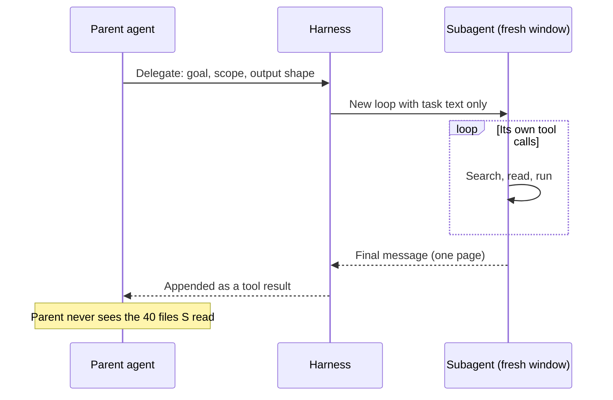
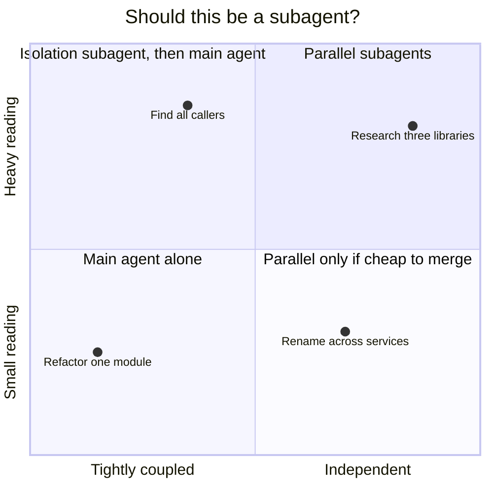

# Subagents & Orchestration

Multi-agent systems are the most over-designed part of the field. It is very satisfying to draw an org chart of agents — a planner, an architect, a coder, a tester, a reviewer — passing work between them. It mirrors how we organize people, it demos well, and it feels like progress. It is much less satisfying to discover that every handoff loses context and, often, that a single well-harnessed agent would have done as well.

Subagents are genuinely useful. Agent org charts mostly are not. The difference is worth understanding, because the same mechanism — a second model loop with its own context window — is behind both.

!!! tip "The one-liner"
    Use a subagent to keep noise out of a context window or to run truly independent work in parallel. Do not use one to imitate a team.

!!! note "Last reviewed"
    October 2026. Subagent features (file formats, nesting limits, built-in agents) are version-specific.

---

## What problem this solves

Two real problems:

1. **Context pollution.** Exploration fills the main agent's window with material it will never need again. A subagent with its own window can do the searching and return only the answer.
2. **Parallelism.** Independent pieces of work can run at the same time instead of in sequence.

A third problem people try to solve with multi-agent systems — "a specialist will do this better" — is usually better solved with a [skill](skills.md) loaded into one agent. Specialism is mostly knowledge, and knowledge can be loaded. What a separate agent adds is a separate *window*, and that is only valuable when separation is what you want.

---

## How a subagent works

Mechanically, a subagent is the [agent loop](how-a-coding-agent-works.md) run a second time. The parent writes a task description, the harness starts a new loop with a fresh context window, a system prompt and a set of tools, and when that loop finishes only its final message comes back to the parent as a tool result.



Two consequences follow directly. The subagent knows nothing you did not put in the task — in Claude Code's words, a new subagent "doesn't see your conversation history". (The exception is a *fork*, which inherits the parent's conversation.) And the parent learns nothing the subagent did not put in its answer. Anthropic describes subagents typically returning "a condensed, distilled summary of its work (often 1,000-2,000 tokens)". That compression is the whole point when you want isolation, and the whole problem when you needed the details.

In Claude Code, a custom subagent is a Markdown file with frontmatter, checked into `.claude/agents/`:

```markdown
---
name: code-reviewer
description: Reviews code for quality and best practices
tools: Read, Glob, Grep
model: sonnet
---

You are a code reviewer. When invoked, analyze the code and provide
specific, actionable feedback on quality, security, and best practices.
```

The `tools` line is the one most teams skip. Omit it, and the subagent inherits every tool the parent has. Claude Code also ships built-in subagents — a read-only *Explore* agent for codebase search, a *Plan* agent used for research in plan mode, and a general-purpose one — and allows nesting up to three levels below the main conversation by default. Other harnesses have converged on the same idea: the source-code study of eleven agent harnesses found multi-agent orchestration in eight of them.

---

## What the evidence says

The evidence is more interesting than either camp's slogans.

**For multi-agent: Anthropic's research system.** In June 2025 Anthropic reported that a multi-agent setup, with a lead agent directing parallel subagents, outperformed a single agent by 90.2% on its internal research evaluation. The same post explains why: on a browsing benchmark, token usage alone explained about 80% of the variance in performance, and multiple agents let a system spend more tokens in parallel. It also states the cost — multi-agent systems used about 15 times the tokens of a chat — and the limit: domains where agents must share context or depend on each other are a poor fit, and "most coding tasks involve fewer truly parallelizable tasks than research".

**Against: Cognition's "Don't build multi-agents".** Walden Yan's essay, also from June 2025, argues from two principles: share full context and agent traces, not just messages; and "actions carry implicit decisions, and conflicting decisions carry bad results". His example is a Flappy Bird clone split between two subagents, one of which builds a background in the style of Super Mario Bros while the other builds a bird that matches neither. Each did its subtask reasonably. The combination is incoherent.

**From production: Azure SRE agent.** As summarized in ZenML's case study of Microsoft's write-up, the team grew to more than 50 specialized subagents, found that "problems requiring more than four handoffs almost always failed", and consolidated to a handful of generalist agents with a few wide tools.

**From harness research.** In the *Natural-Language Agent Harnesses* paper (2026), adding a multi-candidate search module — more branches, about five times the agent calls — *lowered* the score on SWE-bench Verified from 73.0 to 71.4, while adding 2.8 points on the OSWorld computer-use benchmark. A verifier module added almost nothing on SWE-bench Verified (73.0 to 73.2) but 8.4 points on OSWorld. The authors' conclusion is a good line to keep: "More search is not automatically better harness design." Extra agents and checks help on some kinds of task and not others, and you only find out which by measuring.

Read together, these do not contradict each other. Parallel agents help when the work really decomposes and the cost is worth paying. They hurt when pieces share decisions, because each handoff is a lossy summary of context.

!!! info "What we know / what we don't"
    We know subagents reliably help with context isolation, and that parallel agents can help on breadth-first work like research at a large token cost. Evidence that elaborate multi-role teams beat a single well-harnessed agent on coding is thin, and production reports of handoff failures are consistent. Treat agent teams as experiments to measure, not architecture to adopt.

---

## The patterns that hold up

### 1. Subagent for isolation

The main agent delegates a bounded, read-heavy task and receives a condensed result.

- "Find every caller of `charge()` and summarise how each one handles failure."
- "Read the last 30 incident reports and list the ones involving the payment queue."
- "Run the flaky test suite five times and report which tests failed and how often."

This is the highest-value use of subagents, and the one every major agent now supports natively. HumanLayer calls subagents a "context firewall", which is exactly the right image.

### 2. Independent reviewer

A separate agent, with a fresh context and a different prompt, reviews the work of the first. Its value comes from *not* sharing the author's assumptions — which is why it should not see the author's reasoning, only the requirement and the result. Here the information loss Cognition warns about is the feature. See [Verification](../workflow/verification.md).

### 3. Parallel workers on independent tasks

Several agents work on unrelated tasks at once, each in its own worktree or sandbox. This works when the tasks really are independent — separate files, separate services. It breaks down when they touch the same code and you spend the gains resolving merge conflicts, or, worse, when they make compatible-looking but inconsistent decisions that no conflict marker will show you.

### 4. Deterministic orchestration with agentic steps

A script or workflow engine controls the sequence; agents perform individual steps. Stripe's Minions run on a fork of Block's goose customized to interleave agent loops with deterministic code for Git operations, linters and tests, so the required steps always run. This is often more reliable than asking one agent to orchestrate others, because the control flow cannot be talked out of a step.



---

## The patterns that usually disappoint

**Role-play teams with many handoffs.** Every handoff is a lossy compression of context. A planner's summary for the coder drops the reason a constraint exists; the coder's summary for the tester drops the edge case it decided not to handle. The Azure SRE team's four-handoff ceiling is the clearest production data point.

**Reviewer agents bolted on by default.** A reviewer that produces confident but wrong feedback can send the author in circles. A reviewer earns its place on evidence, like everything else: measure whether it catches real problems on your tasks before making it a mandatory step.

**Agents orchestrating agents in free form.** An orchestrator agent deciding at runtime which agent to call, with what context, compounds non-determinism. Prefer explicit workflows.

---

## When to use this

**Use subagents when:**

- **A task requires reading much more than it will use.**
- **Work splits cleanly into independent pieces.**
- **You want a check that does not share the author's context.**

**Avoid them when:**

- **The pieces are tightly coupled** and need constant back-and-forth.
- **A skill in the main agent would do the same job.**
- **You cannot explain what each agent's output is for.**

---

## Roles and ownership

| Role              | Responsibility                                                                     |
| ----------------- | ---------------------------------------------------------------------------------- |
| **Harness owner** | Defines the shared subagents, their tool restrictions and when they are used       |
| **Tech lead**     | Decides which work is independent enough to parallelize                            |
| **Engineers**     | Write good delegations; notice when summaries are losing information that mattered |

---

## Designing a good delegation

A subagent only knows what you give it. A good delegation includes:

1. **The goal** — one sentence.
2. **The scope** — what to look at, and what to ignore.
3. **The output shape** — format and maximum length.
4. **What not to do** — usually "do not modify files".
5. **How to report uncertainty** — "list what you could not determine".

And restrict its tools to what it needs. marmelab's 2026 audit of open-source harnesses found that, in the median repository using subagents, only one in four subagents had a restricted tool list. A read-only researcher should not be able to write.

---

## Worked example: one investigation, three shapes

An illustrative example. An engineer needs to replace a deprecated payment SDK call used across a monorepo.

**Shape 1 — everything in the main session.** The agent searches for the call, finds 37 hits, reads each file to understand the error handling around it, and starts editing. By the twelfth file the window is past 60% and it begins applying the error-handling pattern from the billing service to the refunds service, where it is wrong. The engineer stops it.

**Shape 2 — isolation subagent, then main agent.** The engineer restarts and delegates first: "Find every use of `PaymentClient.charge` outside tests. For each, report file:line, how failures are handled (retry, raise, swallow), and whether it runs in a request or a background job. Do not modify files. Under 80 lines. List anything you could not determine." The Explore-style subagent reads dozens of files; the main session receives a 70-line table. It notices three distinct error-handling patterns, which become three steps in the plan. The window stays under 30%.

**Shape 3 — parallel workers.** Tempted by speed, the engineer splits implementation by service across four parallel agents in separate worktrees. Three merge cleanly. The fourth, working on a shared retry helper that two services import, changes its signature in a way the other agents did not know about. Every branch passes its own tests; the integration fails. The fix is to make the shared helper change first, in one agent, and only then parallelize the per-service changes that depend on it.

**Then an independent check.** Before opening the pull request, a reviewer subagent receives the original requirement and the diff — not the implementer's plan or transcript — and is asked to look for call sites whose failure semantics changed. It flags one background job that used to swallow errors and now raises. That is exactly the class of issue the author, having designed the change, was least likely to see.

The pattern generalizes: isolate the reading, sequence the shared decisions, parallelize only what is truly independent, and keep the reviewer ignorant of the author's reasoning.

---

## What good looks like

| Signal                       | What you observe                                                          |
| ---------------------------- | ------------------------------------------------------------------------- |
| **Main context stays clean** | Long tasks do not degrade as exploration happens                          |
| **Condensed results**        | Subagents return a page, not a transcript                                 |
| **Tool access matches role** | Researchers read; only implementers write                                 |
| **Explicit orchestration**   | The sequence lives in code or a workflow, not in an agent's improvisation |
| **Measured additions**       | New agents are added because an eval showed they help                     |

---

## Failure modes and mitigations

The multi-agent failure usually starts with a diagram. Someone sketches roles that mirror the team — product, architect, engineer, QA — and builds them. Early demos look impressive because each agent's output is plausible in isolation. The problems surface as inconsistencies between outputs, and debugging them means reading several transcripts to find which summary dropped which fact.

| Failure mode                  | What it looks like                                       | Mitigation                                                                |
| ----------------------------- | -------------------------------------------------------- | ------------------------------------------------------------------------- |
| **The agent org chart**       | Seven roles, each passing summaries to the next          | Collapse to one agent with skills; keep subagents for isolation           |
| **Echo-chamber review**       | The reviewer sees the author's reasoning and agrees      | Give reviewers the requirement and the diff, not the chain of thought     |
| **Parallel collisions**       | Agents in parallel edit the same files or shared helpers | Partition work by file or service; do shared changes first; use worktrees |
| **Unbounded delegation**      | "Investigate the codebase" with no output limit          | Specify scope, format and length                                          |
| **Over-privileged subagents** | A research subagent inherits write and network tools     | Set the tool list explicitly                                              |

---

## Copy this: a delegation template

```text
Goal: <one sentence>
Scope: Look at <paths/systems>. Ignore <paths/systems>.
Do not modify any files.
Return, in under <N> lines:
  1. <specific answer>
  2. File paths and line numbers for every claim.
  3. What you could not determine, and why.
```

---

## Further reading

- **[How we built our multi-agent research system](https://www.anthropic.com/engineering/multi-agent-research-system)** by Anthropic — The strongest case for multi-agent work, with its costs and limits stated honestly. (Vendor engineering post.)
- **[Don't build multi-agents](https://cognition.com/blog/dont-build-multi-agents)** by Walden Yan (Cognition) — The two principles every delegation design should be checked against. (Vendor post.)
- **[Context engineering for production SRE agents](https://www.zenml.io/llmops-database/context-engineering-for-production-sre-agents)** by ZenML — A case-study summary of Microsoft's Azure SRE agent and its handoff ceiling. (Secondary source.)
- **[Natural-Language Agent Harnesses](https://arxiv.org/abs/2603.25723)** by Linyue Pan et al. — Module ablations, including a search module that cost more and scored lower. (Preprint.)
- **[Create custom subagents](https://code.claude.com/docs/en/sub-agents)** by Anthropic — The subagent file format, built-in agents and nesting rules in Claude Code. (Vendor docs.)
- **[Skill issue: harness engineering for coding agents](https://www.humanlayer.dev/blog/skill-issue-harness-engineering-for-coding-agents)** by HumanLayer — Subagents as a context firewall in brownfield work.
- **[The state of AI harness engineering 2026](https://marmelab.com/blog/2026/09/24/the-state-of-ai-harness-engineering-2026.html)** by marmelab — How subagents are actually configured in open-source harnesses.

---

## Related pages

- [Context Engineering](context-engineering.md) — Why isolation matters in the first place.
- [Building with Agents](../workflow/building-with-agents.md) — Delegation in day-to-day work.
- [Verification](../workflow/verification.md) — Independent review as part of the definition of done.
