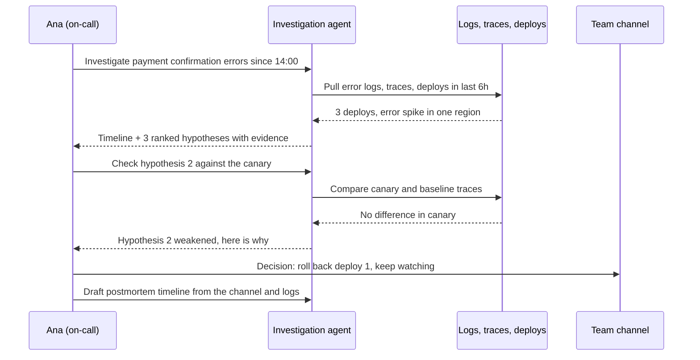

# Beyond Code

!!! note "Last reviewed"
    October 2026. The practices here are moving quickly; the numbers are dated so you can judge their age.

Most of the conversation about AI in engineering is about writing code. DX's research, presented in June 2026, puts the share of developer time spent writing code at about 14%. Even if agents made that part free, the other 86% would still be there: the planning session that starts with nobody quite sure what the data says, the incident where the first forty minutes go on finding the right dashboard, the launch that nobody returns to because the next sprint has already started.

The pioneers I find most interesting are not the ones generating the most code. They are the ones pointing agents at everything around it.

!!! tip "The one-liner"
    Let agents gather and assemble; keep people in the conversations the gathering was for.

---

## What problem this solves

Engineering teams spend enormous amounts of time collecting and assembling information. Pulling metrics before a planning session. Reading forty support tickets to understand one problem. Reconstructing what happened during an incident from logs, deploys and a Slack channel moving faster than anyone can read. Checking, weeks later, whether a launch did what it was supposed to.

That work has three properties that make it a good fit for agents: it is voluminous, it is repetitive, and it depends on stitching together context from many places. It also competes directly with the judgment it feeds. The engineer who spent the morning assembling the evidence for a decision has less energy left for the decision itself.

There is a second, less obvious problem. A lot of this work simply does not happen. The post-release review gets skipped. The question "how does this actually work across our three services?" gets answered from memory instead of from the code. I wrote about this as [the engineering work that leaves no commit](https://dreamingecho.es/blog/engineering-value-beyond-code): the conversation that improves the next ten pull requests, the pattern someone names so three people stop repeating a mistake. When code becomes less scarce, that is where the bottleneck goes. Agents can do much of the legwork for it, as long as nobody mistakes the legwork for the work.

---

## When to use this

**Use it when:**

- The task is mostly gathering and assembling: many sources, a known shape of output, a person who will read the result.
- The output is an input to a human decision or conversation, not the decision itself.
- You can check the agent's work cheaply: queries you can rerun, sources you can open, a timeline you can compare with the logs.
- The work currently does not happen at all because nobody has time for it.

**Skip it when:**

- The value is in the contact itself. A summary of user interviews is not a substitute for having been in the room.
- The agent would need data it should not see. Discovery agents often want customer data; apply your [data policy](../security/data-and-policy.md) before your enthusiasm.
- The output leaves the building. External communication stays a draft until a person reads it and decides to send it.

---

## Where agents are proving useful

### Product discovery and framing

Before anyone writes a ticket, there is a question worth asking: what do we already know about this problem? An agent can gather usage data, support tickets, sales notes and previous decisions about a problem area, then draft a problem statement with its unknowns made explicit. It can prepare an interview guide, and afterwards it can synthesise notes across interviews into themes, with quotes linked back to the source.

What it cannot do is have the conversations. The agent prepares; the engineer and the product partner talk to people. The best use of this is not a faster discovery phase but a better first conversation: everyone arrives having read the same evidence, so the meeting starts at the disagreement instead of at the recap. See [Intent Before Code](../workflow/intent-before-code.md).

### Research and analysis

"How does X actually work across our systems?" is one of the most expensive questions in a mature codebase, because the honest answer lives in code, configuration and documentation spread across repositories, and is rarely what the module names suggest. Agents are good at tracing it, and the output is checkable: every claim should come with a file and a line.

The same goes for metrics. An agent can write and run the queries, draft a first analysis and explain what it did. The trap is that a metric analysis can be fluent, well formatted and wrong. A join that silently drops a segment, a time window that includes a holiday, a definition of "active" that differs from the one the team uses: none of these shows up in the conclusion. Review the queries, not the prose.

### Incident response

Incidents are where the case for agents beyond code is strongest, and where the evidence is most concrete.

Meta described an AI-assisted root cause system in 2024 that combines heuristic retrieval (narrowing thousands of candidate code changes to a few hundred using ownership and the runtime code graph) with an LLM-based ranker. In backtesting on historical investigations in its web monorepo, the root cause was among the top five suggested changes 42% of the time. Just as interesting is how Meta framed the risk: such a system can "suggest wrong root causes and mislead engineers", so it prioritises explainability, lets responders reproduce the results, and withholds low-confidence answers, "sacrificing reach in favor of precision".

Microsoft's Azure SRE Agent team, writing in December 2025, reported a lesson that applies far beyond incidents. They began with more than 100 tools and more than 50 specialised agents, each owning one Azure service and handing investigations to each other. Problems needing more than four handoffs "almost always failed". They ended with five core tools and a handful of generalist agents, with domain knowledge moved into files the agents read on demand, and reported the agent became more reliable. They also found that dumping metrics into the context window and asking the model to find anomalies was "backwards"; giving it a code interpreter to analyse the data worked better.

Stripe points the same way from the other side of the on-call rotation. Its Minions post describes engineers spinning up several unattended agents in parallel, which "can be particularly helpful during an on-call rotation to effectively resolve many small issues that might arise".

The pattern across all three: agents assemble the timeline, rank hypotheses and handle the small fixes. People decide what is going on and what to do about it.

### Post-release learning

The step most teams skip is returning to a feature after it ships. An agent can make that return cheap: at seven and thirty days, pull the signals named in the original hypothesis, compare expected and observed behaviour, and prepare the keep, iterate or reconsider decision for a person to make. Nothing about this is technically hard. It fails because nobody owns it, and an agent that schedules itself is a surprisingly effective owner of the legwork. See [Rollout & Learning](../workflow/rollout-and-learning.md).

### Communication and documentation

Release notes, changelogs, stakeholder updates and documentation drafted from the actual changes are now routine. More interesting is keeping documentation true over time. OpenAI's account of building a product with agents describes "a recurring 'doc-gardening' agent" that scans for documentation that no longer reflects the code and opens fix-up pull requests. It is the same idea as a linter, pointed at prose.

### Work that would not otherwise happen

Anthropic's study of its own engineers, published in December 2025, asked whether AI was enabling new work or just speeding up old work. Employees estimated that 27% of their Claude-assisted work would not have been done without it: scaling projects, nice-to-have tools such as interactive dashboards, tedious but useful documentation and testing, exploratory work that would not have been cost-effective by hand. That figure is self-reported, by employees of the company that makes the tool, and should be read that way. It still matches what many teams notice: some of the most valuable output is the small improvement nobody would ever have prioritised.

---

## A worked example: an incident investigation with an agent

Consider a hypothetical team running a checkout service. At 14:05 on a Tuesday, the error rate on payment confirmation climbs from 0.2% to 4%. The on-call engineer, Ana, is paged. The team has an investigation agent with read-only access to logs, traces, the deploy history and past postmortems, and with no permission to change anything in production.

**Minute 2.** The agent returns a first timeline: three deploys in the previous six hours, errors concentrated in one region, and a spike in timeouts from a payment provider's client library. It proposes three hypotheses, each with the evidence for and against: a configuration change in the first deploy, a client library upgrade in the second, and a regional problem at the provider.

**Minute 6.** The first thing goes wrong. The agent ranks the library upgrade highest, because the timeouts point that way. Ana asks it to compare the canary that received the upgrade with the baseline. No difference. The agent says so plainly and moves the hypothesis down. This is the moment that matters: a system tuned to sound confident would have defended its first answer. A good investigation agent treats every hypothesis as something to try to falsify, and shows its working.

**Minute 11.** The configuration change in the first deploy turns out to have shortened a timeout for one region. Ana decides to roll it back. The agent did not make that decision and could not have executed it; the team's [human gates](../harness/human-gates.md) keep production changes with people.

**The next morning.** The agent drafts the postmortem timeline from the channel, the logs and the deploy history. Ana corrects two entries where the agent inferred intent from timing ("the engineer rolled back because…") rather than from what anyone said. The final document is hers. The draft saved her an hour of reconstruction, and the corrections are a reminder of why a person signs it. The [agent incident postmortem template](../templates/agent-incident-postmortem.md) has a section for exactly this kind of error.

What made this work was not the model. It was read-only access to the right sources, an agent instructed to present evidence against its own hypotheses, and a clear line between assembling the picture and acting on it.

---

## Roles and ownership

| Role                    | Responsibility                                                                        |
| ----------------------- | ------------------------------------------------------------------------------------- |
| **Engineer or on-call** | Asks the question, checks the evidence, makes the decision, signs the output          |
| **Product partner**     | Owns contact with users; decides which synthesised findings are worth acting on       |
| **Tech lead**           | Decides which sources agents may read, and which outputs may leave the team as drafts |
| **Platform or SRE**     | Owns read-only access, audit logging and the tools the investigation agent uses       |
| **Engineering manager** | Protects the time freed up so it goes to conversations, not more throughput           |

The last row is the one most often missing. If the hours saved on gathering are immediately absorbed by more tickets, nobody ever spends more time with users, and the leverage evaporates.

---

## What good looks like

| Signal                                    | What you observe                                                          |
| ----------------------------------------- | ------------------------------------------------------------------------- |
| **Engineers arrive prepared**             | Planning and incident conversations start with evidence already assembled |
| **More time in conversations**            | Time saved on gathering is spent with users and stakeholders              |
| **Verified analysis**                     | Queries and sources are checked, not just conclusions read                |
| **Hypotheses come with counter-evidence** | Agent output shows what would make each explanation wrong                 |
| **Late steps happen**                     | Post-release reviews actually take place, on schedule                     |
| **Drafts stay drafts**                    | Nothing external is sent without a person reading it                      |

---

## Failure modes and mitigations

The failures beyond code are quieter than the ones in code, because there is no test suite to go red. They tend to unfold the same way. An agent produces a metric analysis for a planning session. It is clear, well formatted and confidently argued, and it becomes the basis for a quarter's priorities. Two months later someone notices that the query excluded a customer segment. Nobody did anything careless: the analysis simply looked finished, and finished-looking work does not get questioned.

The second failure is more corrosive and slower. A team starts summarising user interviews with an agent, then starts summarising support tickets instead of reading them, then stops doing interviews because the summaries seem sufficient. Each step was reasonable. Together they remove the team's contact with the people it builds for, which is the one input no agent can replace.

| Failure mode                     | What it looks like                                         | Mitigation                                                                                |
| -------------------------------- | ---------------------------------------------------------- | ----------------------------------------------------------------------------------------- |
| **Analysis that looks finished** | A fluent, plausible conclusion built on a wrong query      | Review queries and sources; rerun the numbers that matter                                 |
| **Synthesis without contact**    | Summaries replace conversations with users                 | Keep a minimum of direct contact; treat summaries as preparation                          |
| **Confident first hypothesis**   | The agent defends its first explanation during an incident | Instruct it to seek counter-evidence and show it                                          |
| **Drafts that escape**           | An agent-written update reaches a customer unread          | External output is always a draft; a person sends it                                      |
| **Data sprawl**                  | Discovery agents quietly gain access to customer data      | Apply the [data policy](../security/data-and-policy.md); prefer read-only, audited access |
| **Saved time absorbed**          | Hours saved become more tickets, not better conversations  | Make the use of freed time an explicit team decision                                      |

!!! info "What we know / what we don't"
    **What we know:** engineers spend a small fraction of their time writing code; agents are useful for assembling evidence in incidents and analysis; production teams (Meta, Azure SRE Agent, Stripe) report value with careful limits on autonomy.

    **What we don't:** whether teams actually reinvest saved time in judgment-heavy work, or simply produce more. Most evidence beyond code is from the companies that built the systems, and very little measures the quality of the decisions that follow.

---

## Further reading

- **[The current impact of AI on engineering velocity](https://newsletter.getdx.com/p/the-current-impact-of-ai-on-engineering)** by DX — Source of the ~14% time-writing-code figure and the "false velocity" warning. (Vendor research.)
- **[How AI is transforming work at Anthropic](https://www.anthropic.com/research/how-ai-is-transforming-work-at-anthropic)** by Anthropic — Survey, interviews and transcript analysis of Anthropic's own engineers, including the 27% of work that would not have been done. (Self-reported, by the tool's maker.)
- **[Leveraging AI for efficient incident response](https://engineering.fb.com/2024/06/24/data-infrastructure/leveraging-ai-for-efficient-incident-response/)** by Meta Engineering — Retrieval plus LLM ranking for root cause, and a careful stance on precision over reach.
- **[Context engineering lessons from building Azure SRE Agent](https://techcommunity.microsoft.com/blog/appsonazureblog/context-engineering-lessons-from-building-azure-sre-agent/4481200/)** by Microsoft — Why 50+ specialist agents collapsed into a few generalists.
- **[Minions: Stripe's one-shot, end-to-end coding agents](https://stripe.dev/blog/minions-stripes-one-shot-end-to-end-coding-agents)** by Stripe — Unattended agents started from Slack and internal tools, including during on-call.
- **[The state of AI harness engineering 2026](https://marmelab.com/blog/2026/09/24/the-state-of-ai-harness-engineering-2026.html)** by marmelab — Includes OpenAI's doc-gardening agent among many harness practices.
- **[The engineering work that leaves no commit](https://dreamingecho.es/blog/engineering-value-beyond-code)** by Iván González Sáiz — Why the work around code is where the bottleneck moves.

## Related pages

- [Human Gates](../harness/human-gates.md) — Where the system stops and a person decides.
- [Roles & the Shape of Work](../team/roles-and-the-shape-of-work.md) — How roles change when code is less scarce.
- [Rollout & Learning](../workflow/rollout-and-learning.md) — Making post-release review actually happen.
- [Data & Policy](../security/data-and-policy.md) — What agents may read, and where it may go.
