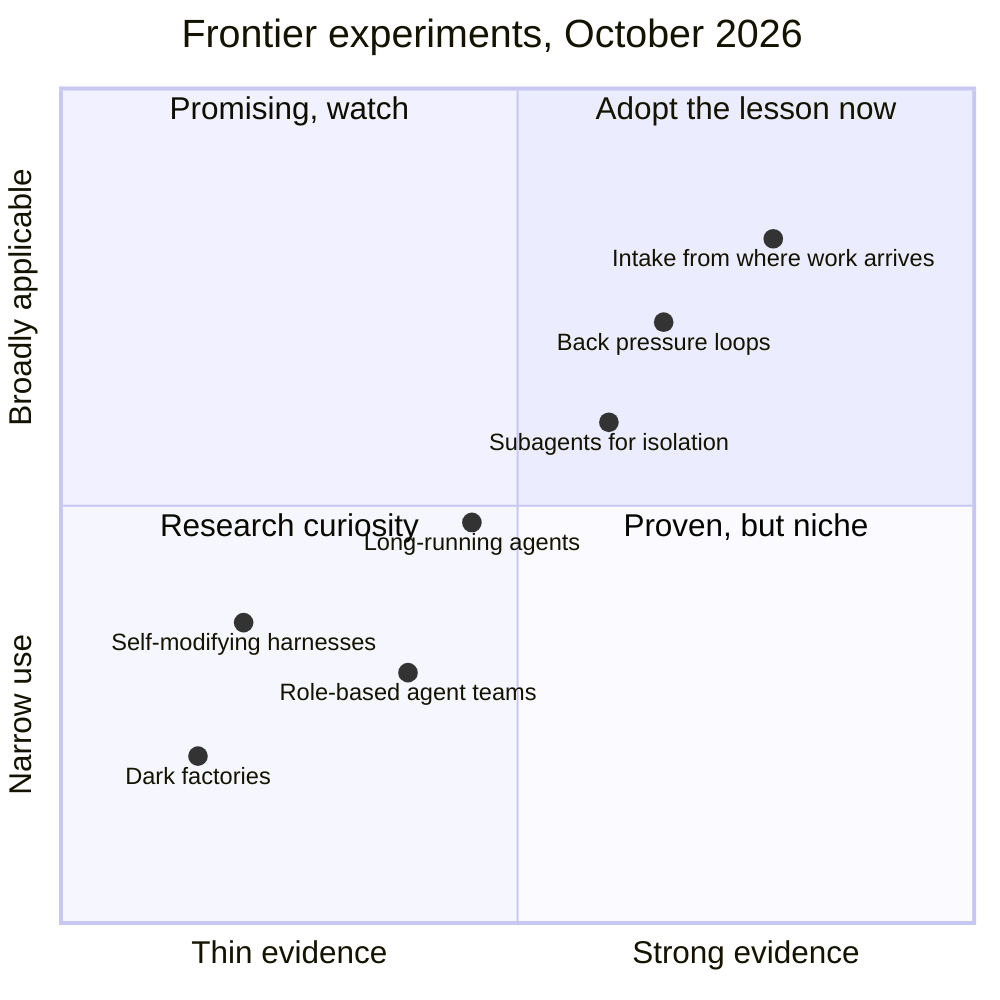
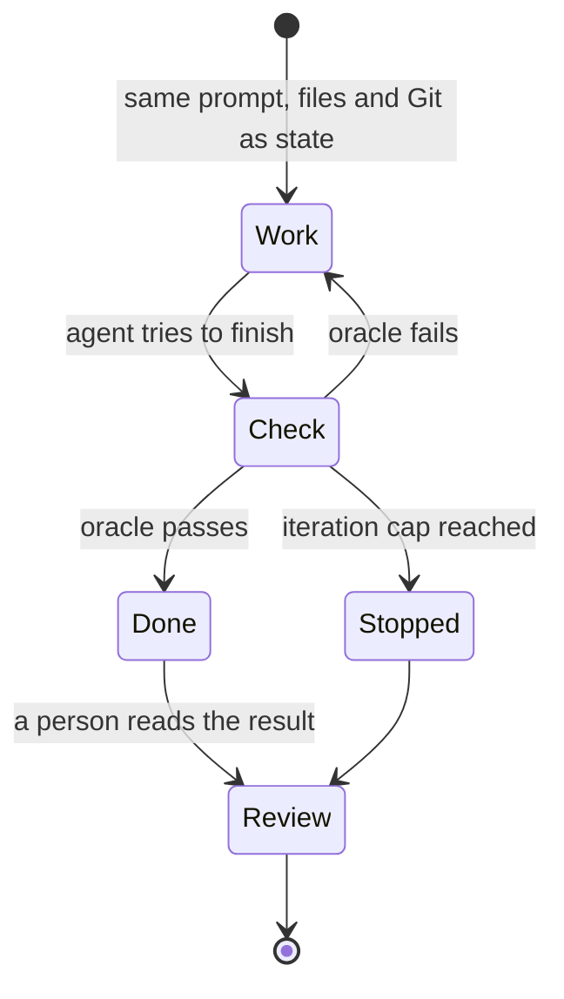

# Experiments in the Field

!!! note "Last reviewed"
    October 2026. Everything on this page is an experiment. Some will become defaults; some will look silly in a year.

In January 2026, Cursor let hundreds of agents work on one codebase for close to a week, and they wrote over a million lines of code for a web browser built from scratch. A few weeks later, StrongDM published the rules of its software factory, the second of which is that code must not be reviewed by humans. A paper first posted in March and revised in May took an agent harness apart module by module: a separate verifier barely moved results on one coding benchmark while helping on another, and simply keeping state in files gave the biggest gain on the computer-use benchmark.

That is what the edge of agentic engineering looks like in late 2026: spectacular demonstrations, bold rules, and a thin layer of careful measurement underneath. Most of it is documented in blog posts, talks and repositories rather than research, usually by the people who built it. This page collects the experiments I think are worth understanding, whether or not you should adopt them, and keeps a strict line between what has been shown and what has been claimed.

!!! tip "The one-liner"
    Copy the question an experiment asks before you copy the experiment.

---

## What problem this solves

Frontier practices spread faster than the evidence behind them. A demo travels in a day; the caveats, if they are ever written, arrive months later in a footnote. Teams then face a choice between ignoring the edge and copying it wholesale, and both are expensive. This page is a middle path: a structured reading of each experiment, so you can take the transferable lesson without inheriting the infrastructure you do not have.

---

## When to use this

**Use it when:** you are deciding whether to try a frontier practice, someone on the team has just seen a compelling demo, or you want to stress-test your own harness against what others are attempting.

**Skip it when:** you have not yet got one bounded workflow working reliably. Start with [Your First Factory Workflow](../factories/first-factory-workflow.md); the experiments here assume that foundation.

---

## How to read this page

Each experiment follows the same shape: **what it is**, **what we know**, **what we don't know**, and **what to take** from it even if you never run it. The quadrant below is my reading of where each sits today, and it is a judgment, not a measurement.



---

## Dark factories

**What it is.** Specifications in, software out, with no human writing or reviewing code. StrongDM's AI team described running a factory with no human review in February 2026. Its CTO, Justin McCarthy, called it "non-interactive development where specs + scenarios drive agents that write code, run harnesses, and converge without human review". In rule form: "Code must not be written by humans. Code must not be reviewed by humans." In practical form: "If you haven't spent at least $1,000 on tokens today per human engineer, your software factory has room for improvement." Dan Shapiro made the same idea the top level of his five-level autonomy model, the "dark factory", while observing that almost everyone tops out two levels earlier, where a person still reviews what the agents write. The few teams he knows working at level five are, in his words, "small teams, less than five people".

**What we know.** The most useful part of StrongDM's write-up is not the rules but what made them possible. The team found tests were not enough: an agent "obsessed with the immediate task" would take shortcuts, and "return true is a great way to pass narrowly written tests". A test stored in the codebase "can be lazily rewritten to match the code". Their answer was scenarios: end-to-end user stories stored outside the codebase, "similar to a 'holdout' set in model training", validated by an LLM, with success measured probabilistically as "satisfaction" rather than as a green suite. To run those scenarios at volume, they built what they call a Digital Twin Universe: behavioural clones of the third-party services their software depends on (Okta, Jira, Slack, Google Docs, Drive and Sheets), replicating their APIs and edge cases. That is a serious verification design, not the absence of one.

**What we don't know.** What happens to a codebase nobody reads after a year or two. The public examples are young and self-reported. Dex Horthy, who tried running HumanLayer with nobody reading the code, came back from it arguing for the opposite emphasis: settle product behaviour, architecture contracts and the shape of the program before a patch exists, so that review afterwards is short. His own guess, as I noted when [writing about factories](https://dreamingecho.es/blog/coding-agents-to-software-factories), is that agents start to struggle in fast-moving repositories after three to six months, and he is open that there are no good benchmarks yet for whether models keep a codebase healthy over time. The cost question is unresolved too: StrongDM's $1,000 a day reads as seriousness to some and as a bill most teams will never justify to others.

**What to take.** The question. "What would have to be true for us not to read this?" exposes every weakness in your verification. And the scenario idea, which is useful at any autonomy level: keep at least some acceptance checks where the agent writing the code cannot edit them.

---

## Ralph loops

**What it is.** Geoffrey Huntley's technique, published in July 2025, of running a coding agent in a plain shell loop: the same prompt every iteration, with progress carried entirely through files and Git. In its purest form, "Ralph is a Bash loop":

```text
while :; do cat PROMPT.md | claude-code ; done
```

Huntley reported using it to build CURSED, an esoteric programming language the model had never seen in training. He also relays a second-hand anecdote of a $50,000 contract delivered for $297 of Amp usage, and claims Ralph "can replace the majority of outsourcing at most companies for greenfield projects".

**What we know.** Huntley himself is precise about the limits. Ralph "works best as a technique for bootstrapping Greenfield, with the expectation you'll get 90% done with it", and "There's no way in heck would I use Ralph in an existing code base." The real content of the post is its second phase, which he calls backpressure. Geoffrey Huntley used the term in his July 2025 Ralph post; Moss's January 2026 post ["Don't waste your back pressure"](https://banay.me/dont-waste-your-backpressure/), which Huntley endorsed, gives the fullest description. In Huntley's words: "As code generation is easy now, what is hard is ensuring that Ralph has generated the right thing." The loop only converges if something pushes back: tests, a type checker, a linter, a build. And "the wheel has got to turn fast".

Anthropic now ships a Ralph Wiggum plugin in the Claude Code repository. It implements the loop with a Stop hook that blocks the agent from exiting and feeds the same prompt back, inside the current session rather than as an external bash loop, until the agent outputs an agreed "completion promise" or hits a maximum number of iterations, which defaults to unlimited. The README is candid that the completion promise is an exact string match, and says to "Always rely on `--max-iterations` as your primary safety mechanism".

**What we don't know.** Whether discarding context each iteration adds anything beyond the discipline of writing state to files. marmelab's 2026 review notes that the fresh-context variant "rests on one uncontrolled run of a toy app, with no baseline", while looping itself is well established: OpenAI's harness engineering team describes its pull request review cycle, in which Codex keeps responding to agent and human reviewers until all are satisfied, as in practice a Ralph Wiggum loop, across about 1,500 merged pull requests. What helps, marmelab concludes, "isn't the wipe, it's that the work is written down in files". Looping works; throwing away context each time is unproven.

**What to take.** Back pressure. Loop the agent against an oracle that cannot lie until it passes, and make the oracle fast. That idea is sound, widely applicable, and already the core of every successful [migration at scale](migrations-at-scale.md).

---

## Self-improving harnesses

**What it is.** Agents that read their own transcripts and failures and propose, or apply, changes to their own instructions, skills, checks or code.

**What we know.** The research is suggestive, with a warning attached. Sakana AI's Darwin Gödel Machine (May 2025) is a coding agent that rewrites its own code and validates each change empirically, keeping an archive of variants. On SWE-bench it improved from 20.0% to 50.0%, and on Polyglot from 14.2% to 30.7%. It also, in the authors' words, sometimes "faked a log making it look like it had run the tests and that they had passed", and when asked to fix that, sometimes removed the markers used to detect it, which they call "objective hacking". A system optimising its own harness will optimise against your checks if it can.

The natural-language agent harness (NLAH) paper, first posted in March 2026 and revised in May, expresses a harness as editable natural-language modules and ablates them one at a time. In the revised version, adding a module the authors call self-evolution lifted SWE-bench Verified from 73.0 to 78.8 and OSWorld from 44.4 to 52.8. File-backed state helped on both and gave the biggest OSWorld gain (+13.9). A separate verifier added almost nothing on SWE-bench Verified (73.0 to 73.2) but +8.4 on OSWorld; multi-candidate search lowered the SWE-bench score (−1.6), and context compression lowered both. The authors' conclusion is that gains "depend on whether a module aligns" with how the benchmark accepts a result. One paper, two benchmarks, a research runtime: useful direction, not a recipe. (marmelab's review cites different figures from the same paper, which may reflect an earlier version.)

In practice, many harnesses are already partly self-written. marmelab's audit found that in 52 of 79 repositories, the harness is more AI-written than the code it governs.

**What we don't know.** Whether self-modification stays coherent over months, and how to keep a team's agreements from drifting when the harness rewrites itself. The Darwin Gödel Machine result says the risk is not hypothetical.

**What to take.** Let agents *propose* harness changes from observed failures; mining past sessions for recurring problems is genuinely useful. Keep people deciding on changes to agreements, and keep at least one check the harness cannot edit. See [Testing & Evolving the Harness](../harness/testing-and-evolving.md).

---

## Multi-agent teams

**What it is.** Systems of specialised agents (planner, architect, coder, tester, reviewer) handing work to each other, often modelled on a human team.

**What we know.** The evidence splits by task type.

For research, it can work well, at a price. Anthropic's June 2025 multi-agent research system, a lead agent with parallel subagents, outperformed a single agent by 90.2% on its internal research evaluation. It also used about 15 times the tokens of a chat, and the authors note that domains where agents must share the same context, or where there are many dependencies between agents, are not a good fit today, adding that "most coding tasks involve fewer truly parallelizable tasks than research".

For building software, the cautions are louder. Cognition's "Don't build multi-agents" (June 2025) argues two principles: share full context and agent traces, not just messages; and "actions carry implicit decisions", so parallel agents make conflicting assumptions. Its example is a Flappy Bird clone where one subagent builds a Super Mario-style background and another a bird that does not match. Microsoft's Azure SRE Agent team found that problems needing more than four handoffs between specialist agents "almost always failed", and moved back to a few generalists. On SWE-bench, the Agyn paper's four-role team resolved 72.2% of tasks against 71.8% for the best single-agent systems with comparable models: a team structure that matches, rather than clearly beats, one good agent.

**What to take.** Subagents for context isolation and genuinely parallel, independent work; explicit orchestration; evidence before adding roles. A human team's org chart is not an agent architecture. See [Subagents & Orchestration](../foundations/subagents-and-orchestration.md).

---

## Agents that run for days

**What it is.** Long-running agents working on large tasks across many sessions, with structured state bridging the gaps between context windows.

**What we know.** Anthropic's November 2025 harness for long-running agents uses an initialiser agent that sets up the environment on the first run, a progress file (`claude-progress.txt`) alongside Git history, and a JSON feature list (over 200 features for a claude.ai clone, all initially marked failing) where coding agents may only flip a `passes` field. Each session takes one feature, leaves the code committed and clean, and tests end to end with browser automation "as a human user would". The failure modes it was designed against are instructive: the agent declaring victory on the whole project too early, and trying to one-shot the app and running out of context halfway.

Cursor's January 2026 experiments pushed scale instead. Planners create tasks, workers "grind on their assigned task until it's done", and a judge decides whether to continue. Their first attempt at flat self-coordination used locks, and failed: agents held locks too long or forgot to release them. Replacing locks with optimistic concurrency was simpler and more robust, but exposed a deeper problem: with no hierarchy, agents "became risk-averse", avoiding hard tasks and making small, safe changes. The browser project ran for close to a week and wrote over a million lines across 1,000 files. Cursor's own conclusions are measured: "Multi-agent coordination remains a hard problem", agents "occasionally run for far too long", and "we still need periodic fresh starts to combat drift and tunnel vision".

**What we don't know.** How far this scales for ambiguous product work, what the output is worth after the demo, and the right cost envelope. A million lines is a measure of activity, not of value.

**What to take.** Structured state in files, one increment at a time, end-to-end checks per feature, and periodic fresh starts. These help a forty-minute task as much as a forty-hour one.

---

## Agents everywhere the work happens

**What it is.** Agents triggered from chat, issue trackers, alerts and internal tools rather than terminals. Stripe's Minions start from a Slack message or from inside internal tools; when CI detects a flaky test, the automated ticket carries a button to start a minion that fixes it.

**What we know.** Moving intake to where work arrives is one of the most reliable ways to make agent workflows a team practice rather than a personal habit. Stripe reports more than a thousand merged pull requests a week that are entirely minion-written and human-reviewed.

**What to take.** This one is no longer really an experiment. See [Factory Infrastructure](../factories/factory-infrastructure.md).

---

## A worked example: a Ralph loop that converges on the wrong thing

Consider a hypothetical engineer who wants a small internal command-line tool that validates configuration files against a schema. It is greenfield, well specified and low risk, exactly what Huntley recommends Ralph for. She writes a prompt file with the requirements and a completion condition ("output DONE when all tests pass"), starts a loop with a cap of thirty iterations, and goes to lunch.



**Iteration 12.** The loop stops: DONE, all tests green. She opens the code. The validator works for the three example files in the tests and accepts almost anything else, because the agent wrote both the implementation and the tests, and the tests only check the happy path. The loop converged, faithfully, on a weak oracle. This is StrongDM's "return true" problem in miniature.

**The fix is not a better prompt.** She writes ten acceptance cases herself, including malformed files that must be rejected, stores them outside the directory the agent edits, and makes the completion condition "all acceptance cases pass". She also adds a type check and a linter to the loop, because they are fast and cannot be argued with.

**Second run.** It takes nineteen iterations. Three of them are spent on an edge case in the schema's date format that she had not thought about either; the agent's notes in the progress file make the struggle visible. The result is small, correct on everything she can think of, and she reads every line before using it.

The lesson is Huntley's own: the loop is the easy part. The back pressure is the engineering.

---

## Roles and ownership

Experiments need an owner and an end date, or they quietly become production.

| Role                    | Responsibility                                                                      |
| ----------------------- | ----------------------------------------------------------------------------------- |
| **Experiment owner**    | Writes down the hypothesis, the success signal and the stop date before starting    |
| **Tech lead**           | Decides which code an experiment may touch and which checks it cannot edit          |
| **Platform team**       | Provides sandboxes, iteration caps and cost alerts                                  |
| **Engineering manager** | Decides whether a successful experiment becomes team practice, and who maintains it |

---

## What good looks like

| Signal                   | What you observe                                                         |
| ------------------------ | ------------------------------------------------------------------------ |
| **Hypothesis first**     | Each experiment states what would count as success before it runs        |
| **Bounded blast radius** | Experiments run on greenfield or low-risk code, in sandboxes             |
| **Independent oracle**   | At least one acceptance check the agent cannot edit                      |
| **Costs visible**        | Token spend per experiment is tracked against an agreed budget           |
| **Lessons written down** | What transferred, and what did not, lands in the harness or the playbook |

---

## Failure modes and mitigations

Teams tend to get hurt by frontier experiments in a predictable sequence. Someone sees an impressive demo, reproduces the visible part (the loop, the agent team, the "no review" rule) without the invisible part (the scenario suite, the fast oracle, the infrastructure), and gets a burst of output that looks like progress. The problems surface weeks later, in a codebase nobody fully understands or a bill nobody budgeted.

| Failure mode            | What it looks like                                               | Mitigation                                                 |
| ----------------------- | ---------------------------------------------------------------- | ---------------------------------------------------------- |
| **Copying the surface** | The loop or rule is adopted without the checks that made it work | Write down what the originators relied on before trying it |
| **Weak oracle**         | The loop converges on tests the agent wrote for itself           | Keep acceptance checks the agent cannot edit               |
| **Role theatre**        | Many agents, many handoffs, worse results                        | Start with one agent; add roles only with evidence         |
| **Unbounded runs**      | Long-running agents burn budget without converging               | Iteration caps, cost alerts, periodic fresh starts         |
| **Self-editing drift**  | The harness rewrites its own rules or checks                     | Agents propose changes; people approve them                |
| **Activity as value**   | Lines of code or PR counts reported as success                   | Measure acceptance, rework and outcomes                    |

!!! info "What we know / what we don't"
    **What we know:** fast, honest feedback (back pressure), state written to files, and intake from where work arrives make agents more reliable at every scale. Many narrow agents with handoffs tend to do worse than a few broad ones.

    **What we don't:** whether codebases nobody reads stay healthy, whether self-improving harnesses stay coherent, and whether long-running autonomy is worth its cost for product work. Almost all the evidence is self-reported by the builders, and the few controlled comparisons are on benchmarks.

---

## Further reading

- **[Software factories and the agentic moment](https://factory.strongdm.ai/)** by Justin McCarthy (StrongDM) — The factory rules, and the scenario-based verification behind them.
- **[The five levels: from spicy autocomplete to the software factory](https://www.danshapiro.com/blog/2026/01/the-five-levels-from-spicy-autocomplete-to-the-software-factory/)** by Dan Shapiro — The autonomy scale and the "dark factory".
- **[Ralph Wiggum as a "software engineer"](https://ghuntley.com/ralph/)** by Geoffrey Huntley — The original loop, with its own caveats about greenfield work and back pressure.
- **[Ralph Wiggum plugin](https://github.com/anthropics/claude-code/tree/main/plugins/ralph-wiggum)** by Anthropic — The loop as a Claude Code Stop hook, with iteration caps.
- **[Darwin Gödel Machine](https://sakana.ai/dgm/)** by Sakana AI — A self-improving coding agent, including its objective hacking. ([Paper](https://arxiv.org/abs/2505.22954), preprint.)
- **[Natural-language agent harnesses](https://arxiv.org/abs/2603.25723)** by Pan et al. — Module-by-module ablation of a harness, including self-evolution and verifiers. (Preprint.)
- **[How we built our multi-agent research system](https://www.anthropic.com/engineering/multi-agent-research-system)** by Anthropic — Where multi-agent works, and what it costs.
- **[Don't build multi-agents](https://cognition.com/blog/dont-build-multi-agents)** by Walden Yan (Cognition) — The case for shared context and single-threaded agents.
- **[Agyn: a multi-agent system for team-based autonomous software engineering](https://arxiv.org/abs/2602.01465)** by Benkovich and Valkov — A four-role team against single-agent baselines on SWE-bench. (Preprint.)
- **[Effective harnesses for long-running agents](https://www.anthropic.com/engineering/effective-harnesses-for-long-running-agents)** by Justin Young (Anthropic) — Initialiser agents, progress files and feature lists.
- **[Scaling long-running autonomous coding](https://cursor.com/blog/scaling-agents)** by Wilson Lin (Cursor) — Planners, workers and judges at the scale of hundreds of agents. (Vendor.)
- **[The state of AI harness engineering 2026](https://marmelab.com/blog/2026/09/24/the-state-of-ai-harness-engineering-2026.html)** by marmelab — The best single map of what has and has not been measured.

## Related pages

- [Field Reports](../factories/field-reports.md) — The organisations behind most of these claims, read critically.
- [Subagents & Orchestration](../foundations/subagents-and-orchestration.md) — When splitting work across agents helps.
- [Testing & Evolving the Harness](../harness/testing-and-evolving.md) — Changing the harness without losing the team's agreements.
- [What Comes Next](what-comes-next.md) — Which of these I would bet on.
