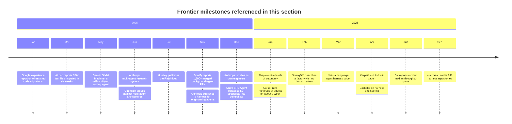

# Frontier

!!! note "Last reviewed"
    October 2026. This is the most perishable section of the playbook. Dates and numbers are given so you can tell how old each claim is.

In July 2025, Geoffrey Huntley published a blog post whose central technique was a single line of shell: a loop that fed the same prompt file to a coding agent, forever. Within months the same idea shipped as a plugin in Anthropic's own Claude Code repository. Since then, Cursor has run hundreds of agents on one codebase for close to a week, and StrongDM has written down, as a rule, that code must not be reviewed by humans.

Some of that will become ordinary. Some of it will look naive. The interesting part is that, standing in late 2026, it is genuinely hard to tell which is which.

The rest of this playbook is about what works today for most teams. This section is about the edges: what is being tried, by whom, with what evidence, and what I would take from it even if I would not copy it.

---

## Why a playbook needs a frontier section

I include it for two reasons.

**Yesterday's experiment is often next year's default.** Triggering agents from the place work arrives (a Slack thread, a flaky-test ticket, an alert) was an experiment eighteen months ago. Today it is how Stripe's Minions start, and it is one of the most reliable ways to turn agent use from a personal habit into a team practice. Builders who only read about what is proven end up a year behind what is useful.

**The extremes are the best audit of your own system.** You do not have to want a lights-off factory to learn from one. Asking "what would have to be true for us not to read this code?" exposes every weakness in your verification. Asking "what would a fleet of agents need to migrate our whole codebase?" exposes how much of your test suite you actually trust. The frontier is a mirror: it shows the gaps you have learned to live with.

There is a third, quieter reason. The playbook argues that the advantage is in the workflow, not the model. The frontier is where people are designing new workflows fastest, and where the cost of getting them wrong is most visible.

---

## How the edge moved, 2025–2026

The timeline below is not a complete history. It is the set of milestones this section leans on, each from a primary source you can read yourself.

Two patterns stand out when you lay it out like this.

The first is that the loudest claims came first. Impressive demos and self-reported speedups set the tone early; the sober audits, the "what does not work" lists and the throughput data arrived later, mostly in 2026. That is normal for a young field, and it is why every page in this section separates what has been measured from what has been reported.

The second is that almost every lasting idea is about **structure around the model**, not the model itself: files that carry state between sessions, checks that cannot lie, intake from where work happens, fewer and broader agents instead of many narrow ones. The frontier keeps rediscovering harness engineering under different names.

---

## What this section covers

| Page                                                            | What it covers                                                                                                                                           |
| --------------------------------------------------------------- | -------------------------------------------------------------------------------------------------------------------------------------------------------- |
| **[Beyond Code](beyond-code.md)**                               | Agents in discovery, research, analysis, incidents, post-release learning — the work around the code, where most of an engineer's time actually goes.    |
| **[Migrations at Scale](migrations-at-scale.md)**               | Agent fleets for the large, mechanical changes nobody wants to do, and why the test suite decides whether it works.                                      |
| **[Personal Knowledge Systems](personal-knowledge-systems.md)** | Plain-Markdown knowledge bases maintained by an agent, shared memory across tools, and why a personal system is the best practice ground for a team one. |
| **[Experiments in the Field](experiments-in-the-field.md)**     | Dark factories, Ralph loops, self-improving harnesses, multi-agent teams, agents that run for days — what we know and what we don't.                     |
| **[What Comes Next](what-comes-next.md)**                       | My bets for the next two years, the evidence for and against each, and how I will know if I was wrong.                                                   |

If you are short on time, read **Beyond Code** and **What Comes Next**. The first is the most immediately useful; the second is where I commit to a view.

---

## How to read this section

Every practice on these pages carries one of three labels, sometimes explicitly and sometimes in the prose around it:

**Proven in several places:** reported independently by more than one organisation, with some data. Migrations with a reliable test oracle are here, and so is intake from where work arrives: Stripe, Ramp and Spotify all describe agents started from Slack and other tools engineers already use (see [Factory Infrastructure](../factories/factory-infrastructure.md)).

**Promising but young:** reported by the people who built it, often with real numbers, but not yet reproduced elsewhere. Long-running agents and agent-maintained knowledge bases are here.

**Experiment:** one or two public attempts, mostly self-reported, sometimes contested. Dark factories and self-modifying harnesses are here.

!!! warning "The cargo-cult trap"
    Reproducing a frontier practice without the infrastructure and context of the people who invented it is the most common way teams get hurt by it. StrongDM's factory rests on scenario suites, behavioural clones of the third-party services it depends on, and a heavy token budget; Airbnb's migration rested on a test suite that could judge the output. Copy the question before you copy the practice.

!!! info "What we know / what we don't"
    **What we know:** structure around the model (state in files, independent checks, bounded autonomy) explains more of the successful reports than any single model or tool.

    **What we don't:** how agent-heavy codebases age over years, whether fully autonomous pipelines stay coherent, and what the long-run economics look like. Nobody has that data yet, including the people selling the tools.

---

## Further reading

- **[The state of AI harness engineering 2026](https://marmelab.com/blog/2026/09/24/the-state-of-ai-harness-engineering-2026.html)** by François Zaninotto (marmelab) — An audit of 246 harness repositories and 57 publications, with an unusually honest "what doesn't work" section.
- **[Harness engineering for coding agent users](https://martinfowler.com/articles/harness-engineering.html)** by Birgitta Böckeler (martinfowler.com) — The guides-and-sensors mental model most of the frontier fits into.
- **[The five levels: from spicy autocomplete to the software factory](https://www.danshapiro.com/blog/2026/01/the-five-levels-from-spicy-autocomplete-to-the-software-factory/)** by Dan Shapiro — The autonomy scale people use to place themselves, including the "dark factory" at level five.
- **[From coding agents to software factories](https://dreamingecho.es/blog/coding-agents-to-software-factories)** by Iván González Sáiz — Why the factory is what grows around the agents, and why I expect most teams to settle at the light end.

## Related pages

- [Field Reports](../factories/field-reports.md) — The organisations behind most frontier claims, read critically.
- [The State of the Evidence](../principles/state-of-the-evidence.md) — How to weigh controlled studies, surveys and vendor reports.
- [Core Principles](../principles/core-principles.md) — The decision lenses the frontier is judged against.
