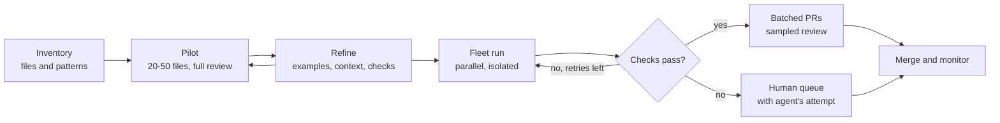

# Migrations at Scale

!!! note "Last reviewed"
    October 2026. The reports here range from January 2025 to April 2026; the pattern has held across them.

Every engineering organisation has one: the migration that has been on the roadmap for three years. The test library nobody uses any more, the 32-bit identifiers that will overflow one day, the framework version that stopped receiving security patches. Everyone agrees it should be done. Nobody can justify the months it would take, so it waits until it becomes a security finding or a hiring problem, and then it gets done in a painful push.

If there is one category of work where agents have already changed what is economically possible, it is this one. Not because the agents are brilliant, but because migrations have a shape agents are good at: many small, independent units, a clear definition of done, and a test suite that can tell you whether each unit came out right.

!!! tip "The one-liner"
    A migration is as automatable as its test suite is trustworthy.

---

## What problem this solves

Large migrations are expensive, boring and risky. The cost is not in any single change; it is in doing the same careful change three thousand times without losing attention on the two hundred that are subtly different. Deterministic codemods handle the uniform cases and break on the rest. People handle the rest and burn out on the uniform cases.

Agents change the economics in a specific way. The per-unit cost drops sharply, a pipeline can run across thousands of files in parallel, and the hard cases arrive at people with a first attempt already made. The work does not disappear. It moves: from typing to designing the pipeline, curating examples, and reviewing what comes out.

---

## When to use this

**Use it when:**

- The change is repeated across many files or repositories with recognisable patterns.
- You have, or can build, an automated check that distinguishes a correct result from a plausible one: tests, a type checker, a build, a linter.
- The units are mostly independent, so they can be processed and reviewed in parallel.
- The migration has been postponed for cost reasons, not because nobody knows what the target should be.

**Skip it, or slow down, when:**

- Tests are weak in the areas you are changing. Write characterisation tests first.
- The change requires understanding business intent, not applying a pattern.
- The units are not really independent: every change touches the same shared module and conflicts with the next.

---

## What has been reported

### Airbnb: test files, brute force and a long tail

Airbnb's migration of nearly 3,500 React component test files from Enzyme to React Testing Library is the best-known early example. As InfoQ reported in March 2025, the team had estimated about a year and a half of engineering effort by hand and finished in six weeks.

The details are more instructive than the headline. The pipeline ran each file through steps: refactor to the new library, fix test failures, fix lint, pass the TypeScript compiler. When a step failed, the model received all the errors and tried again, up to a maximum. With a ten-attempt limit, 75% of all the test files migrated in four hours. The remaining roughly 900 harder files needed what the team called "sample, tune, sweep": sample failing files, tune the prompt and context, sweep again, with 50 to 100 retries per file and prompts that grew to between 40,000 and 100,000 tokens, including up to 50 related files. After four days, 97% of files were converted. Fewer than 100 were finished by hand.

One lesson cuts against intuition: the team found prompt engineering less effective than simply retrying until the checks passed. Their staff engineer called it brute force. Brute force works when the checks cannot be fooled.

### Google: 80% AI-authored, and review becomes the bottleneck

Google's January 2025 experience report, "How is Google using AI for internal code migrations?", describes several migrations in detail. In one, changing identifiers in Google Ads from 32-bit to 64-bit across tens of thousands of code locations, 80% of the code modifications in landed changes were fully AI-authored, and engineers estimated the total time was reduced by about 50%. In a JUnit3 to JUnit4 migration, 5,359 files and more than 149,000 lines changed in three months, with roughly 87% of the generated code committed unchanged. There, the bottleneck was "the speed at which engineers could review the changes".

The paper is honest about the limits. It is explicitly an experience report, not a controlled study. The authors write that LLMs alone "through simple prompting" are not sufficient "for anything but the simplest of migrations"; their pipeline combines models with static analysis and AST-based tooling. Humans usually had to revert some of what the model changed, and review and rollout remained "largely human-driven". On quality: "Whether there is a long-term impact on quality remains to be seen."

### Spotify: background agents across a fleet

Spotify already had a Fleet Management system that applies code transformations across all its repositories and opens pull requests automatically; its engineers write that around half of Spotify's pull requests have been automated by it since mid-2024. The limit was complexity: one deterministic Maven dependency updater grew to more than 20,000 lines of transformation code. In November 2025 they reported adding a background coding agent, Honk, to the system, with more than 1,500 agent-written pull requests merged into production and time savings of 60–90% on those migration types compared with writing the code by hand. They were candid: "We don't have all the answers yet."

Their April 2026 case study is the most candid report I know of a migration without an oracle. Migrating around 1,800 downstream data pipelines to new dataset versions, the team found that the SQL-based (BigQuery Runner and dbt) repositories rarely had build-time unit tests, so the agent could not use its usual verify-and-adjust loop. Its first context, generated from a human migration guide, was not comprehensive enough, and the agent "was left to make assumptions" about field mappings, often incorrectly. Engineers rewrote the context with explicit mapping tables, the agent was told to leave judgment-heavy fields alone and link to the guide, and owning teams tested the pull requests by hand. The result was 240 automated migration pull requests and an estimated ten engineering weeks saved. The catch is where the verification went: with no tests to check against, every owning team had to test every pull request by hand.

### Cursor: a migration as a stress test

Cursor's January 2026 post on long-running agents lists, among its experiments, a Solid to React migration that ran for over three weeks with +266K/-193K lines of edits. It is a vendor demonstration of its own system, not a production migration with a known outcome, but it shows how far the unit of work has grown.

---

## Why migrations suit agents

**A checkable definition of done.** The old pattern is gone, the tests pass, the build is green. Every successful report above rests on this.

**Many independent units.** Files, modules or repositories can be processed in parallel and reviewed in batches.

**Repeated transformations.** The pilot's lessons generalise, because the hundredth file looks like the tenth.

**A valuable long tail.** If agents handle 90%, the remaining 10% is a far smaller project, and arrives with a first attempt.

The common thread is back pressure: an oracle the agent cannot argue with. Geoffrey Huntley used the term in his July 2025 Ralph post; Moss's January 2026 post ["Don't waste your back pressure"](https://banay.me/dont-waste-your-backpressure/), which Huntley endorsed, gives the fullest description. A migration pipeline is a back-pressure machine. Without the oracle it is just a fast way to produce plausible diffs.

---

## A migration pipeline

**Inventory.** Use scripts and agents to find every instance and classify it by pattern. Google's pipeline starts here with code search and static analysis; the classification decides how many pilots you need.

**Pilot.** Run on a small, varied sample, deliberately including the ugly cases. Review every result. Most of the learning happens here.

**Refine.** Turn the pilot's failures into examples, context and checks, then pilot again. This is the steering loop compressed into days. Spotify's dataset migration shows what happens when the first context is too thin: the agent guesses, until the mappings are made explicit.

**Fleet run.** Parallel agents, each in isolation, each on a small unit, with a capped number of retries. Airbnb's caps went from ten to a hundred as the files got harder; the cap is a budget decision, not a technical one.

**Batch and review.** Group successful changes into reviewable pull requests, routed to the code owners. Review by sampling, with full review for risky areas. Google slowed some migrations deliberately so reviewers were not overwhelmed.

**Human queue.** What fails goes to people, with the agent's attempt as a starting point. Plan for it from day one. It is never zero.

---

## A worked example: a migration pilot, week by week

Consider a hypothetical team of six that owns a monorepo with 2,400 files using a deprecated internal HTTP client. The new client has a different error model: it returns typed errors instead of throwing. Nobody has touched the migration in two years.

**Week 0: decide whether it is a migration at all.** The tech lead runs an inventory script and an agent classification pass. Result: about 1,900 call sites follow four recognisable patterns; about 500 do something unusual, mostly custom retry logic. Test coverage is good in two of the five top-level packages and poor in the other three. The team decides to start with the well-tested packages and to write characterisation tests for the others before touching them. That decision, made before any agent runs, is the most important one of the project.

**Week 1: the pilot.** Forty files, chosen to cover all four patterns and a handful of unusual cases. Every result is reviewed by two engineers. Thirty-one pass checks; twenty-four of those are correct. The seven that pass but are wrong share one problem: the agent swallowed errors the old client used to throw, and the tests never exercised the error path. The suite was green and the migration was wrong. That is the moment the pilot pays for itself.

**Week 2: refine.** The team adds a check that fails if any migrated call site ignores the returned error, adds three worked examples of correct error handling to the agent's context, and writes error-path tests for the most-called endpoints. A second pilot of forty different files: thirty-six pass, thirty-five are correct.

**Week 3: the fleet.** The pipeline runs across the two well-tested packages: 900 files, isolated workspaces, a cap of five retries per file. 810 pass all checks. They are batched into pull requests of around twenty files each, grouped by owning team. Reviewers read one in five files closely and every file touching payments. Two batches are sent back because the agent "improved" logging it had not been asked to touch; the team adds an instruction and a diff-scope check.

**Week 4: the human queue and the rest.** Ninety files are in the human queue, each with the agent's attempt and the failing check. Engineers finish them at a few minutes each, except for eleven with custom retry logic, which take a day. Meanwhile, characterisation tests are landing in the poorly tested packages, and the pipeline moves on to them.

**Six weeks later.** The old client is gone. The team's honest summary: the agents did most of the typing, the pilot and the checks did most of the thinking, and the biggest risk (green tests over wrong behaviour) was caught only because the pilot was reviewed in full.

---

## Agents as archaeologists

A related use is understanding legacy systems before changing them: tracing what calls what, which code is dead, which configuration is actually live, what a module really does as opposed to what its name claims. This is voluminous, context-heavy work that agents do well, and it de-risks everything that follows. Spotify's dataset migration started with lineage data and code search to find every affected consumer; Google's starts with static analysis to find every location to change. The inventory is archaeology. See [Harnessability](../harness/harnessability.md).

---

## Roles and ownership

| Role                    | Responsibility                                                                               |
| ----------------------- | -------------------------------------------------------------------------------------------- |
| **Migration owner**     | Owns the pipeline, the pilot, the retry budget and the human queue                           |
| **Tech lead**           | Decides whether the oracle is trustworthy enough to start, and where full review is required |
| **Code owners**         | Review batched changes in their area; can pause the fleet for their code                     |
| **Platform team**       | Provides isolated workspaces, CI capacity and cost visibility for fleet runs                 |
| **Engineering manager** | Protects review capacity so the migration does not drown other work                          |

---

## What good looks like

| Signal                          | What you observe                                                       |
| ------------------------------- | ---------------------------------------------------------------------- |
| **Oracle before migration**     | Tests reliable enough to judge output, written first where missing     |
| **Pilot before fleet**          | A small, varied, fully reviewed sample, repeated after each refinement |
| **Capped retries**              | No unbounded loops on hard cases; the cap is a conscious budget        |
| **Review sized to capacity**    | Batches grouped by owner and paced to what reviewers can absorb        |
| **Human queue planned**         | The long tail is scheduled, not a surprise                             |
| **Postponed migrations happen** | Work that sat for years gets done                                      |

---

## Failure modes and mitigations

Migrations rarely fail loudly. The typical story starts with a successful pilot on the easy files, a fleet run with an impressive pass rate, and a celebration. Weeks later, a production incident traces back to a migrated file that passed every check and changed behaviour on a path no test exercised. The pass rate measured the test suite, not the migration. Meanwhile, the review queue has grown to hundreds of agent-written pull requests that code owners approve with less and less attention, because they all look the same.

| Failure mode                   | What it looks like                                 | Mitigation                                                                  |
| ------------------------------ | -------------------------------------------------- | --------------------------------------------------------------------------- |
| **Green but wrong**            | Checks pass on behaviour the tests never exercised | Full review in the pilot; add checks for the patterns it reveals            |
| **No oracle**                  | Agent output cannot be judged automatically        | Write characterisation tests first, or keep the migration manual            |
| **Guessing from thin context** | The agent invents mappings or intent               | Explicit examples and mapping tables; tell it to leave judgment calls alone |
| **Review flood**               | Owners rubber-stamp hundreds of similar PRs        | Batch by owner, sample deliberately, pace the fleet                         |
| **Scope creep**                | Agents "improve" code they were not asked to touch | Diff-scope checks; one change per pipeline                                  |
| **Unbounded retries**          | Cost climbs on files that will never pass          | Cap retries; route failures to the human queue early                        |

!!! info "What we know / what we don't"
    **What we know:** across Airbnb, Google and Spotify, agent-assisted migrations finished at a fraction of the estimated manual effort, wherever an automated check could judge the output.

    **What we don't:** the long-term quality of the migrated code, which Google says "remains to be seen"; how much of the reported savings depends on unusually strong internal tooling; and how the numbers look for organisations without it. All the reports are from the companies that did the work.

---

## Further reading

- **[How Airbnb used LLMs to accelerate test migration](https://www.infoq.com/news/2025/03/airbnb-llm-test-migration/)** by Sergio De Simone (InfoQ) — The step pipeline, retry caps and "sample, tune, sweep", reported from Airbnb's own post.
- **[Accelerating large-scale test migration with LLMs](https://medium.com/airbnb-engineering/accelerating-large-scale-test-migration-with-llms-9565c208023b)** by Airbnb Engineering — The original write-up.
- **[How is Google using AI for internal code migrations?](https://arxiv.org/abs/2501.06972)** by Nikolov et al. (Google) — An experience report with unusually candid limitations. (Preprint.)
- **[1,500+ PRs later: Spotify's journey with our background coding agent](https://engineering.atspotify.com/2025/11/spotifys-background-coding-agent-part-1)** by Max Charas and Marc Bruggmann (Spotify) — Fleet-wide changes before and after agents.
- **[Background coding agents: supercharging downstream consumer dataset migrations](https://engineering.atspotify.com/2026/4/background-coding-agents-dataset-migrations-honk-part-4)** by Spotify Engineering — What happens when the oracle is missing.
- **[Ralph Wiggum as a "software engineer"](https://ghuntley.com/ralph/)** by Geoffrey Huntley — Where the loop and the term "back pressure" first appeared.
- **[Don't waste your back pressure](https://banay.me/dont-waste-your-backpressure/)** by Moss — The fullest description of back pressure, endorsed by Huntley.

## Related pages

- [Your First Factory Workflow](../factories/first-factory-workflow.md) — Starting with one bounded, reversible workflow.
- [Harnessability](../harness/harnessability.md) — Making a codebase legible to agents before changing it.
- [Verification](../workflow/verification.md) — Independent checks that do not share the agent's assumptions.
- [Cost & Token Economics](../team/cost-and-token-economics.md) — Budgeting retries and fleet runs.
