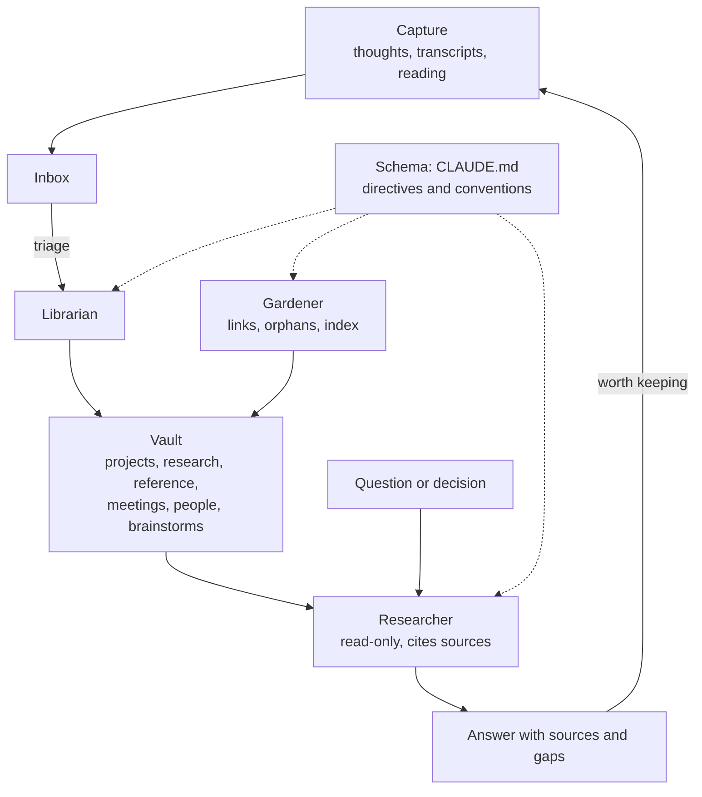

# Personal Knowledge Systems

!!! note "Last reviewed"
    October 2026. The pattern is young; the tools around it change monthly.

Most knowledge workers have a graveyard. A notes app with three thousand entries, a bookmarks folder nobody has opened since it was created, meeting notes that were useful for exactly one afternoon. Every few years we try a new tool, migrate the graveyard into it, and promise ourselves this time we will keep it tidy. We never do, because the tidying is the expensive part, and it competes with everything else.

The same primitives that make a team harness work (context, instructions, skills, memory) turn out to work remarkably well on a single person's knowledge. Some of the most interesting experiments of 2026 are builders pointing agents at their own notes, decisions and reading, and getting something closer to a research assistant than a search engine. The agent does the tidying.

It is also a pattern I use for my own notes, described in more detail below.

!!! tip "The one-liner"
    Keep the knowledge in plain files you own; let the agent do the bookkeeping; keep the thinking for yourself.

---

## What problem this solves

Traditional knowledge tools optimise for two things: capture, and human navigation. They are good at getting things in and reasonably good at letting you browse. Very few help you synthesise: answer a question across forty notes, notice that two things you wrote a year apart contradict each other, or remind you what you decided last time and why.

Agents are good at exactly that, with one condition. The knowledge has to be in a form they can read and reason over. A proprietary database behind an API is hard. A folder of consistently structured Markdown files is easy. That observation, more than any particular tool, is what changed in 2026.

There is a second problem this solves, which matters more for builders. Your working agreements with your agents ("write commit messages like this", "never assume pricing", "this is how I want plans structured") tend to live in one tool's settings and nowhere else. Switch tools and you start from zero. A personal system that holds those agreements in plain files, read by every agent you use, makes them portable.

---

## When to use this

**Use it when:**

- You regularly need to synthesise across your own material: research, meeting notes, decisions, reading.
- You already capture a lot and use very little of it.
- You work with more than one agent and are tired of re-teaching each one how you work.
- You want a low-stakes place to learn how context, skills and memory behave before designing them for a team.

**Skip it, or keep it small, when:**

- Your notes contain data you are not allowed to send to a model provider. Apply your own [data policy](../security/data-and-policy.md) first; a personal system is still a system.
- The overhead of structure would exceed the value. A dozen notes do not need a librarian.

---

## The pattern: plain files, organised for the model

In April 2026, Andrej Karpathy published a short "idea file" as a GitHub gist called **LLM Wiki**. It is designed, in his words, "to be copy pasted to your own LLM Agent", which then builds the specifics with you. The core idea is a contrast with retrieval: instead of an LLM "rediscovering knowledge from scratch on every question", it "incrementally builds and maintains a persistent wiki", a structured, interlinked collection of Markdown files that sits between you and your raw sources.

He describes three layers:

**Raw sources.** Articles, papers, data. Immutable: the agent reads them and never modifies them.

**The wiki.** A directory of Markdown pages the agent writes and maintains entirely: summaries, entity pages, concept pages, comparisons.

**The schema.** A `CLAUDE.md` or `AGENTS.md` that tells the agent how the wiki is structured and which workflows to follow. "This is the key configuration file," he writes, the thing that makes the agent "a disciplined wiki maintainer rather than a generic chatbot".

And three operations: **ingest** (read a new source and update every page it touches; "a single source might touch 10-15 wiki pages"), **query** (answer with citations, and file good answers back into the wiki so explorations compound), and **lint** (periodically check for contradictions, stale claims, orphan pages and missing links). Two special files hold it together: an `index.md` the agent reads first to find relevant pages, and an append-only `log.md` of what happened when. Karpathy reports that the index alone "works surprisingly well at moderate scale (~100 sources, ~hundreds of pages)" without embedding-based retrieval.

His explanation of why it works is the most useful line in the gist: "Humans abandon wikis because the maintenance burden grows faster than the value." The agent makes maintenance nearly free. He frames it as a descendant of Vannevar Bush's Memex, whose unsolved problem was who does the maintenance.

In practice, the choices that make this pattern work are the same ones that make a codebase harnessable. The list below is my reading, not Karpathy's:

**Atomic notes.** One idea per file. Ten focused notes beat one huge one, because the agent can judge relevance without reading everything.

**Consistent structure.** Every note has the same frontmatter, including a one-sentence summary, so a search over summaries is enough to find candidates.

**Links as a graph.** Wiki-links the agent can follow one hop out, where the other half of an answer usually lives.

**Capture first, organise later.** An inbox that accepts anything, triaged later by the agent.

**Skills for recurring operations.** The things you do every week, written down once.

---

## My version: a second brain maintained by an agent

I run a variant of this for my own notes, meetings and research. It differs from Karpathy's in one important way: the system is designed so that most notes are mine, not the agent's. Captures are meant to be in my own words, and the agent's job is structure (filing, linking, indexing, summarising across notes), with an explicit instruction to preserve my wording and opinions when it cleans something up. Karpathy's wiki is a codebase the agent writes; mine is closer to a library the agent looks after.

The structure is deliberately boring:

**Folders by kind of knowledge.** An inbox for raw captures, then folders for projects (work with a goal and an end), research (evolving understanding), reference (evergreen facts and decisions with their rationale), meetings, people and brainstorms. An `INDEX.md` at the root is the map of content.

**A schema file as operating manual.** A `CLAUDE.md` at the root sets the prime directives: never delete content without confirmation, always cite the note files an answer came from, answer from the notes first and say so explicitly before falling back to general knowledge, and preserve my voice.

**Seven skills.** `capture` drops a thought into the inbox with the right template. `triage` files inbox notes, suggesting destination, tags, splits and links. `ask` answers a question from the notes, with citations. `link` repairs and strengthens the graph. `digest` is a weekly review: what changed, orphan notes, stale projects. `meeting` turns raw notes or a transcript into a structured meeting note. `brainstorm` runs an ideation session grounded in existing notes and keeps both the promising and the discarded ideas, with reasons.

**Three subagents with narrow jobs.** A **librarian** that moves, renames, splits and merges notes but never rewrites their content. A **researcher** that is strictly read-only, synthesises across the whole vault, separates recorded facts from my recorded opinions, flags contradictions, and ends every answer with its sources, adding an explicit list of gaps when the notes fall short. A **gardener** that maintains the link graph, and may only touch the "Related" sections, dates and the index.

The most valuable rule in the whole system is the one about gaps. A researcher agent that says "your notes do not cover this; here is what is missing" is worth far more than one that fills the hole with something plausible. It is the same principle as in team work: uncertainty should become a question, not a confident-looking answer.

---

## A worked example: preparing for a decision

What follows is a hypothetical scenario, not a record of a specific day. It shows how a system like this behaves when it is working, and where it needs correcting.

Picture an engineering lead with a decision on Thursday: whether the team should move its agent-driven dependency upgrades from "a person approves every change" to "patch releases in low-risk areas merge automatically".

**Morning: ask.** She asks the vault what she knows. The researcher searches summaries and tags, reads a handful of notes and follows their links one hop out. It returns a synthesis: the team's original rationale for human approval (a meeting note from the spring), three weeks of observations she captured about which upgrades came back clean, a research note on risk-tiered review, and a reference note with the team's agreed definition of "low-risk area". It ends with sources, and with a gap: there is no record of how many auto-approvable upgrades later needed a revert.

**Something goes wrong.** The synthesis says the team "agreed to revisit approval after a month". She does not remember that. She opens the cited meeting note: it says one person *suggested* revisiting after a month, and nobody responded. The agent turned a proposal into an agreement. She corrects the meeting note's summary so the next query does not repeat the mistake, and adds a line to the schema about distinguishing suggestions from decisions. This is the system working as intended. The citation made the error visible in seconds, and the fix went into the system rather than into her memory.

**Midday: fill the gap.** The missing number is not in her notes; it is in the repository. She gets it the ordinary way, from the pull request history, and captures it.

**Afternoon: brainstorm.** She runs a brainstorm on the options. The agent proposes four, grounded in her notes, including one she had not considered: automatic approval only for patch releases with no transitive dependency changes. Two of the four are weak, and the brainstorm note keeps them anyway, with the reasons they were discarded. Next quarter, when someone proposes one of them again, the reasoning is already there.

**Thursday.** She walks into the meeting with a one-page summary: what was decided before and why, what the evidence shows, the gap and how it was filled, the options and the one she recommends. The agent did the assembly. The judgment about what the team can trust, and the conversation in which the team agrees, stayed hers.

---

## Memory across agents

A second pattern sits next to the knowledge base: persistent memory shared across all the agents you use. Decisions, preferences and conventions are stored once, usually in a memory service exposed over MCP, and every agent can query it, whichever tool you happen to be in. I use one shared store across all my agents for exactly this reason.

Combined with **one source of truth for instructions** (a single `AGENTS.md`-style file that every agent reads through a symlink), it means your working agreements follow you from tool to tool. Change a rule once and every agent has it. See [Portability](../tools/portability.md).

The two layers do different jobs, and it helps to keep them apart. The instruction file says *how I want work done*. The memory store records *what has already been decided, and why*. Mixing them produces instruction files that grow without limit and memories that read like rules.

The failure mode is the same as for team memory: stored memories feel authoritative and can be stale or contradictory. Some agents also keep their own local notes per project and load them automatically, which makes them feel even more authoritative than the shared store. Decide explicitly which source wins when they disagree (for me, the shared store outranks any tool's local notes), and correct the loser when you find a conflict, so it cannot mislead the next session. See [Memory & Continuity](../harness/memory-and-continuity.md).

---

## Why this matters beyond personal productivity

Building a personal system is the best practice ground for building a team one. You learn, at low stakes and with fast feedback:

**How much context helps and when it starts to hurt.** You will feel the difference between an agent that reads three relevant notes and one that reads thirty.

**How to write skills that actually trigger.** Vague skill descriptions get ignored; precise ones get used.

**What memory is worth keeping.** Most of it is not. The memories that matter are decisions with their reasons.

**How quickly instructions rot.** A schema file written in July is partly wrong by October, and you will notice it first in your own system.

Every one of those lessons transfers, and they are much cheaper to learn when the only person affected by a bad instruction is you.

---

## Roles and ownership

Even a personal system has roles, and naming them is what keeps it healthy.

| Role                    | Responsibility                                                                     |
| ----------------------- | ---------------------------------------------------------------------------------- |
| **You**                 | Curate sources, ask the questions, decide what the answers mean, approve deletions |
| **Schema file**         | Holds the conventions and directives every agent follows                           |
| **Librarian agent**     | Structure: filing, renaming, splitting, merging, without rewriting content         |
| **Researcher agent**    | Read-only synthesis with sources and explicit gaps                                 |
| **Gardener agent**      | The link graph and the index, nothing else                                         |
| **Shared memory store** | Decisions and preferences that outlive any single tool                             |

---

## What good looks like

| Signal                      | What you observe                                                           |
| --------------------------- | -------------------------------------------------------------------------- |
| **Plain, portable files**   | Knowledge in Markdown you own, versioned in Git, readable without any tool |
| **Consistent structure**    | The agent finds relevant notes from summaries without reading everything   |
| **Answers cite sources**    | Every synthesis names the notes it came from, and its gaps                 |
| **Few, useful skills**      | Capture, triage, ask, digest; each one used weekly                         |
| **Good answers filed back** | Explorations become notes, so the system compounds                         |
| **Memory pruned**           | Stale preferences corrected or removed when found                          |

---

## Failure modes and mitigations

These systems tend to fail in one of two directions. The first is hoarding: capture becomes effortless, so everything gets captured, the inbox grows faster than triage, and the vault becomes a better-organised graveyard. The second is quieter and worse: the agent's syntheses become so fluent that you stop opening the sources, and small errors (a suggestion recorded as a decision, an opinion recorded as a fact) start compounding through answers you no longer check.

| Failure mode                  | What it looks like                          | Mitigation                                                          |
| ----------------------------- | ------------------------------------------- | ------------------------------------------------------------------- |
| **Hoarding**                  | Everything captured, nothing synthesised    | Regular agent-run digests and triage; delete nothing, archive often |
| **Monolithic notes**          | Huge files the agent cannot use well        | Atomic notes; propose a split past ~1,000 words                     |
| **Uncited synthesis**         | Answers you cannot trace back to notes      | Make citations and a "gaps" line mandatory in the schema            |
| **Silent gap-filling**        | General knowledge presented as your notes   | Instruct the agent to say what the notes do not cover               |
| **Sensitive data everywhere** | Private notes sent to unapproved providers  | Apply your own data policy; keep some folders out of reach          |
| **Memory as authority**       | A stale memory overrides a current decision | Decide which source wins; correct the loser when they disagree      |

!!! info "What we know / what we don't"
    **What we know:** plain Markdown with consistent structure is enough for an agent to navigate a personal knowledge base of hundreds of pages without embeddings; Karpathy reports this.

    **What we don't:** how these systems behave at tens of thousands of notes, how much an agent-written wiki drifts from its sources over years, and whether people who delegate the bookkeeping also, slowly, delegate the thinking. Nobody has studied it; the evidence is practitioners' reports, mine included.

---

## Further reading

- **[LLM Wiki](https://gist.github.com/karpathy/442a6bf555914893e9891c11519de94f)** by Andrej Karpathy — The original idea file: raw sources, wiki and schema; ingest, query and lint.
- **[Effective context engineering for AI agents](https://www.anthropic.com/engineering/effective-context-engineering-for-ai-agents)** by Anthropic — Just-in-time retrieval and structured note-taking, the mechanics underneath this pattern.
- **[The real AI advantage is the workflow, not the model](https://dreamingecho.es/blog/real-ai-advantage-is-the-workflow)** by Iván González Sáiz — Why encoding your own standards into reusable instructions protects judgment from your worst hours.

## Related pages

- [Memory & Continuity](../harness/memory-and-continuity.md) — What a team's harness should remember, and how to keep it honest.
- [Portability](../tools/portability.md) — One source of truth for instructions across several agents.
- [My Stack](../tools/my-stack.md) — The tools I use day to day.
- [Skills](../foundations/skills.md) — How to write skills that trigger reliably.
