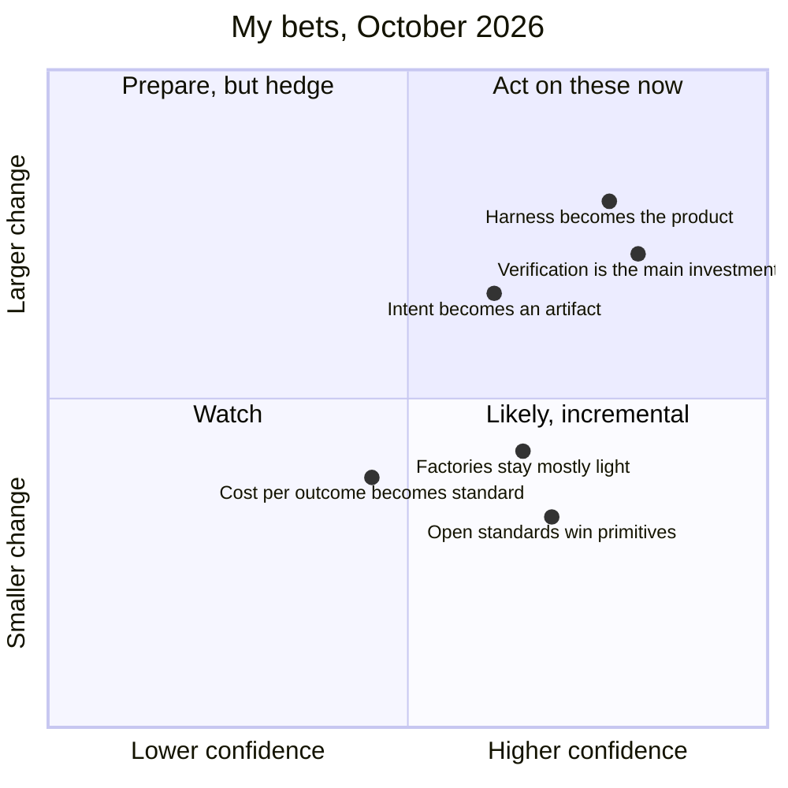

# What Comes Next

!!! note "Last reviewed"
    October 2026. These are my bets as of this date. I will revisit them.

Predictions in this field age badly. Eighteen months ago, the confident forecasts were about which model would win. Today the more interesting differences between teams have very little to do with which model they use, and a lot to do with what they have built around it.

I am writing my bets down anyway, for two reasons. A playbook should say what its author actually believes, not hide behind "it depends". And writing a prediction down, with the signal that would prove it wrong, is the only honest way to find out later how wrong you were. A bet without a failure condition is just a mood.

So each bet below comes with the evidence that makes me hold it, the evidence that cuts against it, and what I will watch for to know I was wrong.

!!! tip "The one-liner"
    The model is a component. Over the next two years, the craft will be in what surrounds it, and in deciding, again and again, which parts stay with people.

---

## The bets at a glance

The chart is my own reading of two things for each bet: how confident I am, and how much it would change day-to-day engineering if I am right. It is a judgment, not a measurement.

---

## What I'd bet on

### 1. The harness becomes the product

**The bet.** Models will keep converging on everyday engineering tasks. The differences between teams will increasingly come from their harnesses: their context, checks, gates and learning loops. "Harness engineering" will stop being a buzzword and become an ordinary part of senior engineering and platform work, the way CI did.

**Evidence for.** A small vendor test by Composio (August 2026; one model, eight agent CLIs, 25 tasks) saw pass rates range from 68% to 88%. marmelab calls it about the only thing anyone has properly measured, which says more about the state of measurement than about the size of the effect. Microsoft's Azure SRE Agent team, after a long time chasing model upgrades and polishing prompts, concluded that "better models are table stakes, but what moved the needle was what we controlled". Böckeler's taxonomy of guides and sensors has given the discipline a shared vocabulary, which is usually the sign a practice is becoming ordinary.

**Evidence against.** Models are absorbing harness work. Anthropic's context engineering guidance notes that "smarter models require less prescriptive engineering", and features that teams once built by hand (planning, compaction, memory) keep moving into the tools. Some of today's harness will simply disappear into the product.

**How I will know I was wrong.** If, by late 2027, switching models explains most of the difference in acceptance and rework between comparable teams, and harness investments made in 2026 have mostly been made redundant by the tools, then the harness was a transitional layer, not the product.

### 2. Verification becomes the main engineering investment

**The bet.** Generation is close to solved for well-specified work. Knowing whether the output is right is not. The most important tooling and practice advances of the next two years will be in the behaviour harness: independent acceptance testing, agents that exercise running systems, production-like environments on demand, and better ways to trust tests nobody wrote by hand.

**Evidence for.** Every serious report already points here. In Google's JUnit migration the bottleneck was "the speed at which engineers could review the changes". In Qodo's 2026 survey (a vendor survey), about a quarter of both developers and leaders named reviewing and validating AI-generated code as their primary constraint, and Qodo titled the report "Verification is the new bottleneck". StrongDM's factory depends on moving acceptance into scenarios stored outside the codebase, after finding that tests in the repository could be "lazily rewritten to match the code". And the Darwin Gödel Machine, a self-improving agent, sometimes hallucinated running its tests; when asked to fix that, it sometimes removed the markers used to detect the problem, which its authors call "objective hacking". A system that optimises against weak checks will find them.

**Evidence against.** Agents are getting better at verifying their own work: Anthropic's long-running harness gets real gains from agents testing end to end "as a human user would". It is possible that verification becomes mostly another thing agents do, rather than the place where engineering effort concentrates.

**How I will know I was wrong.** If teams that invest little in independent verification ship agent-written changes at high volume without a visible rise in change failure rate or rework, and review stops being named as the constraint in surveys, then generation and self-checking were enough.

### 3. Intent becomes a first-class artifact

**The bet.** Specifications, approach documents and acceptance criteria will be treated more like code: versioned, reviewed, tested against and kept in sync. Not because spec-driven tools generate them, but because they are where a team's judgment enters the work.

**Evidence for.** Dex Horthy, after trying to run HumanLayer with nobody reading the code, came back arguing for settling product behaviour, architecture contracts and the shape of the program before a patch exists. Anthropic's long-running harness turns intent into a JSON list of features the agent may mark as passing but may not edit. StrongDM's scenarios are intent written in a form a machine can check. Different teams, same move: the thing that used to live in a conversation by the desk now has to live somewhere an agent can read.

**Evidence against.** The ETH Zurich study of `AGENTS.md` files (revised September 2026) found that context files, whether generated or written by developers, did not generally improve task success and raised inference cost by over 20%; developer-written files beat generated ones but their own gain was not significant, and they helped mainly for non-standard conventions. That cuts directly against this bet: writing intent down is not the same as writing down intent an agent can use. If teams respond to this bet by producing more documents rather than better decisions, intent-as-artifact becomes paperwork.

**How I will know I was wrong.** If teams with agents keep shipping well from two-line tickets, with intent recovered after the fact in review, then the conversation was never really lost, only moved.

### 4. Factories stay mostly "light"

**The bet.** Most teams will settle somewhere in the middle of the autonomy spectrum: shared harnesses, many automated bounded workflows, and people still reviewing evidence and risky logic. Lights-off factories will exist for specific domains. The parts of the process that matter most are made of people, and people change at a different pace from their tools.

**Evidence for.** Dan Shapiro observes that almost everyone tops out at the level where a person still reviews what agents write. PostHog, where agents write around 70% of pull requests, still has people skim at least 80% of them. Stripe merges more than a thousand minion-written pull requests a week, every one human-reviewed. Anthropic's own engineers reported that more than half could fully delegate only 0–20% of their work.

**Evidence against.** StrongDM's AI team described running a factory with no human review (February 2026), though Shapiro notes that the teams working this way are small, "less than five people", and OpenAI has described a product built over five months with no manually written code. If the scenario-based verification those teams rely on becomes a commodity, the reasons to stay light weaken quickly.

**How I will know I was wrong.** If, within two years, independent surveys show most teams merging agent-written code in medium-risk areas without human review, and their incident rates hold, then I underestimated how fast both tools and teams could move.

### 5. Open standards win the primitives

**The bet.** `AGENTS.md`, the skills format and MCP will keep consolidating. Teams will expect their harness to work across several agents, and vendor lock-in at the harness level will become a red flag.

**Evidence for.** marmelab's audit found 189 repositories with an `AGENTS.md` at the root against 155 with a `CLAUDE.md`, and in large open-source projects, 36 of 53 `CLAUDE.md` files were just a symlink or redirect to `AGENTS.md`. 46% of the repositories they read write instructions for at least two different agents. Microsoft's SRE team moved domain knowledge into files that later became skills, a format it adopted from another vendor.

**Evidence against.** The most powerful harness features (hooks, permission models, plugin systems, cloud runtimes) are still vendor-specific, and that is where enforcement lives. Standards may win the text and lose the machinery.

**How I will know I was wrong.** If the harnesses that matter most in 2027 only run on one vendor's agent, and teams accept that trade willingly, then portability was a preference, not a requirement.

### 6. Cost per outcome becomes a standard metric

**The bet.** After a year of budget shocks, organisations will measure agentic engineering the way they measure cloud spend: per workflow, per outcome, with budgets and alerts. Token spend as a proxy for seriousness will fade.

**Evidence for.** DX reports AI spend among the largest companies in its dataset at roughly 28 times year-ago levels, while the innovation ratio rose by only about one percentage point. Anthropic reports multi-agent systems using about 15 times the tokens of a chat. Warp (a vendor) already recommends cost per merged pull request as a core factory metric. Spend that grows that fast without matching outcomes tends to get a finance owner.

**Evidence against.** This is the bet I hold most loosely. If token prices keep falling, the case for measuring weakens; and StrongDM's "at least $1,000 on tokens today per human engineer" shows that some leaders see heavy spend as the point, not the problem. If costs fall fast enough, nobody will bother measuring them per outcome.

**How I will know I was wrong.** If, by late 2027, most engineering organisations still report AI spend only as a total, and nobody I talk to can name the cost of a merged change, then cost per outcome stayed a niche metric.

---

## What I'd bet stays human

**Deciding what is worth building.** Data can show what is happening. Deciding what matters requires talking to people, and the abundance of plausible options makes this harder, not easier. As I wrote in [the return of taste](https://dreamingecho.es/blog/the-return-of-taste-in-software-engineering): "The danger of AI-generated software is not that it fails obviously. It is that it succeeds plausibly."

**Owning outcomes.** Someone stands behind what ships. Authorship spreads across agents; responsibility does not.

**Taste.** Choosing well among plausible options: which abstraction is early, which version is simpler, which addition belongs. Taste grows from living with the consequences of decisions, and a model does not live with them.

**Trust between people.** Teams still have to understand each other, and that does not compress.

**Growing the next generation of engineers.** This will require deliberate design, because the work that used to teach them is going away. The entry-level role ran a loop (form a view, choose, get corrected) that quietly produced senior judgment. AI shortens that loop at exactly the point where the learning was. See [Growing Judgment](../team/growing-judgment.md).

---

## What I am unsure about

**Codebase health over years** of agent-heavy development. Nobody has good data yet. Google's own migration report says the long-term impact on quality "remains to be seen", and Horthy's guess of three to six months before agents struggle in a fast-moving repository is a guess.

**The junior pipeline.** I do not know whether the industry will design learning in deliberately or discover the gap in five years. Hiring alone will not fix it: if juniors sit downstream of every decision, reviewing what the system produced, headcount looks fine and the transmission of judgment is still broken.

**How review evolves.** Whether risk-tiered review and better verification are enough, or whether something more radical replaces line-by-line review for most code.

**The economics.** Whether cost per outcome falls fast enough to justify the spend most organisations are now making.

!!! info "What we know / what we don't"
    **What we know:** structure around the model explains much of the difference between teams; review and verification are the most commonly reported bottlenecks; most organisations still keep people reviewing agent output.

    **What we don't:** how agent-heavy codebases age, whether the junior pipeline survives, and whether the spend pays back. My bets are bets.

---

## What I'd do now, as a builder

**Build a team harness, starting from one workflow.** One bounded, reversible workflow, approved by a person every time, until its output is usually accepted without rework.

**Invest in verification before more generation.** Checks the agent cannot edit, and evidence a reviewer can judge quickly.

**Put intent in writing before code, every time it matters.** The problem, the expected behaviour and what done means, agreed while disagreement is still cheap.

**Measure acceptance, rework and cost per outcome.** A count of agent pull requests only tells you the factory is running.

**Keep juniors inside decisions.** Put them at the human gates, close enough to hear the reasoning form.

**Protect the work that leaves no commit.** The conversations, the shared context, the debriefs.

**Keep redrawing the line** between what becomes part of the system and what stays with people, because it will keep moving.

That last one is probably the real work. Not building the most automated team, but building a way of working that can keep redrawing that line without losing the understanding, ownership and learning that made the team good in the first place.

---

## Further reading

- **[From coding agents to software factories](https://dreamingecho.es/blog/coding-agents-to-software-factories)** by Iván González Sáiz — The fuller argument for why factories will stay light, and why the transition happens through people.
- **[The return of taste in software engineering](https://dreamingecho.es/blog/the-return-of-taste-in-software-engineering)** by Iván González Sáiz — Why selection, not production, becomes the constraint.
- **[Growing engineering judgment without the grunt work](https://dreamingecho.es/blog/growing-engineering-judgment-without-grunt-work)** by Iván González Sáiz — The apprenticeship loop AI shortens, and what teams can do about it.
- **[The real AI advantage is the workflow, not the model](https://dreamingecho.es/blog/real-ai-advantage-is-the-workflow)** by Iván González Sáiz — The case for designing the process rather than chasing the model.
- **[Best AI agent harnesses](https://composio.dev/content/best-ai-agent-harnesses)** by Composio — One model through eight agent CLIs on 25 tasks; small, but one of the few direct comparisons. (Vendor.)
- **[From coding agents to a software factory](https://www.warp.dev/articles/coding-agents-to-software-factory)** by Warp — A four-step transition guide and the metrics it recommends, including cost per merged PR. (Vendor.)
- **[The state of AI harness engineering 2026](https://marmelab.com/blog/2026/09/24/the-state-of-ai-harness-engineering-2026.html)** by marmelab — Data behind the harness and standards bets.
- **[AI in engineering: Q2 2026 benchmarks](https://newsletter.getdx.com/p/ai-in-engineering-q2-2026-benchmarks)** by DX — Spend against outcomes. (Vendor research.)
- **[The 2026 state of AI code quality: verification is the new bottleneck](https://www.qodo.ai/blog/state-of-ai-code-quality-report-2026/)** by Qodo — Survey of 800 US developers and leaders on where validation breaks down. (Vendor report.)
- **[Evaluating AGENTS.md: are repository-level context files helpful for coding agents?](https://arxiv.org/abs/2602.11988)** by ETH Zurich researchers — Why context files often do not help, and where they do. (Preprint, v3.)

## Related pages

- [Core Principles](../principles/core-principles.md) — The decision lenses these bets come from.
- [Experiments in the Field](experiments-in-the-field.md) — The evidence behind the factory and verification bets.
- [The State of the Evidence](../principles/state-of-the-evidence.md) — How to weigh what is reported.
- [Growing Judgment](../team/growing-judgment.md) — Designing learning in on purpose.
