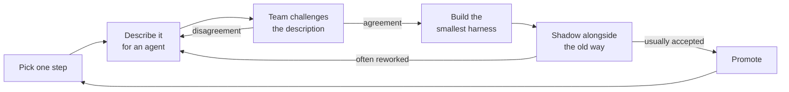

# Designing a Team Harness

The fastest way to build a bad team harness is to start with a tool. The second fastest is to start with your own workflow and roll it out.

I know the second one from the inside. I built the first proof of concept of my team's harness largely on my own, and a working prototype turned out to be more persuasive than it deserved to be; [Ownership & Change](ownership-and-change.md) tells that part of the story.

What changed the direction was a conversation that had nothing to do with agents. Around the same time, the team was reviewing a well-known product methodology one practice at a time, asking what question each ritual answers and whether that question still mattered to us. Instead of finishing my version and asking the team to adapt to it, I started reconciling it with what we had agreed together. Some rules that had seemed obvious while I was writing them became much less obvious as soon as somebody else had to imagine working inside them. Those were often the most useful conversations.

The way that works is slower at the start and much faster afterwards: start from how work actually moves through your team, write it down precisely enough that an agent could execute it, and take that description back to the people who do the work so they can tear it apart.

!!! tip "The one-liner"
    The harness should adapt to the team, not the team to the harness.

---

## What problem this solves

Most teams adopting agents end up with a row of separate workshops. Every engineer has their own prompts, their own skills, their own idea of when to trust the output. Some of those workshops are excellent. They do not add up to anything. Quality depends on who picked up the ticket, and nothing anyone learns reaches anyone else.

The failure is quiet because each workshop works for its owner. One person remembers to gather the metrics first; another starts from the implementation. One validates assumptions; another accepts the first reasonable answer. Warp's guide to moving from coding agents to a shared delivery system makes the same observation from the vendor side: teams that treat this as a tool rollout rather than an infrastructure project tend to see nothing compound.

A team harness turns those workshops into a shared way of working without flattening the judgment that made the best ones good. Consistency applies to the questions every piece of work passes through, not to the answers.

---

## When to use this

**Use it when:**

- Several engineers use agents on the same codebase.
- Quality and approach vary noticeably between people.
- Recurring work (reviews, rollouts, investigations) is done differently every time.
- You are considering background agents or any kind of factory workflow.
- Important steps happen only when somebody remembers.

**Skip it when:**

- The team has not yet used agents enough to know where they fail. A harness designed before you have seen the failures encodes guesses.
- Your existing process is itself in flux. Automate it after it settles, or you will be encoding a moving target.
- One person works alone on a small codebase. A personal harness is enough; see [Instructions & AGENTS.md](../foundations/instructions-and-agents-md.md).

Most teams do not need a harness as extensive as the one I built. What we built reflects our product, tools, repositories and existing ways of working, and much of it would not transfer directly. Reproducing a complete system without a clear need could easily become an expensive tooling project. A smaller version of the exercise, one step of the workflow, is worth doing almost everywhere.

---

## Roles and ownership

| Role                                                    | Responsibility                                                       |
| ------------------------------------------------------- | -------------------------------------------------------------------- |
| **Harness owner** (often a tech lead or staff engineer) | Builds the first version, connects the pieces, maintains it          |
| **The team**                                            | Owns the agreements the harness encodes; challenges and changes them |
| **Engineering manager**                                 | Protects time for harness work; makes sure sceptics are heard        |
| **Product partner**                                     | Owns the product-side gates and the definition of impact             |

The split between owner and team is the design decision that matters most. A whole team does not need to co-write every instruction, check, or workflow definition. Someone has to create the first version and turn ideas into something concrete enough to evaluate. But while the implementation can have a clear owner, the working agreements it represents need to stay open to discussion. [Ownership & Change](ownership-and-change.md) goes deeper.

---

## The design loop

Every step of a team harness goes through the same cycle. The order matters more than the speed.



Two loops go back to the description, and both are the point. The first returns when the team disagrees about how the step should work. The second returns when the harness's output keeps needing rework, which usually means the description was wrong, not the agent.

---

## Step 1: Pick one part of the workflow

Do not start with the whole lifecycle. Pick one part where the cost is mostly volume and the process is reasonably stable:

- Researching an idea before planning.
- Reviewing an implementation approach before code.
- Preparing a rollout.
- Investigating a production error.
- Checking impact thirty days after launch.

The best first candidate is often not the most impressive one. Implementation is where agents look most capable, and it is also where your team's existing habits are most varied and most defended. A step that people do unevenly, or skip when busy, is a better start: the harness has a visible job to do, and nobody's craft feels threatened by it.

---

## Step 2: Write it down precisely enough for an agent

Describe the step as if an agent will execute it tomorrow. Include:

- **Inputs:** what information it needs, and where that information lives.
- **Sources of truth:** which systems it should trust, and which it should not.
- **What it may decide** on its own.
- **What it must never assume.**
- **Where it must stop for a person**, and what that person needs to see.
- **What "done" looks like:** the artifact it produces, and who consumes it.

This is where the real work happens. You will discover that your team does not actually agree on several of these. That discovery is the point.

When I documented the research phase for my team, the goal sounded simple: collect enough metrics and context to judge whether a problem is worth solving. Writing it for an agent exposed a list of unanswered questions. What counts as enough evidence? What should happen when a signal is weak? How far should it investigate before asking someone? Which conclusions may it draw, and which need an explicit product decision? When the process lives mainly in people's heads, those questions can stay unanswered: the team relies on experience and an informal understanding of what "it depends" means in each situation.

An agent cannot work from shared intuition. Every gap in the description becomes a choice the agent makes silently, and its default choice is to produce something plausible. The description is how you take that choice back.

---

## Step 3: Take it to the people who do the work

Share the description and ask them to challenge it. The conversation will quickly expose where the team has a real agreement and where it only has a collection of individual habits. It will also show which steps are genuinely valuable and which survive mainly because nobody has questioned them recently.

The questions that were most useful for us:

1. **Which parts of this process are volume, and which require judgment?**
2. **Where should the harness stop for an engineer, and what understanding should they add?**
3. **When information is missing, should the harness infer an answer or ask a question?**
4. **Which steps must stay consistent, and where should the outcome adapt to the initiative?**
5. **What important work currently happens only when somebody remembers?**

The most valuable changes that came out of these conversations were rarely technical. They came from someone asking why a gate was optional, why a step happened at that point, what evidence was necessary, or what should happen when reality did not match the expected path. Those conversations made the harness better, and they made our understanding of the work clearer.

A useful lens comes from the methodology review I mentioned at the top, which asked four things of each ritual: what question is it trying to answer, is that question still hard or expensive for us, are we already answering it some other way, and does the information it produces actually change a decision? Each practice landed in one of four outcomes: map it to something we already do, adopt it, shrink it to the smallest version that still informs the decision, or retire it. The same four questions can be asked of every step of a harness. A step that cannot name the decision it protects is ceremony, and a harness will happily automate ceremony at scale.

---

## Worked example: designing the research step

The example below is illustrative. The five questions are the ones that shaped my team's harness; the specific drafts and objections show how such a conversation tends to go, not a record of ours.

**The first draft.** The harness owner writes a description of the research step for a new initiative:

```text
Inputs:     the idea, as written by the requester
Sources:    product analytics, support tickets, error tracker
Do:         gather metrics and context on the problem
Output:     a research brief with a recommendation (pursue / don't pursue)
Stop:       never — the brief goes straight to planning
```

It looks reasonable. It would also produce confident, well-formatted briefs that nobody could trust.

**Question 1: volume or judgment?** The team splits the step in two. Pulling the numbers, finding related tickets and tracing which code paths are involved is volume, and the agent should do all of it. Deciding whether the evidence is *enough* is judgment. The "recommendation" field in the draft quietly handed that judgment to the agent. It becomes "evidence summary, gaps, and the questions a person needs to answer".

**Question 2: where should it stop?** An engineer points out that the most useful thing she does in research is talk to the support lead, because support tickets undercount problems customers have stopped reporting. No data source captures that. The step gains a gate: before the brief is final, a named engineer reviews the gaps and decides who to talk to. The agent's job is to make that conversation short by arriving with the evidence already gathered.

**Question 3: infer or ask?** The draft said nothing about missing data. Someone asks what happens when the analytics event that would measure the problem does not exist. The first instinct is to let the agent estimate from a proxy. The team decides against it: an estimate presented in the same font as a measurement is a confident-looking assumption. The rule becomes "say the measurement is missing, propose the event that would capture it, and list it as an open question".

**Question 4: what is consistent, what adapts?** A small internal fix and a new product surface should not produce the same brief. The team agrees the *questions* are fixed (what problem, for whom, what evidence, what is unknown) and the depth adapts. A section can be marked "not applicable" with a reason. It can never disappear silently.

**Question 5: what happens only when somebody remembers?** Nobody, it turns out, records the hypothesis in a form that anyone checks later. The research brief gains one field, "what we expect to change, and how we would see it", which the harness reads back at the seven- and thirty-day impact reviews. See [Memory & Continuity](memory-and-continuity.md).

**The second draft.**

```text
Inputs:     the idea; the requester's stated outcome
Sources:    analytics (trusted), support tickets (trusted, undercounts),
            error tracker (trusted), chat threads (context only, never evidence)
Do:         gather evidence, trace affected code, list contradictions
Never:      estimate a missing metric; recommend pursue/don't pursue
Output:     evidence, gaps, open questions, expected change and how to see it
Stop:       engineer reviews gaps and decides who to talk to (judgment gate)
Depth:      proportional; sections may be "not applicable" with a reason
```

**What it cost and what it bought.** The second draft is longer, and the agent does slightly less. But every line is something the team has agreed, the output can be trusted for what it claims, and the gate tells a person exactly where their time is worth spending. In shadow mode, the thing to watch is whether engineers still rewrite the briefs. If they do, the description is still wrong somewhere, and the loop goes round again.

---

## Step 4: Build the smallest harness that encodes the agreement

Now, and only now, build. Usually:

- A **skill** for the procedure.
- **Sensors** that check its output: scripts that extract facts, tests, a reviewer prompt where meaning matters.
- A **human gate** with defined inputs and outputs.
- An **artifact** the next step can consume.

Keep it small enough that the team can read all of it. A harness nobody can read is a harness nobody can challenge, and the agreements inside it stop being agreements. Prefer scripts for anything that can be checked: marmelab's survey of open-source harnesses found that prose rules are rarely enforced and recommends executable guards wherever possible. Stripe's description of its internal agents has a line worth keeping on the wall: "if it's good for humans, it's good for LLMs, too." Most of what makes a step easy for an agent, such as clear inputs, a fast check, an obvious definition of done, also makes it easier for the next person who joins the team.

---

## Step 5: Run it alongside the old way

Shadow mode first: the harness produces its output, people do the work as before, and you compare. Promote it when its output is usually accepted without rework. Warp's guidance for factory workflows uses this threshold, with a person approving every output until then, and suggests watching acceptance and intervention rather than volume. A count of agent outputs only tells you the harness is running.

Shadow mode is also where scepticism earns its place. The engineer who doubts the step is the best person to compare its output with the real thing, because they will look for what it missed rather than what it got right.

---

## Step 6: Extend one step at a time

Each new step goes through the same cycle: describe, challenge, build small, shadow, promote. Over months, the harness grows into the lifecycle, and every part of it is something the team actually agreed to.

The steps also start to connect. The research brief's "expected change" field feeds the impact review. The approach review consumes the plan. The rollout reads the risk tier the plan declared. Connections are where a harness stops being a set of tools and starts being a way of working, and they are where the most important defaults live.

---

## Design principles

**Consistency applies to questions, not answers.** Every initiative should pass through the same important questions. A small internal fix should not produce the same artifacts as a major product launch. When a step does not apply, it is marked "not applicable" with a reason, never silently skipped.

**Uncertainty becomes a question.** The single most important default. A plausible guess makes a workflow look efficient while it quietly moves away from reality.

**Defaults are opinions.** Reviewing before a pull request rather than after, keeping outward-facing communication as drafts, refusing to advance a rollout without an owner, treating work as unfinished until its impact has been reviewed: none of these is a technical detail. They are statements about how the team wants to operate, and should be discussed as such. None looks significant in isolation. Together, they become the process people follow.

**Every step names the decision it protects.** If it cannot, shrink it or retire it.

**The harness should adapt to the team, not the team to the harness.** One person can own the implementation. The agreements it represents stay open.

!!! warning "The persuasive prototype trap"
    A harness that works is convincing in a way a proposal never is. That is exactly why it can become the team's process without the team deciding it. Show the assumptions, not just the demo.

---

## What good looks like

| Signal                                | What you observe                                          |
| ------------------------------------- | --------------------------------------------------------- |
| **Engineers recognise their process** | "Yes, that's how we do it — written down"                 |
| **Disagreements surface early**       | Arguments happen about the description, not after rollout |
| **Proportional artifacts**            | Small changes produce small outputs                       |
| **Shadow before switch**              | New steps run in parallel before they replace anything    |
| **Sceptics involved**                 | People who doubt the approach design some of the checks   |
| **Steps name their decision**         | Each step can say which decision it protects              |

---

## Failure modes and mitigations

These failures usually start with good intentions: a clever tool, an enthusiastic builder, a desire to cover everything at once. They show up months later as a process nobody chose and nobody can change.

| Failure mode           | What it looks like                                     | Mitigation                                      |
| ---------------------- | ------------------------------------------------------ | ----------------------------------------------- |
| **Tool-first design**  | "We bought X, now let's figure out the process"        | Describe the process first; choose tools to fit |
| **Big-bang harness**   | Full lifecycle automated in one quarter                | One step at a time, on evidence                 |
| **Encoded habits**     | The harness reflects the builder's personal style      | Reconcile with team agreements before rollout   |
| **Automated ceremony** | Steps that protect no decision, now running at scale   | Map, adopt, shrink, or retire each step         |
| **Process freeze**     | The harness makes it hard to change how the team works | Treat it as versioned working agreements        |
| **Silent skipping**    | Steps quietly disappear for "small" work               | Explicit "not applicable" with a reason         |

---

## Copy this

Start with the [Harness Brief](../templates/harness-brief.md). It walks through steps 1–3 for one part of your workflow. If you only do one thing, write the description for one step and take it to the people who do that work.

---

## Further reading

- **[The AI harness should follow the conversation](https://dreamingecho.es/blog/the-ai-harness-should-follow-the-conversation)** by Iván González Sáiz — The essay behind this page: harnesses as working agreements made executable.
- **[Borrowing the question, not the framework](https://dreamingecho.es/blog/borrowing-the-question-not-the-framework)** by Iván González Sáiz — The four-question lens for deciding which practices still earn their place.
- **[From coding agents to a software factory](https://www.warp.dev/articles/coding-agents-to-software-factory)** by Warp — A practical four-step path from personal workflows to a shared system. (Vendor guide.)
- **[Minions: Stripe's one-shot, end-to-end coding agents](https://stripe.dev/blog/minions-stripes-one-shot-end-to-end-coding-agents)** by Stripe — How a large engineering organisation built its harness on the tooling humans already used.
- **[The state of AI harness engineering 2026](https://marmelab.com/blog/2026/09/24/the-state-of-ai-harness-engineering-2026.html)** by marmelab — Evidence for small, failure-driven, script-backed harnesses.

---

## Related pages

- [Human Gates](human-gates.md) — Designing the points where the harness stops for a person.
- [Ownership & Change](ownership-and-change.md) — Keeping the agreements open once the harness exists.
- [Workflow](../workflow/index.md) — The lifecycle a team harness grows into.
- [Harness Brief](../templates/harness-brief.md) — The template for steps 1–3.
