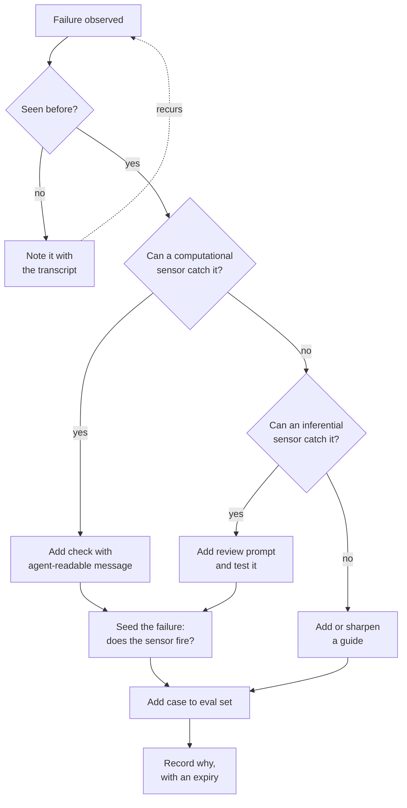

# Guides & Sensors

Look at the instruction file of almost any team that has used agents for six months and you will find its history written in rules. "Never import from the marketing service in billing." "Always run the formatter." "Do not mock the database in integration tests." Each line is a scar from a bad week. Some are followed. Some are not. Nobody knows which, because nothing checks them.

The most useful taxonomy for sorting this out comes from Birgitta Böckeler at Thoughtworks. It is simple enough to remember and sharp enough to design with: **guides** steer the agent before it acts; **sensors** observe what it did and let it correct itself.

Most teams over-invest in guides, more instructions, more rules, more examples, and under-invest in sensors. That is backwards. An agent that cannot see its own failures will repeat them politely forever.

!!! tip "The one-liner"
    Guides without sensors are wishes. Sensors without guides are an expensive way to learn the same lesson repeatedly.

---

## What problem this solves

Without a framework, harness controls accumulate randomly. A rule here after an incident, a check there because someone read a blog post. You end up with forty rules and no idea which failure modes are covered, which rules contradict each other, or which have not mattered since two model releases ago.

Guides and sensors give you a map. For each thing you care about, what steers the agent towards it, and what tells you, and the agent, when it missed? A row with a guide and no sensor is a rule nobody verifies. A row with a sensor and no guide is a check the agent will fail, retry, and fail again before stumbling on the fix. A row with neither is a gap you should know about.

The map also tells you where to spend. Sensors that run on every change are cheap per run and compound over time. Guides cost context on every task, whether or not the task needs them. That asymmetry is why the default order in this playbook is sensors first.

---

## When to use this

**Use it when:**

- Your instruction file keeps growing after every incident.
- The same review comment appears on agent-written changes week after week.
- You are deciding whether a new control should be a rule, a check, or a reviewer prompt.

**Skip it when:**

- The agent cannot yet run your existing tests, linters and type checker. Fix that first; it is the cheapest sensor you will ever add.

---

## Two directions

|                           | Guides (feedforward)                                              | Sensors (feedback)                                                                            |
| ------------------------- | ----------------------------------------------------------------- | --------------------------------------------------------------------------------------------- |
| **When**                  | Before the agent acts                                             | After the agent acts                                                                          |
| **Goal**                  | Raise the odds of a good first attempt                            | Detect problems and enable self-correction                                                    |
| **Examples**              | Instructions, skills, specs, plans, examples, templates, codemods | Tests, type checks, linters, structural tests, review agents, browser checks, runtime signals |
| **Failure if used alone** | Rules that are never verified                                     | An agent that keeps making the same mistakes                                                  |

You need both. In Böckeler's framing, a good outer harness has two goals at once: it raises the probability that the agent gets it right the first time, and it lets the agent correct issues itself before a human ever looks.

A useful name for the second half is **back pressure**. Geoffrey Huntley used the term in his July 2025 Ralph post, where anything from a type system to a test run can be "wired in as back pressure to reject invalid code generation". Moss's January 2026 post "Don't waste your back pressure", which Huntley endorsed, gives the fullest description: structure around the agent that can "provide it with automated feedback on quality and correctness", so it can catch its own mistakes as it goes rather than at the end. Huntley's framing of what changes for engineers is blunt. Software engineering, he writes, "is now about preventing failure scenarios", and "if you aren't capturing your back-pressure then you are failing as a software engineer". Every test, type check, and lint rule your team already has is back pressure the agent can use, provided it can run them and read the results.

**Write sensor output for the agent.** A test failure that says `expected 3, got 4` is useful to a person who already knows the code. One that says `expected 3 line items; discount rows must not be counted — see docs/billing.md#discounts` is useful to an agent that does not. Böckeler calls well-designed sensor messages "a positive kind of prompt injection", and OpenAI's team behind its agent-written product used exactly this pattern: because its lints were custom, it wrote the error messages to inject remediation instructions into the agent's context. It is the cheapest high-leverage change most teams can make: go through the custom checks you already have and rewrite their failure messages to say what to do next.

---

## Two execution types

|                  | Computational                                                                       | Inferential                                                      |
| ---------------- | ----------------------------------------------------------------------------------- | ---------------------------------------------------------------- |
| **What runs it** | Ordinary code on a CPU                                                              | A model                                                          |
| **Examples**     | Tests, linters, type checkers, structural tests, dependency rules, mutation testing | AI code review, LLM-as-judge, semantic duplication detection     |
| **Strengths**    | Fast, cheap, deterministic, cannot be argued with                                   | Understands intent and meaning; catches things no rule describes |
| **Weaknesses**   | Only checks what someone thought to encode                                          | Slower, costlier, non-deterministic, can be confidently wrong    |

The two axes combine. An `AGENTS.md` file or a skill is an inferential guide: a model reads it and decides what to do. A codemod is a computational guide: it reshapes the code before the agent touches it. An ArchUnit-style structural test is a computational sensor. A reviewer agent is an inferential sensor.

**Default to computational.** Use inferential checks where meaning matters and no rule can capture it. marmelab's version of the same advice is crisp: "Scripts measure and never judge; the agent judges and never measures." Let deterministic code extract the facts, such as which files changed, which dependencies moved, which tests touched the changed lines, and let the model reason about them.

There is a second reason to be cautious with inferential sensors, beyond cost. More review is not automatically better. In a 2026 ablation study of natural-language agent harnesses, adding a verifier module changed almost nothing on SWE-bench Verified (73.0% to 73.2%) while adding 8.4 points on a computer-use benchmark, OSWorld; on the same coding benchmark, a multi-candidate search module lowered the score. The value of a reviewer depends on the task. Anthropic's engineers found a related problem in self-review: agents "reliably skew positive when grading their own work", and they got further by tuning a separate evaluator to be sceptical than by asking the generator to critique itself. Taken together, the lesson is not "add a reviewer" or "never add a reviewer". It is that an inferential sensor is a design choice that needs its own evidence, like any other part of the harness.

---

## Three things to govern

Böckeler also distinguishes what the harness is regulating. Each needs its own mix of guides and sensors, and the three are not equally easy.

### Maintainability harness

*Is the code internally healthy?*

The easiest to build, because existing tooling already covers most of it: linters, formatters, complexity and duplication checks, coverage, dependency rules. Models add value on semantic issues such as over-engineering, redundant tests, and misleading names, but Böckeler describes that contribution as expensive and probabilistic. Neither kind of check reliably catches a misdiagnosed problem or a misunderstood instruction. Those need a person, or a better spec.

### Architecture fitness harness

*Does the code respect the system's structural decisions?*

This is where an older idea becomes newly urgent. Neal Ford, Rebecca Parsons and their co-authors defined **fitness functions** in *Building Evolutionary Architectures* (2017): an architectural fitness function "provides an objective integrity assessment of some architectural characteristics", in the Thoughtworks Technology Radar's summary. Module boundaries, dependency direction, performance budgets, logging standards, API conventions. The book's argument was that these checks let architecture evolve safely. Agents make the same checks the main defence against erosion.

Structural tests (`services/billing` must not import from `services/marketing`) are cheap and extremely effective with agents, which otherwise take the shortest path between two points regardless of your architecture. OpenAI's team enforced a layered architecture with custom linters and structural tests for exactly this reason. Böckeler pairs each architectural characteristic with both a guide and a sensor: a performance requirement with a performance test, a logging standard with instructions on how to debug with those logs.

### Behaviour harness

*Does the application actually do what is needed?*

Böckeler calls this "the elephant in the room", and she is right. Common practice is a functional spec as the guide and an agent-written test suite as the sensor, which, in her words, "puts a lot of faith into the AI-generated tests, that's not good enough yet". Tests written by the same agent that implemented the change share its assumptions. They catch real bugs, but not the misunderstanding underneath them. The behaviour harness is where independence matters most:

- **Acceptance criteria** written or approved by a person before implementation.
- **Tests derived from those criteria**, not from the implementation.
- **Browser walkthroughs** and end-to-end checks against a running application. Anthropic found that prompting its long-running agent to test through browser automation, as a user would, substantially improved bug detection.
- **Approved fixtures and snapshots** for outputs that are hard to specify.
- **Production-like environments** and, after release, runtime signals.

See [Verification](../workflow/verification.md).

---

## Timing: keep quality left

Böckeler borrows the principle from continuous integration: place each check as far left on the path to production as possible, because the earlier you find a problem, the cheaper it is to fix.

```text
Agent loop → Pre-commit / push → CI → Pre-release → Continuous
 (seconds)       (seconds)       (minutes)  (minutes–hours)  (always on)
```

| Stage                     | Controls                                                                                                                       |
| ------------------------- | ------------------------------------------------------------------------------------------------------------------------------ |
| **During the agent loop** | Types, linters, fast unit tests, structural tests; the agent runs them itself                                                  |
| **Before commit or push** | Formatting, secret scanning, fast tests                                                                                        |
| **In CI**                 | Full test suite, integration tests, architecture checks, inferential review                                                    |
| **Before release**        | Browser walkthroughs, environment checks, mutation testing on critical paths                                                   |
| **Continuously**          | Drift sensors (dead code, dependency health, coverage quality) and runtime sensors (SLOs, error rates, sampled output quality) |

Stripe's internal agents illustrate the shape. Lint runs on push in under five seconds, and CI is capped at about two rounds, because further rounds rarely help and cost tokens and time. Fast local feedback matters more than exhaustive remote feedback. The continuous row is the one most teams lack. OpenAI's version is a recurring clean-up process that encodes its "golden principles" in the repository, plus a doc-gardening agent that finds stale documentation and opens fix-up pull requests: garbage collection for a codebase that changes faster than people can read it.

---

## The steering loop

The most important practice in the whole harness:

> **When the same problem happens twice, improve the harness so it becomes less likely or impossible.**

Hashimoto describes the same habit as the core of harness engineering; Böckeler describes the human's job as steering the agent "by iterating on the harness". The loop has a fixed preference order, and it is the order that matters.



Agents are good at helping here: drafting structural tests, scaffolding custom lint rules, turning recurring review comments into checks. LangChain's account of improving its own coding agent shows the loop at scale: it ran error-analysis agents over its traces, found the most common failure was an agent that wrote a solution, reread its code, confirmed it looked fine, and stopped, and added a middleware that forces a verification pass before the agent can finish. It also added a loop detector that, after many edits to the same file, suggests reconsidering the approach, and described it as a temporary guardrail for current model limitations. That candour is worth copying: label controls that exist because of today's model, so you know which ones to retest tomorrow.

---

## Worked example: from a recurring failure to a check

The scenario is illustrative.

**Week 1.** A reviewer notices that an agent-written change in the billing service imports a formatting helper from the marketing service. It works, the tests pass, and the reviewer asks for a fix. The agent moves the helper. The failure is noted, with a link to the session transcript.

**Week 3.** The same thing happens in a different change, by a different engineer's session. It has now been seen twice. The steering loop starts.

**The tempting fix.** Add a line to the billing service's `AGENTS.md`: "Do not import from services/marketing." It would take thirty seconds. It is also a guide with no sensor, one more line in a file the agent may or may not weigh against the task in front of it.

**The question the loop asks.** Can a computational sensor catch this? Yes: import direction is exactly what structural tests are for.

**The check.** The engineer asks an agent to write a structural test that fails on any import from `services/marketing` inside `services/billing`, with a failure message written for the next agent:

```text
billing must not depend on marketing (see docs/architecture.md#service-boundaries).
If you need shared formatting, use packages/formatting or ask the billing owner.
Offending import: services/billing/invoice.ts:4
```

**Seeding.** Before trusting it, the engineer reverts one of the two offending changes on a branch and confirms the test fires, then confirms it stays silent on the current main branch. A sensor that has never been seen to fire is not yet a sensor.

**The guide, now pointing at the sensor.** The line in `AGENTS.md` becomes shorter and more useful: "Service boundaries are enforced by `tests/architecture`; read the failure message." The guide no longer has to carry the rule; it only has to tell the agent where the rule lives.

**The record.** A short harness change record says what happened, links the two transcripts, and notes the expiry condition: none, because this is an architectural decision rather than a model workaround. Both original tasks go into the eval set as regression cases.

**What went wrong on the way.** The first version of the test also matched a legitimate import from a shared `packages/` directory and blocked an unrelated change the next day. The engineer added the missing negative case to the guard's own tests. A guard that blocks legitimate work gets disabled; testing it in both directions is part of building it. See [Testing & Evolving the Harness](testing-and-evolving.md).

---

## Roles and ownership

| Role               | Responsibility                                                  |
| ------------------ | --------------------------------------------------------------- |
| **Harness owner**  | Maintains the map of guides and sensors; runs the steering loop |
| **Area owners**    | Define architecture fitness rules for their areas               |
| **Product and QA** | Own acceptance criteria and the behaviour harness               |
| **Engineers**      | Turn recurring failures into proposals for new controls         |

---

## What good looks like

| Signal                           | What you observe                                       |
| -------------------------------- | ------------------------------------------------------ |
| **Sensors before guides**        | The agent can run every check a human would            |
| **Agent-readable failures**      | Error messages say what to do next                     |
| **Computational by default**     | Inferential checks used where meaning matters          |
| **Architecture encoded**         | Boundaries are tests, not tribal knowledge             |
| **Independent behaviour checks** | Acceptance tests not written by the implementing agent |
| **Recurring failures disappear** | The steering loop is visible in the change record      |

---

## Failure modes and mitigations

These failures tend to unfold the same way. An incident produces a rule, the rule produces a paragraph, and after enough incidents the instruction file is long enough that the agent weighs each line less. Meanwhile, the checks that could have caught the original failures were never written, or were written once and never tested.

| Failure mode               | What it looks like                                                | Mitigation                                         |
| -------------------------- | ----------------------------------------------------------------- | -------------------------------------------------- |
| **Guide inflation**        | Every failure produces another paragraph of instructions          | Prefer a sensor when the failure is checkable      |
| **Silent sensors**         | A check that never fires: is the code perfect or the check blind? | Seed known failures to confirm sensors detect them |
| **Inferential everything** | An LLM reviews what a linter could check                          | Computational first                                |
| **Reviewer stacking**      | More review agents added without evidence they help               | Evaluate each inferential sensor like any change   |
| **Self-graded behaviour**  | The agent's own tests are the only proof it works                 | Independent acceptance checks                      |
| **Contradictory controls** | A guide says one thing, a sensor enforces another                 | Review guides and sensors together                 |

!!! info "What we know / what we don't"
    The taxonomy is well established and widely adopted, and the advice to prefer computational sensors is consistent across sources. What nobody has yet is the equivalent of code coverage for a harness: Böckeler names the need for a way to measure harness coverage, "similar to what code coverage and mutation testing do for tests". She also asks the right uncomfortable question: "If sensors never fire, is that a sign of high quality or inadequate detection mechanisms?" Seeding known failures is the best approximation today. The behaviour harness remains the least solved part.

!!! note "Last reviewed"
    October 2026.

---

## Further reading

- **[Harness engineering for coding agent users](https://martinfowler.com/articles/harness-engineering.html)** by Birgitta Böckeler (martinfowler.com) — The source of the guides and sensors taxonomy and the three regulation categories.
- **[SE Radio 730: Birgitta Böckeler on harness engineering for AI agents](https://se-radio.net/2026/07/se-radio-730-birgitta-boeckeler-on-harness-engineering-for-ai-agents/)** by Software Engineering Radio — A long conversation on guides, sensors, and how harnesses help humans prioritise review.
- **[Ralph Wiggum as a "software engineer"](https://ghuntley.com/ralph/)** by Geoffrey Huntley — Where the term back pressure entered the agent conversation, in July 2025.
- **[Don't waste your back pressure](https://banay.me/dont-waste-your-backpressure/)** by Moss — The fullest write-up of back pressure for agents.
- **[Pressure](https://ghuntley.com/pressure/)** by Geoffrey Huntley — Huntley's endorsement, and back pressure as the engineer's main lever. (Partly paywalled.)
- **[Natural-language agent harnesses](https://arxiv.org/abs/2603.25723)** by Pan et al. — Module-by-module ablations of a harness, including verifiers and file-backed state. (Preprint.)
- **[Architectural fitness function](https://www.thoughtworks.com/radar/techniques/architectural-fitness-function)** by Thoughtworks Technology Radar — The fitness function idea from *Building Evolutionary Architectures*, in one paragraph.
- **[Improving Deep Agents with harness engineering](https://www.langchain.com/blog/improving-deep-agents-with-harness-engineering)** by LangChain — A steering loop run on traces, with verification and loop-detection middleware. (Vendor post.)
- **[Harness design for long-running application development](https://www.anthropic.com/engineering/harness-design-long-running-apps)** by Anthropic — Why a separate, sceptical evaluator beats self-review. (Vendor post.)
- **[Minions: Stripe's one-shot, end-to-end coding agents](https://stripe.dev/blog/minions-stripes-one-shot-end-to-end-coding-agents)** by Stripe — Fast local feedback and capped CI rounds in practice.
- **[The state of AI harness engineering 2026](https://marmelab.com/blog/2026/09/24/the-state-of-ai-harness-engineering-2026.html)** by marmelab — "Scripts measure, agents judge", and evidence on reviewer agents.

---

## Related pages

- [Hooks & Deterministic Guards](../foundations/hooks-and-guards.md) — The mechanics of computational controls inside the agent loop.
- [Verification](../workflow/verification.md) — The behaviour harness in the delivery workflow.
- [Testing & Evolving the Harness](testing-and-evolving.md) — How to know whether your controls help.
- [Harnessability](harnessability.md) — Why some codebases give sensors so much more to work with.
