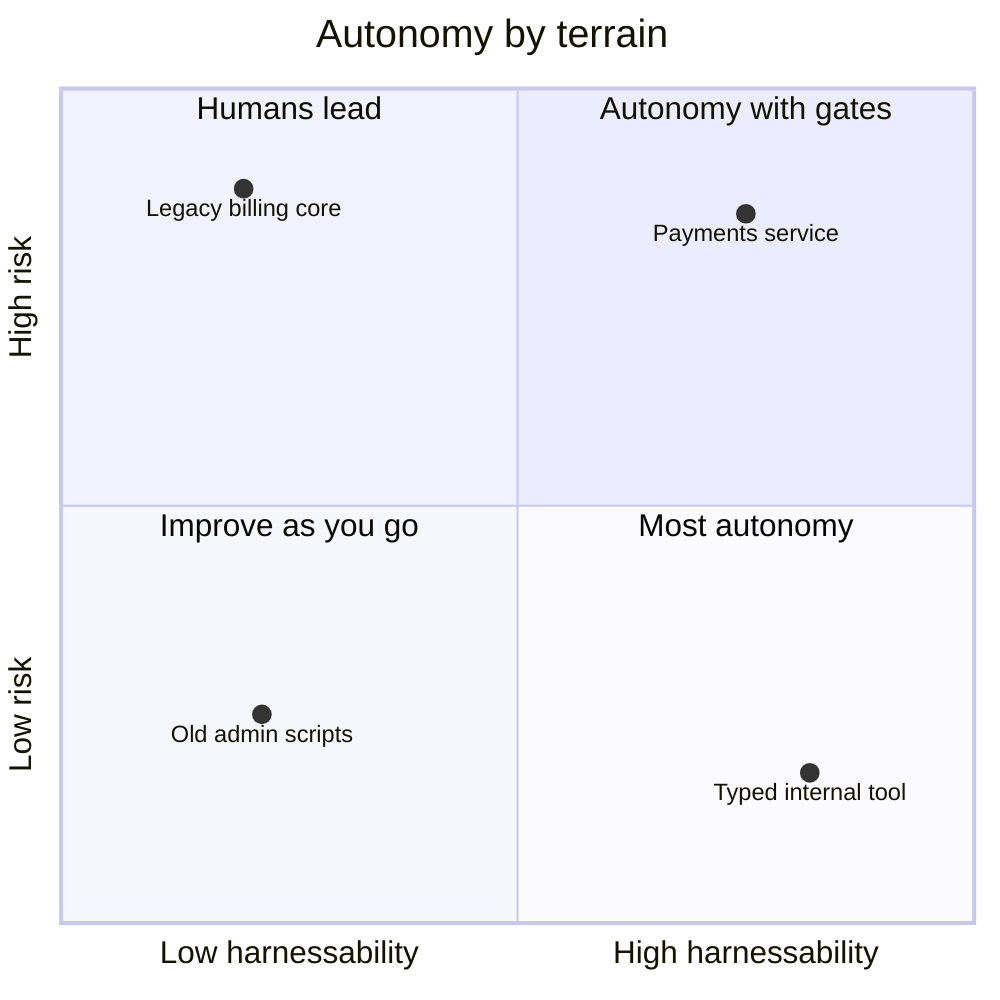

# Harnessability

Some codebases are a pleasure to work on with agents. Others turn every task into an argument. The same agent, with the same model and the same instruction file, will close a well-scoped ticket in a typed service with a fast test suite before you have finished your coffee, and then spend an afternoon in the untyped monolith next door producing changes that look right, pass the three tests that exist, and break something nobody thought to check.

The difference is rarely the agent. It is how much of the codebase's knowledge is explicit, checkable, and close to the code.

Böckeler calls this **harnessability**: how amenable a codebase is to being harnessed. It is worth thinking about directly, because improving it pays off for every agent, every engineer, and every future model.

!!! tip "The one-liner"
    The harness is most needed where it is hardest to build, so every task in a hard codebase should leave it a little easier to harness.

---

## What problem this solves

Teams often conclude "agents don't work on our codebase" when the real finding is "our codebase gives agents nothing to check against." Without types, the type checker cannot catch a wrong argument. Without fast tests, the agent cannot run them in its loop. Without clear boundaries, no structural test can say which import is wrong. The agent is left with only guides, and guides without sensors are wishes.

There is evidence that the terrain matters. Yegor Denisov-Blanch's Stanford research on developer productivity, presented at the AI Engineer World's Fair in 2025 and based on data from nearly 100,000 developers, reported an average productivity boost of around 20% but very wide variance, with some teams seeing productivity decrease. The talk's published summary attributes that variance to task complexity, codebase maturity, language popularity and codebase size. It is a conference talk rather than a peer-reviewed paper, and it predates most of the harness practices on this site. But it matches what most teams report: the same tools produce very different results on different parts of the same system.

Knowing what makes code harnessable tells you where to invest, and sets realistic expectations for each part of your system.

---

## When to use this

**Use it when:**

- Agents work well in one part of the system and badly in another.
- You are starting a new project and can still choose its shape.
- You are deciding how much autonomy to give agents in each area.

**Skip it when:**

- Agents cannot yet run your existing checks at all. Start with [Guides & Sensors](guides-and-sensors.md).

---

## What makes a codebase harnessable

Böckeler's article puts it plainly: "Not every codebase is equally amenable to harnessing." Strong typing makes type-checking sensors possible; clear module boundaries make architectural rules possible; opinionated frameworks reduce the surface an agent has to get right. She borrows Ned Letcher's term **ambient affordances** for the underlying idea: "structural properties of the environment itself that make it legible, navigable, and tractable to agents operating within it".

| Property                    | Why it helps agents                                                                        |
| --------------------------- | ------------------------------------------------------------------------------------------ |
| **Static types**            | The type checker is a fast, free sensor that catches a large class of mistakes immediately |
| **Fast, reliable tests**    | The agent can run them in its loop and trust the result                                    |
| **Clear module boundaries** | Changes stay local; structural tests can enforce the boundaries                            |
| **One way to do things**    | Agents copy patterns; consistent patterns get copied correctly                             |
| **Opinionated frameworks**  | Conventions are encoded in the framework rather than in tribal knowledge                   |
| **Accurate, nearby docs**   | Context is easy to load and trustworthy                                                    |
| **Runnable locally**        | The agent can start the app, drive it, and see what happens                                |
| **Good error messages**     | Failures tell the agent what went wrong                                                    |

None of this is new. It is what good engineers have always wanted. Agents make the return on it larger and more immediate. Stripe's write-up about its internal coding agents puts it in one line: "if it's good for humans, it's good for LLMs, too." The flip side is less comfortable. A codebase that was always hard for new joiners is now hard for every agent session, every day, and the cost that used to land on onboarding now lands on every change.

### Let the agent run the thing

The property most teams underrate is the last-but-one: can the agent start the application and observe it? OpenAI's harness engineering team made the application startable per Git worktree, wired the Chrome DevTools Protocol into the agent's runtime, and gave each worktree its own ephemeral logs, metrics and traces, so the agent could reproduce a bug and watch its fix work. That made prompts like "ensure service startup completes in under 800ms" tractable. marmelab's recommendation generalises it: let agents run and verify the app, then turn the checks they ran into scripts that need no model. An agent that can only read code can only guess about behaviour. An agent that can run it can find out.

---

## Matching autonomy to the terrain

Harnessability is one axis. Risk is the other. Together they say how much autonomy a part of the system can safely have.



**High harnessability, low risk** is where agents can run with the least supervision: the checks are good and mistakes are cheap. **High harnessability, high risk** can still go fast, but through the judgment and control gates described in [Human Gates](human-gates.md). **Low harnessability, low risk** is where to invest opportunistically: every task can add a type or a test. **Low harnessability, high risk** is where people lead and agents assist, mostly with research and archaeology, until the terrain improves. See [Risk Tiers & Autonomy](../factories/risk-tiers-and-autonomy.md).

The positions in the chart are examples, not a ranking. The useful exercise is to place your own areas on it, and to notice that a single repository usually spans several quadrants.

---

## Greenfield

On a new project you can design harnessability in from day one:

- **Choose a typed language and an opinionated framework.**
- **Set up structural tests for boundaries** before the boundaries erode.
- **Keep the test suite fast from the start.** It is far easier to keep fast than to make fast.
- **Write `AGENTS.md` alongside the first commit**, not after the hundredth.
- **Make the app runnable and inspectable by agents:** logs, health endpoints, seed data, a one-command start.

OpenAI's agent-written product is the extreme case: everything, including the application, tests, CI, documentation and observability, was built for agents to work on. The team, three engineers growing to seven, split each business domain into fixed layers through which code may only depend forwards (Types → Config → Repo → Service → Runtime → UI), enforced by custom linters and structural tests. Most greenfield projects do not need that, but they can borrow the instinct.

!!! warning "The greenfield drift trap"
    Greenfield is where agents look most impressive and where architecture drifts fastest, because there is no existing structure to copy. Speed can outrun understanding by month three. Settle the architecture explicitly and encode it in checks early, while it is still cheap.

---

## Legacy

Böckeler names the hard case directly: in legacy systems, "the harness is most needed where it is hardest to build." There are few types, slow or flaky tests, several competing patterns, and knowledge that lives with people who may have left.

What helps:

- **Research before change.** Separate research and planning phases matter much more here. See [Research & Planning](../workflow/research-and-planning.md).
- **Characterisation tests first.** Before an agent changes legacy behaviour, have it (or you) pin the current behaviour with tests. They are the sensor the codebase never had.
- **Nested instructions for the dangerous areas.** "This module has hidden callers via reflection: search for string references before renaming anything."
- **Improve harnessability incrementally.** Add types to the module you are touching. Speed up the test you keep waiting for. Every task can leave the area a little more harnessable.
- **Use agents for archaeology.** Tracing behaviour across a system nobody fully understands is exactly the voluminous work agents are good at. See [Migrations at Scale](../frontier/migrations-at-scale.md).

Böckeler's earlier memo asks whether retrofitting a harness onto an older codebase is worth the effort at all. It is a fair question, and the answer depends on the code's future. A module scheduled for replacement may only need characterisation tests and research support. A module the business will depend on for another decade is where the investment compounds most.

---

## Monorepos

Monorepos combine the best and worst cases: shared tooling and conventions, but enormous context and many owners.

- **Nested `AGENTS.md` per package or domain.** Conditional rules by subdirectory, as Stripe does.
- **Targeted test commands.** The agent must be able to run only the affected tests; document exactly how.
- **Ownership files.** Make code owners explicit, so agent changes route to the right reviewers.
- **Dependency rules as structural tests.** Monorepos rot through unintended imports, and agents take the shortest path.

---

## Harness templates and requisite variety

Böckeler suggests a further step: bundles of guides and sensors for common service topologies, a "standard API service harness" or a "standard frontend app harness". She describes a harness template as "a bundle of guides and sensors that leash a coding agent to the structure" of a topology, and connects it to the service templates many organisations already use to put new services on a golden path.

The argument behind it comes from cybernetics. W. Ross Ashby's **law of requisite variety** says, in the Principia Cybernetica summary, that "the larger the variety of actions available to a control system, the larger the variety of perturbations it is able to compensate", or, in the slogan, "only variety can destroy variety". Böckeler's version for harnesses: "a regulator must have at least as much variety as the system it governs." A harness that has to cover every possible shape of service needs an enormous number of controls. Committing to a few topologies narrows what the agent can produce, which makes a comprehensive harness achievable. She calls it "a variety-reduction move".

This is an argument for platform engineering and paved roads that predates AI and becomes much stronger with it. It also brings the old problems of templates with it, which Böckeler names: copies fall out of sync with upstream changes, and versioning and contribution are harder when some of the controls are non-deterministic. A harness template is a starting point that each team shapes, and someone has to own keeping the copies honest. See [Ownership & Change](ownership-and-change.md).

---

## Worked example: raising the score of a legacy module

The scenario is illustrative.

**The complaint.** After a month with agents, a team concludes that "AI doesn't work on billing". Agent changes there are reverted three times as often as anywhere else.

**The assessment.** The tech lead runs the checklist at the bottom of this page against the billing module. It scores 2 out of 8: there is an owner, and the app can be run locally. There are no types in the module, the only test command runs the whole suite in 25 minutes, three different patterns exist for database access, and the module's documentation describes a design that was abandoned years ago.

**Setting the autonomy.** For now, billing sits in the "humans lead" quadrant. Agents do research and draft characterisation tests; engineers make the changes.

**The first investments, chosen by pain.** Rather than a big clean-up, the team picks the three changes that remove the most friction for both people and agents:

1. **A targeted test command** that runs only billing's tests, in under a minute. This alone lets an agent run tests in its loop.
2. **Characterisation tests** for invoice calculation, drafted by an agent from production examples and reviewed line by line by the module's owner. Two of the agent's drafts encode a bug as expected behaviour; the owner catches it, and the team files the bug instead.
3. **A short nested `AGENTS.md`** that names the one database-access pattern to use from now on, with a structural test that fails on new uses of the other two.

**Six weeks later.** The module scores 5 out of 8. Agent reverts in billing drop to roughly the level of the rest of the codebase. The team moves billing to "autonomy with gates" for changes outside invoice calculation, which still requires an approach review.

**What went wrong on the way.** The first attempt to add types to the whole module in one agent-driven pull request produced a diff nobody could review, and it was abandoned. Types now arrive one file at a time, alongside whatever change touches that file.

---

## Roles and ownership

| Role                         | Responsibility                                                        |
| ---------------------------- | --------------------------------------------------------------------- |
| **Tech lead**                | Assesses harnessability per area; chooses where to invest             |
| **Area owners**              | Own the characterisation tests and nested instructions for their area |
| **Platform team** (at scale) | Builds harness templates and paved roads; keeps them in sync          |
| **Engineers**                | Leave each area a little more harnessable than they found it          |

---

## What good looks like

| Signal                                      | What you observe                                 |
| ------------------------------------------- | ------------------------------------------------ |
| **Agents can run every check a human runs** | Locally, quickly                                 |
| **Agents can run the app**                  | And observe its behaviour, not just its code     |
| **Boundaries are enforced**                 | Structural tests fail on unintended dependencies |
| **Harnessability improves with each task**  | Types and tests added where agents work          |
| **Expectations match the terrain**          | Teams know which areas need more human attention |

---

## Failure modes and mitigations

These failures share a root: treating the codebase as uniform. One bad week in the hardest part of the system becomes a verdict on agents everywhere, or a good month in the easiest part becomes a reason to grant the same autonomy to all of it.

| Failure mode          | What it looks like                                           | Mitigation                                       |
| --------------------- | ------------------------------------------------------------ | ------------------------------------------------ |
| **Blaming the agent** | "AI doesn't work here" after one bad week in the legacy core | Assess harnessability; invest where it is lowest |
| **Uniform autonomy**  | Same autonomy in the typed service and the untested monolith | Tie autonomy to harnessability and risk          |
| **Greenfield drift**  | Fast early progress; tangled architecture by month three     | Encode architecture in checks from the start     |
| **Slow feedback**     | Agents wait ten minutes per test run                         | Invest in targeted, fast tests                   |
| **Big-bang clean-up** | One huge harnessability pull request nobody can review       | Improve one file at a time, with the work        |
| **Template drift**    | Harness templates forked and never synced                    | An owner and a version for each template         |

!!! info "What we know / what we don't"
    The properties that make a codebase harnessable are well understood and uncontroversial. What we lack is good measurement: harnessability scores like the one below are judgment, not metrics, and the published evidence on how much AI helps in legacy versus greenfield code comes mainly from conference talks and vendor reports rather than peer-reviewed studies.

---

## Copy this: a harnessability assessment

```text
Area / service:
[ ] Typed (or type-checked) — coverage: ___%
[ ] Single-test command documented and < 30s
[ ] Full suite < 10 min and reliable
[ ] Module boundaries enforced by tests
[ ] One dominant pattern per concern (data access, errors, logging)
[ ] App runnable locally by an agent, with seed data
[ ] Area-specific AGENTS.md exists and is current
[ ] Owners defined

Score (0–8):
Risk (low / medium / high):
Autonomy we will allow here:
Top investment to raise the score:
```

---

## Further reading

- **[Harness engineering for coding agent users](https://martinfowler.com/articles/harness-engineering.html)** by Birgitta Böckeler (martinfowler.com) — Harnessability, ambient affordances, and harness templates.
- **[Harness engineering memo](https://martinfowler.com/articles/exploring-gen-ai/harness-engineering-memo.html)** by Birgitta Böckeler (martinfowler.com) — Harnesses as future service templates, and whether retrofitting is worth it.
- **[The law of requisite variety](https://pespmc1.vub.ac.be/REQVAR.html)** by Francis Heylighen and Cliff Joslyn (Principia Cybernetica) — Ashby's law, with its limits.
- **[Minions: Stripe's one-shot, end-to-end coding agents](https://stripe.dev/blog/minions-stripes-one-shot-end-to-end-coding-agents)** by Stripe — Building on the tooling humans already had, with rules per subdirectory.
- **[Harness engineering](https://openai.com/index/harness-engineering/)** by Ryan Lopopolo (OpenAI) — A codebase designed for agents from the first commit. (Vendor post.)
- **[OpenAI introduces harness engineering: Codex agents power large-scale software development](https://www.infoq.com/news/2026/02/openai-harness-engineering-codex)** by Leela Kumili (InfoQ) — An independent summary of OpenAI's layered architecture and structural tests.
- **[Does AI actually boost developer productivity?](https://www.youtube.com/watch?v=tbDDYKRFjhk)** by Yegor Denisov-Blanch (Stanford, AI Engineer World's Fair) — Why results vary with codebase maturity and task complexity. (Conference talk.)
- **[The state of AI harness engineering 2026](https://marmelab.com/blog/2026/09/24/the-state-of-ai-harness-engineering-2026.html)** by marmelab — Letting agents run the app, and OpenAI's environment design.

---

## Related pages

- [Guides & Sensors](guides-and-sensors.md) — The controls a harnessable codebase makes possible.
- [Risk Tiers & Autonomy](../factories/risk-tiers-and-autonomy.md) — Turning terrain and risk into autonomy levels.
- [Research & Planning](../workflow/research-and-planning.md) — The phases that matter most in legacy code.
- [Migrations at Scale](../frontier/migrations-at-scale.md) — Agents as archaeologists in old systems.
