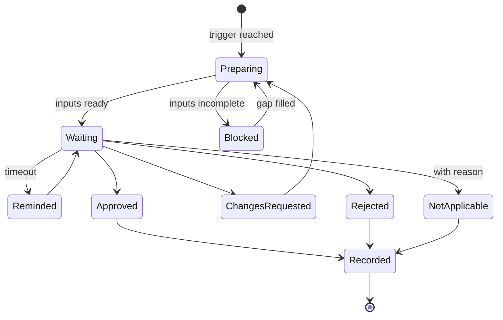

# Human Gates

One of the most important design questions in any harness is deceptively simple: **where should it stop and wait for an engineer?**

I first approached it as a question of control. Which decisions should never be delegated? Where do we need explicit approval? Which actions are too consequential for an agent to take alone? Those questions still matter. But over time I started to see the boundary differently. The places where the harness has to stop are not simply the weaknesses of the system. They are often the points where the most valuable engineering work begins.

And later, while thinking about how people early in their careers build judgment, I saw a third thing in the same list. The gates in my team's harness are a written record of every decision in our process that requires judgment, with the evidence it needs and the reason it cannot be handed over. That is close to a curriculum.

!!! tip "The one-liner"
    A human gate is not an approval step. It is the transition from information processing to product judgment.

---

## What problem this solves

Without explicit gates, two things happen. Either agents run straight through decisions that needed a person, and you get *a polished answer to an incomplete question*, or people approve everything out of habit, and the gate is theatre.

The second failure is better documented than most teams realise. In a March 2026 engineering post, Anthropic reported that users of Claude Code accept 93% of permission prompts anyway, and named the result: "approval fatigue, where people stop paying close attention to what they're approving." By August its figure was 97%, and in a controlled experiment with 1,053 paid professional testers, working in a test environment where one permission prompt per session was swapped for a clearly dangerous command, human review caught just 13.6% of those commands. Anthropic was using those numbers to argue for its own classifier-based approval mode, so read them as a vendor making a case. But the mechanism they describe is old. Lisanne Bainbridge's *Ironies of Automation* made the point in 1983: automate the routine and you leave the operator only the exceptions, while removing the practice that made exceptions manageable.

Anthropic's August post contains a detail that matters more for harness design than the headline. Users rejected only 3% of individual permission requests, but 39% of the plans Claude presented for approval. Plans and commands differ in content as well as framing, so this is an inference rather than a finding, but it is the one I would design around: people engage with decisions that are framed as decisions, and wave through interruptions that are framed as interruptions.

Well-designed gates do two jobs at once: they protect against consequential mistakes, and they mark the transition from **information processing to product judgment**.

---

## When to use this

**Use it when:**

- Agents can take actions that are irreversible, external, or expensive.
- A step in your workflow needs context that no system the agent can read contains.
- Approvals in your current process happen in seconds and rarely say no.

**Skip it when:**

- The question can be answered by a check. Make it a sensor instead; see [Guides & Sensors](guides-and-sensors.md).
- The action is cheap to reverse and low risk. A sandbox or an undo beats an approval.

---

## The two kinds of gate

|                          | Control gate                                                                  | Judgment gate                                                                                        |
| ------------------------ | ----------------------------------------------------------------------------- | ---------------------------------------------------------------------------------------------------- |
| **Purpose**              | Prevent an irreversible or high-risk action                                   | Bring in understanding that does not exist in the data                                               |
| **Examples**             | Merge to `main`, production migration, external communication, spending money | Committing to a problem, accepting a scope, interpreting rollout signals, deciding keep/iterate/kill |
| **What the person does** | Verifies evidence and approves or rejects                                     | Leaves the tool, talks to people, and brings context back                                            |
| **Failure mode**         | Rubber-stamping                                                               | Treated as a formality, so the conversation never happens                                            |

Control gates are well understood, and many of them can eventually be replaced by better sensors and boundaries: a sandbox that makes an action reversible removes the need to approve it. Judgment gates cannot be replaced that way, because what they need is not in any system the agent can read. They are where most of the value, and most of the neglect, lives.

---

## Why judgment gates matter

An agent can gather large amounts of context, compare metrics, trace behaviour across repositories, summarise past decisions, and produce a plausible recommendation. What it cannot do is understand why one stakeholder sees the problem differently from another, which constraint has never been written down, what a customer is struggling to express, or whether solving the visible request would address the real need underneath it.

More data does not remove the need for those conversations. A metric can show that something is happening, but not always why it matters. A support ticket can describe a problem, but not how representative it is. A stakeholder can request a feature, but understanding the desired outcome may require challenging the request, talking to users, involving another team, or reframing the problem entirely.

The harness can arrive at those moments with the repetitive work already done: evidence collected, gaps identified, contradictions surfaced, questions prepared. Then the engineer has to leave the tool, talk to people, and bring that understanding back into the process.

Seen that way, the useful question is not only what the agent is capable of doing. It is where an engineer can add understanding that does not exist in the available data. That is where the harness should stop, not because the work cannot continue technically, but because continuing without those conversations would produce a polished answer to an incomplete question. It is also where engineers get to spend more of their time on [the work that leaves no commit](https://dreamingecho.es/blog/engineering-value-beyond-code).

---

## Gates as teaching positions

There is a second use for judgment gates that I only saw after building them.

Entry-level work used to run a loop that quietly produced senior judgment: be put inside a problem whose end you cannot see, form a view before anyone tells you whether it is right, choose, and let reality correct you with someone nearby to explain what you missed. AI shortens that loop at exactly the point where the learning was, because it lets anyone go from a problem to a plausible answer without forming a view first.

Hiring alone does not fix this. Enrique Ide's economic model of how knowledge passes between generations predicts that entry-level automation can raise output now and reduce long-run growth even when junior employment is unchanged, if it moves novices away from the most skilled experts. Tacit knowledge passes between people working on the same problem at the same time. If a junior engineer only sits downstream of a gate, reviewing what the system already produced, the headcount looks fine and the transmission is still broken.

So the gates are worth a second design pass. Not as rubber stamps, but as places to put somebody less experienced *inside* the decision while it is being made, close enough to hear the reasoning form rather than meet it after it has hardened. A practical pattern: at a judgment gate, the less experienced engineer writes their view before reading the agent's recommendation, and the gate owner asks what else was considered before saying anything about what was chosen. See [Growing Judgment](../team/growing-judgment.md).

---

## Where gates usually belong

A typical product-engineering flow has judgment and control gates at predictable points:

| Gate                       | Type               | The question a person answers                                      |
| -------------------------- | ------------------ | ------------------------------------------------------------------ |
| **Problem commitment**     | Judgment           | Is this worth solving, and for whom?                               |
| **Scope acceptance**       | Judgment           | Which trade-offs are acceptable? What are we explicitly not doing? |
| **Approach review**        | Judgment + control | Is this the right way to build it, before code exists?             |
| **Merge**                  | Control            | Is the evidence enough to trust this change?                       |
| **Rollout advance**        | Judgment + control | What do the signals mean for real users? Should exposure grow?     |
| **Impact decision**        | Judgment           | Keep, iterate, or reconsider? What did we learn?                   |
| **External communication** | Control            | Is this safe and right to send? (Agents draft, people send.)       |

Each judgment gate has the same shape. Before committing to a problem, somebody needs to understand whether it is worth solving and for whom. Before accepting a scope, somebody needs to explore the trade-offs with product, design, and the teams affected by it. Before advancing a rollout, somebody needs to interpret the signals in the context of real users. After release, somebody needs to decide what the results mean.

Not every change needs every gate. A dependency patch might only need merge. A new product surface needs all of them. Tie gate requirements to [risk tiers](../factories/risk-tiers-and-autonomy.md), and notice that the approach review is the cheapest place to reject work: before code exists, saying no costs a conversation, not a rewrite. See [Intent Before Code](../workflow/intent-before-code.md).

---

## Designing a gate

Every gate should define:

1. **Trigger:** when the harness stops.
2. **Inputs:** exactly what the person sees: evidence, open questions, recommendation, what the agent could not verify.
3. **The decision:** the options available (approve, reject, request changes, mark not applicable with a reason).
4. **Owner:** a named role, not "someone".
5. **Output:** what gets recorded, and what the next step consumes.
6. **Timeout behaviour:** what happens if nobody decides. Usually nothing proceeds, and someone is reminded.

The lifecycle of a single gate is a small state machine. Writing it down is what stops "approved by default after a timeout" from creeping in.

Two transitions carry most of the design. **Blocked** exists because a gate presented with incomplete inputs invites a guess; the harness should refuse to ask for a decision it cannot support. **Reminded** loops back to waiting rather than forward to approved, because silence is not consent.

The inputs matter most. A gate that presents a wall of agent output invites rubber-stamping. A gate that presents a short recommendation, the evidence behind it, and an explicit list of what could not be verified invites a decision. The permission study marmelab summarises adds a warning about the opposite instinct: participants who wrote rules up front, instead of approving each action, blocked fewer bad actions, partly because most of them set their rules to "ask me" and then approved the prompts anyway. Moving the decision earlier only helps if the decision is still a real one.

---

## Worked example: redesigning a gate after rubber-stamping

The scenario is illustrative.

**The gate.** A team's harness stops before merge for any change the agent marks as touching a public API. The gate shows the full diff, the test results and a model-written summary, and asks the reviewer to approve.

**The signal.** After two months, the harness owner looks at the gate's numbers. Approval rate: 99%. Median time from opening the gate to approving: under two minutes, for diffs that average several hundred lines. Then a breaking change to an API response field ships, and a partner integration fails. The change went through the gate. It was approved in ninety seconds.

**The diagnosis.** In the retro, the reviewer is honest: the diff was long, the tests were green, the summary said "no breaking changes", and nothing on the screen pointed at the field. The gate asked a person to do in ninety seconds what the harness should have done in advance. It presented everything and highlighted nothing.

**The redesign.**

- **A sensor takes over the checkable part.** A computational check compares the API schema before and after and lists every removed or renamed field. That question no longer needs a human at all.
- **The inputs shrink.** The gate now shows: the schema diff, which consumers are known to use the changed fields, what the agent could not verify (for example, unknown external consumers), and a one-line recommendation. The full diff is a link, not the page.
- **The decision becomes explicit.** The reviewer chooses between "compatible", "breaking — versioned", and "breaking — needs a conversation with consumers". The third option routes to a judgment gate owned by the API owner, who talks to the affected teams.
- **The trigger narrows.** Changes with an empty schema diff no longer stop at the gate at all.

**What changed.** The gate fires far less often. When it fires, the approval rate is lower and the time spent is longer, which is the point. Over the following months the "needs a conversation" option is chosen a handful of times, and each time a consumer team hears about the change before it ships rather than after. The harness owner tracks one more number: how often a gate decision differs from the agent's recommendation. A gate that never disagrees is either unnecessary or unattended.

**What went wrong on the way.** The first redesign kept the old gate *and* added the new one, so reviewers saw two prompts for the same change and approved both faster. Removing the old gate was part of the fix.

---

## Keeping gates honest

**Measure approval rates and decision times.** If a gate is approved 100% of the time, either the upstream work is excellent or nobody is looking. The numbers do not tell you which; a conversation with the people at the gate does.

**Make rejection cheap.** If rejecting means hours of rework, people will approve marginal work. Earlier, smaller gates make rejection cheaper.

**Rotate gatekeepers on judgment gates.** Fresh eyes ask different questions, and rotation is how less experienced engineers get inside the decision.

**Convert checkable gates into sensors.** If a gate's question can be answered by code, answer it with code and keep the person for what code cannot answer.

**Remove gates that never change outcomes.** Every gate costs attention. If a gate has not changed a decision in months, it may belong as a deterministic check instead, or not at all.

!!! warning "The approval fatigue trap"
    Each extra gate feels like extra safety. Past a point, each one makes every other gate weaker, because attention is shared. Fewer gates with better inputs beat more gates with the same inputs.

---

## Roles and ownership

| Role                             | Responsibility                                                  |
| -------------------------------- | --------------------------------------------------------------- |
| **Harness owner**                | Implements gates; reports approval rates and wait times         |
| **Gate owners** (named per gate) | Make the decisions; challenge weak inputs                       |
| **Engineering manager**          | Ensures gate owners have time to do the work behind the gate    |
| **Product partner**              | Co-owns problem, scope, rollout, and impact gates               |
| **Less experienced engineers**   | Take part in judgment gates while decisions are made, not after |

---

## What good looks like

| Signal                                | What you observe                                                       |
| ------------------------------------- | ---------------------------------------------------------------------- |
| **Gates change outcomes**             | A meaningful share of decisions differ from the agent's recommendation |
| **Engineers talk to people at gates** | Judgment gates trigger conversations with users and stakeholders       |
| **Inputs are short**                  | Recommendation, evidence, unknowns, on one screen                      |
| **Waits are visible**                 | Time spent waiting at gates is tracked and managed                     |
| **Gates scale with risk**             | Small changes pass fewer gates than large ones                         |
| **Gates teach**                       | Less experienced engineers sit inside judgment gates                   |

---

## Failure modes and mitigations

Gates rarely fail in one dramatic moment. Approval gets a little faster each week, inputs get a little longer, and one day a gate that used to start conversations has become a button.

| Failure mode                       | What it looks like                                                | Mitigation                                                  |
| ---------------------------------- | ----------------------------------------------------------------- | ----------------------------------------------------------- |
| **Rubber-stamping**                | Approval within seconds, every time                               | Better inputs; approval-rate monitoring; smaller gates      |
| **Gate sprawl**                    | Every step needs approval                                         | Tie gates to risk tiers; convert checkable gates to sensors |
| **Approval without understanding** | The person approves what they cannot evaluate                     | Gate owners must be able to judge the evidence              |
| **Polished incomplete answers**    | The harness skips a judgment gate because it "had enough data"    | Judgment gates cannot be skipped by the agent               |
| **Unowned gates**                  | "The team" approves; nobody actually does                         | Named roles per gate                                        |
| **Downstream-only juniors**        | Less experienced engineers only see decisions after they are made | Put them inside judgment gates                              |

!!! info "What we know / what we don't"
    Approval fatigue is well documented, though the best numbers come from a vendor arguing for its own alternative. Anthropic's data suggests people engage more with plans than with individual permission prompts, though the two also differ in content. We do not yet have good evidence on which gate designs keep attention high over months, or on how much judgment gates actually help people grow; the teaching argument is a design hypothesis, not a measured result.

---

## Copy this

Use the [Human Gate Definition](../templates/human-gate-definition.md) template for each gate in your harness. Fill in the inputs section first; if you cannot say what the person will see, the gate is not ready.

---

## Further reading

- **[The AI harness should follow the conversation](https://dreamingecho.es/blog/the-ai-harness-should-follow-the-conversation)** by Iván González Sáiz — Gates as the transition from information processing to product judgment.
- **[Growing engineering judgment without the grunt work](https://dreamingecho.es/blog/growing-engineering-judgment-without-grunt-work)** by Iván González Sáiz — Human gates as teaching positions.
- **[Engineering value beyond code](https://dreamingecho.es/blog/engineering-value-beyond-code)** by Iván González Sáiz — The work that happens at judgment gates.
- **[Claude Code auto mode](https://www.anthropic.com/engineering/claude-code-auto-mode)** by Anthropic — The 93% figure and a clear description of approval fatigue. (Vendor post.)
- **[Auto mode is now the default in Claude Code](https://claude.com/blog/auto-mode-default-in-claude-code)** by Anthropic — Plans rejected far more often than permissions, and how little manual review catches. (Vendor post.)
- **[Automation, AI, and the intergenerational transmission of knowledge](https://arxiv.org/abs/2507.16078)** by Enrique Ide — Why junior engineers need to be near experts while decisions are made. (Preprint.)
- **[The state of AI harness engineering 2026](https://marmelab.com/blog/2026/09/24/the-state-of-ai-harness-engineering-2026.html)** by marmelab — Includes the permission study on writing rules up front versus approving each action.

---

## Related pages

- [Risk Tiers & Autonomy](../factories/risk-tiers-and-autonomy.md) — Which changes pass which gates.
- [Intent Before Code](../workflow/intent-before-code.md) — The approach review as the cheapest gate.
- [Rollout & Learning](../workflow/rollout-and-learning.md) — Rollout and impact gates in practice.
- [Growing Judgment](../team/growing-judgment.md) — Building judgment deliberately when the work no longer does it for you.
- [Human Gate Definition](../templates/human-gate-definition.md) — The template.
