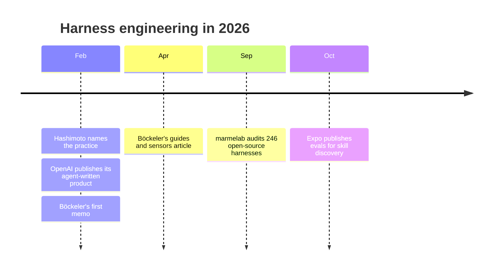
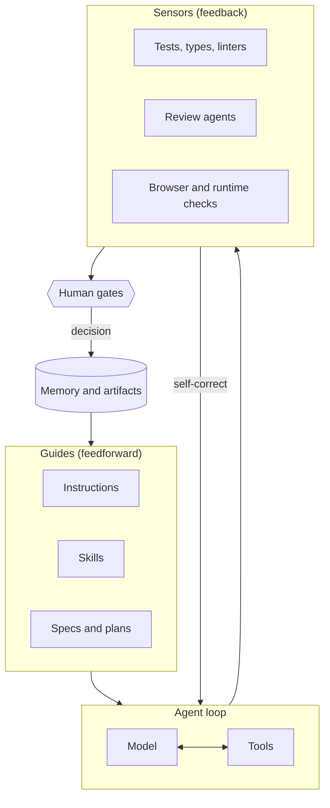

# AI Harness

A prompt can improve one interaction. It does not create a reliable way of working.

Watch two engineers on the same team pick up similar tickets with the same agent and the same model. One starts by pulling the metrics that explain why the ticket exists, checks the assumption behind it, and asks the agent for a plan before any code. The other pastes the ticket in and accepts the first plausible diff. Both open a pull request by lunch. Reviews differ, rollout plans vary, and whatever either of them learns after release stays in a personal note or disappears. The model is the same. The surrounding process is not.

The harness is that surrounding process, made explicit and executable. This section is about designing one that works for a team, and that the team can trust, challenge, and change.

!!! tip "The one-liner"
    Use the harness to carry the volume. Give engineers the space to build understanding.

---

## The idea in one paragraph

**Agent = Model + Harness**, a framing Böckeler uses and links to LangChain's description of agent harnesses. The harness is everything except the model: the instructions it reads, the tools it can call, the permissions it has, the checks that observe its work, the points where it must stop for a person, the memory that carries across sessions, and the workflow that connects all of it. You do not control the model. You control, completely, the harness. And for a team, a harness is something more than tooling: it is **a version of the team's working agreements made executable**.

---

## Why this became the centre of the conversation in 2026

The word is new; the practice is not. Good teams were writing instruction files, wiring linters into agent loops and stopping agents before risky actions long before anyone named it. What changed in 2026 is that the name arrived, and with it a shared vocabulary.

In February, Mitchell Hashimoto described the habit of fixing the environment every time an agent makes a mistake, so that it does not make that mistake again, and said he had "grown to calling this 'harness engineering'". Days later, OpenAI published an account of a five-month internal experiment in which a team of three engineers, later seven, built a product of around a million lines and merged about 1,500 pull requests without writing any code by hand. Its conclusion was that the hardest problems had become "designing environments, feedback loops, and control systems". Böckeler turned those threads into the taxonomy most of this section relies on, first in a memo and then in a longer article on martinfowler.com: guides and sensors, computational and inferential controls, and the idea that some codebases are more *harnessable* than others. By May, Thoughtworks was calling harness engineering "one of the most significant terms to emerge in software engineering in 2026".

The evidence has started to catch up with the vocabulary, and it is less flattering than the keynotes. When marmelab audited 246 open-source harness repositories in September, about 60% of the 97 harnesses large enough to assess had neither tests nor evals. Most teams are building harnesses. Very few know whether theirs helps.

---

## A harness in one picture

Guides shape what the agent does before it acts. Sensors observe what it did and let it correct itself. Human gates sit where judgment is needed. Memory carries what was learned into the next piece of work. The loop from sensors back to guides, improving the harness whenever a failure recurs, is what makes it compound.

---

## Where I'm coming from

Over recent months I built a harness for my team that covers most of the path from an early product idea to what happens after that idea reaches users: gathering context and metrics, defining the problem, planning, implementing, running quality checks, reviewing, preparing the rollout, measuring impact, and capturing what we learned seven and thirty days later. Agents, instructions, checks, human gates, and evaluations are organised around that flow.

The original goal was practical: delegate the work AI has made cheaper in time and attention, so we could spend more of it on the parts that have not become cheaper. Understanding users. Talking to stakeholders. Challenging assumptions. Deciding what is worth building at all.

The most useful outcome was not the automation. It was being forced to describe, with far more precision than usual, how we believe work should move through the team, and discovering how many decisions had never been written down anywhere. Building it was partly a technical exercise and partly an exercise in organisational clarity.

The pages in this section are what that taught me, cross-checked against what others building harnesses are finding. Where the published evidence is thin or comes from vendors, the pages say so.

---

## How to read this section

The pages build on each other, but each stands alone.

**Start with the concept.** [What a Harness Is](what-a-harness-is.md) gives the anatomy and the argument for why the harness matters more than the model. [Designing a Team Harness](designing-a-team-harness.md) is the method: start from the team's real conversations, not from a tool.

**Then the controls.** [Guides & Sensors](guides-and-sensors.md) and [Human Gates](human-gates.md) are the two halves of how a harness steers work: automatic controls, and the deliberate points where a person decides.

**Then time.** [Memory & Continuity](memory-and-continuity.md) is about work that spans sessions and steps that lose urgency. [Testing & Evolving the Harness](testing-and-evolving.md) is about knowing whether any of it helps, and removing what stopped helping.

**Then the terrain and the people.** [Harnessability](harnessability.md) explains why the same harness works in one codebase and fails in another. [Ownership & Change](ownership-and-change.md) is about keeping the harness the consequence of the team's conversations rather than a replacement for them.

| Page                                                          | What you will learn                                                                            |
| ------------------------------------------------------------- | ---------------------------------------------------------------------------------------------- |
| [**What a Harness Is**](what-a-harness-is.md)                 | The anatomy of a harness, inner versus outer, and why it matters more than the model           |
| [**Designing a Team Harness**](designing-a-team-harness.md)   | How to start from the team's real conversations, and the questions that shape the design       |
| [**Guides & Sensors**](guides-and-sensors.md)                 | Feedforward and feedback controls, computational and inferential, and the steering loop        |
| [**Human Gates**](human-gates.md)                             | Where the harness stops for a person, and why that is where the most valuable work begins      |
| [**Memory & Continuity**](memory-and-continuity.md)           | How work survives across sessions, and how the harness protects steps that lose urgency        |
| [**Testing & Evolving the Harness**](testing-and-evolving.md) | Evals from real failures, usage telemetry, and removing rules that stopped earning their place |
| [**Harnessability**](harnessability.md)                       | Why some codebases are easier to harness, and how to treat greenfield, legacy, and monorepos   |
| [**Ownership & Change**](ownership-and-change.md)             | Who owns the harness, how the team changes it, and how to version it                           |

---

## What good looks like

A healthy team harness is less about the number of agents in it than about whether the team understands and trusts the decisions encoded inside it.

| Signal                                     | What you observe                                                                                |
| ------------------------------------------ | ----------------------------------------------------------------------------------------------- |
| **Consistent questions, adaptive answers** | Every initiative passes through the same important questions; the artifacts scale with the work |
| **Gaps become questions**                  | The harness stops and asks rather than guessing                                                 |
| **Failures improve the system**            | Recurring problems lead to harness changes, not just retries                                    |
| **The harness shrinks too**                | Rules are removed when they stop earning their place                                            |
| **The team can explain it**                | Anyone can say why a gate exists and who owns it                                                |
| **It is tested**                           | Changes to the harness are evaluated, not assumed                                               |

---

## Failure modes and mitigations

Most harness failures are not technical. They start with something reasonable, one person's excellent setup or a rule added after a bad week, and harden into something nobody chose.

| Failure mode                 | What it looks like                                               | Mitigation                                                      |
| ---------------------------- | ---------------------------------------------------------------- | --------------------------------------------------------------- |
| **Personal workshops**       | Every engineer has an excellent private setup; nothing is shared | Promote the best practices into the team harness                |
| **The persuasive prototype** | One person's harness adopted wholesale because it works          | Reconcile it with team agreements before rollout                |
| **Uniform ceremony**         | A copy change produces the same artifacts as a new product       | Same questions, proportional answers; explicit "not applicable" |
| **Untested harness**         | Nobody knows if the rules help                                   | Evals and usage telemetry from the start                        |
| **Sediment**                 | Rules from two model generations ago                             | Every control has a reason and an expiry                        |

!!! note "Last reviewed"
    October 2026. Harness engineering is moving quickly; the vocabulary here is stable, the tooling is not.

---

## Further reading

- **[Harness engineering for coding agent users](https://martinfowler.com/articles/harness-engineering.html)** by Birgitta Böckeler (martinfowler.com) — The guides and sensors taxonomy this section builds on.
- **[My AI adoption journey](https://mitchellh.com/writing/my-ai-adoption-journey)** by Mitchell Hashimoto — Where the practice got its name, in six honest steps.
- **[Harness engineering](https://openai.com/index/harness-engineering/)** by Ryan Lopopolo (OpenAI) — The five-month, agent-written product that made the term mainstream. (Vendor post.)
- **[OpenAI introduces harness engineering: Codex agents power large-scale software development](https://www.infoq.com/news/2026/02/openai-harness-engineering-codex)** by Leela Kumili (InfoQ) — An independent summary of OpenAI's experiment.
- **[What is harness engineering?](https://sites.libsyn.com/130291/what-is-harness-engineering)** by Thoughtworks Technology Podcast — Böckeler on the core ideas and the practices they grew from.
- **[The state of AI harness engineering 2026](https://marmelab.com/blog/2026/09/24/the-state-of-ai-harness-engineering-2026.html)** by marmelab — An audit of 246 open-source harnesses; the best data available on what teams actually build. (The authors disclose one audited harness is theirs.)
- **[The AI harness should follow the conversation](https://dreamingecho.es/blog/the-ai-harness-should-follow-the-conversation)** by Iván González Sáiz — The essay this section grew out of.

---

## Related pages

- [Foundations](../foundations/index.md) — The primitives a harness is built from.
- [Workflow](../workflow/index.md) — The flow the harness supports.
- [Harness Brief](../templates/harness-brief.md) — A template to start your own.
