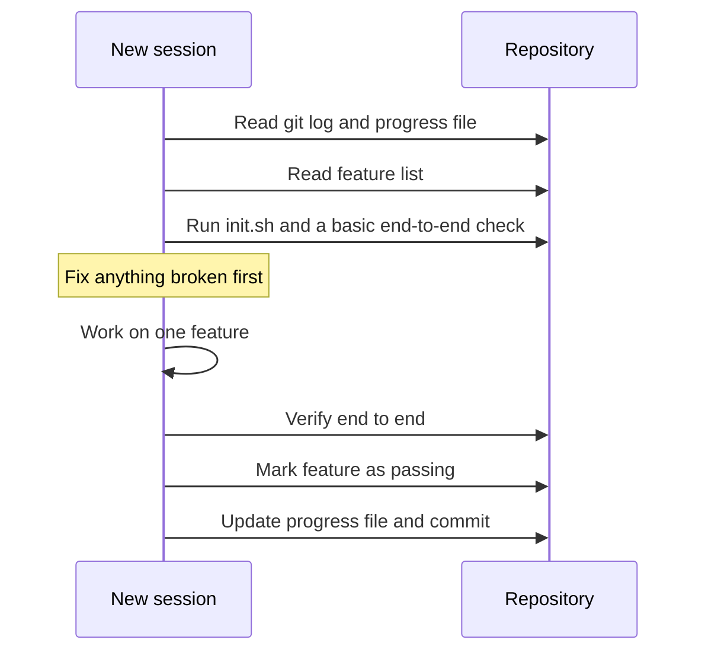
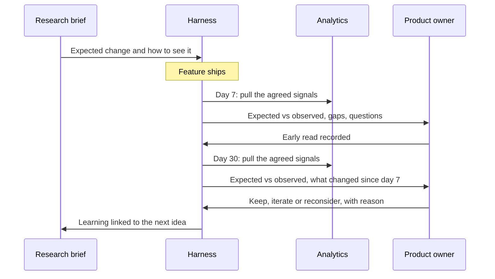

# Memory & Continuity

Agents wake up with no memory. Every session starts from zero, reconstructs what it can from the files in front of it, and forgets everything when it ends.

Teams are not so different. A feature ships on a Thursday. By Monday the channel has moved on, the dashboard nobody bookmarked has drifted out of view, and the hypothesis that justified the work lives in a planning document no one will open again. Thirty days later, if anyone asks whether it worked, the honest answer is a shrug and a guess.

The agent's forgetting sounds like a limitation to work around. It turns out to be an opportunity. Because nothing persists by accident, everything that persists has to be designed, and designed memory is better than the accidental kind most teams run on.

!!! tip "The one-liner"
    A harness is most valuable not where it makes an urgent step faster, but where it preserves a valuable step that has no urgency at all.

---

## What problem this solves

Three different continuity problems hide under the word "memory":

1. **Within a task.** A long piece of work spans several sessions. How does the next session know what the last one did, decided, and left unfinished?
2. **Across tasks.** The team learns things: a convention, a gotcha, a decision and its reason. How does that reach the next agent run, and the next person?
3. **Across time.** Some steps matter weeks after the work, like the impact review thirty days after launch. How does anything remember to come back?

They need different mechanisms. Within a task, memory is a set of files the next session reads first. Across tasks, it is curated knowledge the harness loads when relevant. Across time, it is a schedule with an owner. Most teams have some of the first, a little of the second, and almost none of the third.

---

## When to use this

**Use it when:**

- Agent work regularly spans more than one session.
- The same explanation keeps being given to agents, or to new people.
- Steps that happen after release, such as impact reviews, depend on someone remembering.

**Skip it when:**

- Tasks fit comfortably in one session and nothing learned needs to outlive them. A short `AGENTS.md` is enough.

---

## Within a task: write state to files

Anthropic's engineering team described the failure modes of long-running agents clearly in late 2025. Given a large goal, an agent tried to build too much at once, ran out of context mid-feature, and left undocumented, half-finished work. A later session saw the progress, concluded the project was finished, and stopped early. Features were marked complete after a unit test or a `curl` call, without anyone checking the behaviour end to end.

Their fix was not a smarter model. It was a harness that writes state to files. The first session, an "initializer", sets up the environment and creates:

- **An `init.sh` script** that starts the application, so every later session can run it the same way.
- **A progress file** (`claude-progress.txt` in their example): what has been done, what is in progress, what is next.
- **A feature list**: over two hundred features for their example application, all marked as failing at the start.
- **An initial commit**, so Git history becomes part of the record.

Every later session follows a fixed routine before doing anything new.

Two details in the design are worth copying even if you never run an agent for hours. The feature list is JSON rather than Markdown, because the model was less likely to inappropriately rewrite a structured file; and agents may only change each feature's pass status, never edit or remove the features themselves. The structure protects the memory from the agent that is using it. And each session aims to leave the code in a clean state that could be merged, so the next session starts from something that works.

marmelab's audit makes a related point about the popular fresh-context loops, where an agent is restarted with an empty context over and over: there is no baseline showing that discarding context is what helps. What clearly helps is writing the work down to files.

The research and plan artifacts from [Context Engineering](../foundations/context-engineering.md) work the same way. Each phase hands over through a file, not through a conversation.

**Practical rules:**

- **Keep progress files short and structured.** A list the agent can update reliably beats prose it will rewrite.
- **Record decisions and their reasons**, not just actions.
- **Record what could not be verified.** The next session, or the next person, needs to know where the uncertainty is.
- **Commit at meaningful checkpoints** so history tells the story.
- **Make reading the state the first step**, not an optional one. A progress file nobody reads is a diary.

---

## Across tasks: the team's memory

### Decision records

When a decision is made, at a human gate, in an approach review, after an incident, record it where agents will read it: an ADR, a decision log, a section in the relevant `AGENTS.md`. Stale decision records are dangerous, because wrong information is worse than missing information, so mark superseded ones clearly. One of the harnesses marmelab singled out keeps nine dated decision records and a `declined/` folder for ideas the team considered and rejected. The rejected ideas are as useful as the accepted ones: they stop the same proposal from coming back every quarter with no memory of why it lost.

### Bug and pattern write-ups

Some harnesses keep short write-ups of recurring bugs or tricky areas that agents consult before working there. The same harness has 98 of them, each with a `root_cause` field and a prevention rule. This is the *compound* step in Every's compound engineering loop: each piece of work should make the next one easier, by capturing what was learned as guidance future sessions will load.

The discipline that makes write-ups work is the same one that makes the steering loop work. A write-up should end in a change to the harness, a sensor, a guide, a test case, or it should say explicitly why it does not. A pile of write-ups nobody turns into controls is a second, slower way to forget.

### Memory stores

A newer category: persistent memory services, usually exposed over MCP, that store facts, preferences, and decisions across sessions and across agents, and are queried at session start. I use one across all the agents I work with; it holds decisions and preferences from earlier sessions so I do not repeat them.

They are powerful and they have a failure mode worth naming: **a memory store feels authoritative, and it can be wrong.** Memories written months ago reflect what was true then. A local note that contradicts a team decision can silently override it if nothing says which source wins. Treat memory as context to verify, not as instructions to follow. Decide which store wins when two disagree, write that down, and give memory the same pruning discipline as instruction files.

!!! warning "The confident memory trap"
    A memory that says "we always do X" carries no date, no author and no reason, and it is read with the same confidence as a decision made yesterday. Store the reason and the date with every memory you expect an agent to act on.

---

## Across time: protecting the work that loses urgency

This is the part of my team's harness I care about most.

At the end of the pilot, after seven days, and again after thirty, the flow returns to the metrics the work was expected to influence. It compares the outcome with the original assumptions and prepares the context for a decision: keep the feature, iterate on it, or reconsider it.

Most teams agree this is important. Few do it consistently. The reason is rarely a lack of care. Once a feature has shipped, the natural urgency disappears. There is no deployment waiting, no pull request blocking anyone, no immediate problem demanding attention. By the time the thirty-day mark arrives, the next piece of work is louder.

This is where a harness is valuable not because it makes an urgent step faster, but because it **preserves a valuable step that has no urgency at all**. The system remembers what the work was meant to achieve, retrieves the evidence, compares expected and observed signals, and puts it in front of a person without anyone having to remember. The person still interprets it and makes the product decision. The repetitive work needed to get there no longer competes for the same attention.

It also closes a loop most teams leave open. What is learned after release does not stay in an isolated report; it feeds the next idea, the next scope adjustment, the next decision about where to invest. That is the kind of continuity a prompt cannot provide. It requires a system that remembers intent and brings it back when it becomes relevant.

The diagram depends on one thing that has to happen long before launch: the hypothesis has to be written down in a form a machine can read back. In my team's flow, the review returns to the original hypothesis and the metrics the work was expected to influence, which only works because both were written down before anyone started building. Without them, the thirty-day review has nothing to compare against, and the harness can only produce a dashboard. See [Rollout & Learning](../workflow/rollout-and-learning.md).

### Product learning and operating learning

There are two kinds of learning after a release, and a harness can protect both. **Product learning** asks how the feature landed: did the metric move, did users adopt it, what should change in the experience? **Operating learning** asks what the delivery revealed about the team's own system: which assumption was wrong, which review arrived late, which check caught more than expected. I have written about the second as a short shipping debrief: one surprise, the assumption beneath it, one operating change with a signal and a review date. The impact review handles the first. The harness can schedule the second too, and route its output into the harness's own change record. See [Ownership & Change](ownership-and-change.md).

---

## Worked example: the thirty-day review that nobody had to remember

The scenario is illustrative.

**Before launch.** A team ships a redesigned onboarding checklist. The research brief, written weeks earlier, recorded: "We expect the share of new workspaces that invite a teammate in their first week to rise from roughly a fifth to roughly a quarter. We will see it in the `workspace_invite_sent` event, split by signup cohort." It also recorded an open question: whether the change would increase support contacts about permissions.

**Day 7.** The harness pulls the invite event for the first post-launch cohort and the support tags for permissions. It reports that invites are up, but on a small cohort, and that permission-related contacts doubled from a low base. It flags what it cannot tell: whether the support increase comes from the new checklist or from an unrelated pricing change the same week. The product owner records an early read: promising, watch support.

**Day 30.** The harness runs the same queries, unchanged. Invites have settled slightly above the old baseline, well short of the expectation. The support increase has persisted. Because the queries were pinned when the review was scheduled, nobody can quietly swap in a friendlier metric.

**The decision.** The product owner and an engineer read the evidence together and talk to the support lead, who says the new checklist sends users to a permissions screen before they understand roles. That fact was not in any system the harness could read. The decision is to iterate: move the invite step after the role explanation. The reason is recorded, and the new expectation becomes the next brief's hypothesis.

**What went wrong on the way.** In an earlier version of the flow, the day-30 review was a calendar reminder for the product owner. It fired during a busy week, was snoozed twice, and never happened. The change that fixed it was not a better reminder. It was having the harness do the preparation first, so that the reminder arrived with the evidence already attached and the decision was the only thing left to do.

---

## Roles and ownership

| Role                | Responsibility                                                              |
| ------------------- | --------------------------------------------------------------------------- |
| **Harness owner**   | Designs the artifact formats and where memory lives                         |
| **Engineers**       | Keep progress and decision records accurate during work                     |
| **Tech lead**       | Curates decision records; marks superseded ones                             |
| **Product partner** | Owns the impact reviews the harness schedules, and the decision at each one |

---

## What good looks like

| Signal                      | What you observe                                                      |
| --------------------------- | --------------------------------------------------------------------- |
| **Sessions resume cleanly** | A new session picks up long work without a human re-explaining        |
| **Decisions are findable**  | Agents cite the decision record when following a convention           |
| **Learning compounds**      | Recurring mistakes become write-ups, and write-ups become controls    |
| **Late steps happen**       | Impact reviews at 7 and 30 days take place without anyone remembering |
| **Hypotheses are pinned**   | Reviews compare against what was expected before launch               |
| **Memory is pruned**        | Stale memories are corrected or removed                               |

---

## Failure modes and mitigations

Memory failures are slow. A progress file stops being read, a decision record goes stale, a review gets snoozed. Each is harmless for a week. Together they mean the team, and its agents, keep relearning what they already knew.

| Failure mode                | What it looks like                                       | Mitigation                                                      |
| --------------------------- | -------------------------------------------------------- | --------------------------------------------------------------- |
| **Conversation as memory**  | Important context lives only in a chat transcript        | Write it to a file the next session reads                       |
| **Memory as authority**     | A stale memory overrides a newer decision                | Verify against sources of truth; prune regularly                |
| **Write-only logs**         | Progress files nobody reads                              | Make reading them the first step of every session               |
| **The forgotten follow-up** | Impact never reviewed                                    | Schedule it in the harness, with an owner and prepared evidence |
| **Moving goalposts**        | The day-30 review uses a different metric from the brief | Pin the queries when the review is scheduled                    |
| **Everything remembered**   | Memory store full of trivia                              | Remember decisions and reasons, not every action                |

!!! info "What we know / what we don't"
    The file-based pattern for long-running work is well described and widely copied. What we know less about is how memory stores behave over a year of use across a team: how fast they go stale, and how often a confident wrong memory causes harm. There is very little published evidence on whether scheduled impact reviews change decisions, as opposed to producing reports.

---

## Copy this

Use the [Impact Review](../templates/impact-review.md) template for the 7- and 30-day reviews. The field that matters most is written before launch: what you expect to change, and how you will see it.

---

## Further reading

- **[Effective harnesses for long-running agents](https://www.anthropic.com/engineering/effective-harnesses-for-long-running-agents)** by Anthropic — The initializer pattern, progress files, and why the feature list is JSON. (Vendor post.)
- **[Compound engineering gets an upgrade](https://every.to/source-code/compound-engineering-gets-an-upgrade)** by Every — Capturing learning so each piece of work makes the next easier.
- **[The state of AI harness engineering 2026](https://marmelab.com/blog/2026/09/24/the-state-of-ai-harness-engineering-2026.html)** by marmelab — Examples of decision records, declined folders and bug write-ups in real harnesses.
- **[The AI harness should follow the conversation](https://dreamingecho.es/blog/the-ai-harness-should-follow-the-conversation)** by Iván González Sáiz — Protecting the work that loses urgency.
- **[Shipping debrief: the work is not done when it ships](https://dreamingecho.es/blog/shipping-debrief-work-not-done)** by Iván González Sáiz — Operating learning after a release, in twenty minutes.

---

## Related pages

- [Context Engineering](../foundations/context-engineering.md) — Handing work between phases through files.
- [Rollout & Learning](../workflow/rollout-and-learning.md) — Where impact reviews sit in the workflow.
- [Testing & Evolving the Harness](testing-and-evolving.md) — Turning write-ups into eval cases.
- [Impact Review](../templates/impact-review.md) — The template.
