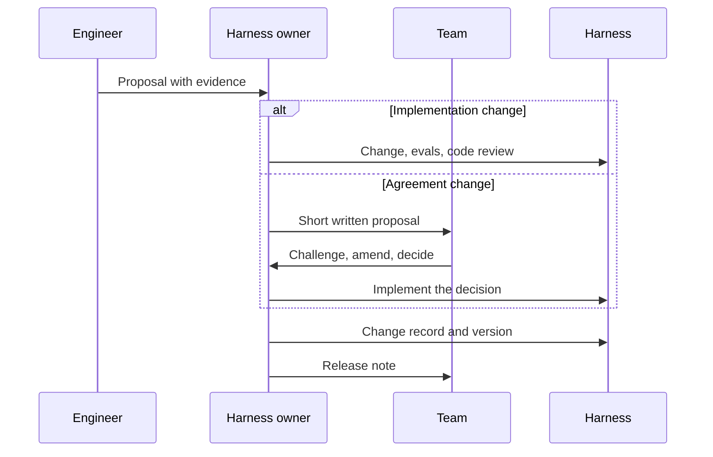

# Ownership & Change

I built the first version of my team's harness largely on my own. That was useful: a working proposal is far easier to evaluate than an abstract description, and I wanted to know what was possible before asking anyone to spend time on it.

The risk appeared later. Once a prototype works, it becomes persuasive. People see the value of the overall idea, but not every assumption encoded inside it: where the process stops, what may be skipped, what counts as complete, how uncertainty is handled, which decisions stay human. A working harness can quietly become the team's process without the team ever having decided it.

I have to count myself in that picture rather than above it. I am one of the people who built the harness, wrote the instructions, and found the whole thing exciting. From the other side of the table, that enthusiasm can look like a decision already taken.

This page is about avoiding that, and about what happens next: how a harness changes once a team depends on it.

!!! tip "The one-liner"
    One person can own the implementation. The agreements it represents stay open.

---

## What problem this solves

Harnesses fail organisationally more often than technically:

- **The hero harness.** One enthusiast maintains it; when they move on, it rots.
- **Habits as law.** It encodes one person's habits as team rules, and others route around it.
- **Unexplained rules.** Changes happen ad hoc, so nobody knows why a rule exists or whether it can go.
- **Frozen process.** It becomes so central that changing the process means changing the harness, and nobody dares.

There is a newer version of the first problem. marmelab found that a quarter of commits touching harness files since January 2025 were explicitly signed by an AI, which it calls a floor, and that in 52 of 79 repositories the harness was more AI-written than the code it governs (median shares of 16% against 9%). The shares are still low. But a harness that agents write and nobody reads end to end has no owner in any meaningful sense, however tidy its commit history looks.

---

## When to use this

**Use it when:**

- More than one person depends on the harness.
- The harness encodes gates, definitions of done, or what may be skipped.
- Several repositories or teams share harness components.
- Engineers have started keeping private workarounds.

**Skip it when:**

- The harness is still a personal setup. Ownership only matters once someone else has to live inside it. Until then, keep notes on what you assumed, because you will need them when it stops being personal.

---

## The ownership model

Separate **implementation** from **agreements**:

|                    | Implementation                                | Agreements                                                                                             |
| ------------------ | --------------------------------------------- | ------------------------------------------------------------------------------------------------------ |
| **What**           | The code, configuration, skills, hooks, evals | What the harness enforces: gates, definitions of done, what may be skipped, how uncertainty is handled |
| **Owner**          | A named harness owner (or small group)        | The team                                                                                               |
| **How it changes** | Normal code review, with eval results         | Discussion, then a recorded decision, then implementation                                              |

Someone has to create the first version, connect the pieces, and turn ideas into something concrete enough to evaluate. A whole team does not need to co-write every instruction. But while the implementation has a clear owner, the working agreements it represents stay open to discussion.

The line between the two is not always obvious, and the useful test is this: **would a person working inside the harness notice the change?** Rewording a skill so it loads more reliably is implementation. Making a gate optional, changing what counts as done, or letting the agent infer something it used to ask about is an agreement, even if the diff is one line.

---

## How the harness changes

### Every change has a record

A short record: what changed, why, which failure or decision prompted it, how it was evaluated, and when to revisit it. See the [Harness Change Record](../templates/harness-change-record.md). Over time this becomes the most useful document about how your team works, because it is the only one that explains *why*.

The shape is borrowed from a practice I use after deliveries: evidence from what happened, one operating change, a signal to watch, a steward, and a review date. The review date matters most. Without it, a temporary response to one bad week becomes permanent process.

### Agreement changes go through the team

Changing a gate, a definition of done, or what the harness may decide on its own is a process change. Discuss it the way you would any process change, in a retro, a short async proposal, or a team meeting. Then implement. As [Designing a Team Harness](designing-a-team-harness.md#step-3-take-it-to-the-people-who-do-the-work) describes, these conversations are where the most valuable changes tend to come from.

### Implementation changes go through review

New skills, hooks, and checks are code. Review them like code, with an eval result where relevant. A harness change that cannot show its effect on the eval set is a guess with a commit message. See [Testing & Evolving the Harness](testing-and-evolving.md).

### The harness is versioned

When several repositories or teams share a harness, version it. Teams adopt updates deliberately rather than waking up to a new process. A simple convention works: a change to an *agreement* is a breaking change and gets a release note that says what people will notice; a change to *implementation* is a minor version.

Shared harnesses bring an old problem with them. Böckeler, discussing harness templates for common service types, names the risks: templates drift out of sync as teams shape them for their own needs, and versioning and contribution are harder when some of the controls are non-deterministic. Her earlier memo asks the question directly: will we see "a similar forking and synchronization challenge with harnesses" as we already have with service templates? The answer so far seems to be yes. Make it someone's job to keep the copies honest, and make it easy for teams to send improvements back upstream.

---

## Bringing people in

Resistance to a team harness tends to take three shapes, and only one of them is loud. There is the engineer who argues in planning. There is the one who agrees and then keeps doing the work by hand, because they do not trust what comes out the other end. And there is the one who goes along completely, approving whatever is green. That last one looks like adoption from the outside, and is probably the riskiest of the three.

It is tempting to treat all three as a mindset problem. That misreads most of them. For many engineers, writing code is not only the job; it is how they come to understand a system well enough to be responsible for it. Some of the scepticism is simply correct, such as the person asking who will understand this code when it breaks at three in the morning.

**Invite challenge, not approval.** Share the description of a harness step before the implementation, and ask what is wrong with it. Approval can be given without reading. Challenge cannot.

**Give sceptics the controls.** The engineer most worried about unreadable code is the right person to design the verification gate. A sceptic who designs the check has far less reason to block it.

**Agree whose name is on the work.** Authorship spreads across agents; responsibility does not. If nobody has agreed whose name sits on work that nobody typed, the weight tends to land on whoever cares most, and stays there.

**Count yourself in the picture.** Some of the doubt in a team will be about agents. Some of it may be about not having been asked, and that part, at least, you can do something about.

!!! warning "The process by commit trap"
    A one-line pull request can change how the whole team works: a gate made optional, a step allowed to be skipped. If it goes through the same review as a typo fix, the team's process is being changed by whoever has commit access.

---

## Worked example: a proposal to make a gate optional

The scenario is illustrative.

**The proposal.** An engineer notices that the approach review, a judgment gate before any code is written, adds a day of waiting to small changes, and that it almost never changes the outcome for them. She opens a pull request that skips the gate for changes the plan estimates at under a hundred lines.

**The owner's first call.** The harness owner reads it and sees a one-line change to a trigger. Under the test above, though, it is an agreement change: people will notice that the gate no longer happens. Instead of reviewing the code, the owner asks her to write a short proposal for the team.

**The proposal, written down.** Two paragraphs: the problem (waiting time on small changes), the evidence (approval rate and wait time at the gate for the last two months, split by plan size), and the proposed rule.

**The challenge.** In the team discussion, the staff engineer who owns the payments service points out that some of the most expensive mistakes last year were small changes to money-handling code. Lines of code measure size, not risk. A product partner adds that the approach review is also where she hears about changes before they ship. If small changes skip it, she would like a weekly digest instead.

**The decision.** The team agrees to a narrower rule that matches its [risk tiers](../factories/risk-tiers-and-autonomy.md): low-risk changes (tier 0 and 1) skip the approach review; standard feature work (tier 2) keeps it for larger changes, roughly 200 lines or more; and high-risk work (tier 3: money, authentication, personal data, migrations, public APIs) always has one, regardless of size. The harness posts a weekly digest of skipped reviews. The skip is recorded as "not applicable: low risk, small" rather than disappearing silently. The change record names the engineer as steward and sets a review date after six weeks.

**The review.** Six weeks later, wait times for small changes have dropped. One skipped change caused rework that an approach review would probably have caught. The team keeps the rule and moves one more area into tier 3. The change record is updated with both facts.

**What it cost.** A week longer than merging the original pull request. What it bought was a rule the team understands and owns, a better one than the original proposal, and a record of why.

---

## Roles and ownership

| Role                         | Responsibility                                                                      |
| ---------------------------- | ----------------------------------------------------------------------------------- |
| **Harness owner**            | Implementation, evals, change records, versions, upgrades                           |
| **Team**                     | Agreements; challenge and approval of process changes                               |
| **Tech lead**                | Ensures architecture and quality decisions are reflected                            |
| **Engineering manager**      | Protects time; ensures every voice is heard; owns the people side of the transition |
| **Platform team** (at scale) | Shared harness components, versioning, templates, paved roads                       |

---

## What good looks like

| Signal                              | What you observe                                                |
| ----------------------------------- | --------------------------------------------------------------- |
| **Named owner, shared agreements**  | Everyone knows who maintains it and that they can change it     |
| **Change records exist**            | Every rule can be traced to a reason                            |
| **Process changes are discussed**   | Gates and definitions change after a conversation, not a commit |
| **Versions are deliberate**         | Teams know which harness version they run and what changed      |
| **The harness survives its author** | Someone else could maintain it tomorrow                         |
| **Disagreement is visible**         | Objections are recorded and answered, not absorbed              |

---

## Failure modes and mitigations

The organisational failures of a harness rarely look like failures at first. A prototype gets adopted because it works. A gate gets relaxed in a small pull request. A sceptic stops arguing. Each step is reasonable, and the sum is a process that belongs to nobody.

| Failure mode                  | What it looks like                                   | Mitigation                                    |
| ----------------------------- | ---------------------------------------------------- | --------------------------------------------- |
| **The hero harness**          | One person built it, one person understands it       | Pairing, docs, a second maintainer            |
| **Process by commit**         | A gate changed in a PR nobody discussed              | Agreement changes need a team decision        |
| **Persuasive prototype**      | Adopted because it works, not because it was agreed  | Reconcile with team agreements before rollout |
| **Unread AI-written harness** | Agents write the harness; nobody reads it end to end | Review harness changes like production code   |
| **Frozen harness**            | Nobody dares change it                               | Change records and evals make changes safe    |
| **Shadow harnesses**          | Engineers maintain private workarounds               | Find out why; fix the shared harness          |

!!! info "What we know / what we don't"
    We know a measurable share of harness changes is already written by agents, from a single snapshot rather than a trend, and that shared templates bring synchronisation problems. What nobody has published yet is good evidence on how team harnesses age: how often agreements change, whether versioning helps adoption, or what happens when the original author leaves. Most of what is on this page comes from practice and from older lessons about shared process and platform templates.

---

## Further reading

- **[The AI harness should follow the conversation](https://dreamingecho.es/blog/the-ai-harness-should-follow-the-conversation)** by Iván González Sáiz — Why the implementation can have an owner while the agreements stay open.
- **[From coding agents to software factories](https://dreamingecho.es/blog/coding-agents-to-software-factories)** by Iván González Sáiz — The three shapes of resistance, and why the transition happens through people.
- **[Shipping debrief: the work is not done when it ships](https://dreamingecho.es/blog/shipping-debrief-work-not-done)** by Iván González Sáiz — The evidence, change, signal, steward and review-date shape used in change records.
- **[Harness engineering for coding agent users](https://martinfowler.com/articles/harness-engineering.html)** by Birgitta Böckeler (martinfowler.com) — The risks of harness templates: drift, versioning, contribution.
- **[The state of AI harness engineering 2026](https://marmelab.com/blog/2026/09/24/the-state-of-ai-harness-engineering-2026.html)** by marmelab — How much of today's harnesses are written by agents.

---

## Related pages

- [Designing a Team Harness](designing-a-team-harness.md) — Where the ownership split starts.
- [Adoption Without Mandates](../team/adoption-without-mandates.md) — Bringing a team along without forcing it.
- [Accountability & Audit Trail](../security/accountability-and-audit.md) — Whose name is on agent-written work.
- [Harness Change Record](../templates/harness-change-record.md) — The template.
