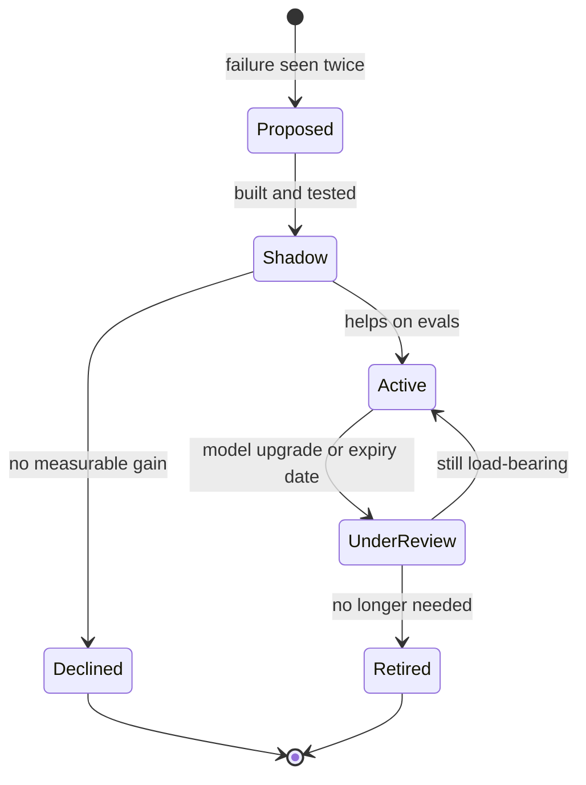

# Testing & Evolving the Harness

Here is an uncomfortable set of numbers. When marmelab audited open-source harnesses in September 2026, it looked at 246 harness repositories plus a comparison set of 145 large projects. Of the 97 harnesses large enough to assess, about 60% had neither tests nor evals. 21% tested themselves, 27% kept evals under version control, and only seven did both. Of all 391 repositories in the study, five recorded anything about how their harness was actually used. Of the 26 with evaluation cases, one published a before-and-after comparison with a replication and a null result.

Most teams, in other words, have no idea whether their instructions, skills, and reviewers help, hurt, or do nothing. They are running software on every agent task, affecting every change, and costing real money, without a single test.

A harness is software. It deserves the same discipline as any other code that matters, plus one more: it runs on top of a model that changes underneath it several times a year.

!!! tip "The one-liner"
    Every control in a harness is a hypothesis. Test it when you add it, and test it again when the model changes.

---

## What problem this solves

Without measurement, harnesses grow on intuition. A rule is added because it felt right. A skill is kept because someone wrote it. A reviewer agent stays in the pipeline because removing it feels risky. Meanwhile, the model improves, and some of those controls become dead weight or actively harmful.

The research is clear that intuition is not enough here. The ETH Zurich study of repository context files found that they do not generally improve task success and raise inference cost by over 20% on average. An ablation study of agent harness modules found that adding a verifier made almost no difference on a coding benchmark, while a multi-candidate search module made results slightly worse. Anthropic's engineers found that a harness component they had relied on, context resets for a model that wrapped up work too early, was no longer needed once a newer model "largely removed that behavior on its own". Each of these is a control someone added for a good reason that turned out not to pay, or stopped paying.

Testing and telemetry let you answer the only questions that matter: **does this part of the harness make outcomes better, and is it still needed?**

---

## When to use this

**Use it when:**

- Your harness has more than a handful of rules, skills, or hooks.
- You are about to change a model, or a vendor has just released one.
- A control is expensive: it adds context to every task, or a reviewer to every change.
- People disagree about whether a part of the harness helps.

**Skip it when:**

- You have a short `AGENTS.md` and the tests the codebase already had. Start by making sure the agent can run those; the codebase's own tests are the first eval.
- You are still discovering failure modes. Collect them first; they are the raw material for the eval set.

---

## Four kinds of evidence

### 1. Tests for guards and checks

Deterministic parts of the harness, such as hooks, guards, and custom lint rules, get ordinary tests. Each one should be tested in both directions: it fires when it should, and it stays silent when it should not. A guard that blocks legitimate work will be disabled within a week, and a guard that never fires might be blind.

marmelab's audit gives a concrete example of what "both directions" looks like: one harness has 63 test cases across 12 guards, of which 29 must block, 19 must allow, and 15 check the output of a routing script, and its runner replays each case against the real script. Another harness's tests caught a leak: a check was passing only because it read a personal settings file on the author's machine. Neither would have been found by using the harness and seeing whether it felt right.

### 2. Evals for behaviour

An eval is a realistic task with a grader, run repeatedly. Anthropic's guidance on agent evals is the best practical starting point I know:

- **Start small.** "20-50 simple tasks drawn from real failures is a great start." Do not wait for a large suite.
- **Combine graders.** Code-based where possible (did the tests pass, did the build succeed), model-based where meaning matters, human review to calibrate both.
- **Grade outcomes, not paths.** Agents often find valid approaches nobody anticipated. Check that the result is right, not that specific steps were taken.
- **Write unambiguous tasks.** A good task is one where two domain experts would independently reach the same pass or fail verdict, with a reference solution that passes every grader.
- **Treat 0% as a likely bug.** With frontier models, a task that fails every time is more often broken than impossible.
- **Separate capability and regression evals.** Capability evals start with low pass rates and give you something to improve. Regression evals should stay near 100%; a drop means something broke. Capability tasks that reliably pass can graduate into the regression suite.
- **Choose the right consistency measure.** pass@k asks whether at least one of k attempts succeeds, which suits work where a person picks the best result. pass^k asks whether all k succeed, which suits anything that runs unattended.
- **Balance the set.** Test that a behaviour happens when it should *and* does not happen when it should not. "One-sided evals create one-sided optimization."
- **Read the transcripts.** You will not know whether your graders work until you read what the agent actually did.

LangChain's account of building evals for its own agents adds a useful warning: "More evals ≠ better agents." Every eval pulls the harness's prompts and tool descriptions towards passing it, so an eval that does not reflect a behaviour you care about in production is not neutral; it is steering you somewhere you did not choose. Their best source of cases is the same as Anthropic's: errors found while using the agent every day, each one a candidate eval.

For a coding team, the best eval set is usually **your own recent work**: replay a set of merged pull requests from their starting commit, and compare the agent's result against what was actually merged.

**Incidents make the best evals of all.** The Claude Code team evaluates its AI code reviewer against a collection of past pull requests that caused incidents, together with their fix-forwards and reverts, after engineers who know that code confirmed each bug and where it lived. Every new incident joins the collection, and every change to the reviewer is scored against all of it. They measure the other side too, because it is easy to find more bugs by reporting more things that are not bugs: they record what the person on the pull request did with each comment — fixed it, rejected it, marked it as intentional, or decided it did not matter — and run the reviewer on pull requests known to be clean to see how often it raises something that would have led to a harmful change. That is a balanced eval in the sense above, built from the team's own failures, and it applies to any sensor in a harness, not only to reviewers.

### 3. Evals for skills: discovery, not just invocation

Skills need a test most teams forget. A skill can work perfectly when invoked by name and still be useless, because the agent never thinks to load it. Expo's October 2026 write-up is the clearest example so far. Across ten realistic app specifications that mentioned Expo but never named a skill, run three times each in Claude Code with one model configuration, only about one session in ten loaded any Expo skill at all. After Expo added a single entrypoint skill that points to the specialised ones, the share of sessions loading at least one specialised skill rose from 9% to 55%. The stricter measure, how many of the skills relevant to each task were actually loaded, rose only from 2% to 18%, and the authors call the result "an initial signal from a handful of datapoints". A separate test on Codex CLI found that in a crowded catalogue of 175 installed skills, only about the first sixty characters of each description were visible to the agent. Their recommendation is worth adopting verbatim: "Test whether agents can find skills, not only whether skills work when called."

### 4. Telemetry from real use

Evals cover the tasks you chose. Real usage shows what actually happens: which skills fire, which hooks block, how often people intervene, which steps are skipped. Most agents can now export telemetry; Claude Code, for example, supports OpenTelemetry. The harnesses marmelab found doing this kept it simple: one runs a hook after every skill call that emits a "skill activated" event; another logs every skill suggestion, activation and block to a `metrics.jsonl` file and excludes benchmark sessions so they do not pollute the numbers. The VS Code team runs offline benchmarks first, then A/B tests and weekly reporting after release. It does not need to be sophisticated to be useful.

---

## Measuring a change to the harness

Treat each harness change like an experiment:

1. **State the hypothesis.** "Adding a migration skill will reduce migration-related rework."
2. **Change one thing.** marmelab's advice is to freeze a set of 20 to 50 tasks from real failures, change one part of the harness at a time, and then remove each part to see which ones matter.
3. **Run with and without, several times.** Agents are non-deterministic. Compare in aggregate, and look at the spread as well as the average.
4. **Check cost as well as quality.** More context and more checks cost tokens and time. The ETH study is a reminder that context which feels helpful can raise cost without raising success. Its authors' conclusion is narrower than "less is more": developer-written files beat generated ones by about seven points, though their 2.4% average gain over no file was not statistically significant, and context files were most useful for non-standard coding practices. Measure what your own files do.
5. **Ship it with a reason and a review date.** Record the result, including null results. A control that made no measurable difference is information.

---

## The harness lifecycle

Every control moves through the same states. Making the states explicit is what lets a harness shrink as well as grow.



**Declined** and **Retired** are states, not deletions. Keeping a short record of what was tried and why it lost, in the way some harnesses keep a `declined/` folder, stops the same idea from coming back every quarter.

---

## Evolving: the steering loop, and its reverse

The steering loop adds controls: when a failure recurs, add a sensor or a guide. See [Guides & Sensors](guides-and-sensors.md).

The reverse loop removes them, and it is just as important. Anthropic's engineers put the principle well: "every component in a harness encodes an assumption about what the model can't do on its own", and those assumptions go stale. When a newer model arrived, they moved to "removing one component at a time" to see which were still load-bearing, and dropped the sprint structure they had built for the older model, which the new one no longer needed. LangChain describes some of its own harness middleware as temporary guardrails for current model limitations. Both are telling you the same thing: some of your harness is scaffolding for a model you will not be using next year.

In practice:

- **On every model upgrade**, re-run your evals with your rules removed one group at a time. Anthropic's eval guidance notes that teams with evals can assess a new model and upgrade in days, while teams without them can spend weeks testing by hand.
- **Quarterly**, review controls that never fire, skills that never load, and gates that never change a decision.
- **Every control carries an expiry condition**: "remove when the model reliably does X", "review after the billing migration completes", or "none: architectural decision".
- **Scan sessions for what the harness missed.** Erratic behaviour that no sensor caught is the input for the next turn of the steering loop.

OpenAI's team running an agent-written product describes a recurring clean-up process it compares to garbage collection: mechanical "golden principles" encoded in the repository, and a doc-gardening agent that finds documentation that no longer matches the code and opens fix-up pull requests. The harness needs gardening as much as the code does.

---

## Worked example: an eval set built from real failures

The scenario is illustrative.

**The trigger.** A team's harness has grown to around forty rules, six skills and a reviewer agent over nine months. A new model is announced, and nobody can say which of the forty rules still matter. The harness owner decides to build an eval set before upgrading.

**Collecting cases.** Over a week, she gathers candidates from three places: the harness change records (every rule that cites a failure), the last quarter's reverted or heavily reworked agent pull requests, and two production incidents involving agent-written changes. That yields 38 candidates. She drops eight that cannot be reproduced from a clean starting commit and keeps 30.

**Making them gradable.** For each case she writes the starting commit, the prompt as the engineer originally gave it, and graders. Most graders are code: the test suite passes, a specific structural test passes, the migration uses a non-locking index. Four cases need a model-based grader, for example "the pull request description states the lock impact and rollback plan", and she grades ten transcripts by hand to check the model grader agrees with her. It disagrees on two; she tightens the rubric.

**Balancing.** All 30 cases test that the agent *does* something. She adds six where the right behaviour is to stop and ask, such as a task with a missing requirement, because a harness tuned only on "do" cases will drift towards confident guessing.

**The first run, and the first surprise.** Five runs per case on the current model. Two cases score 0%. Reading the transcripts shows both are broken: one starting commit no longer builds, and one grader checks a file path that was renamed. Fixed, they pass most of the time. As Anthropic warns, a 0% was a bug in the eval, not in the agent.

**The ablation.** On the new model, she runs the set with the full harness, then with each group of rules removed in turn. Three findings:

- **Load-bearing:** the structural tests and the migration skill. Removing either sends failures back up on exactly the cases they were built for.
- **Dead weight:** a block of eleven rules about test naming and file layout. The new model's results are the same with or without them. They are retired, with a note.
- **Harmful:** the reviewer agent. With it, two of the "stop and ask" cases fail, because the reviewer pushes the implementer to produce *something* rather than stop. It moves to shadow mode while the team decides whether to redesign or remove it.

**What it cost.** About a week of one person's time, and the token cost of a few hundred runs. What it bought was a harness eleven rules shorter, a model upgrade made on evidence, and a regression suite that now runs on every harness change.

---

## Roles and ownership

| Role                | Responsibility                                                           |
| ------------------- | ------------------------------------------------------------------------ |
| **Harness owner**   | Maintains the eval set, runs it on changes and upgrades, reports results |
| **Engineers**       | Contribute failing tasks to the eval set when they hit failures          |
| **Tech lead or EM** | Make harness maintenance visible, planned work                           |

---

## What good looks like

| Signal                             | What you observe                                                    |
| ---------------------------------- | ------------------------------------------------------------------- |
| **Guards have tests**              | Both firing and non-firing cases                                    |
| **A small, real eval set**         | Dozens of tasks from your own work, run on every significant change |
| **Skills are found**               | Discovery is tested, not just invocation                            |
| **Usage is visible**               | You know which skills fire and which hooks block                    |
| **Upgrades trigger re-evaluation** | New model, rerun evals, remove what is no longer needed             |
| **The harness shrinks sometimes**  | The change record has deletions with reasons                        |

---

## Failure modes and mitigations

The pattern is familiar from any untested codebase. Each change is reasonable on its own; nobody can say what the whole does any more; and the first time someone tries to remove something, nobody dares.

| Failure mode               | What it looks like                                     | Mitigation                                                       |
| -------------------------- | ------------------------------------------------------ | ---------------------------------------------------------------- |
| **Vibes-based harness**    | "It feels better since we added that"                  | With and without comparison on a fixed task set                  |
| **Single-run conclusions** | One good run taken as proof                            | Aggregate across runs                                            |
| **Benchmark substitution** | Public benchmark scores used to choose harness changes | Your own tasks; public benchmarks rarely look like your codebase |
| **One-sided evals**        | Only "do" cases; the harness learns to guess           | Add "stop and ask" cases                                         |
| **Only adding**            | Harness grows every month, never shrinks               | Expiry conditions; the reverse loop                              |
| **Grader blindness**       | LLM grader accepted without spot checks                | Read transcripts; calibrate against human judgment               |

!!! info "What we know / what we don't"
    The practices for agent evals are converging, and the advice from Anthropic, LangChain and marmelab is consistent: small sets from real failures, outcome grading, transcripts read by people. What is still rare is published evidence of harness changes measured properly; marmelab found one before-and-after comparison with a replication across 26 repositories with evals. Much of the guidance comes from vendors evaluating their own agents.

!!! note "Last reviewed"
    October 2026.

---

## Copy this: a minimal eval record

```yaml
id: migration-add-index-large-table
source: incident-2026-08-14  # where this task came from
start: commit 4f2a9c1
prompt: "Add an index on orders.customer_id to speed up the account page."
graders:
  - type: code
    check: "migration uses CREATE INDEX CONCURRENTLY"
  - type: code
    check: "test suite passes"
  - type: model
    rubric: "PR description states lock impact and rollback plan"
kind: regression   # capability | regression
expect: pass       # pass | stop-and-ask
runs: 5
```

Record each harness change with the [Harness Change Record](../templates/harness-change-record.md).

---

## Further reading

- **[Demystifying evals for AI agents](https://www.anthropic.com/engineering/demystifying-evals-for-ai-agents)** by Anthropic — The most practical guide to agent evals available. (Vendor post.)
- **[How we build evals for Deep Agents](https://www.langchain.com/blog/how-we-build-evals-for-deep-agents)** by LangChain — Why more evals do not mean better agents, and how to source them from daily use. (Vendor post.)
- **[How the Claude Code team does code review](https://claude.dev/blog/solving-code-review-at-anthropic/)** by Addy Osmani, Morgan Westlee Lunt and Qing Wang (Anthropic) — Incidents as the reviewer's eval set, and measuring its noise. (Vendor post.)
- **[Your skills need an evaluation mechanism](https://expo.dev/blog/your-skills-need-an-evaluation-mechanism)** by Expo and Georgian AI Lab — Testing whether agents find skills, with numbers. (Vendor post; small sample.)
- **[Natural-language agent harnesses](https://arxiv.org/abs/2603.25723)** by Pan et al. — Module-by-module ablations of a harness. (Preprint.)
- **[Harness design for long-running application development](https://www.anthropic.com/engineering/harness-design-long-running-apps)** by Anthropic — Removing harness components one at a time when a new model arrives. (Vendor post.)
- **[The state of AI harness engineering 2026](https://marmelab.com/blog/2026/09/24/the-state-of-ai-harness-engineering-2026.html)** by marmelab — How few harnesses are tested, and what the tested ones do.
- **[Evaluating AGENTS.md](https://arxiv.org/abs/2602.11988)** by Gloaguen et al., ETH Zurich — Measured cost and benefit of context files. (Preprint.)

---

## Related pages

- [Guides & Sensors](guides-and-sensors.md) — The steering loop that adds controls.
- [Evaluating a Tool on Your Own Work](../tools/evaluating-tools.md) — The same discipline applied to choosing tools.
- [Measuring Impact Honestly](../team/measuring-impact.md) — Measuring the effect on the team, not just the harness.
- [Harness Change Record](../templates/harness-change-record.md) — The template.
