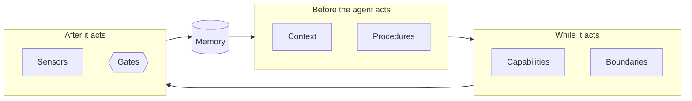

# What a Harness Is

A few months into adopting coding agents, most teams have the same conversation. Some engineers are shipping more than ever; others are drowning in rework; the codebase is drifting in three directions at once. Someone suggests the answer is a better model, or a better prompt, and the team spends a week comparing both. Results barely move.

What the team is missing usually has nothing to do with the model. It is the system around it: what the agent is told, what it can touch, what checks its work, where it has to stop, and what it remembers next time. "Harness" is the word the industry settled on in 2026 for that system, which good teams were already building without a name. It is worth defining carefully, because a vague definition leads to a vague harness, usually a pile of prompts that someone calls a system.

!!! tip "The one-liner"
    You choose the model. You design the harness, and the harness is where your team's judgment lives.

---

## What problem this solves

Teams adopt coding agents and get very uneven results. The variance is not mysterious. Each engineer has, in effect, built a private harness: their own instruction file, their own habits about when to run the tests, their own sense of when to trust the output. Some of those private harnesses are excellent. They do not add up to anything, and nothing one engineer learns reaches the others.

The usual reaction is to look for a better model or a better prompt. The harness is a different answer: improve the system around the model, so that results depend less on who is driving and more on what the team has agreed. It also gives a team somewhere to put what it learns. Without a harness, a lesson from a bad week lives in someone's memory. With one, it becomes a check that runs on every change.

---

## When to use this

**Use it when:**

- You are starting to use agents as a team and need a shared vocabulary for what surrounds the model.
- Results vary a lot between engineers using the same tools.
- Someone proposes switching models to fix problems that may live in the system around the model.

**Skip it when:**

- You already have a harness and need to change it. Go to [Designing a Team Harness](designing-a-team-harness.md) or [Testing & Evolving the Harness](testing-and-evolving.md).

---

## A working definition

> **A harness is everything around the model that turns it into a reliable agent for a particular codebase and team: what it reads, what it can do, what checks its work, where it must stop, what it remembers, and the workflow that connects them.**

The shorthand is **Agent = Model + Harness**, a framing Birgitta Böckeler's article on martinfowler.com uses and links to LangChain's description of agent harnesses. It is a deliberately broad formula: everything that is not the model is harness. Böckeler then narrows it for people who *use* coding agents rather than build them. Picture three rings. The model sits in the middle. Around it is the harness the agent's builder ships: the system prompt, the code retrieval, the orchestration loop. The outermost ring is the one you add for your own use case and your own system. She is candid about the metaphor's limits, quoting the objection "Have you ever tried to put a harness on the inside of a dog?", and that candour is useful. The word is a convenience, not a theory.

Two other sources gave the idea its practice and its proof point. Mitchell Hashimoto, describing his own adoption of agents in February 2026, called it "harness engineering": whenever an agent makes a mistake, take the time to engineer a fix so that it never makes that mistake again. In his case the fixes took two forms, a line in `AGENTS.md` for each past bad behaviour and small programmed tools such as scripts for screenshots and filtered test runs. Days later, OpenAI published an account of a team that spent five months building an internal product with no manually written code: around a million lines and about 1,500 merged pull requests, steered by three engineers who later grew to seven. Böckeler's reading of that account sorts its harness into three parts: a continuously improved knowledge base in the repository, architectural constraints enforced by custom linters and structural tests, and periodic "garbage collection" agents that look for drift. She also notes what it leaves out: verification of functionality and behaviour.

---

## Inner and outer harness

The distinction that matters most in practice is between the harness you choose and the harness you design.

|                      | Inner harness                                                              | Outer harness                                                      |
| -------------------- | -------------------------------------------------------------------------- | ------------------------------------------------------------------ |
| **Who builds it**    | The agent vendor                                                           | Your team                                                          |
| **Examples**         | Claude Code, Codex, Cursor, Copilot, Gemini CLI, opencode                  | Your instructions, skills, hooks, checks, gates, workflow          |
| **What it controls** | The loop, context assembly, tool execution, compaction, subagent mechanics | What the agent knows about *your* system and how *your* team works |
| **How it changes**   | Vendor releases, often weekly                                              | Your decisions                                                     |

You choose an inner harness. You *design* an outer one. The rest of this section is about the outer harness, with one caution: the boundary moves. Vendors keep absorbing things teams used to build themselves, such as planning modes, subagents, and permission classifiers. Part of maintaining an outer harness is noticing when the inner one now does the job and deleting your version. The mechanics of the inner loop are covered in [How a Coding Agent Works](../foundations/how-a-coding-agent-works.md).

---

## The anatomy

A team harness has seven parts. Not every harness needs all of them on day one, and most harnesses that fail have plenty of one part and none of another.

| Part             | What it does                                       | Primitives                                           | Read more                                                          |
| ---------------- | -------------------------------------------------- | ---------------------------------------------------- | ------------------------------------------------------------------ |
| **Context**      | What the agent knows about the system and the task | Instructions, docs, specs, research artifacts        | [Context Engineering](../foundations/context-engineering.md)       |
| **Procedures**   | How the team does recurring things                 | Skills                                               | [Skills](../foundations/skills.md)                                 |
| **Capabilities** | What the agent can do                              | Tools, CLIs, MCP servers                             | [Tools & MCP](../foundations/tools-and-mcp.md)                     |
| **Boundaries**   | What it must never do                              | Permissions, sandboxes, hooks                        | [Hooks & Deterministic Guards](../foundations/hooks-and-guards.md) |
| **Sensors**      | How its work is checked                            | Tests, linters, types, review agents, runtime checks | [Guides & Sensors](guides-and-sensors.md)                          |
| **Gates**        | Where a person decides                             | Human approvals with defined inputs and outputs      | [Human Gates](human-gates.md)                                      |
| **Memory**       | What survives between sessions and initiatives     | Progress files, decision records, impact reviews     | [Memory & Continuity](memory-and-continuity.md)                    |

Around those parts sits the **workflow**: the sequence of phases a piece of work moves through, from an idea to what happens after it reaches users. See [Workflow](../workflow/index.md).

The parts are easier to remember by the question each one answers. *What does it know? How do we do this here? What can it touch? What must it never touch? How will we find out it is wrong? Who decides? What will we remember?* A harness with no answer to one of those questions has a gap, whether or not anyone has noticed yet.

---

## Worked example: one failure, seven parts

The anatomy is easiest to understand by following a single failure through it. The scenario below is illustrative, but the pattern is common.

**The failure.** An agent is asked to speed up a slow account page. It adds an index on `orders.customer_id` in a migration. The tests pass, the reviewer skims a three-line migration, and it merges. In production the index build blocks writes to the orders table for several minutes during peak traffic.

**The first reaction.** Someone adds a paragraph to `AGENTS.md`: "Always create indexes concurrently on large tables." Two weeks later a different agent session, on a different table, does the same thing. The paragraph was there. It was one rule among two hundred lines, and nothing checked it.

**Following it through the anatomy.**

1. **Context.** The agent did not know the table was large. A short note in the database module's nested instruction file, pointing to a script that reports table sizes, gives it the fact it was missing.
2. **Procedures.** Schema changes recur. A migration skill describes the team's procedure: check table size, choose a non-locking strategy, describe lock impact and rollback in the pull request.
3. **Capabilities.** The agent needs a read-only way to ask how big a table is. Without it, the instruction to "check table size" is a wish.
4. **Boundaries.** A hook prevents the agent from running migrations against anything but a disposable local database.
5. **Sensors.** A custom lint rule fails any migration that creates an index without `CONCURRENTLY`, or that tries to run a concurrent index build inside a transaction (PostgreSQL does not allow it), with a message written for the agent: what is wrong, why, and which document to read. This is the control that actually stops the failure, because it runs every time.
6. **Gates.** Schema changes on the highest-risk tables still stop for an approach review by a person who owns the database, before code exists.
7. **Memory.** The incident becomes a short decision record and a case in the harness's eval set, so a future change to the migration skill is tested against it.

**What changed.** The fix that worked was not a better sentence. It was a sensor, backed by just enough context and procedure to let the agent pass it on the first attempt. The paragraph in `AGENTS.md` did not disappear; it became a pointer to the skill. That is the shape most good harness changes take: a failure observed twice, traced to the part of the anatomy that should have caught it, fixed with the cheapest control that reliably would.

---

## Why the harness matters more than the model

**The evidence points the same way.** DORA's 2025 research describes AI's primary role as "an amplifier, magnifying an organization's existing strengths and weaknesses". The harness is where most of those strengths and weaknesses become concrete. LangChain reported moving its coding agent from just outside the top 30 to the top 5 on Terminal Bench 2.0, from 52.8% to 66.5%, with the model held fixed and changes only to prompts, tools, middleware and reasoning-effort settings; the most common failure pattern it found was the agent writing a solution, rereading its own code, judging it fine, and stopping. LangChain sells agent tooling and the ranking is a February 2026 snapshot, but the mechanism is the point: same model, different system, different results. marmelab's audit reports a similar second-hand finding from Composio, where the same model went from 68% to 88% success across eight harnesses.

**The harness is yours.** It encodes your architecture, your conventions, your risk appetite, and your definition of done. No vendor can ship that, because no vendor knows it.

**It has to move with the model.** This cuts both ways. Anthropic's engineers built context resets into a long-running harness because one model wrapped up work prematurely as it approached its context limit; a later model "largely removed that behavior on its own", and the resets were dropped. Their summary is worth keeping in view: "every component in a harness encodes an assumption about what the model can't do on its own." A harness built around one model's weaknesses becomes dead weight when those weaknesses go. A harness built around your team's agreements and your system's real constraints keeps its value, and usually gets better as the model improves.

**My own read**, and it is a read rather than a measurement: on everyday work, the difference between two frontier models is now usually smaller than the difference between a team with a thoughtful harness and one without. That is why the conversation has moved from which model to what surrounds it.

---

## A harness is a working agreement

This is the part I did not expect when I built one.

I first noticed it while documenting the research phase of my team's flow. The goal sounded simple, and describing it precisely enough for an agent to execute exposed a surprising number of unanswered questions, about what counts as enough evidence and which conclusions need a person. [Designing a Team Harness](designing-a-team-harness.md#step-2-write-it-down-precisely-enough-for-an-agent) lists them.

When the process lives in people's heads, those questions can stay unanswered. The team relies on experience and an informal understanding of what "it depends" means in each situation. An agent cannot work from the same shared intuition. Every missing fact becomes a design decision: infer a plausible answer, skip the step, or ask someone. The answer we kept returning to was that **uncertainty should become a question, not a confident-looking assumption**. A plausible guess can make a workflow look efficient while it quietly moves away from reality.

Writing those rules means making decisions about how the team should work. That is why a team harness cannot be one person's preferences, and why the most valuable outcome of building one is often the clarity it forces rather than the automation it delivers. [Designing a Team Harness](designing-a-team-harness.md) turns this into a method.

---

## How big should a harness be?

Smaller than you think, and growing only on evidence.

marmelab's 2026 audit is the best data available on what teams actually build, and its recommendations are consistently minimalist: build rules from observed failures and keep them few, replace prose rules with executable guards, limit tools per agent. Several of the examples it collects point the same way. OpenAI tried one large instruction file and moved to roughly a hundred lines that work as a table of contents for deeper documentation, because the big file crowded out the task, rotted quickly, and could not be checked mechanically. Microsoft's Azure SRE agent grew past a hundred tools in two weeks before being collapsed into two broad ones. More context is not free either: the ETH Zurich study of repository context files found that they do not generally improve task success and raise inference cost by over 20% on average. Developer-written files did better than generated ones, by about seven points, but their average gain over having no file, 2.4%, was not statistically significant. The authors' own conclusion is narrower than "delete your AGENTS.md": repository overviews did not help, agents followed the instructions well, and context files are most useful for specifying non-standard coding practices.

A useful sequence for a new harness:

1. **Start with the inner harness and a short `AGENTS.md`.** Commands, layout, boundaries.
2. **Add sensors before guides.** Make sure the agent can run tests, types, and linters and see the results.
3. **Add a guard for every irreversible action.**
4. **Add skills for the procedures that recur.**
5. **Add gates where judgment is needed.**
6. **Add memory when work spans sessions.**
7. **Add evals as soon as you have more than a handful of rules.**

Sensors come second, before skills and gates, for a reason. An agent that can see its own failures will improve with every guide you add. An agent that cannot will follow your guides some of the time, and neither of you will know which times.

!!! info "What we know / what we don't"
    We know the harness changes outcomes: controlled comparisons with the model held fixed show large swings, and the minimal, failure-driven style is consistently recommended. We do not yet know how to measure a harness's coverage, which failure modes its controls actually catch, or how a harness ages over years rather than months. Most published results come from companies that sell agents or agent tooling.

---

## What good looks like

| Signal             | What you observe                                                  |
| ------------------ | ----------------------------------------------------------------- |
| **One page**       | You can draw your harness on one page, and the team recognises it |
| **Owned parts**    | Every part has an owner                                           |
| **Reasoned rules** | Every rule can be traced to a failure or a decision               |
| **Known usage**    | You know which parts are used and which are not                   |
| **Model-portable** | Changing models does not require starting over                    |

---

## Failure modes and mitigations

The failures below tend to arrive in pairs. A team that leans on instructions eventually discovers that nothing checks them; a team that leans on checks discovers that the agent keeps failing them for the same reasons.

| Failure mode                    | What it looks like                                | Mitigation                                                            |
| ------------------------------- | ------------------------------------------------- | --------------------------------------------------------------------- |
| **"Our harness is our prompt"** | A long system prompt is the whole system          | Separate context, procedures, boundaries, sensors, gates              |
| **Vendor-shaped harness**       | Everything lives in one tool's proprietary config | Open formats (`AGENTS.md`, skills); scripts over config               |
| **All guides, no sensors**      | Lots of instructions, nothing checks the result   | Sensors first; the agent must see its own failures                    |
| **All sensors, no guides**      | Checks fail repeatedly for the same reasons       | Turn recurring failures into guidance                                 |
| **Model-shaped harness**        | Workarounds for a model you no longer use         | Re-test components on every model upgrade                             |
| **Harness as side project**     | One enthusiast maintains it in spare time         | Explicit ownership; see [Ownership & Change](ownership-and-change.md) |

!!! note "Last reviewed"
    October 2026.

---

## Further reading

- **[Harness engineering for coding agent users](https://martinfowler.com/articles/harness-engineering.html)** by Birgitta Böckeler (martinfowler.com) — The definitive taxonomy, with the three-ring picture of model, builder harness and user harness.
- **[Harness engineering memo](https://martinfowler.com/articles/exploring-gen-ai/harness-engineering-memo.html)** by Birgitta Böckeler (martinfowler.com) — Her first reading of OpenAI's experiment, and what it left out.
- **[My AI adoption journey](https://mitchellh.com/writing/my-ai-adoption-journey)** by Mitchell Hashimoto — The practitioner's definition: fix the environment, not the output.
- **[Harness engineering](https://openai.com/index/harness-engineering/)** by Ryan Lopopolo (OpenAI) — The agent-written product experiment. (Vendor post.)
- **[Improving Deep Agents with harness engineering](https://www.langchain.com/blog/improving-deep-agents-with-harness-engineering)** by LangChain — Same model, harness-only changes, a 13.7-point gain on Terminal Bench 2.0. (Vendor post.)
- **[Harness design for long-running application development](https://www.anthropic.com/engineering/harness-design-long-running-apps)** by Anthropic — Why every harness component is an assumption about the model, and how to test it. (Vendor post.)
- **[The state of AI harness engineering 2026](https://marmelab.com/blog/2026/09/24/the-state-of-ai-harness-engineering-2026.html)** by marmelab — What 246 open-source harnesses contain, and how few are tested.
- **[Evaluating AGENTS.md](https://arxiv.org/abs/2602.11988)** by Gloaguen et al., ETH Zurich — The cost of context files, measured. (Preprint.)
- **[State of AI-assisted Software Development 2025](https://dora.dev/research/2025/dora-report/)** by DORA — AI as an amplifier of existing practices.

---

## Related pages

- [Designing a Team Harness](designing-a-team-harness.md) — How to design one from the team's real conversations.
- [Guides & Sensors](guides-and-sensors.md) — The controls inside the anatomy, in depth.
- [How a Coding Agent Works](../foundations/how-a-coding-agent-works.md) — The inner harness you choose.
- [Harness Brief](../templates/harness-brief.md) — A template for your first harness step.
