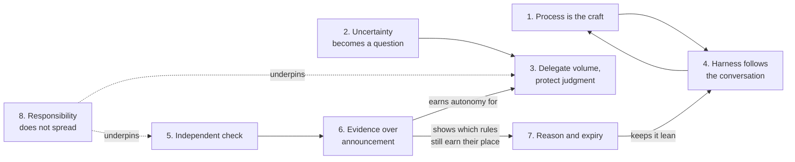

# Core Principles

These are not values. A value says "we care about quality." A principle says "the agent that wrote the change does not get to be the only thing that checks it, because its tests share its assumptions."

I arrived at these eight by building things — a harness for my team and my own daily setup across several coding agents. Each one is a decision lens for the moments when the right answer is not obvious: when speed conflicts with understanding, when an agent could keep going but probably should not, when a tool demo is very persuasive.

Each principle includes:

- **Why it matters** — the reasoning, and where it comes from.
- **What good looks like** — behaviours you can adopt this week.
- **When to bend** — because principles are not dogma.
- **An example** — something concrete.

---

## 1. The model is a component, the process is the craft

!!! tip "The one-liner"
    The advantage is not which model you use. It is how the work around the model is organised.

### Why it matters

A new model arrives every few weeks. Benchmarks move, someone publishes a demo that builds a whole feature from a paragraph, and the conversation shifts to which provider is winning. Most of us respond by trying the new thing, writing a few prompts, and moving on.

But software is not built one prompt at a time. It is built across stages — exploration, definition, implementation, verification, delivery, learning — and its quality depends on how well those stages connect. A brilliant generation built on a requirement nobody examined is worthless. The gaps between stages are where quality lives or dies, and prompts do not span gaps.

The evidence points the same way. DORA's 2025 research describes AI as an amplifier: it strengthens organisations that already work well and exposes the weaknesses of fragmented ones. DORA's AI Capabilities Model makes the same point from the other side: of the seven capabilities it found amplify AI's benefit, not one is a tool — they are things like small batches, strong version control, a user-centric focus and good internal platforms. And LangChain has reported moving its coding agent from the top 30 to the top 5 on Terminal Bench 2.0 by changing only the harness, with the model held fixed. The model is something you consume. The workflow is something you design.

### What good looks like

**You can describe your workflow without naming a tool.** If your process collapses when a vendor changes pricing, it was the vendor's process.

**Improvements land in the system, not in someone's head.** When an engineer finds a better way to get a plan out of an agent, it becomes a skill or an instruction the whole team gets.

**Tool changes are evaluated on your own work.** You replay recent tasks with the new model or harness and compare acceptance and rework, instead of reading the launch post.

### When to bend

Sometimes the model genuinely is the constraint — a class of task that simply did not work six months ago and does now. When that happens, adopt fast. The principle is about where you invest by default, not a reason to ignore capability jumps.

### Example

A team spends a quarter migrating between three coding tools, each time chasing a better benchmark. Their acceptance rate stays flat. Another team keeps its tool and spends the same quarter writing down its definition of done, adding a browser walkthrough to verification, and turning its three most common review comments into deterministic checks. Its rework rate halves. Same models, different craft.

---

## 2. Uncertainty becomes a question

!!! tip "The one-liner"
    When information is missing, the system asks. It does not fill the gap with something plausible.

### Why it matters

A two-line ticket used to be fine, because whoever picked it up would wander over and ask what you meant — and that question doubled as a design conversation. An agent does not wander over. It fills the gap with something plausible and keeps going.

That is the most expensive failure mode in agentic work, because it is invisible. The output looks complete. The workflow appears efficient. And it is quietly moving away from reality. When I documented the research phase of my team's harness, the decision that kept recurring was not what the agent should do, but what it should do when a fact was missing: infer, skip, or ask. The answer we kept returning to was to ask.

### What good looks like

**Plans have an "open questions" section, and it is not empty.** An agent that never has open questions is not thorough. It is guessing.

**Instructions say explicitly what the agent must never assume.** Pricing, data retention, user-facing copy, anything legal.

**"Not applicable" is allowed; silent skipping is not.** A step can be marked irrelevant with a reason. It cannot simply disappear.

**Stopping is rewarded.** An agent run that stops early with a sharp question is treated as a success, not a failure.

### When to bend

For genuinely reversible, low-stakes work — a refactor behind a test suite, a draft nobody will see — let the agent make a reasonable call and note the assumption. The cost of asking should be proportional to the cost of being wrong.

### Example

An agent is asked to add rate limiting to an API. The spec does not say what the limit should be. One harness picks 100 requests per minute because it is a common default, and the change ships. Another stops and asks, surfacing that two enterprise customers routinely exceed 400. The second run took ten minutes longer. The first one would have taken an incident.

---

## 3. Delegate volume, protect judgment

!!! tip "The one-liner"
    Hand agents the work whose cost is repetition and context-gathering. Keep the work whose cost is thinking — and use the time you get back for more of it.

### Why it matters

Much of engineering work is expensive not because it is hard, but because it is voluminous: collecting metrics from four systems, tracing behaviour across repositories, drafting a rollout plan from a template, writing the twentieth similar test. Agents are very good at that.

What they cannot do is understand why one stakeholder sees a problem differently from another, which constraint has never been written down, what a customer is struggling to express, or whether solving the visible request would address the real need underneath it. More data does not remove the need for those conversations.

The goal is not a faster team that produces more code. It is a team whose engineers spend less time producing the inputs to product decisions and more time taking part in them. Anthropic's study of its own engineers found that most could fully delegate only a small share of their work, and that the delegable share was the easily verifiable and the tedious. That is the line to design around.

### What good looks like

**Engineers arrive at conversations prepared.** The harness gathered the evidence; the engineer uses it to ask better questions.

**The time saved is visible and deliberately spent.** On user research, approach reviews, mentoring — not just on more tickets.

**Human gates are where judgment enters, not bureaucratic checkpoints.** See [Human Gates](../harness/human-gates.md).

### When to bend

Sometimes doing the voluminous work by hand is how you learn a system. A new engineer tracing a request through the codebase manually is building judgment, not wasting time. Protect that deliberately — see [Growing Judgment](../team/growing-judgment.md).

### Example

Before a planning session, an agent pulls usage data for the feature under discussion, the last thirty support tickets mentioning it, and the relevant incidents, and drafts three possible problem statements. The engineer reads it in fifteen minutes and spends the hour that used to go on assembling it talking to two customers. The plan that comes out of planning is noticeably different from all three drafts.

---

## 4. The harness follows the conversation

!!! tip "The one-liner"
    A harness is the team's working agreements made executable. It adapts to the team, not the team to the harness.

### Why it matters

Every automated workflow carries opinions, even when they look like defaults. Running a review before opening a pull request puts friction somewhere different from reviewing after. Allowing a step to be marked "not applicable" says something about accountability. Stopping when information is missing defines how much uncertainty the team accepts.

None of these looks significant on its own. Together, they become the process people follow. That is why the harness cannot be one person's preferences, however good. When I built the first version of ours largely on my own, it was persuasive precisely because it worked — and that made the assumptions encoded inside it harder to see. The most valuable changes came when people who had to work inside it asked why a gate was optional, or why a step happened at that point.

### What good looks like

**One person can own the implementation; the agreements stay open.** Someone builds the first version. The decisions underneath it become team decisions.

**Changes to the harness are reviewed like changes to the code.** With a reason, an author, and a way to revert.

**Sceptics design some of the gates.** A sceptic who designs the check has far less reason to block it.

### When to bend

At the very start, a single builder exploring alone is fine — a working proposal is easier to evaluate than an abstract description. Bend the principle for discovery; do not bend it for rollout.

### Example

A harness requires a written approach review before any change touching billing. An engineer argues it slows down trivial copy fixes. The team agrees to scope the gate to changes in the billing domain logic, records the reasoning in the harness change log, and adds a deterministic check that flags any diff touching the pricing tables regardless. The gate got narrower and stronger at the same time.

---

## 5. The check cannot come from the same place as the code

!!! tip "The one-liner"
    Tests written by the agent that wrote the code share its assumptions. Verification has to be independent.

### Why it matters

An agent that implements a change and writes the tests for it will usually produce tests that pass. That is useful — those tests do catch real regressions — but they are built on the same understanding as the code. If the agent misunderstood the requirement, the tests encode the misunderstanding.

Anthropic's engineers found the same thing when building long-running agents: "agents reliably skew positive when grading their own work" — most of all on subjective tasks like design — and separating the agent doing the work from the agent judging it was one of their strongest levers. Birgitta Böckeler at Thoughtworks calls the behaviour harness — checking that the application actually does what is needed — "the elephant in the room" of harness engineering. Stripe found it worth investing in lint feedback that runs in seconds on every push; OpenAI's harness engineering team made the application bootable per Git worktree and wired browser control into the agent's runtime so it could reproduce a bug and then drive the app again to verify the fix. The common thread is verification from a different angle than generation.

### What good looks like

**Acceptance criteria are written before the implementation.** Ideally by a human, or at least approved by one.

**Some checks are computational and fast.** Types, linters, structural tests, fitness functions — they cannot be talked out of a failure.

**Some checks exercise the running system.** Browser walkthroughs, contract tests, production-like environments.

**Reviewer agents are separate from author agents.** Different context, ideally a different prompt, sometimes a different model.

### When to bend

For throwaway prototypes and spikes, agent-written tests are enough. The principle scales with the cost of being wrong.

### Example

An agent implements a discount feature and writes twelve passing tests. An independent check derived from the acceptance criteria — "a 100% discount cannot produce a negative total" — fails immediately. The agent had handled rounding correctly and stacking incorrectly, and its tests only covered rounding.

---

## 6. Evidence over announcement

!!! tip "The one-liner"
    Autonomy is earned one workflow at a time, with data on acceptance and rework — not declared in a kickoff.

### Why it matters

A plan does not make a team ready. What seems to move people is watching one workflow succeed, fail, and get fixed in front of them. The transitions that hold up start small, stay reversible for a while, and expand only when the record justifies it.

This also protects you from the most common measurement mistake: counting adoption. A count of agent pull requests tells you the machine is running. It does not tell you whether the output is accepted without rework, how often people have to step in, or what it costs per merged change. DX's research warns about "false velocity" for exactly this reason — more code does not necessarily mean more business value — and the academic studies of agent pull requests in open source keep finding that they are merged less often than human ones. Volume is not the record you want. Acceptance is.

### What good looks like

**Every new automated workflow starts with a human approving every output.**

**Promotion criteria are written down in advance.** "Auto-approve patch upgrades in low-risk services once 30 consecutive runs are accepted without rework."

**Metrics include the cost of failure.** Rework, reverts, intervention rate, and incidents sit next to throughput.

### When to bend

Some low-risk automations — formatting, changelog drafting — do not need a ceremony. Use judgment on blast radius.

### Example

A team wants an agent to triage incoming bug reports. Instead of switching it on for everything, they run it in shadow mode for three weeks: it proposes labels and owners, humans decide. Agreement reaches 85% on two categories and stays at 40% on a third. They automate the first two and keep the third human. Nobody had to argue about it.

---

## 7. Every control has a reason and an expiry

!!! tip "The one-liner"
    Each rule in the harness exists because of an observed failure, and it is removed when the failure stops happening.

### Why it matters

Harnesses grow by accretion. An agent does something wrong, someone adds a rule, and the rule stays forever. Six months later the instruction file is two thousand lines long, half of it compensates for weaknesses of models nobody uses any more, and the agent spends its context reading it.

The evidence here is unusually clear. A 2026 study from ETH Zurich found that repository context files do not generally improve agent success — whether generated by a model or written by developers — while raising inference cost by more than 20%; developer-written files beat generated ones, but their gain over no file at all was small and not statistically significant. They earn their place mainly when they describe non-standard practices an agent could not guess. OpenAI's harness engineering team replaced one large instruction file with a table of contents of roughly a hundred lines. Anthropic built context resets into a long-running harness to stop a model wrapping up work prematurely, then dropped them when Opus 4.5 "largely removed that behavior on its own" — and advises stripping away whatever is no longer load-bearing each time a new model arrives. Mitchell Hashimoto's definition of harness engineering is useful precisely because it is reactive: when an agent makes a mistake, engineer a solution so it does not happen again.

### What good looks like

**Every rule has a short "why" next to it.** Ideally a link to the failure that prompted it.

**Rules are re-tested when the model changes.** Remove a rule, run the eval, see if anything breaks.

**Prose rules are promoted to scripts when they matter.** A rule that must never be broken belongs in a hook or a linter, not a paragraph.

### When to bend

Some rules encode team agreements rather than model weaknesses — commit conventions, ownership, what counts as done. Those do not expire with models. They expire when the team changes its mind.

### Example

A team's instruction file says "Always run the full test suite before finishing." A newer model does this without being told, and the instruction now causes it to run the slowest suite twice. The rule is removed, the eval set confirms nothing regressed, and the change record notes which model made it obsolete.

---

## 8. Authorship spreads, responsibility does not

!!! tip "The one-liner"
    Someone puts their name on work that nobody typed. Decide who before it matters.

### Why it matters

As agents do more of the implementation, authorship spreads across tools, prompts, and people. Responsibility does not spread with it. When something breaks at three in the morning, someone has to understand it well enough to fix it — and "the agent wrote it" is not an answer anyone accepts.

If nobody has agreed whose name sits on work nobody typed, the weight tends to land on whoever cares most, and stays there. That is unfair, it burns out the most conscientious people, and it is entirely avoidable.

### What good looks like

**Every change has a named human owner.** Usually whoever approved the work into the pipeline, not whoever clicked merge.

**Areas of code have owners who understand them.** Even if they did not write most of the recent changes.

**The audit trail records who decided what.** See [Accountability & Audit Trail](../security/accountability-and-audit.md).

### When to bend

You cannot bend this one. You can only decide how to implement it.

### Example

A team adopts the rule that whoever approves an agent's plan owns the resulting change through its first thirty days in production. Plan approvals immediately become more careful — which was the point.

---

## How the principles fit together

The principles are not independent. Uncertainty becoming a question (2) is what makes delegating volume (3) safe. Independent verification (5) is what makes evidence (6) trustworthy. Controls with an expiry (7) keep the harness that follows the conversation (4) from turning into sediment. And responsibility (8) is what keeps all of it honest.

Read the diagram as a loop rather than a list. The process (1) is designed through the team's agreements (4). Inside it, gaps become questions (2), which is what makes it safe to hand volume to agents (3). Independent checks (5) produce evidence you can trust (6), and that evidence does two jobs: it earns more autonomy for the delegated work, and it tells you which controls have stopped earning their place (7), which keeps the harness lean enough for people to keep discussing it. Responsibility (8) sits underneath everything, because none of the loop matters if nobody's name is on the result.

If you only adopt one, adopt the second. Most of the damage agents do in real teams is not dramatic. It is plausible.

---

## Further reading

- **[State of AI-assisted Software Development 2025](https://dora.dev/research/2025/dora-report/)** by DORA (Google Cloud) — The research behind "AI as an amplifier", with the [AI Capabilities Model](https://cloud.google.com/blog/products/ai-machine-learning/introducing-doras-inaugural-ai-capabilities-model) as its companion.
- **[Harness engineering for coding agent users](https://martinfowler.com/articles/harness-engineering.html)** by Birgitta Böckeler (martinfowler.com) — Guides and sensors, computational and inferential controls, and the behaviour harness.
- **[Harness design for long-running application development](https://www.anthropic.com/engineering/harness-design-long-running-apps)** by Prithvi Rajasekaran (Anthropic) — Why a separate evaluator beats self-grading, and why harness pieces should be removed when models change. (Vendor engineering post.)
- **[My AI adoption journey](https://mitchellh.com/writing/my-ai-adoption-journey)** by Mitchell Hashimoto — The reactive definition of harness engineering.
- **[Evaluating AGENTS.md](https://arxiv.org/abs/2602.11988)** by Gloaguen et al. (ETH Zurich) — The controlled study behind "less context, focused on non-standard practices the agent cannot guess". (Preprint.)
- **[Harness engineering](https://openai.com/index/harness-engineering/)** by Ryan Lopopolo (OpenAI) — Building a product with agents writing all the code. (Vendor post.)
- **[The state of AI harness engineering 2026](https://marmelab.com/blog/2026/09/24/the-state-of-ai-harness-engineering-2026.html)** by marmelab — An audit of 246 repositories and a summary of OpenAI's harness engineering write-up.
- **[Improving deep agents with harness engineering](https://www.langchain.com/blog/improving-deep-agents-with-harness-engineering)** by LangChain — Same model, different harness, different ranking. (Vendor engineering post.)
- **[How AI is transforming work at Anthropic](https://www.anthropic.com/research/how-ai-is-transforming-work-at-anthropic)** by Anthropic — What engineers could and could not delegate. (Vendor study of its own staff.)
- **[Minions: Stripe's one-shot, end-to-end coding agents](https://stripe.dev/blog/minions-stripes-one-shot-end-to-end-coding-agents)** by Stripe — Fast deterministic feedback at scale.
- **[The current impact of AI on engineering velocity](https://newsletter.getdx.com/p/the-current-impact-of-ai-on-engineering)** by DX — The warning about false velocity. (Vendor research.)
- **[The AI harness should follow the conversation](https://dreamingecho.es/blog/the-ai-harness-should-follow-the-conversation)** by Iván González Sáiz — Where principles 2 and 4 came from.

---

## Related pages

- [The State of the Evidence](state-of-the-evidence.md) — What the research supports, and how strongly.
- [What a Harness Is](../harness/what-a-harness-is.md) — Where the principles become a system.
- [Human Gates](../harness/human-gates.md) — Principle 3 in practice: where judgment enters the workflow.
- [Verification](../workflow/verification.md) — Principle 5 in practice: checks that do not share the author's assumptions.
