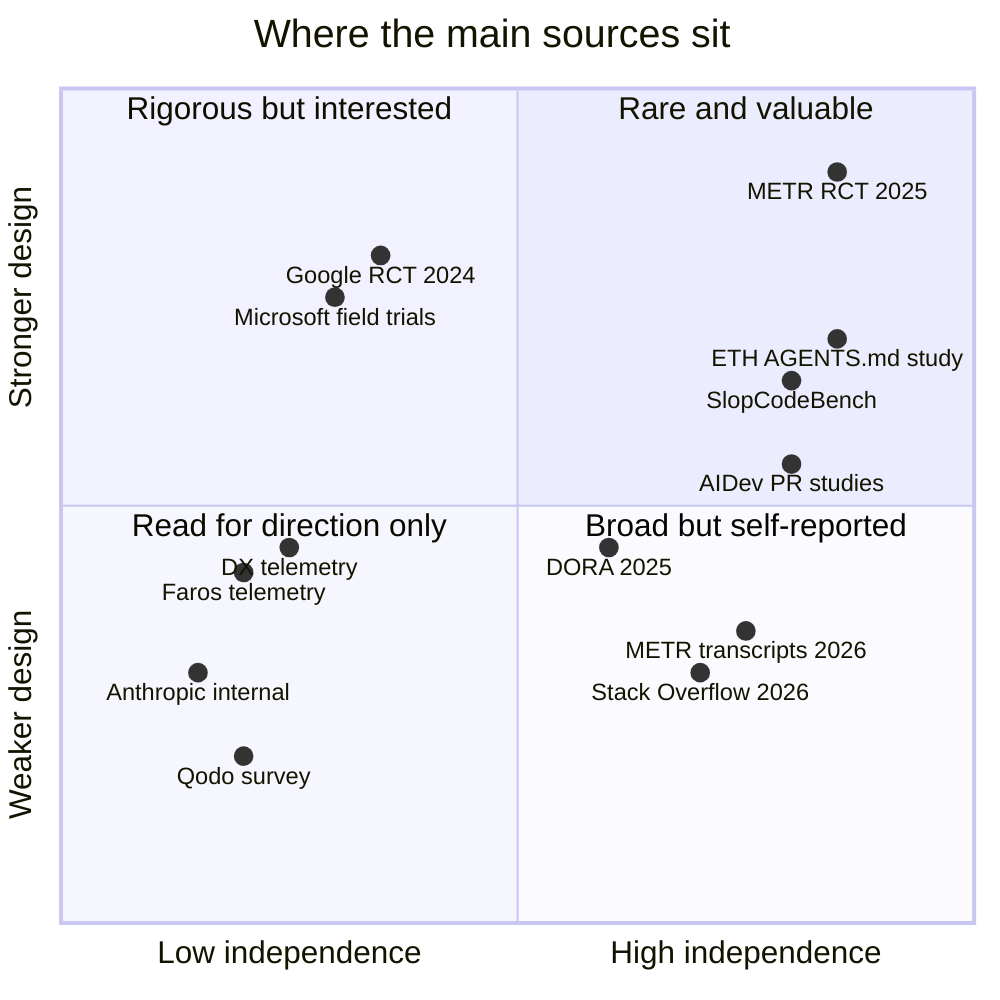
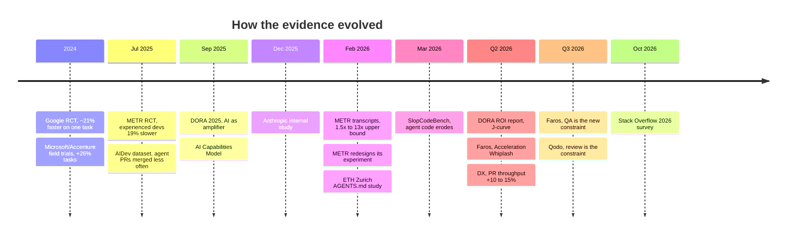

# The State of the Evidence

!!! note "Last reviewed"
    October 2026. This page will age faster than any other in the playbook. Treat specific numbers as a snapshot, and check the date on every source before you repeat it.

In February 2026, METR published two pieces of research a week apart. The first analysed more than five thousand Claude Code transcripts from its own staff and estimated that, on the tasks people used the agent for, they were saving time by a factor of somewhere between 1.5 and 13. The second reported a randomised experiment whose headline estimate was an 18% speed-up for one group of developers and 4% for another, with confidence intervals that crossed zero — and then explained why METR no longer trusted its own experiment.

Same organisation, same month, same question. Numbers that differ by an order of magnitude. Neither is wrong. They measure different things, under different conditions, with different blind spots, and METR said so plainly in both.

That is the state of the evidence in one paragraph. There is a lot of confidence in the conversation about AI and engineering productivity, and much less evidence than the confidence suggests. That is not a reason for cynicism. It is a reason to be precise about what we know, what we suspect, and what is being sold to us.

This page is the evidence base the rest of the playbook leans on. When another chapter says "the research suggests", this is what it means.

!!! tip "The one-liner"
    Speed is the easiest thing to measure and the least useful thing to plan on. Look for where the cost moved.

---

## What problem this solves

Teams make large decisions — tooling budgets, hiring plans, process changes, how much code to stop reading — on the strength of claims they have never examined. A keynote figure becomes a planning assumption. A vendor survey becomes a board slide. A chart of pull requests per engineer becomes the definition of success.

The cost shows up later: budgets that run out in four months, review queues that triple, QA that becomes the new constraint, engineers who feel slower while dashboards say they are faster. Knowing the shape of the evidence helps you set expectations that survive contact with reality, and it helps you notice when your own data starts telling a different story from the one you were sold.

There is a second, quieter problem. Leaders who have been burned by hype sometimes swing to the opposite error and decide that because nothing is proven, nothing is worth trying. That is also a decision made without evidence. The point of reading the research carefully is not to find a reason to wait. It is to know which experiments are worth running on your own team, and what result would change your mind.

---

## When to use this

**Use it when:** you are building a business case for agents, setting productivity expectations for a quarter, answering "what does the research say?" from someone senior, deciding where to invest after the first wave of adoption, or evaluating a vendor's claim before it reaches a slide.

**Skip it when:** you need to decide something about your own team that your own data already answers. Your baseline beats anyone's benchmark. External evidence tells you what to look for; it does not tell you what you will find.

---

## How to read AI productivity claims

Before the findings, a short field guide. Ask four questions of any number you see.

**Who measured it, and what do they sell?** Most large datasets come from companies that sell analytics, review tools, or the agents themselves. Their data is often good; their framing favours their category. An analytics vendor will find that you need better analytics. A review-tool vendor will find that review is the bottleneck. They may both be right — but you should notice the coincidence.

**Was it measured or reported?** Self-reported productivity is systematically optimistic. METR's 2025 study is the cleanest demonstration: developers expected AI to speed them up by 24%, measured time went up by 19%, and afterwards they still believed it had sped them up by 20%. Perception is not useless — it tells you how people feel about the work — but it is a different variable from throughput.

**What was the unit?** Pull requests, tasks, lines, and "time saved" are all proxies. More pull requests is not more value; DX's research readout warns about exactly this under the heading "beware of false velocity": more code does not necessarily mean more business value. Faros reports average pull request size up by more than 70% under deep AI adoption, which means even "pull requests merged" no longer means what it meant two years ago.

**What was the context?** Greenfield or a ten-year-old monolith? Senior or junior? Early-2025 autocomplete or late-2026 agents running in parallel? A study of Copilot completions in 2024 tells you very little about background agents in 2026. Results do not travel well across these lines.

### The evidence ladder

Not all evidence is equal, and the ranking is not the one most slide decks imply. This is roughly how much weight I let each kind of source carry:

```text
            ┌───────────────────────────────┐
            │ Randomised controlled trials  │  METR, Google, Microsoft/Accenture
            ├───────────────────────────────┤
            │ Independent observational     │  Academic studies of agent PRs,
            │ studies and benchmarks        │  SlopCodeBench, ETH AGENTS.md study
            ├───────────────────────────────┤
            │ Large surveys (not tool data) │  DORA, Stack Overflow
            ├───────────────────────────────┤
            │ Vendor telemetry              │  DX, Faros, GitHub Octoverse
            ├───────────────────────────────┤
            │ Vendor surveys and            │  Qodo, Anthropic's internal study,
            │ self-described case studies   │  most "how we built it" posts
            └───────────────────────────────┘
```

Three caveats keep this honest. First, rigour and relevance pull in opposite directions: the most rigorous trials are often the oldest, because a good experiment takes a year to run and publish, and the tools have changed by the time it lands. Second, "independent" is relative: DORA is run by Google Cloud, which sells AI tools; it sits higher than vendor telemetry because its method is published and its questions are not about one product. Third, "vendor" is not a synonym for "wrong". Telemetry from tens of thousands of developers sees things no trial can. What changes is how you read it: look for the direction of an effect across several independent sources, and be careful with any single magnitude.

The chart below places the main sources on this page along those two axes. It is a judgment, not a measurement — and the empty top-right corner is the point.



### Worked example: reading a vendor claim

Picture a slide in a quarterly planning deck. It says: *"Teams using AI see 3× more incidents per pull request. We need an AI governance platform."* The source is a real report — Faros AI's Q2 2026 "Acceleration Whiplash" — and the number is real. Here is how I would read it, step by step.

1. **Who measured it, and what do they sell?** Faros sells engineering analytics. Its report draws on two years of telemetry from about 22,000 developers across 4,000 teams. That is a large and genuinely useful dataset, collected from tools rather than from opinions. It is also a company whose product is the remedy the report implies.
2. **Measured or reported?** Measured, from workflow telemetry. That is a point in its favour over any survey.
3. **What was the unit, and what was compared?** The comparison is between high and low AI adoption within the same organisations. The full figure is incidents per pull request up 242.7%. But pull requests also got about 51% larger in the same comparison, so part of "per pull request" is simply "per bigger pull request". The finding is correlational: teams that adopted heavily may differ in other ways too.
4. **What was the context?** The Q2 report studied the *transition* from low to high adoption. Faros's own Q3 2026 follow-up, "The Speed Trap", looked at organisations deepening adoption they already had, and reported incidents per pull request up 14.5% — not 242.7% — while total monthly incidents rose 125.4% and time in QA rose about 300%.
5. **Does it converge?** Partly. The direction — more output, more downstream cost — matches DORA's finding that AI adoption is associated with lower delivery stability, Qodo's survey finding that review and validation is the most-cited constraint, and SlopCodeBench's evidence that agent code degrades over long iterative work. The magnitude does not converge with anything, and the vendor's own next report moved it by an order of magnitude.
6. **What would we need to see in our own data?** Our incident rate, change failure rate and rework, split by whether a change was agent-assisted, before and after rollout, normalised by change size.

The honest version of the slide reads: *"Several independent sources agree that downstream quality costs rise with AI adoption. One vendor's telemetry suggests the effect is largest during the transition and that QA becomes the new constraint. We will measure incidents and rework per change on our own teams before buying anything."* That is a less exciting slide. It is also the one that will still be true next quarter.

!!! warning "The single-number trap"
    A number quoted without its comparison, its unit and its date is not evidence. It is decoration. If you cannot answer "compared with what, measured how, when?", do not put it on a slide.

---

## How the evidence changed, 2025 → 2026

The most important thing about the evidence is that it moved. In early 2025, the best controlled study showed experienced developers getting slower. By late 2026, nobody serious argues that agents do not speed up the typing; the argument has moved to where the cost went.



Read as a story, the timeline has three acts.

**Act one: does it help at all?** The trials at Google and at Microsoft, Accenture and a Fortune 100 company, published in 2024–25, measured pre-agent coding assistants and found real but modest effects — about 21% faster on one enterprise task at Google, about 26% more completed tasks across the three field experiments, with less experienced developers gaining more. Then METR's July 2025 trial, on experienced maintainers of large open-source repositories, found the opposite. The question in 2025 was genuinely open.

**Act two: it helps individuals; does it help organisations?** DORA's 2025 report shifted the frame. Ninety percent of respondents used AI at work, and AI adoption now had a positive relationship with throughput — but a continued negative relationship with stability. The finding that mattered most was not a number but a framing: AI amplifies the system it lands in.

**Act three: where did the cost go?** By 2026 the interesting research is about the rest of the pipeline. METR's own redesign note says developers are probably faster now and that it cannot measure by how much. DX finds organisation-level throughput gains of roughly 10–15%. Faros, Qodo, and the academic studies of agent pull requests all point at the same place: review, verification, QA and code health. DORA's 2026 ROI report, as summarised by InfoQ, expects most organisations to see a J-curve — a temporary productivity dip before long-term gains — and InfoQ lists a verification tax, the cost of reviewing AI-generated code, among the causes.

---

## What we know with reasonable confidence

### Adoption is near-universal; benefit is not

DORA's 2025 report surveyed nearly 5,000 technology professionals and found 90% using AI at work, for a median of about two hours a day. More than 80% believed it had increased their productivity, while 30% reported little or no trust in the code it generated. The Stack Overflow 2026 Developer Survey, with more than 30,000 respondents, found that 73% of those using AI coding assistants or agents use them daily, and 62% of all respondents view AI at least somewhat positively. Usage is not the open question any more.

What DORA found about outcomes is more nuanced than the "AI doesn't help" summaries that circulated. Unlike in 2024, AI adoption had a positive relationship with software delivery throughput and product performance. It continued to have a negative relationship with delivery stability. And the gains were concentrated: teams in loosely coupled architectures with fast feedback loops saw them, while teams constrained by tightly coupled systems and slow processes saw little or none.

DORA's central framing is that AI is a **mirror and a multiplier**: it amplifies strong organisations and exposes weak ones. I find that the single most useful sentence in the 2025 literature, because it turns "should we adopt AI?" into "what will AI amplify here?"

### The seven capabilities that predict benefit

DORA's companion **AI Capabilities Model** names seven capabilities that magnify the positive impact of AI adoption. None of them is a tool, and most of them were good engineering practice long before anyone had heard of a coding agent:

| Capability                           | What it means in practice                                                                   |
| ------------------------------------ | ------------------------------------------------------------------------------------------- |
| **Clear and communicated AI stance** | People know what is expected, what is permitted, and that experimentation is supported.     |
| **Healthy data ecosystems**          | Internal data is high quality, accessible and unified.                                      |
| **AI-accessible internal data**      | Tools are connected to company context, not just the public internet.                       |
| **Strong version control practices** | Frequent commits and confident rollback absorb a higher volume of change.                   |
| **Working in small batches**         | Small changes amplify AI's benefit to product performance and reduce friction.              |
| **User-centric focus**               | A deep focus on the end user; without it, DORA finds AI adoption can hurt team performance. |
| **Quality internal platforms**       | Shared platforms scale individual gains into organisational ones.                           |

The sixth row is the one I would underline. DORA's finding is not merely that user focus helps; it is that AI adoption without it can make team performance worse. A team that is not clear about whom it serves now produces the wrong thing faster.

### Measured throughput gains are real but modest

DX's June 2026 readout, drawn from its customer base, found pull request throughput rising by about 10–15% in most organisations, with a median improvement closer to 8%. Developers spend only about 14% of their time writing code, which caps how much a coding tool alone can move the whole system. DX's Q2 2026 benchmarks add two telling details: among the largest companies in its dataset, AI spend reached roughly 28 times year-ago levels, while what DX calls the innovation ratio rose by only about one percentage point.

The controlled trials point the same way. The best estimates from the studies published in 2024–25 — about 21% at Google, about 26% across the Microsoft and Accenture field experiments — are meaningful and nowhere near the multiples quoted in keynotes. They also measured task completion, not delivered value.

### Review and verification are the new constraint

Qodo's September 2026 survey of 500 US developers and 300 US engineering leaders found "reviewing and validating AI-generated code" was the most-cited delivery constraint in both groups, at 26% each. Thirty-six percent of developers said reviewing AI code takes the same time it always did but demands more cognitive effort to catch subtle bugs. Only 3.7% of leaders believed their current processes could maintain quality and governance as agents take on more work. Qodo sells AI code review, which is worth remembering, but the finding is consistent with every other source on this page.

Faros's Q3 2026 telemetry names QA as the new bottleneck, with time in QA up about 300%. And at the far end of the scale, OpenAI's VP of Engineering for Applied Infra told Gergely Orosz that pull requests per engineer were "growing like a hockey stick", with roughly a tenfold increase in load on some systems and every part of the build-test-deploy pipeline under more pressure.

### Quality costs show up later than speed gains

Faros's Q2 2026 telemetry, comparing high with low AI adoption, reported task throughput up about a third — and bugs per developer up 54% and code churn up more than eightfold. Treat the magnitudes cautiously, for the reasons in the worked example above. The direction is consistent with DORA's stability finding and with independent research.

The strongest independent evidence here is **SlopCodeBench**, a 2026 academic benchmark by Gabriel Orlanski and colleagues, listed as accepted at NeurIPS 2026. It asks agents to extend their own code repeatedly as specifications evolve — closer to real product work than a one-shot benchmark. Across fifteen agents, none solved any problem end to end and the best passed 14.8% of checkpoints. Structural erosion rose in 77% of trajectories and verbosity in 75.5%; agent code ended up 2.3× more verbose and 2.0× more eroded than a comparison set of 473 open-source Python repositories. Explicit quality guidance reduced the initial mess by up to a third but did not change the rate of decline. Speed arrives immediately; the bill arrives a quarter later.

### Context files help less than everyone assumed

ETH Zurich's 2026 study of `AGENTS.md`-style files is one of the few controlled results on how to configure agents. In its revised version, the authors find that context files do not generally improve task success, whether generated by a model or written by developers, while raising inference cost by more than 20%. Developer-written files did better than generated ones — by about seven points — but improved success over no file by only 2.4% on average, which was not statistically significant. Agents follow the instructions well; repository overviews, a common recommendation, did not help. The authors conclude that context files are most useful for specifying non-standard practices — the things an agent could not guess. That supports a minimal, reactive approach to instructions, and it is why [Instructions & AGENTS.md](../foundations/instructions-and-agents-md.md) argues for less.

---

## What we suspect but cannot prove

### Developers are probably faster than they were a year ago

METR's 2025 randomised trial found 16 experienced open-source developers, working on 246 real issues in repositories averaging more than a million lines of code, took 19% *longer* with early-2025 AI tools. METR's February 2026 follow-up, with 57 developers and more than 800 tasks, produced point estimates pointing the other way: an 18% speed-up among returning developers and 4% among new ones, both with intervals that include zero. METR called the data unreliable. More developers refused to participate if it meant working without AI; 30–50% of developers said they withheld some tasks they did not want to do without it; pay had been cut; and self-reported time breaks down when people run several agents at once. METR's judgment is that developers are more sped up now than in early 2025, and that its data is "only very weak evidence for the size of this increase".

The transcript note published the same month comes at the question from the other side. Analysing 5,305 Claude Code transcripts from seven METR staff in January 2026, it used a model to estimate how long each task would have taken without AI and arrived at a time-savings factor of roughly 1.5× to 13×. Its author is explicit that this is a soft upper bound: people choose to use AI on tasks where it helps, sometimes do work they would otherwise have skipped, and the estimating model tends to overestimate how long humans take. Her conclusion is that people are substantially sped up on the tasks they use the agent for, and that the overall productivity uplift is "likely much lower (but likely still positive)".

Put the two together and you have the most honest summary of the field I know: faster at the task, by an amount nobody can yet measure, with the effect on the whole job smaller than the effect on the task.

### Delegation is narrower than the hype, and widening

Anthropic's December 2025 study of its own engineers — 132 surveyed, 53 interviewed, 200,000 Claude Code transcripts — found self-reported productivity gains rising from 20% to 50% over a year, and merged pull requests per engineer per day up 67% after Claude Code adoption. It also found that more than half could fully delegate only up to 20% of their work, mostly the easily verifiable and the tedious, and that 27% of assisted work would not have been done at all otherwise. The share of transcripts spent on design and planning rose from 1% to about 10%, and on feature implementation from 14% to 37%. This is a vendor studying itself, with self-report and selection bias; the direction is still informative.

### Agent pull requests are accepted less often, and fail in recognisable ways

The academic work on agent-authored pull requests is young but growing. The AIDev dataset, published in July 2025 by Hao Li, Haoxiang Zhang and Ahmed E. Hassan, covers more than 456,000 pull requests from five agents — Codex, Devin, GitHub Copilot, Cursor and Claude Code — across 61,000 repositories. Its first analysis found agent pull requests are merged less often than human ones, despite being produced much faster, and are structurally simpler. A study accepted at MSR 2026 examined 33,000 of them and found that documentation, CI and build changes merge most often while performance and bug-fix changes merge least; rejected pull requests tended to be larger, touch more files, and fail CI. Its taxonomy of rejection reasons includes unwanted features and agent misalignment — the plausible gap-filling that [Core Principles](core-principles.md) warns about. A February 2026 study of 654 rejected agent pull requests found seven rejection modes that appear only for agents, including reviewers' distrust of AI-generated code.

These are open-source repositories with mostly uninvited contributions, so they do not describe a team's own harness. They do suggest that the agent's output is rarely the problem on its own; the problem is the absence of agreed intent and fast checks around it.

### Context and product inputs matter more than models

PostHog's newsletter argues that agents make better decisions with the same inputs good engineers use — how the product is used, who the customers are, what users complain about — and that most "factories" fail by enforcing a clean separation between deciding what to build and building it. LangChain reports moving its coding agent from the top 30 to the top 5 on Terminal Bench 2.0 (52.8 to 66.5) by changing only the harness, with the model fixed. Both are self-reported, and both are consistent with DORA's capability model. Plausible, consistent with experience, and not yet measured rigorously.

---

## What we genuinely do not know

**What happens to codebases few people read closely.** SlopCodeBench is the first serious benchmark of degradation over iterative work, and it is not reassuring, but there is still almost no independent longitudinal work on real product codebases after one or two years of agent-heavy development. One cautionary account comes from HumanLayer: Dex Horthy's team ran a lightly supervised factory for three or four months, deliberately leaving questionable code in place to see whether agents could recover; the codebase grew to 30,000–40,000 lines and was eventually archived (as reported by the Agentic AI Foundation). One team's experience is not a dataset. Margaret-Anne Storey's 2026 paper gives the risk a useful name — *cognitive debt*, "the erosion of shared understanding across a team" — but nobody yet knows how to measure it well.

**What the right cost per engineer is.** StrongDM's suggestion that a factory which has not spent at least $1,000 on tokens per human engineer per day "has room for improvement" reads as seriousness to some and as fantasy to others. DX sees spend at roughly 28 times year-ago levels among the largest companies, with innovation barely moving. Organisations are discovering budgets the hard way. See [Cost & Token Economics](../team/cost-and-token-economics.md).

**How senior judgment will be grown.** The Microsoft and Accenture field experiments found the largest gains among less experienced developers. The entry-level work that used to teach juniors a codebase is also the work agents find easiest. Nobody has a proven way to keep the learning while removing the grunt work. See [Growing Judgment](../team/growing-judgment.md).

**Whether lights-off factories generalise.** The public examples come from well-resourced teams with unusual codebases, and are almost all described by the teams themselves.

**What the J-curve looks like for a team like yours.** DORA's 2026 ROI work, as summarised by InfoQ, expects most organisations to go through an initial dip — learning curve, the cost of reviewing AI-generated code, downstream processes catching up — before returns arrive. How deep and how long that dip is depends on exactly the foundations the capability model describes. Nobody can tell you from the outside.

!!! info "What we know / what we don't"
    **Known, with several independent sources agreeing:** adoption is near-universal; individual task speed is up; organisation-level throughput gains are modest; stability, review, QA and code health absorb the cost; outcomes depend on pre-existing engineering practices.
    **Suspected:** developers are meaningfully faster on the work they choose to delegate; delegation is widening; product context matters as much as the model.
    **Unknown:** long-term code health under agent authorship, sustainable token budgets, how juniors become seniors, and whether lights-off factories work outside a handful of teams.

---

## Roles and ownership

Evidence does not read itself. Someone has to own the habit of checking claims before they become plans.

| Role                            | Responsibility                                                                                                               |
| ------------------------------- | ---------------------------------------------------------------------------------------------------------------------------- |
| **Engineering leader**          | Refuses to plan headcount or budget on external numbers alone; asks for a baseline and a measured delta.                     |
| **Tech lead or staff engineer** | Runs the evidence check on tool and vendor claims; designs the small experiment that tests them locally.                     |
| **Whoever owns metrics**        | Measures acceptance, rework, intervention, incidents and cost per change alongside throughput, split by agent-assisted work. |
| **Every engineer**              | Notices the gap between "it feels faster" and what the data says, and says so.                                               |

---

## What this means for your decisions

The evidence does not tell you what to do. It does narrow the range of reasonable expectations.

| If you are deciding…                  | The evidence suggests…                                                                                                                                                    |
| ------------------------------------- | ------------------------------------------------------------------------------------------------------------------------------------------------------------------------- |
| **Whether to adopt coding agents**    | Yes — but expect the benefit to depend on your existing practices, not the tool. Fix small batches, fast feedback and user focus first.                                   |
| **How much productivity to plan for** | Single-digit to low double-digit throughput gains at organisation level, with large individual variance and a likely dip first. Do not plan headcount on keynote numbers. |
| **Where to invest next**              | Verification, review and QA capacity, and intent — not more generation.                                                                                                   |
| **How to measure**                    | Acceptance, rework, intervention, incidents and cost per merged change, alongside DORA metrics. Never adoption alone.                                                     |
| **How much context to give agents**   | Less than you think, focused on non-standard practices the agent cannot guess, grown reactively.                                                                          |
| **How autonomous to go**              | One workflow at a time, on evidence from your own runs.                                                                                                                   |

---

## What good looks like

A team that reads evidence well is not one that cites more studies. It is one whose plans change when its own data disagrees with someone else's.

| Signal                             | What you observe                                                            |
| ---------------------------------- | --------------------------------------------------------------------------- |
| **Baselines before rollout**       | Throughput, rework, incidents and review time recorded before agents arrive |
| **Sources carry their caveats**    | Planning documents say who measured a number and what they sell             |
| **Directions over magnitudes**     | Decisions rest on effects several independent sources agree on              |
| **Cost is measured next to speed** | Rework, QA time and incidents per change sit beside PR throughput           |
| **Claims get retired**             | Old figures are removed when a newer study or your own data supersedes them |

---

## Failure modes and mitigations

The way teams misuse evidence follows a pattern. It starts with a borrowed number in a planning document — a case study's 2× becomes this year's target. Six weeks in, a dashboard of pull requests per engineer confirms the plan, because pull requests are what agents produce most easily. The review queue grows, QA slips, a few incidents trace back to changes nobody read closely, and by the time anyone asks what changed for users, the budget conversation has already happened. Nobody lied. The team just measured the part that got faster.

| Failure mode                  | What it looks like                                             | Mitigation                                                             |
| ----------------------------- | -------------------------------------------------------------- | ---------------------------------------------------------------------- |
| **Keynote planning**          | Roadmaps assume the throughput gains of a case study           | Baseline your own metrics before rollout; plan on measured deltas      |
| **Perception as measurement** | "The team feels 2× faster" in a quarterly review               | Pair surveys with telemetry; METR's perception gap is real             |
| **Proxy worship**             | PR count becomes the goal while PRs grow larger                | Track rework, incidents and value-adjacent outcomes next to throughput |
| **Vendor data as neutral**    | An analytics vendor's figure cited without context             | Note who measured it and what they sell; look for convergence          |
| **Stale evidence**            | A 2024 autocomplete study used to justify a 2026 agent rollout | Check the tool generation and date before citing                       |
| **Evidence paralysis**        | "We'll wait until the research is clear"                       | Run small, reversible experiments and measure them yourself            |

---

## Copy this: an evidence check for any AI claim

```text
Claim:
Source (who measured it, what they sell):
Design (RCT / observational / telemetry / survey / case study):
Measured or self-reported:
Unit of measure (PRs, tasks, time, lines, incidents, outcomes):
Compared with what (baseline, control group, low adopters):
Context (codebase type, seniority, tool and model generation, date):
Does it converge with independent sources? [yes / partly / no]
Has the same source published a newer figure?
What would we need to see in OUR data to believe it?
Decision it supports:
```

---

## Further reading

- **[State of AI-assisted Software Development 2025](https://dora.dev/research/2025/dora-report/)** by DORA (Google Cloud) — The amplifier framing, team archetypes, and the throughput-up, stability-down result. Read alongside the [announcement post](https://cloud.google.com/blog/products/ai-machine-learning/announcing-the-2025-dora-report) for the headline numbers.
- **[Introducing DORA's inaugural AI Capabilities Model](https://cloud.google.com/blog/products/ai-machine-learning/introducing-doras-inaugural-ai-capabilities-model)** by Kevin M. Storer and Derek DeBellis (DORA) — The seven capabilities, each in a paragraph.
- **[How are developers using AI? Inside our 2025 DORA report](https://blog.google/technology/developers/dora-report-2025/)** by Ryan J. Salva (Google) — Source of the "mirror and a multiplier" phrasing and the two-hours-a-day median.
- **[New DORA report claims strong engineering foundations drive AI return on investment](https://www.infoq.com/news/2026/05/dora-roi-ai-assisted-dev-report/)** by Matt Saunders (InfoQ) — A summary of DORA's 2026 ROI report: the J-curve and the verification tax.
- **[Measuring the impact of early-2025 AI on experienced open-source developer productivity](https://metr.org/blog/2025-07-10-early-2025-ai-experienced-os-dev-study/)** by METR — The randomised trial that found a 19% slowdown and a large perception gap.
- **[We are changing our developer productivity experiment design](https://metr.org/blog/2026-02-24-uplift-update/)** by METR — Why the follow-up could not be trusted, and what METR believes anyway.
- **[Analyzing coding agent transcripts to upper bound productivity gains from AI agents](https://metr.org/notes/2026-02-17-exploratory-transcript-analysis-for-estimating-time-savings-from-coding-agents/)** by Amy Deng (METR) — The 1.5×–13× upper bound and every reason it overstates the effect.
- **[How much does AI impact development speed? An enterprise-based randomized controlled trial](https://arxiv.org/abs/2410.12944)** by Paradis et al. (Google) — 96 Google engineers, about 21% faster, with a wide interval. (Preprint.)
- **[The effects of generative AI on high-skilled work](https://www.microsoft.com/en-us/research/publication/the-effects-of-generative-ai-on-high-skilled-work-evidence-from-three-field-experiments-with-software-developers/)** by Cui et al. (Microsoft Research and others) — Three field experiments, 4,867 developers, +26% completed tasks, larger gains for less experienced developers.
- **[The current impact of AI on engineering velocity](https://newsletter.getdx.com/p/the-current-impact-of-ai-on-engineering)** by DX — The 10–15% throughput finding and the warning about false velocity. (Vendor research.)
- **[AI in engineering: Q2 2026 benchmarks](https://newsletter.getdx.com/p/ai-in-engineering-q2-2026-benchmarks)** by DX — Spend up roughly 28×, innovation ratio up about one point. (Vendor research.)
- **[The 2026 State of AI Code Quality](https://www.qodo.ai/blog/state-of-ai-code-quality-report-2026/)** by Qodo — Survey of 800 US developers and leaders on review as the constraint. (Vendor report.)
- **[AI acceleration whiplash](https://www.faros.ai/research/ai-acceleration-whiplash)** and **[The Speed Trap: 8 takeaways](https://www.faros.ai/blog/ai-speed-trap-takeaways)** by Faros AI — Telemetry from 22,000 developers; read both to see how the numbers moved. (Vendor reports.)
- **[The results of the 2026 Developer Survey are here](https://stackoverflow.blog/2026/10/06/the-results-of-the-2026-developer-survey-are-here/)** by Stack Overflow — Daily use, sentiment, and what developers need before they trust AI output.
- **[Octoverse 2025](https://github.blog/news-insights/octoverse/octoverse-a-new-developer-joins-github-every-second-as-ai-leads-typescript-to-1/)** by GitHub — Platform-scale activity, the first million coding-agent pull requests, and why typed languages rose. (Vendor report.)
- **[The rise of AI teammates in software engineering 3.0](https://arxiv.org/abs/2507.15003)** by Li, Zhang and Hassan — The AIDev dataset of 456,000 agent pull requests. (Preprint.)
- **[Where do AI coding agents fail?](https://arxiv.org/abs/2601.15195)** by Ehsani et al. (MSR 2026) — Which agent pull requests get merged, and a taxonomy of why the rest do not.
- **[Why agentic-PRs get rejected](https://arxiv.org/abs/2602.04226)** by Nakashima et al. — Rejection modes unique to agents. (Preprint.)
- **[SlopCodeBench](https://arxiv.org/abs/2603.24755)** by Orlanski et al. — How agent code erodes over long iterative tasks. (Preprint; accepted at NeurIPS 2026.)
- **[Evaluating AGENTS.md](https://arxiv.org/abs/2602.11988)** by Gloaguen et al. (ETH Zurich) — The controlled study of context files. (Preprint.)
- **[How AI is transforming work at Anthropic](https://www.anthropic.com/research/how-ai-is-transforming-work-at-anthropic)** by Anthropic — A vendor studying its own engineers; candid about skill atrophy and delegation limits.
- **[Can software factories actually work?](https://posthog.com/newsletter/software-factories)** by Jina Yoon (PostHog) — The argument for product context.
- **[Inside OpenAI's agentic software factory](https://newsletter.pragmaticengineer.com/p/openai-software-factory)** by Gergely Orosz — What happens to infrastructure when pull requests go hockey-stick. (Partly paywalled.)
- **[From technical debt to cognitive and intent debt](https://www.alphaxiv.org/abs/2603.22106)** by Margaret-Anne Storey — A vocabulary for the risk nobody can measure yet. (Preprint.)

---

## Related pages

- [Measuring Impact Honestly](../team/measuring-impact.md) — How to turn the questions on this page into metrics for your own team.
- [The Bottleneck Moves](../factories/the-bottleneck-moves.md) — What review, QA and intake look like once implementation stops being the constraint.
- [Field Reports](../factories/field-reports.md) — The self-described case studies, read with the caveats above.
- [Core Principles](core-principles.md) — The principles this evidence supports, and where it is thinner than the principles imply.
