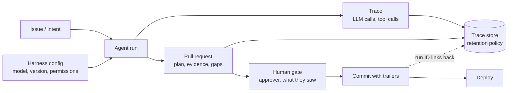
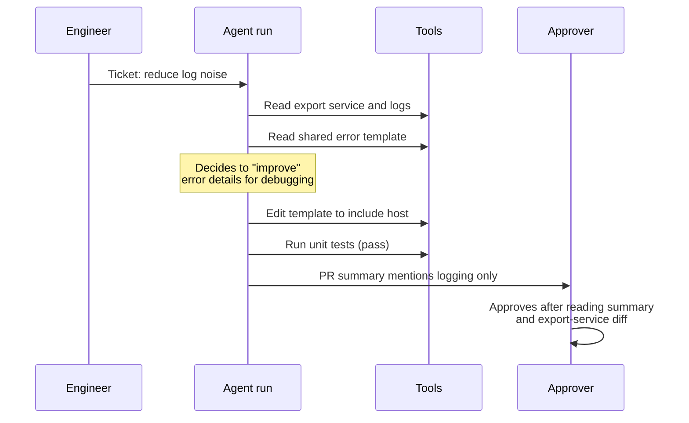

# Accountability & Audit Trail

Authorship spreads across agents. Responsibility does not.

Picture the incident review. A change merged on Tuesday leaked internal hostnames into a public error page. The pull request says it was opened by a bot account. The description is a tidy summary written by the agent. Someone approved it. Nobody can say what the agent read before it made the change, whether it ran the tests that would have caught it, or why it touched the error handler at all when the ticket was about logging. The room spends forty minutes arguing about whether the approver should have noticed, which is the least useful question available.

When an agent-written change causes an incident, "the agent did it" is not an answer anyone accepts: not customers, not auditors, not the engineer paged at three in the morning. Someone stands behind every change. The questions are whether you decided who in advance, and whether you can reconstruct what happened well enough to fix the system rather than blame a person.

!!! tip "The one-liner"
    Decide whose name sits on work nobody typed before it matters, and keep enough of each run that you can replay the decision, not just the diff.

---

## What problem this solves

Two gaps open as agents do more of the work.

**The accountability gap.** Nobody feels responsible for code they did not write and only skimmed. If nobody has agreed whose name sits on work nobody typed, the weight lands on whoever cares most, and stays there. That is unfair, it burns out the most conscientious people, and it is avoidable.

**The traceability gap.** Nobody can reconstruct what the agent did, what it read, or why. Qodo's 2026 report, based on a Censuswide survey of 300 US engineering leaders (and, separately, 500 developers), found that 90% of the leaders said they could report AI's impact to executives or the board, but only 45% had traceability connecting AI activity to the code changes it produced. Qodo sells AI code review, so read the framing with that in mind, but the gap it describes is easy to recognise: organisations count agent pull requests long before they can explain any single one.

The two gaps feed each other. Without a trail, accountability collapses into blaming the last human who clicked something. Without clear accountability, nobody invests in keeping the trail.

---

## When to use this

**Use it when:** from the first agent change that reaches production. Retrofitting a trail after an incident means investigating that incident without one.

**Lighter version when** agents are used only interactively, with an engineer reviewing every change as their own. The engineer is then simply the author, and ordinary code review and Git history do most of the work. The rest of this page matters most once agents work in the background.

---

## Accountability rules

**Every change has a named human owner.** For interactive work, the engineer who directed it. For background or factory workflows, the person who approved it; for auto-merged tiers, the workflow owner. "The bot" is never the owner.

**Owners own the first weeks in production.** The approver is the first point of contact for issues. The [Core Principles](../principles/core-principles.md#8-authorship-spreads-responsibility-does-not) give an example of a team adopting a thirty-day rule, and plan approvals becoming more careful as a result. That was the point.

**Areas have maintainers.** Someone understands each area well enough to support it, even if agents wrote most of the recent changes. Ownership of a change is temporary; ownership of an area is not.

**Agreed before it matters.** These rules are written down and known, not invented in the incident review.

**The operator answers for the agent.** When an agent authors a change, the person who ran it is one of its required reviewers, and an agent's approval never counts as a person's. This is how the Claude Code team closes the gap between authorship and responsibility, and it is cheap to copy with code-owner rules and branch protection.

**"You land it, you own it" needs reversibility to be fair.** The same team expects whoever merges a small or medium change to fix it if it goes wrong, and explains why that does not spiral: changes are small, nearly everything can be reverted in minutes through flags, reverts and staged rollouts, riskier code gets more eyes, regressions surface quickly through telemetry and heavy internal use, and incident reviews look at the system rather than for someone to blame. Take away the reversibility and the same rule becomes a punishment for whoever was holding the change when it broke.

The approver rule raises a fair objection: is it reasonable to hold someone accountable for a 2,000-line agent diff they could not fully review? No, and the answer is not to drop the rule but to stop producing such diffs. If approvers keep being asked to own changes they cannot understand, that is a signal about the size of the work or the quality of the evidence attached to it. [Review at Agent Speed](../workflow/review-at-agent-speed.md) covers that side.

---

## What to record

A useful audit trail answers three questions for any change: *what was asked*, *what was done*, and *who decided it was acceptable*. That needs more than the diff.

| Record                                        | Why                                                                |
| --------------------------------------------- | ------------------------------------------------------------------ |
| **Agent, model and harness version**          | To correlate problems with tool or configuration changes           |
| **The intent and plan** it worked from        | To compare what was asked with what was done                       |
| **The run transcript or trace**               | To see what it read, which tools it called, and in what order      |
| **Verification evidence**                     | To see what was actually checked, not what the summary claims      |
| **What it could not verify**                  | To know which risk a human accepted                                |
| **Who approved, at which gates, seeing what** | Accountability, and to judge whether the gate could have caught it |
| **Credentials and permissions in effect**     | To bound what the run *could* have done                            |

Much of this lives naturally in the pull request: the linked issue, the plan, the checks, the approvals. The run itself, what the agent read and executed, needs deliberate capture and retention. A first factory version of a dependency upgrade, in the way I described it in [From coding agents to software factories](https://dreamingecho.es/blog/coding-agents-to-software-factories), has the agent write down "what it changed, why, and what it could not verify" before a person approves. That note is the start of the audit trail, written at the moment it is cheapest to write.



The dotted line is the part teams forget. If the commit does not carry an identifier for the run that produced it, the trace and the code drift apart, and six weeks later nobody can join them.

---

## Telemetry: OpenTelemetry for agents

The practical way to capture runs is the same way you capture everything else in production: traces.

OpenTelemetry has semantic conventions for generative AI, which now live in their own repository and are still marked as **Development** status, meaning names can change. They define spans for operations such as `invoke_agent` and `execute_tool`, attributes such as the requested model, and separate conventions for MCP. The content attributes, the actual input and output messages, system instructions and tool definitions, are **opt-in**, and the specification warns that they are likely to contain sensitive information.

Coding agents increasingly emit this telemetry themselves. Claude Code can export metrics, events and, optionally, distributed traces over OpenTelemetry. Tracing is a beta feature that needs `CLAUDE_CODE_ENHANCED_TELEMETRY_BETA=1` as well as the usual telemetry switch; its traces link each user prompt to the API requests and tool executions it triggered, and shell subprocesses inherit a `TRACEPARENT` so that anything they emit can join the same trace. Codex also supports opt-in OpenTelemetry export. In both, telemetry is off by default, and in Claude Code's case prompt text, tool inputs and tool content are redacted unless explicitly enabled.

That default is the central tension of this page. For privacy and data protection, redacted is right: full prompt logs are a new store of source code, secrets that slipped into context, and possibly personal data. For investigation, redacted traces tell you that the agent read a file and opened a pull request, which is exactly what an injected agent looks like too (see [Agent Threat Model](agent-threat-model.md)). There is no universal answer. A reasonable pattern:

- **Metadata always**: which agent, model, tools, files touched, commands run, durations, outcomes, run ID.
- **Content for background and high-risk workflows**, stored in a restricted trace store with a defined retention period and access logging, treated under [Data & Policy](data-and-policy.md) like any other confidential data.
- **Content off by default for interactive local use**, where the engineer is the author and the transcript is their working notes.

!!! warning "The redacted-trace trap"
    A trace that records only "read file, ran command, opened PR" proves the agent was busy. It cannot tell you whether it was doing your work or an attacker's. Decide where you need content before the incident, because you cannot turn logging on retroactively.

---

## Attribution in Git

Git has a standard place for this kind of metadata: **trailers**, key-value lines at the end of a commit message, separated from the body by a blank line. GitHub, for example, recognises `Co-authored-by:` trailers to attribute a commit to several authors. Custom trailers work the same way and can be added and parsed with `git interpret-trailers`.

Teams differ on how agent involvement should appear. Some add a co-author trailer for the agent; others deliberately do not, considering the human who directed and approved the change its author. Both are defensible. What is not defensible is leaving it to each tool's default, so that history says something different depending on which agent each engineer happened to use.

Whatever you choose for authorship, a machine-readable link from commit to run is worth having independently of it. Something like:

```text
fix(billing): handle missing currency in invoice export

The export assumed every invoice had a currency; legacy invoices
created before 2023 do not. Default to the account currency and
log a warning. Tests cover both paths.

Agent-Run: run_2026-10-14_8f3a2c
Approved-by: Jane Doe <jane@example.com>
```

The trailer names here are illustrative, not a standard. Pick names, document them, and enforce them in a commit-msg hook or CI check so they are applied consistently.

### Provenance

Supply-chain frameworks already have a vocabulary for "how was this artefact produced". SLSA defines provenance as "verifiable information about software artifacts describing where, when and how something was produced". It is designed for builds, not for authorship of source changes, and I am not aware of a settled standard for agent-authored code. But the idea transfers: a signed, machine-verifiable record linking a change to the run, configuration and approvals that produced it is stronger than a trailer anyone can type. Expect this space to move; for now, consistent trailers and retained traces get most of the value.

---

## Worked example: reconstructing an incident from traces

Return to the opening incident: internal hostnames appeared on a public error page after an agent-authored change to error handling. The scenario is illustrative. The team has traces with content enabled for background workflows, and run IDs in commit trailers.

**Step 1: start from the commit, not the person.** The commit carries `Agent-Run: run_…`. That ID finds the trace in the trace store, and the pull request links the original ticket: "reduce noise in error logs for the export service".

**Step 2: compare intent with action.** The plan in the PR says "adjust log levels in the export service". The diff also modifies the shared error-page template. That divergence is the first finding: the agent did more than its plan.

**Step 3: read the trace in order.**



The tool-call spans show the agent read the error template after encountering an error in the logs, then edited it to include more context "to make debugging easier". No external content was involved, so this was not injection; it was an overeager change. The tests passed because no test asserted what the public error page must not contain.

**Step 4: look at the gate.** The approver's review is recorded: they commented on the export-service files and approved. The PR summary, written by the agent, did not mention the template change. The trace shows the approver was given a summary that was incomplete, and a diff in which the template change was one of fourteen files.

**Step 5: ask what in the harness allowed it.** Not "why did Jane not notice?" but:

- The plan was not enforced: nothing flagged files changed outside the plan's scope.
- The PR summary was generated by the same agent that made the change, so it shared its blind spot.
- Shared templates rendered to the public had no tier marking that would require a second reviewer.
- No test or check asserted that public error pages exclude internal details.

**Step 6: fix the system.** The team adds a check that compares changed paths against the plan and flags out-of-scope files in the PR; generates the "files changed" list deterministically instead of trusting the agent's summary; marks public templates as a higher [risk tier](../factories/risk-tiers-and-autonomy.md); and adds a test for internal hostnames in public responses. The incident becomes an eval case. The postmortem uses the [Agent Incident Postmortem](../templates/agent-incident-postmortem.md) template.

**What made this possible.** Every useful finding came from the trace with content and the run ID in the commit. With redacted traces, step 3 would have shown "read file, edit file, run tests", and the review would have fallen back to arguing about the approver.

---

## When things go wrong

Treat agent-caused incidents like any other: blameless, focused on the system. The questions are about the harness: a missing check, a weak gate, a wrong tier, injected content, a permission that should not have existed. The approver is part of the system too. If they were shown an incomplete summary and an unreviewable diff, the gate failed, not the person.

Two habits make this work over time. First, every agent incident produces at least one harness change and, where possible, a new eval case, so the same failure is caught mechanically next time. Second, the incident is checked against the [Agent Threat Model](agent-threat-model.md): was this an overeager agent, or could the same path be triggered deliberately by someone who can put text in front of it? The fix may need to be stronger in the second case.

---

## Roles and ownership

| Role                         | Responsibility                                                            |
| ---------------------------- | ------------------------------------------------------------------------- |
| **Approver of each change**  | Accountable for it in production; first contact for its early weeks       |
| **Workflow owner**           | Accountable for automated workflows, including auto-merged changes        |
| **Area maintainers**         | Understand and support their areas regardless of who wrote recent changes |
| **Platform / harness owner** | Provides telemetry, trace retention, run IDs and attribution hooks        |
| **Security and privacy**     | Decide content-logging policy and access to the trace store               |

---

## What good looks like

| Signal                            | What you observe                                                          |
| --------------------------------- | ------------------------------------------------------------------------- |
| **Named owner per change**        | Visible in the PR; never a bot account alone                              |
| **Reconstructable runs**          | Any change traceable to its intent, run, evidence and approvals           |
| **Consistent attribution**        | Team convention for trailers enforced automatically                       |
| **Deliberate content logging**    | A written decision on where traces include content, and who can read them |
| **Harness fixes after incidents** | Postmortems produce harness changes and eval cases, not reprimands        |

---

## Failure modes and mitigations

The failure is usually discovered at the worst moment. The team has been shipping agent changes for months, the dashboards show volume going up, and then something breaks and the only record is a bot-authored PR with an agent-written summary. The review turns into a hunt for whoever clicked approve, the approver concludes that approving agent work is a liability, and approvals slow down for everyone.

| Failure mode                 | What it looks like                                         | Mitigation                                         |
| ---------------------------- | ---------------------------------------------------------- | -------------------------------------------------- |
| **"The bot did it"**         | No human owner for automated changes                       | Workflow owners accountable; owner named in the PR |
| **Lost transcripts**         | Runs not retained, or retained without content             | Trace retention policy decided in advance          |
| **Blame the approver**       | Approver punished for an agent mistake                     | Blameless review of the gate and harness           |
| **Self-reported evidence**   | The agent's own summary is the only record of what changed | Deterministic change lists; independent checks     |
| **Inconsistent attribution** | Each tool's default applies                                | Team decision, enforced by hook                    |
| **Traces as a data leak**    | Full prompts in a widely readable observability tool       | Restricted store, retention limits, access logging |

---

## Further reading

- **[How the Claude Code team does code review](https://claude.dev/blog/solving-code-review-at-anthropic/)** by Addy Osmani, Morgan Westlee Lunt and Qing Wang (Anthropic) — The operator as reviewer, and "you land it, you own it" with reversibility underneath. (Vendor post.)
- **[The 2026 State of AI Code Quality](https://www.qodo.ai/blog/state-of-ai-code-quality-report-2026/)** by Qodo — Survey of US developers and leaders, including the traceability gap. (Vendor report.)
- **[OpenTelemetry GenAI semantic conventions](https://github.com/open-telemetry/semantic-conventions-genai)** by OpenTelemetry — Agent, tool and MCP spans, and which attributes are opt-in because they carry content.
- **[Monitoring](https://code.claude.com/docs/en/monitoring-usage)** by Anthropic — How Claude Code exports metrics, events and traces, and what is redacted by default. (Vendor.)
- **[Agent approvals & security](https://developers.openai.com/codex/agent-approvals-security)** by OpenAI — Codex's opt-in OpenTelemetry export. (Vendor.)
- **[git-interpret-trailers](https://git-scm.com/docs/git-interpret-trailers)** by the Git project — The trailer format and tooling.
- **[Creating a commit with multiple authors](https://docs.github.com/en/pull-requests/committing-changes-to-your-project/creating-and-editing-commits/creating-a-commit-with-multiple-authors)** by GitHub — How `Co-authored-by` trailers are recognised.
- **[SLSA provenance](https://slsa.dev/spec/v1.0/provenance)** by the SLSA project — The supply-chain vocabulary for "how was this produced".
- **[Security Best Practices: token passthrough](https://modelcontextprotocol.io/specification/2026-07-28/basic/security_best_practices#token-passthrough)** by the Model Context Protocol project — Why forwarding tokens through MCP servers breaks audit trails.
- **[From coding agents to software factories](https://dreamingecho.es/blog/coding-agents-to-software-factories)** by Iván González Sáiz — Keeping accountability with people while agents do the work.

---

## Related pages

- [Core Principles: Authorship spreads, responsibility does not](../principles/core-principles.md#8-authorship-spreads-responsibility-does-not) — The principle this page implements.
- [Agent Incident Postmortem](../templates/agent-incident-postmortem.md) — A template for turning an incident into harness changes.
- [Review at Agent Speed](../workflow/review-at-agent-speed.md) — Making approvals meaningful when the volume goes up.
- [Risk Tiers & Autonomy](../factories/risk-tiers-and-autonomy.md) — Matching review depth and logging to the damage a change could do.
