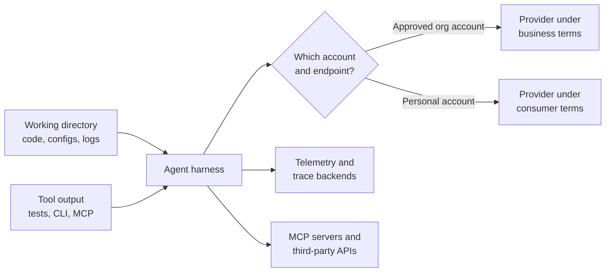
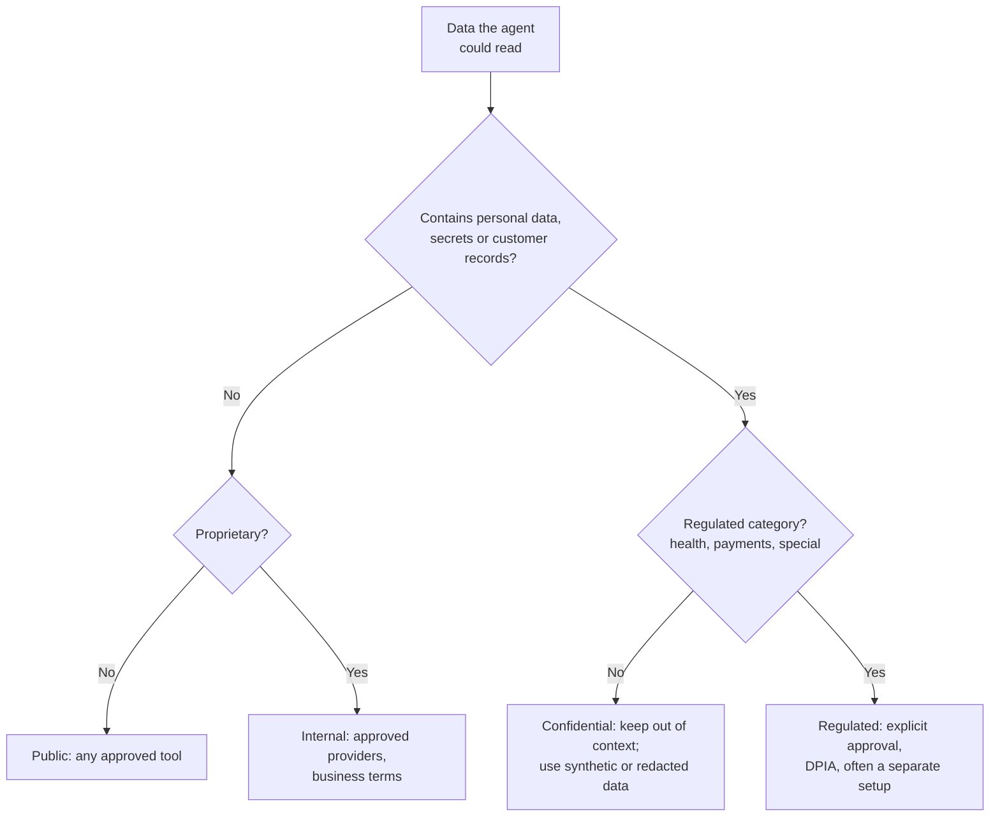
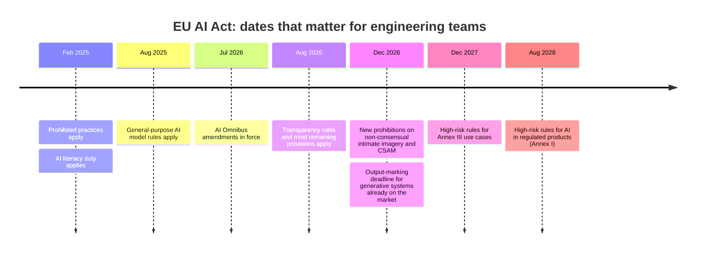

# Data & Policy

Every prompt an agent sends carries data to a model provider. Not only what the engineer typed: the files it opened, the output of the commands it ran, the stack trace with a customer's email address in it, the `.env` file it read while "understanding the project". A coding agent is, among other things, a very efficient mechanism for moving the contents of a working directory to a third party.

Most organisations have a policy for where customer data may go. Far fewer have checked whether their agents follow it. And in many teams the most consequential data decision is made silently by which account an engineer happens to be logged into: the company's enterprise plan, with contractual terms the legal team negotiated, or a personal subscription on the same laptop, with consumer terms nobody read.

!!! tip "The one-liner"
    A clear, short AI stance is a security control. Ambiguity does not stop people using AI; it stops them using it where you can see.

---

## What problem this solves

Without a clear policy, two failures happen at once. Some engineers avoid AI tools entirely because they are unsure what is allowed. Others use whatever works, sending data to places the organisation never approved.

DORA's research names this directly. Its AI Capabilities Model includes a *clear and communicated AI stance* as one of the capabilities that amplify AI's benefits, and describes the cost of its absence in the same two-sided terms: "developers acting too conservatively out of fear they will cross an invisible line, or acting too permissively and using unvetted tools that introduce significant risk." DORA reports finding "with a high degree of certainty" that a clear stance amplifies AI's positive influence on individual effectiveness and organisational performance. It also names what ambiguity produces: people hiding their usage, *shadow AI*, or avoiding the technology entirely.

Read that as a security finding as much as a productivity one. Shadow AI is the case where you have no logs, no approved provider, no retention terms and no idea which data left. A permissive, clear stance with enforced boundaries is safer than a restrictive, vague one.

---

## When to use this

**Use it when:**

- Before broad adoption, ideally before the first agent touches a repository with customer data nearby.
- Whenever you add a provider, a tool, or a new kind of data to agent context.
- When regulation changes, or when your product starts shipping AI features to users.

**Skip the heavy version when** you are a small team working only on open-source code with no customer data. Even then, write down which accounts to use; it takes ten minutes.

---

## Where the data actually goes

It helps to trace the path once, concretely, because it is longer than most people assume.



Four destinations, not one. The model provider is the obvious one. Telemetry is the forgotten one: if you enable full prompt logging for audit (see [Accountability & Audit Trail](accountability-and-audit.md)), your observability vendor now holds the same data. MCP servers and third-party tools receive whatever the agent passes them. And the branch at the top, which account, is where most accidental exposure happens.

### Provider terms: what to check, and why the account matters

Provider terms differ by product tier, and the difference is often larger than the difference between providers. As of October 2026, for example:

- OpenAI states that data sent to its API has not been used to train its models since 1 March 2023 unless the customer opts in, and that business data in its enterprise products is not used for training by default. Its API documentation also says abuse-monitoring logs, which may contain prompts and responses, are retained for up to 30 days by default, subject to legal exceptions, with Zero Data Retention available to eligible customers.
- Anthropic states that by default it does not use inputs or outputs from its commercial products, such as Claude for Work and the API, to train its models, and points to separate terms for consumer plans, explicitly including when consumer accounts use Claude Code.

Both are vendors describing their own terms; read the current page and your contract rather than this summary. The questions to ask of any provider are the same:

| Question                      | Why it matters                                                                      |
| ----------------------------- | ----------------------------------------------------------------------------------- |
| **Training on inputs**        | Is it off by default for this tier, and does feedback (thumbs up/down) change that? |
| **Retention**                 | How long are prompts and outputs kept, including for abuse monitoring?              |
| **Zero or reduced retention** | Is it available, and which features stop working under it?                          |
| **Data residency**            | Where is data processed and stored? Matters for international transfers.            |
| **Sub-processors**            | Who else touches the data, and how are you told about changes?                      |
| **Account control**           | Can you enforce that engineers use the organisation's account, not a personal one?  |

The last row is the one teams skip. A contract with excellent terms protects nothing if half the team uses personal subscriptions because the enterprise rollout took three months.

---

## Data classes and what agents may do with them

Classify data by what it is, then decide what each class may be used with. A four-level scheme is enough for most teams:

| Data class       | Example                                                             | Agent use                                                         |
| ---------------- | ------------------------------------------------------------------- | ----------------------------------------------------------------- |
| **Public**       | Open-source code, public docs                                       | Any approved tool                                                 |
| **Internal**     | Proprietary source, internal docs, architecture notes               | Approved providers under business terms with no training          |
| **Confidential** | Customer data, credentials, financials, production logs             | Not in prompts; synthetic or redacted data only                   |
| **Regulated**    | Health data, payment card data, special categories of personal data | Not in agent context without explicit legal and security approval |

The practical work is in the boundary between *internal* and *confidential*, because that boundary runs through the working directory. Source code is internal. The production database dump someone left in `tmp/` is confidential. The agent does not know the difference and will read both. Which is why enforcement has to happen in the environment, not in a sentence asking the agent to be careful.



---

## Regulation: what applies, plainly

This is not legal advice, and what applies depends on your jurisdiction and what your product does. But engineers should understand the shape of it well enough to know when to ask.

### Data protection (GDPR and equivalents)

If personal data reaches a model provider, data protection law applies to that processing, whether or not the tool is "just a coding assistant". Under the GDPR, three provisions come up again and again:

**Processors (Article 28).** A provider processing personal data on your behalf is a processor. You may only use processors "providing sufficient guarantees to implement appropriate technical and organisational measures", and the relationship needs a contract. In practice, this is the data processing agreement that comes with business tiers and usually not with personal accounts.

**International transfers (Chapter V).** Transfers of personal data outside the EEA are allowed only under the conditions that chapter sets out. Where a provider processes data matters.

**Impact assessments (Article 35).** Where processing "using new technologies" is likely to result in a high risk to people's rights, the controller must assess the impact first. Agents processing customer data at scale are a plausible trigger; agents working on source code with no personal data usually are not.

The cleanest way to reduce all three to a small problem is the one in the data-class table: keep personal data out of agent context in the first place.

### The EU AI Act

The AI Act entered into force on 1 August 2024 and applies in stages. The schedule was amended in 2026 by the so-called AI Omnibus, which the European Commission says entered into force on 27 July 2026 and moved the high-risk dates later.



For a team using coding agents internally, two things are worth knowing. First, an **AI literacy** duty has applied since February 2025. As originally adopted, it required providers and deployers to "take measures to ensure, to their best extent, a sufficient level of AI literacy" of their staff; the AI Omnibus softened it in 2026 to taking measures to support AI literacy among staff who operate and use AI systems. A clear stance plus onboarding is a reasonable way to show that. Second, most of the heavier obligations attach to **what you build and ship**, not to the tools your engineers use. If your product includes AI features, particularly in the high-risk areas the Act lists, such as employment, education or critical infrastructure, involve legal early, because those obligations are now on a fixed timeline.

The Commission's own page is the place to check current dates. Third-party trackers are useful but secondary.

---

## Enforcing it

A policy nobody enforces is a memo. These controls turn it into a boundary:

**Approved providers by configuration.** Route agent traffic through the organisation's accounts or an internal gateway; block known consumer endpoints on managed devices where you can. Claude Code and Codex, for example, both document administrator-managed configuration; check whether your tool can also enforce which account people sign in with.

**No real customer data where agents run.** Development environments use synthetic or anonymised data. This is the single most effective control on this page, because it makes the confidential row of the table mostly empty.

**Secrets out of the working directory.** Secret scanning on commits always; secrets injected at runtime by tools rather than sitting in `.env` files the agent will read. See [Sandboxing & Permissions](sandboxing-and-permissions.md).

**Network egress restricted** to approved model endpoints and registries, which also blocks the "other provider" path.

**Logging of which provider received what class of request**, with content logging decided deliberately, because full prompt logs are themselves a store of sensitive data.

---

## Worked example: writing a one-page AI stance

Consider a 40-person product engineering organisation. Some engineers use an enterprise coding agent the company pays for; others use personal subscriptions to different tools; one team has been told by a manager that "we're not allowed to use AI on the billing service" and nobody knows where that came from. Legal has a draft twelve-page AI policy that nobody has finished reading. The scenario is illustrative.

**Step 1: find out what is actually happening.** The engineering manager runs an anonymous, no-blame survey: which tools, which accounts, on which code, with what data. The answer is predictable: three tools, a mix of accounts, and two people who pasted production log excerpts into a chat window to debug an incident.

**Step 2: decide the defaults, not the exceptions.** The leadership group, with legal and security in the room, agrees four things in one meeting: which providers are approved (two, under business terms with no training on inputs), that personal accounts are not used for company code, that confidential and regulated data stay out of prompts, and that the default answer to "may I use AI for this?" is yes, within those rules.

**Step 3: write it on one page.** The first draft is three pages. Every paragraph that explains *why* moves to a linked FAQ. What remains fits on a page and uses the structure below.

**Step 4: make the rules true by configuration.** Before the stance is announced, the platform team enables managed settings that pin the approved provider on company machines, adds egress rules, and gives every engineer an account on the approved tool the same day. Announcing a policy before the approved option exists is how you create shadow AI.

**Step 5: answer the billing team.** The billing service handles payment data, so it falls under *regulated*. The answer is not "no AI" but "no real payment data in context": agents can work on the code with synthetic fixtures. The rule that nobody could source turns out to be a misremembered conversation; the stance replaces it with one that can be checked.

**Step 6: open a channel and a review date.** A named channel answers "is this allowed?" within a day. The stance carries a review date three months out, because the tools will have changed.

**What went wrong along the way.** The first announcement said "approved tools only" without listing them, and the channel filled with the same question forty times. The fix was to put the list in the first line of the page. The production log paste prompted a specific rule, "logs from production are confidential until scrubbed", and a scrubbing script in the incident runbook, which did more than the rule.

---

## Copy this: one-page AI stance

```text
AI STANCE — <organisation>                     Last reviewed: <date>  Next review: <date>

1. Default: Yes. We expect engineers to use AI tools for their work, within these rules.

2. Approved tools and accounts
   - <tool A>, <tool B>, via company accounts only (SSO). No personal accounts for company work.
   - Terms: no training on our inputs; retention <n> days; data processed in <region>.

3. Data rules
   - Public and internal code and docs: fine with approved tools.
   - Confidential (customer data, credentials, production logs, financials): never in prompts.
     Use synthetic or scrubbed data. Production logs are confidential until scrubbed.
   - Regulated (payments, health, special categories): ask first.

4. Where agents may run
   - Local, in the provided sandbox, or in <approved cloud environment>. Never against production.

5. What needs a human
   - Anything touching production, external communication, deleting data, spending money,
     anything legal or contractual.

6. Disclosure
   - <Our convention for marking AI involvement in commits / customer-facing content.>

7. Ask
   - #<channel>. Answered within one working day. Owner: <name>.
```

---

## Roles and ownership

| Role                                  | Responsibility                                                   |
| ------------------------------------- | ---------------------------------------------------------------- |
| **Leadership with legal and privacy** | Own the stance, the approved providers and the contracts         |
| **Security**                          | Enforces data boundaries technically: accounts, egress, scanning |
| **Engineering managers**              | Make sure the team knows the stance and has the approved tools   |
| **Engineers**                         | Follow it; flag when it blocks legitimate work, so it gets fixed |

---

## What good looks like

| Signal                                | What you observe                                                       |
| ------------------------------------- | ---------------------------------------------------------------------- |
| **One-page stance**                   | Engineers can summarise it in a sentence                               |
| **Approved by configuration**         | Unapproved providers and personal accounts blocked on company machines |
| **No customer data in agent context** | Synthetic data in development environments                             |
| **Fast answers**                      | "Is this allowed?" answered within a day                               |
| **Reviewed regularly**                | Updated as tools, terms and regulation change                          |

---

## Failure modes and mitigations

The pattern is familiar from every previous wave of tooling. A cautious organisation bans or delays, the useful tools are one browser tab away, and usage moves somewhere no log can see it. Or an enthusiastic organisation approves everything and never asks what the terms say. Both end with data in places nobody chose.

| Failure mode               | What it looks like                              | Mitigation                                                   |
| -------------------------- | ----------------------------------------------- | ------------------------------------------------------------ |
| **No stance**              | Everyone guesses, differently                   | Publish a one-page stance                                    |
| **Ban by default**         | Tools blocked; engineers use personal accounts  | Approve good options quickly; make them available on day one |
| **Policy by memo**         | Rules exist, nothing enforces them              | Managed settings, account control, egress rules              |
| **Production data in dev** | Agents read real customer records               | Synthetic data; scrub logs before use                        |
| **Forgotten telemetry**    | Full prompts logged to a vendor nobody assessed | Treat trace backends as data destinations too                |

!!! note "Last reviewed"
    October 2026. Provider terms and AI Act dates are perishable; check the linked primary pages before relying on specifics.

---

## Further reading

- **[Clear and communicated AI stance](https://dora.dev/capabilities/clear-and-communicated-ai-stance/)** by DORA — Why ambiguity produces both over-caution and shadow AI, and what a stance should contain.
- **[AI Act: regulatory framework](https://digital-strategy.ec.europa.eu/en/policies/regulatory-framework-ai)** by the European Commission — The official overview, including the AI Omnibus changes to high-risk dates.
- **[Implementation timeline](https://artificialintelligenceact.eu/implementation-timeline/)** by the Future of Life Institute (artificialintelligenceact.eu) — A detailed, regularly updated date tracker. (Secondary.)
- **[General Data Protection Regulation (EU) 2016/679](https://eur-lex.europa.eu/eli/reg/2016/679/oj/eng)** on EUR-Lex — The text of Articles 28, 35 and Chapter V referenced above.
- **[Enterprise privacy at OpenAI](https://openai.com/enterprise-privacy/)** and **[Your data](https://developers.openai.com/api/docs/guides/your-data)** by OpenAI — Training, retention and Zero Data Retention terms. (Vendor.)
- **[Is my data used for model training?](https://privacy.claude.com/en/articles/7996868-is-my-data-used-for-model-training)** by Anthropic — Commercial versus consumer terms. (Vendor.)
- **[OWASP Top 10 for LLM Applications 2025](https://genai.owasp.org/llm-top-10/)** by the OWASP GenAI Security Project — Sensitive information disclosure is LLM02.

---

## Related pages

- [Agent Threat Model](agent-threat-model.md) — How data leaves through an injected agent, not only through policy gaps.
- [Sandboxing & Permissions](sandboxing-and-permissions.md) — The technical controls that make data rules true.
- [Accountability & Audit Trail](accountability-and-audit.md) — Logging what agents did without creating a new data store nobody governs.
- [Adoption Without Mandates](../team/adoption-without-mandates.md) — Rolling out tools so people choose the approved path.
