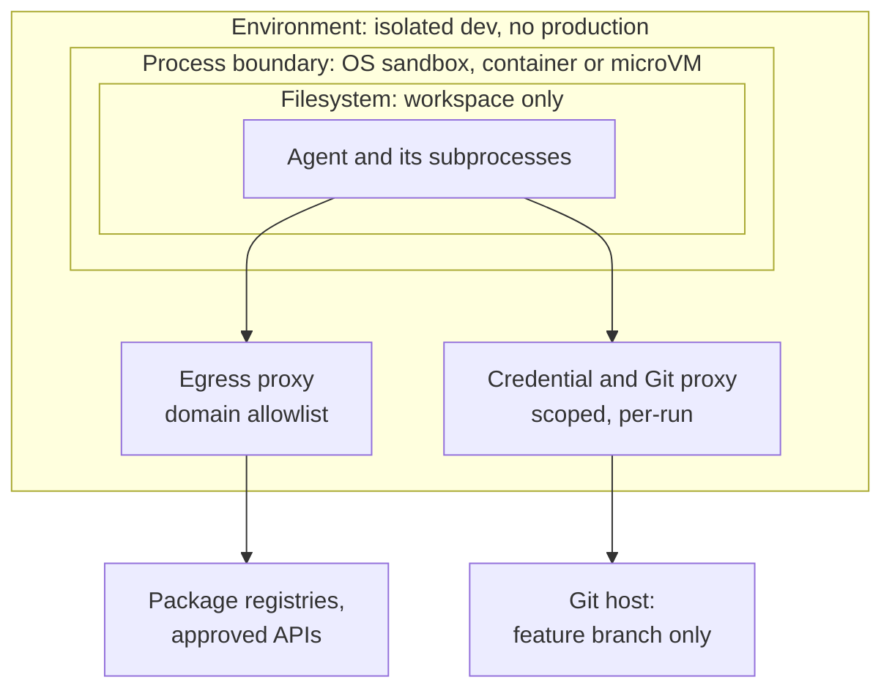
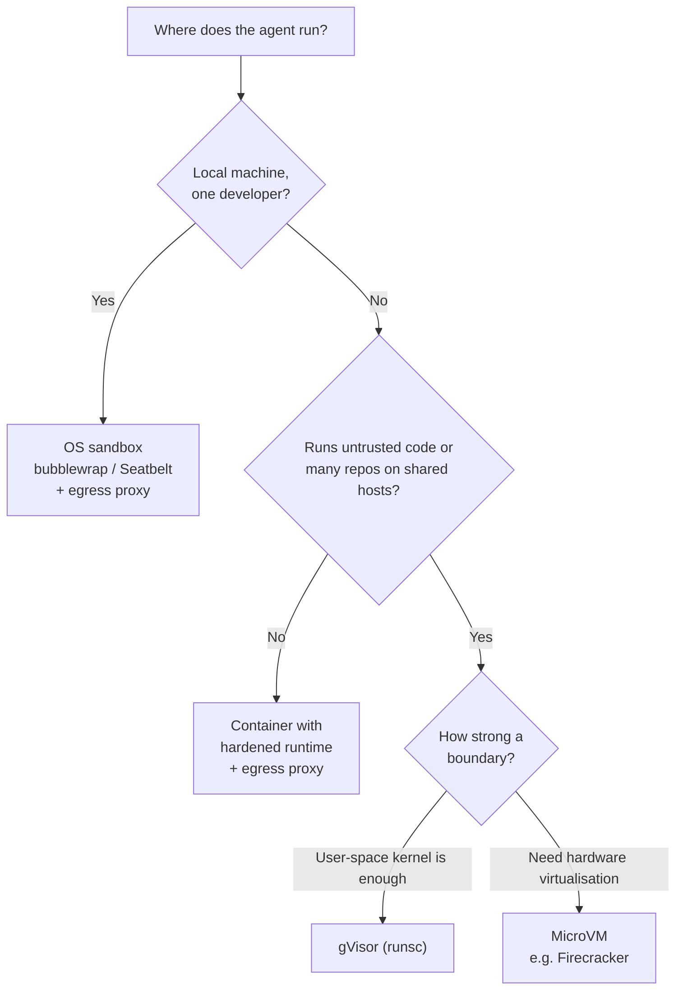

# Sandboxing & Permissions

There are two ways to keep an agent from doing something harmful: ask a person before every risky action, or make the harmful action impossible. The first sounds safer and works worse.

Anyone who has used a coding agent for a week knows why. The first dozen permission prompts get read carefully. By the end of the afternoon the hand is on the key before the prompt has finished rendering. Anthropic has published the number for its own tool: in practice, users accept 93% of Claude Code's permission prompts. That is not a character flaw in engineers. It is what happens when a person is asked the same low-stakes question hundreds of times and the answer is almost always yes. The one prompt that mattered arrives looking exactly like the ninety-nine that did not.

Sandboxes change the question. Instead of "should I allow this command?", you ask once, in advance, "what should this environment be able to reach?" Inside a well-designed boundary most prompts become unnecessary, and the few that remain mean something.

!!! tip "The one-liner"
    Decide what the environment can reach, not what each command may do. Then keep humans for the handful of actions no sandbox can make reversible.

---

## What problem this solves

Permission prompts are the default safety mechanism in most coding agents, and they fail in three ways.

**They fatigue.** The 93% approval rate above is the interactive case, with a person at the keyboard. Anthropic's write-up of its sandboxing work names the effect directly: constant approval "can lead to 'approval fatigue', where users might not pay close attention to what they're approving."

**They do not scale to background work.** A nightly dependency agent, a factory workflow picking up tickets, or ten parallel agents in worktrees have nobody to ask. Teams either block on human approval, which removes the point of running in the background, or switch prompts off, which removes the safety.

**Writing rules in advance is not automatically better.** It is tempting to replace prompts with a policy file. A 2026 preprint studied 113 participants without professional software backgrounds supervising a simulated agent day with seven overreach actions. Participants who wrote their own allow/ask/never rules up front blocked 20.1 percentage points less overreach than those approving each action. The paper's exploratory analysis suggests why: participants set 114 of their 140 rules to "ask", and 133 of the 148 overreach actions that ran under the policies did so after a human approved them. The population is not engineers and the study is a single preprint, so treat it as a warning rather than a verdict. The warning is that policy written by a person still routes through that person's attention.

A second 2026 preprint looked at 481 public `CLAUDE.md` files and found that only about 4–16% of the security rules written there (4.4% under the strictest standard) could be expressed by one of Claude Code's built-in controls; the rest need added code such as hooks, scanners or CI checks, or are left to the model's judgment. A rule that exists only as a sentence in a Markdown file is a wish until something enforces it.

The answer to all three is the same: put the boundary in the environment, where the model cannot negotiate with it and a tired human does not have to defend it.

---

## When to use this

**Use it when:**

- Always for background, cloud, scheduled or parallel agents.
- For local agents, whenever you want to stop approving every command.
- Strictly for any workflow that reads untrusted content (see [Agent Threat Model](agent-threat-model.md)).

**Skip the heavier layers when** an agent is used interactively, read-only, on a repository with no secrets and no network need. Even then, keep the filesystem boundary: it is cheap, and it is the one that stops an agent wandering into your home directory.

---

## Layers of isolation

A sandbox is not one thing. It is a set of boundaries, each of which contains a different kind of failure. Thinking in layers is what stops a team from believing a Git checkpoint protects them from exfiltration.

| Layer                | What it limits                           | Examples                                                               |
| -------------------- | ---------------------------------------- | ---------------------------------------------------------------------- |
| **Filesystem**       | What the agent can read and write        | Working directory only; no home directory, SSH keys or cloud config    |
| **Network**          | Where it can connect                     | No egress, or an allowlist of registries and approved APIs via a proxy |
| **Process / kernel** | What a compromised process can escape to | OS sandbox, container, gVisor, microVM                                 |
| **Credentials**      | What it can do in other systems          | Scoped, short-lived tokens held by a proxy, not the agent              |
| **Source control**   | What it can change                       | Feature branches only; protected branches enforced server-side         |
| **Environment**      | What it can affect                       | Isolated dev environments with synthetic data; never production        |

The diagram's important feature is what is *outside* the inner boxes. The network proxy and the credential proxy sit beyond the agent's reach, so nothing the agent writes can change where it may connect or what its token can do.

Each layer contains some failures and not others:

**A Git checkpoint** lets you undo file changes. It does nothing about a secret already sent over the network.

**A filesystem boundary** stops reads of your SSH keys. It does not stop a malicious package install pulling a credential stealer if the network is open and credentials sit in environment variables.

**A network boundary** stops data leaving. It does not stop the agent corrupting the workspace or committing a bad change.

**A kernel boundary** (VM or gVisor) protects the host if the agent, or code it runs, exploits a kernel bug. It does nothing if you then hand the guest a production token.

Anthropic makes the pairing point explicitly about its own sandbox: "effective sandboxing requires *both* filesystem and network isolation. Without network isolation, a compromised agent could exfiltrate sensitive files like SSH keys; without filesystem isolation, a compromised agent could easily escape the sandbox and gain network access."

---

## How the major tools approach it

The details move quickly, so read this section as the shape of the options rather than a feature comparison. Both vendors below sell the agents they describe.

**Claude Code** (Anthropic, October 2025) added a sandboxed bash tool built on OS primitives, bubblewrap on Linux and Seatbelt on macOS, that applies to the command and every subprocess it spawns. Writes are limited to the working directory; network traffic goes through a proxy outside the sandbox that enforces a domain allowlist and asks the user about new domains. Anthropic reports that in internal use sandboxing "safely reduces permission prompts by 84%", and has open-sourced the runtime so it can sandbox other agents and MCP servers. For its cloud sessions, Anthropic describes keeping "sensitive credentials (such as git credentials or signing keys)" outside the sandbox entirely: the Git client inside authenticates to a proxy with a scoped credential, and the proxy checks the operation, for example that it only pushes to the configured branch, before attaching the real token.

**Codex** (OpenAI) separates a *sandbox mode*, what the agent can technically do, from an *approval policy*, when it must ask. Locally it uses an OS-enforced sandbox; the documented defaults are no network access and writes limited to the active workspace. Its cloud environments have historically run setup with network access to install dependencies and then run the agent phase offline unless internet access is enabled. The documentation is also candid about a subtlety worth checking in any tool: enabling network access and enabling the domain-restricting proxy are separate switches, and turning on the first without the second gives unrestricted outbound access.

**Stripe's Minions** show the same principle at organisational scale. Each run starts in a pre-warmed devbox, the same kind of machine Stripe engineers use, and the devboxes are "isolated from production resources and the internet, so we can run minions on devboxes without human permission checks." The isolation is what buys the autonomy.

**Classifiers between prompts and sandboxes.** Anthropic's auto mode puts a model-based classifier where the human approver was. It is useful, and its authors are clear about its limits (a 17% miss rate on a small set of real overeager actions). One design detail transfers to any harness: on entering auto mode, it drops allow rules that grant arbitrary code execution, such as blanket shell access or wildcarded interpreters, because those rules would let everything bypass the classifier.

---

## Choosing the process boundary

For local, interactive work, an OS-level sandbox like the ones above is usually enough. For background agents running code from many repositories, or running in shared infrastructure, the question becomes how strong the boundary between the agent and the host needs to be.

**Plain containers** share the host kernel. They are a packaging and resource boundary first; a kernel exploit from inside one reaches the host. LangChain, which sells a microVM-backed sandbox product, makes the point that the open-source Kubernetes Agent Sandbox "is only secure if deployed to a cluster that has kernel-level isolation between containers, which most Kubernetes clusters do not enforce." The vendor interest is obvious; the technical point stands.

**gVisor** is an application kernel written in Go that runs in user space and intercepts the container's system calls, so the host kernel's attack surface is much smaller. It ships an OCI runtime, `runsc`, that works with Docker and Kubernetes. Its documentation says it is not a syscall filter and not a conventional VM, but a user-space kernel; it offers "a merged guest kernel and VMM, or... seccomp on steroids" as two ways to picture it.

**MicroVMs** such as Firecracker give each workload its own kernel under KVM, with a deliberately minimal device model (the project cites only five emulated devices). Firecracker was built for multi-tenant serverless workloads and underpins AWS Lambda.

The flowchart is a starting heuristic, not a standard. Whatever the process boundary, the network and credential layers still decide most of the outcomes that matter.

---

## Permissions inside the boundary

**Least privilege, per task.** A research agent needs read access. An implementation agent needs write access to a branch. Neither needs admin.

**Separate read from write.** Grant read broadly within the task's scope; grant write narrowly.

**Short-lived credentials.** Issued per run, scoped to the repository or resource, expiring after it. The MCP security guidance on scope minimisation says the same thing for tool servers: start with a minimal scope set and elevate incrementally, rather than requesting every scope up front.

**Credentials outside the context.** Tools, proxies and servers hold credentials; the model never sees them. If the agent can print a token, an injected agent can exfiltrate it.

**Narrow allowlists.** Auto-approve specific commands (`npm test`, `git status`), not families (`git *`, `python *`). An allowlisted command is only as safe as everything it can be told to do, and CVE-2026-22708 showed an allowlist being bypassed by changing the environment around allowed commands.

**Boundaries the model cannot change.** Sandbox and permission configuration must live outside the workspace, or in paths the agent cannot write. CVE-2025-54135 (an agent creating its own MCP configuration) and CVE-2025-59532 (a sandbox root derived from a model-generated path) are both versions of this mistake.

**Block the metadata endpoint.** Cloud instance metadata services (at the link-local address `169.254.169.254`) hand out credentials to anything on the machine that asks. MCP's security guidance, in its SSRF section, lists link-local `169.254.0.0/16` among the ranges to block because cloud metadata endpoints "can exfiltrate cloud credentials"; the same logic applies to agent egress. An egress allowlist does this for you; an open network does not.

---

## Worked example: sandbox layers for a nightly dependency agent

Consider a team that wants an agent to keep dependencies current across a dozen service repositories. Each night it should check for new releases, read changelogs, update the lockfile, run the tests and open a pull request with notes on anything it could not verify. This is the kind of unglamorous first factory workflow described in [Your First Factory Workflow](../factories/first-factory-workflow.md). The scenario is illustrative.

**Step 1: list what it must do, and what it reads.** It must read repository code, fetch packages from the registry, fetch changelogs (untrusted content written by package maintainers, or by whoever compromised them), run the test suite (which executes the new dependency's code), and push a branch. It runs unattended.

**Step 2: identify the trifecta.** Untrusted content: changelogs and, more seriously, the dependency code itself. Private data: the repository and any secrets the tests need. External communication: the registry, the changelog hosts, and the Git push. This workflow will hold all three legs unless the layers remove some.

**Step 3: the first design, and what is wrong with it.** The quick version runs in a CI runner with the organisation's deploy token in an environment variable, open egress, and permission to push to any branch. A compromised release of a dependency (the LiteLLM incident in March 2026 is the pattern, see [Agent Threat Model](agent-threat-model.md)) would execute during the test run and find a powerful token and an open network. The agent never needs to be "injected" at all.

**Step 4: choose layers that remove legs.**

| Layer              | Choice                                                                             | Leg it addresses                                     |
| ------------------ | ---------------------------------------------------------------------------------- | ---------------------------------------------------- |
| **Process**        | A fresh microVM or gVisor sandbox per repository per run, destroyed afterwards     | Contains code execution; no persistence between runs |
| **Filesystem**     | Only the checked-out repository; no host mounts, no cached credentials             | Private data limited to one repo                     |
| **Network**        | Egress via proxy to the package registry and the Git host only; link-local blocked | Removes arbitrary external communication             |
| **Credentials**    | No tokens in the sandbox; a Git proxy outside it pushes only to `deps/*` branches  | Removes credential theft as a payoff                 |
| **Test secrets**   | None; tests needing real services are skipped and reported as "not verified"       | Private data further reduced                         |
| **Source control** | Branch protection; merge requires CI and a human review                            | State changes gated                                  |

**Step 5: deal with the leftover legs.** Changelog fetching needs arbitrary hosts, which the egress policy forbids. Rather than open the network, the team splits it out: a separate step with web access but no repository and no credentials fetches changelogs and reduces each to structured fields (version, breaking-change flag, a summary capped in length) that the main run reads. This is the Dual LLM pattern from the threat model, and it means the main run never touches arbitrary web content.

**Step 6: check the failure cases.** If a new dependency version contains a credential stealer, it executes inside a disposable VM with no credentials and can reach only the registry and the Git proxy, which accepts only pushes to `deps/*`. If the agent is confused into editing CI configuration, the change arrives as a pull request a human reviews. If the agent runs a destructive command, it destroys a VM that was going to be destroyed anyway.

**Step 7: measure the friction honestly.** Some upgrades now fail because a test needed a real service. The team accepts that and marks them "not verified" in the PR. That is a cost, and it is visible, which is better than a hidden risk.

---

## Keeping humans for what matters

With good isolation, the remaining permission prompts and human gates should be few and meaningful. These are the actions no sandbox can make safe, because their effects land outside it:

- Anything touching production.
- External communications: messages, public comments, emails.
- Deleting data or infrastructure.
- Spending money or changing billing.
- Changing the harness's own permissions or sandbox configuration.

Design the gate so the person sees what matters. Invariant's tool-poisoning research noted that a confirmation dialog which hides the full tool arguments cannot protect anyone. A gate that shows "approve push?" without the diff is a ritual, not a control. [Human Gates](../harness/human-gates.md) covers how to design them.

!!! warning "The YOLO-on-the-laptop trap"
    "Skip permissions" modes are reasonable inside a disposable, credential-free sandbox. On a laptop with your SSH keys, cloud credentials and browser sessions, they turn every injection into a compromise of your machine. The flag is not the problem; where it runs is.

---

## Roles and ownership

| Role              | Responsibility                                                                          |
| ----------------- | --------------------------------------------------------------------------------------- |
| **Platform team** | Provides sandboxed environments, egress proxies and credential brokering as the default |
| **Security**      | Defines boundaries: filesystem, network, credentials; reviews exceptions                |
| **Harness owner** | Configures agent permissions and allowlists; keeps config out of the agent's reach      |
| **Engineers**     | Use sandboxes by default; do not bypass them for convenience; report friction           |

The platform team's real job is to make the safe path the easy one. If the sandbox takes a day to configure per repository, engineers will run agents without it. Pre-built images, a standard egress policy and a credential proxy that "just works" do more for security than any policy document.

---

## What good looks like

| Signal                                | What you observe                                                      |
| ------------------------------------- | --------------------------------------------------------------------- |
| **Background agents fully sandboxed** | No production access, no open egress, disposable environments         |
| **Few, meaningful prompts**           | People read the prompts they see, because there are few of them       |
| **Scoped credentials**                | Per-run, minimal, expiring, held outside the agent                    |
| **Server-side enforcement**           | Branch protection and policies live on the Git host, not in the agent |
| **Bypass is rare and logged**         | Permission-skipping modes used only inside isolated environments      |

---

## Failure modes and mitigations

The usual story is drift. A team sets up a careful sandbox for its first background agent. Then a test needs a real database, so a connection string is added to the environment. A new tool needs a domain, so egress opens "temporarily" to everything. Someone running locally finds the prompts tiresome and enables skip-permissions on their laptop. Six months later the sandbox exists in the architecture diagram and nowhere else.

| Failure mode              | What it looks like                                      | Mitigation                                                                                              |
| ------------------------- | ------------------------------------------------------- | ------------------------------------------------------------------------------------------------------- |
| **Approve-all fatigue**   | Prompts clicked through                                 | Sandboxes that remove the need for most prompts                                                         |
| **YOLO on the laptop**    | Permission bypass on a machine with real credentials    | Bypass only inside isolated environments                                                                |
| **Shared admin token**    | One powerful credential for all agents                  | Per-run scoped tokens via a proxy                                                                       |
| **Open egress**           | Agent can reach any host, including metadata endpoints  | Egress allowlist; block link-local and private ranges                                                   |
| **Agent-editable config** | Agent can change its own permissions or MCP config      | Config outside the workspace; protected paths                                                           |
| **Rules in prose**        | Security rules in `AGENTS.md` with no enforcing control | For each rule, decide: built-in control, hook or CI check, or accepted model judgment, and record which |
| **Sandbox drift**         | Exceptions accumulate until isolation is nominal        | Review exceptions on a schedule; expire them by default                                                 |

!!! note "Last reviewed"
    October 2026. Sandbox features in coding agents change frequently; check your tool's current documentation for defaults before relying on this page.

---

## Further reading

- **[Beyond permission prompts: making Claude Code more secure and autonomous](https://www.anthropic.com/engineering/claude-code-sandboxing)** by Anthropic — Filesystem plus network isolation, the 84% prompt reduction, and credential proxies for cloud sessions. (Vendor.)
- **[How we built Claude Code auto mode](https://www.anthropic.com/engineering/claude-code-auto-mode)** by Anthropic — The 93% approval figure, a classifier as approver, and an unusually honest residual-risk number. (Vendor.)
- **[Agent approvals & security](https://developers.openai.com/codex/agent-approvals-security)** by OpenAI — Codex's split between sandbox mode and approval policy, and how network settings actually combine. (Vendor.)
- **[Minions: Stripe's one-shot, end-to-end coding agents](https://stripe.dev/blog/minions-stripes-one-shot-end-to-end-coding-agents)** by Stripe — Isolation as the thing that removes per-action permission checks.
- **[Do User-Authored Permission Policies Improve Protection Against AI Agent Overreach?](https://arxiv.org/abs/2608.27443)** by Ting Yan — Rules written in advance versus approving each action. (Preprint; participants were non-engineers.)
- **[When "Do Not" Is Not Deny: Security Rules in CLAUDE.md vs Built-In Controls](https://arxiv.org/abs/2608.23550)** by Ting Yan — How few written security rules map to a built-in control, and what the rest need instead. (Preprint.)
- **[What is gVisor?](https://gvisor.dev/docs/)** by the gVisor project — How an application kernel differs from VMs and syscall filters.
- **[Firecracker](https://firecracker-microvm.github.io/)** by the Firecracker project — MicroVM isolation with a minimal device model.
- **[How to choose the right sandbox for your agent](https://langchain.com/blog/how-to-choose-the-right-sandbox-for-your-agent)** by LangChain — A clear checklist of sandbox properties. LangChain sells a sandbox product. (Vendor.)
- **[Security Best Practices](https://modelcontextprotocol.io/specification/2026-07-28/basic/security_best_practices)** by the Model Context Protocol project — Scope minimisation, egress proxies and local server sandboxing.
- **[The state of AI harness engineering 2026](https://marmelab.com/blog/2026/09/24/the-state-of-ai-harness-engineering-2026.html)** by marmelab — An audit showing how rarely public harnesses use deny rules and hooks.

---

## Related pages

- [Agent Threat Model](agent-threat-model.md) — The attacks these boundaries exist to contain.
- [Hooks & Deterministic Guards](../foundations/hooks-and-guards.md) — Enforcing rules in code at the moment an action happens.
- [Human Gates](../harness/human-gates.md) — Designing the few approvals that remain so they mean something.
- [Factory Infrastructure](../factories/factory-infrastructure.md) — Where sandboxes fit when agents run as a production system.
