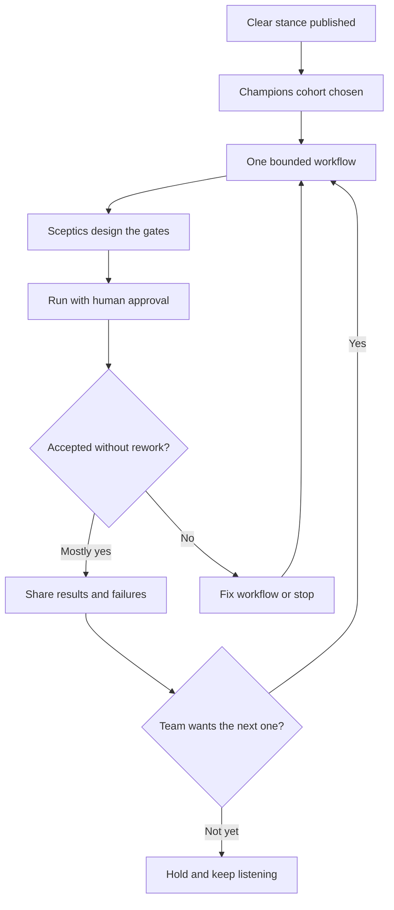

# Adoption Without Mandates

Everyone in the room said yes. The new agent workflow was approved, the rollout date was set, the meeting moved on.

Three weeks later, one engineer is still arguing about it in every planning session. Another nodded in the meeting and has quietly gone on doing the work by hand. A third has adopted it completely and approves anything that comes back green. The adoption dashboard shows two out of three. The truth is closer to zero out of three: one person has not changed, one has changed in name only, and one has changed in the most dangerous possible way.

A plan does not make a team ready. What seems to move people, if anything does, is watching one workflow succeed, fail, and get fixed in front of them, with the doubters holding some of the controls.

!!! tip "The one-liner"
    The goal is not adoption. It is a team that works better, and understands why.

---

## What problem this solves

Many organisations respond to AI with mandates: usage targets, "AI-first" memos, adoption dashboards in leadership reviews. The best-known example is Shopify's April 2025 memo from Tobi Lütke, which made "reflexive AI usage" a baseline expectation, said AI use would become part of performance reviews, and asked teams to show why work could not be done with AI before asking for more people or resources. It was widely read, widely copied, and it is worth taking seriously: it is a clear stance, and clarity is valuable. What it also does is attach the stance to individual evaluation, and that is the part I would not copy.

Mandates produce adoption numbers. They also produce the three kinds of resistance in the opening scene above, described in the [section introduction](index.md). The last one, uncritical compliance, is the most dangerous because it looks like success. An engineer who is measured on how much they use AI has every incentive to use it everywhere and review it lightly, and a usage dashboard cannot tell that engineer apart from one who uses it well.

There is also a quieter cost. When a decision arrives already made, the people who had legitimate concerns learn that raising them is pointless. Those concerns do not disappear. They go underground, and resurface months later as cynicism, or as a production incident in exactly the area someone was worried about.

---

## When to use this

**Use it when:**

- Introducing a new way of working of any size: a single skill, a shared harness, a factory workflow.
- Leadership is asking for an adoption plan and you want one that produces evidence rather than compliance.
- A previous rollout stalled, and the team now treats "AI" as a word that means more work.

**Skip the full programme when:**

- The change is genuinely individual and reversible: one engineer trying a new tool on their own work. Let them. Just ask them to share what they learn.

---

## Roles and ownership

| Role                          | Responsibility                                                                             |
| ----------------------------- | ------------------------------------------------------------------------------------------ |
| **Leadership**                | Sets a clear stance on what is permitted and expected, without usage quotas                |
| **Engineering manager**       | Owns the people side: listening, time, fairness, pace                                      |
| **Champions**                 | Explore, teach, and bring back what does not work                                          |
| **Sceptics**                  | Design and own the verification gates                                                      |
| **Tech lead / harness owner** | Turns what works into shared practice in the [harness](../harness/ownership-and-change.md) |

---

## What the evidence says works

### A clear stance, not a quota

DORA's AI Capabilities Model, published in September 2025, names seven capabilities that amplify the benefits of AI adoption. The first is a *clear and communicated AI stance*: clarity on expectations for AI use, support for experimentation, and which tools are permitted. DORA's research found that a clear stance amplifies AI's positive impact on individual effectiveness and organisational performance and reduces friction. The detail I find most useful is what DORA explicitly does not measure: the content of the policy. Organisations can reach this capability whatever their stance is, as long as it is clear and communicated.

That is the distinction between a stance and a quota. A stance tells people what is allowed, what is expected, and where the boundaries are: which tools, which data, which kinds of work, who to ask. A quota tells people what to report. Ambiguity stalls adoption and creates risk, because people either avoid the tools or use them in ways nobody sanctioned. A quota does not fix ambiguity. It replaces "am I allowed to?" with "how do I make the number look right?".

The other six capabilities are worth knowing because several of them are team decisions rather than tool decisions: healthy data ecosystems, AI-accessible internal data, strong version control practices, working in small batches, a user-centric focus, and quality internal platforms. DORA notes that without a user-centric focus, AI adoption can have a negative impact on team performance. That is the point of this whole page in one finding: the tool is not the variable that decides whether adoption helps.

### Champions, chosen and resourced

Practitioner reports converge on champions: people who explore early, document small wins and failures, and help colleagues. A LeadDev piece from February 2026 collected examples from IBM, Carta, Twitch, and others, and argues that power users, not mandates, drive broad adoption, and that strict executive mandates and rigid productivity targets build resentment. "You can't tell them a better way; you need to show them," as one Carta engineer put it. An IBM leader quoted in the same piece warns that forcing usage risks shallow adoption.

The most concrete public description of a champions programme I have found is from Block. In a December 2025 podcast interview, Angie Jones, Block's VP of Engineering for AI Tools and Enablement, described assembling a cohort of 50 engineers whose repositories collectively cover about 60% of Block's code, each dedicating roughly 30% of their time to AI enablement, experimentation, and pattern creation. Her selection criterion was people who would not be discouraged by early failures. The programme ran alongside two shared channels, one for help and one for sharing workflows, and her summary of the lesson was blunt: when you force a tool on engineers, they resist; give them choices, and adoption follows. This is one company's account of its own programme, and Block builds its own agent tooling, but the shape (a bounded cohort, real time, coverage of the codebase rather than enthusiasm alone) is the useful part.

What makes champions work, in these reports and in the shape of the evidence:

**Chosen, not only volunteered.** People respected by their peers, including at least one sceptic. A cohort of enthusiasts produces enthusiasm. A mixed cohort produces evidence.

**Given real time.** Not "in your spare time". Block's 30% is more than most teams can afford, but zero is the number that guarantees failure.

**Covering the work, not the org chart.** Block chose champions by how much of the codebase their repositories covered. That is a better criterion than seniority or title, because patterns need to be tested where the work actually is.

**Expected to report failures.** A champion who only shares wins is an evangelist. The team learns more from "here is where it fell apart and what we changed" than from any demo.

### One workflow before a transformation

Start with one bounded, reversible workflow, as described in [Your First Factory Workflow](../factories/first-factory-workflow.md). Warp's guidance for moving from coding agents to a factory is the same: mirror one workflow, with a human approving every output, and move on only when that output is usually accepted without rework. Let the team form an opinion from evidence. Then the next one.

Mitchell Hashimoto's account of his own adoption journey makes the same point at the scale of one engineer. He describes it as a sequence of steps rather than a switch, and the practice he calls harness engineering is itself incremental: each time an agent makes a mistake, engineer a fix so it does not recur. A team can do the same thing, just with more people watching.

### Sceptics design the gates

Hand the verification gates to the people who worry most about unreadable code. A sceptic who designs the check has far less reason to block it, and usually designs a better check than an enthusiast would, because they are imagining the failure the enthusiast is not.

This is not a trick to neutralise dissent. It is putting the most useful knowledge in the right place. The person asking "who will understand this at three in the morning?" is describing a requirement. Make them its owner.

### Ask, before deciding

If you built the harness and find it exciting, your enthusiasm can look like a decision already taken. I know this from the inside: I was one of the people who built my team's harness, and part of the doubt in any team is about not having been asked. That part, at least, a team can fix. Bring the proposal unfinished. Let people change it. In my experience the useful part of a proposal begins when it stops being yours.

---

## The adoption journey

Adoption is not a line from zero to everyone. It is a loop that repeats per workflow, with a real possibility of stopping.



The "stop" and "hold" branches are not failure states. A team that tried a workflow, found it did not pay off, and stopped has learned something real and kept its trust in the process. A team that was forced through every stage on schedule has learned that the process is not listening.

---

## Taking the concerns seriously

Being told the new role is to write specifications and supervise agents can sound like being asked to manage the thing you used to make, and to call it a promotion. Some people want exactly that. Others find meaning in understanding and building systems directly, and for them it can feel like losing an important part of the work.

Neither group is wrong. A healthy transition makes room for both:

**Some work stays hands-on by choice,** especially in areas where deep understanding matters most.

**People choose how much they delegate,** within the team's shared standards. The standard is about quality and accountability, not about volume of agent use.

**The sceptics' questions get real answers in the harness,** not reassurance. "Who owns this?" becomes a field in the PR template. "Who understands it?" becomes an approach review before code exists. "What happens at 3 a.m.?" becomes a runbook and a rollback path.

There is a leadership skill underneath this that is easy to skip under time pressure. Alignment is not something you can extract in a meeting. What you can create in a meeting is clarity about the direction, the reasoning, and what is reversible. Commitment comes later, when people have had time to test the direction against their own understanding. A sentence that captures this: "I'm not asking you to agree. I'm asking you to commit, and keep the signal alive." It separates commitment from agreement, and it tells the sceptic that their objection is still wanted after the decision.

---

## Worked example: a champions programme over one quarter

A hypothetical engineering group of 40 people, five teams, has been told by leadership to "adopt agents". The engineering manager responsible chooses not to set a quota. Here is the quarter.

**Weeks 1–2: stance and cohort.** Leadership publishes a one-page stance: which tools are approved, which data must never be sent to them, that agent use is encouraged but not measured per person, and that each team will choose its own first workflow. The manager picks six champions, one or two per team, chosen so that their repositories cover most of the active codebase. Two of them are known sceptics. Each gets one day a week, protected in sprint planning.

**Weeks 3–4: one workflow each.** Each champion picks one bounded workflow with their team: test generation for an under-tested service, dependency upgrades, a migration of deprecated API calls, first-draft PR descriptions. Every output is approved by a person. The two sceptics take ownership of the verification gates for their teams' workflows.

**Weeks 5–6: the first failure.** The test-generation workflow produces tests that pass and assert almost nothing. One of the sceptics catches it, because her gate requires a mutation-testing check on a sample. The champion writes it up in the shared channel: what happened, why the agent's tests shared its assumptions, what changed in the instructions. This write-up gets more engagement than any demo so far. It is the moment the programme becomes credible.

**Weeks 7–9: evidence.** Three of the five workflows reach the point where most outputs are accepted without rework. One (PR descriptions) turns out to be useful but trivial, and the team keeps it without fanfare. One (the migration) is stopped: the codebase's conventions are too inconsistent for the agent to follow reliably, and the team decides the inconsistency is the real problem to fix first.

**Weeks 10–12: the review.** The quarterly review reports acceptance without rework per workflow, the one caught failure, the one stopped workflow, and the survey. It does not report seats or sessions. Two teams ask to try the dependency workflow. Nobody is told to.

**What went wrong along the way.** One champion, eager to show results, started running the workflow on more repositories than he could review, and two low-quality PRs merged. The fix was not a reprimand. It was a rule the champions wrote themselves: never run more agent work than you can meaningfully review that day.

The result after a quarter is not universal adoption. It is three workflows the team trusts, one it deliberately stopped, a shared vocabulary for failure, and a group of sceptics who own part of the system rather than standing outside it. That is a better position from which to start quarter two than an 80% adoption figure would have been.

---

## What good looks like

| Signal                            | What you observe                                              |
| --------------------------------- | ------------------------------------------------------------- |
| **Opinions formed from evidence** | Discussions cite workflow results, including failures         |
| **Champions report failures**     | Failure write-ups are shared and acted on                     |
| **Sceptics involved**             | Doubters own checks and gates                                 |
| **Clear stance**                  | Everyone knows what is allowed and expected, and where to ask |
| **No quotas**                     | Nobody is measured on how much AI they use                    |
| **Stopping is allowed**           | At least one workflow has been tried and deliberately dropped |

---

## Failure modes and mitigations

Adoption programmes usually fail politely. The kickoff is enthusiastic, the champions are keen, the first demos are impressive. Then the demos stop being representative of real work, the sceptics stop arguing because nobody seemed to listen, and the adoption number becomes the thing people manage. By the time anyone notices, the team has learned that "AI adoption" means performing usage for a dashboard.

| Failure mode                     | What it looks like                   | Mitigation                                 |
| -------------------------------- | ------------------------------------ | ------------------------------------------ |
| **Usage quotas**                 | "50% of PRs must be agent-written"   | Outcome metrics; drop the quota            |
| **Usage in performance reviews** | AI use scored per person             | Team-level evidence only                   |
| **Champion as evangelist**       | Champions only share wins            | Ask champions to report what failed        |
| **Mindset framing**              | Concerns dismissed as resistance     | Treat concerns as requirements             |
| **Big bang**                     | Whole process changes in one quarter | One workflow at a time                     |
| **Uncritical compliance**        | Everything green gets approved       | Review quality signals; independent checks |
| **Champions burn out**           | Enablement on top of a full load     | Protected time, written into planning      |

!!! warning "The leaderboard trap"
    Ranking people or teams by AI usage feels like encouraging adoption. It rewards volume, makes heavy spend look like seriousness, and teaches people to perform usage rather than to use AI well.

---

## Copy this: a one-page champions charter

```markdown
## Purpose
Find out, with evidence, which workflows help this team — and which do not.

## Cohort
- Names, team, and the repositories each covers
- At least one self-described sceptic

## Time
- [N] days per week, protected in sprint planning

## Each champion commits to
- One bounded workflow with their team, human approval on every output
- A short write-up of every significant failure, shared within a week
- Never running more agent work than they can review that day

## Sceptics commit to
- Designing and owning the verification gate for one workflow

## Reported at the end of the quarter
- Acceptance without rework, per workflow
- Workflows stopped, and why
- What the team says (survey + retro)

## Not reported
- Seats, sessions, tokens, or usage per person
```

---

## Further reading

- **[Introducing DORA's inaugural AI Capabilities Model](https://cloud.google.com/blog/products/ai-machine-learning/introducing-doras-inaugural-ai-capabilities-model)** by DORA (Google Cloud) — The seven capabilities, starting with a clear and communicated AI stance.
- **[AI champions are the key to engineering adoption](https://leaddev.com/ai/ai-champions-are-the-key-to-engineering-adoption)** by Sage Lazzaro (LeadDev) — Examples from IBM, Carta, and Twitch of power users outperforming mandates.
- **[How Block deployed AI agents company-wide in 2 months](https://www.aviator.co/podcast/block--ai-agents-goose)** with Angie Jones (Aviator podcast) — The most concrete public description of a champions cohort. (Hosted by a developer-tools vendor; Block builds its own agent.)
- **[Shopify CEO's internal memo on AI](https://www.digitalcommerce360.com/2025/04/08/internal-memo-shopify-ceo-declares-ai-non-optional/)** by Digital Commerce 360 — Reporting on the best-known AI mandate memo.
- **[From coding agents to a software factory](https://www.warp.dev/articles/coding-agents-to-software-factory)** by Warp — Mirror one workflow first, then expand. (Vendor.)
- **[My AI adoption journey](https://mitchellh.com/writing/my-ai-adoption-journey)** by Mitchell Hashimoto — One engineer's path from sceptic to daily user, step by step.
- **[From coding agents to software factories](https://dreamingecho.es/blog/coding-agents-to-software-factories)** by Iván González Sáiz — Where the three kinds of resistance and "sceptics design the gates" come from.
- **[Leading without forcing alignment](https://dreamingecho.es/blog/leading-without-forcing-alignment)** by Iván González Sáiz — Containment, clarity, and repair when decisions move faster than people.

## Related pages

- [Ownership & Change](../harness/ownership-and-change.md) — How changes to the shared harness are proposed and owned.
- [Your First Factory Workflow](../factories/first-factory-workflow.md) — Choosing and running the first bounded workflow.
- [Measuring Impact Honestly](measuring-impact.md) — What to report at the end of the quarter instead of adoption.
- [Engineering Culture](https://dreamingecho.es/playbooks/engineering-leadership/culture/engineering-culture/) — The cultural foundations a change programme depends on (Engineering Leadership Playbook).
