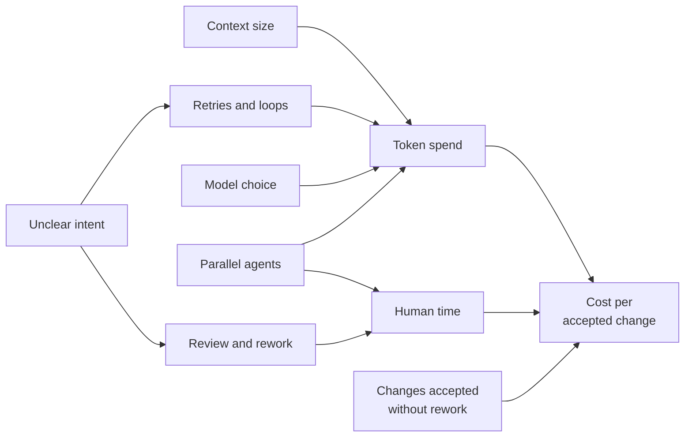

# Cost & Token Economics

!!! note "Last reviewed"
    October 2026. Pricing models are changing quickly. The principles here should hold; the figures will not.

For most of the history of developer tools, cost was a seat licence: predictable, small, and nobody's problem. You bought an IDE, a CI plan, a code-search tool, and finance could forecast the bill a year out.

Agentic engineering broke that model. An agent consumes tokens in proportion to how much it reads, thinks, and retries. A quick question costs fractions of a cent. A long autonomous session over a large codebase, with a few failed CI rounds and a context window that gets re-read at every step, can cost more than a month of the old seat licence. An engineer running several background agents can now spend in a day what a seat licence used to cost in months, and nobody has to approve it.

That is not an argument against spending. It is an argument for knowing what the spend buys.

!!! tip "The one-liner"
    Token totals tell you what you spent. Cost per accepted change tells you whether it was worth it, and most of that cost is still human time.

---

## What problem this solves

Organisations are discovering their AI budgets the hard way.

**Uber** is the best-known case. According to PYMNTS's summary of the reporting, Uber's CTO told The Information in April 2026 that the company had already used its full-year budget for AI coding tools, and in June Bloomberg reported that Uber had capped spending at $1,500 per employee, per month, per agentic coding tool, with an internal dashboard and a process to request more.

**GitHub** moved all Copilot plans to usage-based billing from June 2026 (annual subscribers at renewal). Premium request counts were replaced by monthly AI Credits, metered by token consumption (input, output, and cached tokens) at each model's published API rate. Business and Enterprise seats now include credits equal to their seat price, and admins can set budgets at enterprise, cost-centre, and user level, then choose whether to allow overage or cap it. The seat still exists; it is no longer the bill.

**DX's Q2 2026 benchmarks** found AI spend among the largest companies in its dataset at roughly 28 times its level a year earlier, while the innovation ratio (the share of time going to new capabilities) rose by only about one percentage point. Much of the time saved was being absorbed elsewhere: meetings, interruptions, build and test waits, environment toil, review delays. DX sells measurement, but the shape of that finding is the important part. Spend can rise by more than an order of magnitude while the outcome it was meant to buy barely moves.

The question is not whether to spend. It is whether you can tell what the spend buys.

---

## When to use this

**Use it when:**

- Agents run in the background or in parallel.
- Usage-based pricing applies to your tools, which is now most of them.
- Factory workflows run at volume.
- Finance has started asking.

**Keep it light when:**

- AI use is occasional, interactive, and on flat-rate plans. Watch the trend; do not build a FinOps programme for it.

---

## Roles and ownership

| Role                         | Responsibility                                                   |
| ---------------------------- | ---------------------------------------------------------------- |
| **Engineering leadership**   | Sets budget, acceptable cost per outcome, and policy             |
| **Platform / harness owner** | Instruments spend; implements budgets, alerts, and model routing |
| **Workflow owners**          | Own cost per accepted change for their workflows                 |
| **Finance / FinOps**         | Forecasts variable spend; reviews showback with engineering      |
| **Engineers**                | Understand what drives cost in their own usage                   |

---

## What drives cost

Most surprise spend comes from a small number of mechanisms, and almost all of them are design decisions, not usage decisions.

| Driver                | Why it costs                                           | Lever                                                                 |
| --------------------- | ------------------------------------------------------ | --------------------------------------------------------------------- |
| **Context size**      | Every step re-reads the window                         | Short instructions, trimmed tool output, fewer tools, phased sessions |
| **Retries and loops** | Each failed attempt repeats the cost                   | Better checks earlier; caps on CI rounds                              |
| **Model choice**      | Frontier models cost more per token                    | Smaller models for simple, well-specified tasks                       |
| **Parallelism**       | More agents, more spend, not always more value         | Run only what you can review                                          |
| **Exploration**       | Searching large codebases                              | Subagents with focused scopes; cached research                        |
| **Always-on context** | Instruction files and tool definitions load every step | Prune ruthlessly                                                      |
| **Human time**        | Review, rework, intervention                           | Better intent up front; risk-tiered review                            |



Two things in that diagram are worth noticing. **Unclear intent** feeds both retries and rework, which is why the cheapest cost lever is often upstream of the agent entirely: see [Intent Before Code](../workflow/intent-before-code.md). And **parallelism** feeds both token spend and human time, because every additional agent produces something a person has to judge.

Always-on context deserves a specific mention, because it is invisible. The ETH Zurich study of repository context files (AGENTS.md and similar), in its September 2026 revision, found that providing them does not generally improve task success, while increasing inference cost by over 20% on average, for both LLM-generated and developer-written files. That does not mean context files are useless; it means every line in them is paid for on every step, and should earn its place. See [Instructions & AGENTS.md](../foundations/instructions-and-agents-md.md).

The FinOps Foundation's guidance on AI cost makes the same practical points from the finance side: match model quality to the task, shorten prompts while keeping them clear, cache repeated responses, set quotas per team or project, and alert on sudden spikes in token use. It also warns that token pricing varies across vendors and versions and can change sharply, which makes trend-based forecasting harder than for traditional cloud.

---

## Measure cost per accepted change

Seats and token totals tell you what you spent. They do not tell you whether it was worth it. The metric that matters:

> **Cost per accepted change**: total spend (tokens, compute, and human time) divided by changes merged without rework.

The FinOps Foundation's unit metrics (cost per inference, per token, per API call) are useful for the platform team running the spend. They stop one step short of the question an engineering leader needs answered, which is what a useful outcome costs. Cost per accepted change takes that step.

The practical prerequisite is attribution. Most teams cannot compute this metric on day one because their spend arrives as one line per vendor, and their PRs carry no record of which workflow produced them. Fixing that is unglamorous platform work: tag every agent run with the workflow that started it, carry that tag into the PR, and record whether the PR needed rework after review. The FinOps Foundation recommends the same tagging by project, team, and workload for showback. Once the tags exist, the metric is a query. Without them, it is an argument.

Track it per workflow, not per team or per person. Different workflows have wildly different economics, and averaging them hides the one that is losing money. And do not forget human time. An agent run that is cheap in tokens but needs an hour of a senior engineer's review is not cheap.

---

## Worked example: two workflows, one month

The numbers below are illustrative, chosen to show the arithmetic. Use your own token bills and your own loaded engineering cost. I assume a loaded cost of $100 per engineer-hour to keep the maths readable.

**Workflow A: dependency upgrades.** Agents pick up new releases, make the change, run the agreed checks, and open a PR with what they changed and what they could not verify.

| Item                         | Value                                          |
| ---------------------------- | ---------------------------------------------- |
| **Runs**                     | 120                                            |
| **Token spend**              | 120 × $0.80 = $96                              |
| **Human review**             | 120 × 5 min = 10 h → $1,000                    |
| **Rework**                   | 12 runs needed fixes, 30 min each = 6 h → $600 |
| **Accepted without rework**  | 108                                            |
| **Cost per accepted change** | ($96 + $1,000 + $600) ÷ 108 ≈ **$15.70**       |

**Workflow B: small features from tickets.** Agents implement from a written intent; an engineer reviews.

| Item                          | Value                                                       |
| ----------------------------- | ----------------------------------------------------------- |
| **Runs**                      | 30                                                          |
| **Token spend**               | 30 × $18 = $540                                             |
| **Intent writing and review** | 30 × 1.5 h = 45 h → $4,500                                  |
| **Rework**                    | 12 runs needed significant rework, 2 h each = 24 h → $2,400 |
| **Accepted without rework**   | 18                                                          |
| **Cost per accepted change**  | ($540 + $4,500 + $2,400) ÷ 18 ≈ **$413**                    |

**What the numbers say.** Tokens are under 10% of the cost in both workflows. A dashboard showing only token spend would conclude that Workflow B costs $30 per change and is a bargain; the real figure is more than ten times that. Workflow A is clearly worth running. Workflow B might or might not be, depending on what the same features would cost without agents, which is the comparison to make next.

**Where the levers are.** In Workflow B, the 40% rework rate dominates. The team looked at the twelve reworked runs and found that eight came from tickets with no acceptance criteria. Requiring a short intent document before an agent could pick up a ticket cost about 20 minutes per ticket and cut rework to four runs the next month. Assuming token spend rose to about $600 (the agents were reading more context), cost per accepted change fell to roughly $265: ($600 + $4,500 + $1,000 intent time + $800 rework) ÷ 26 accepted.

**What went wrong first.** Before switching to this metric, the team had tried to cut costs by moving Workflow B to a cheaper model. Token spend fell by half; rework rose, and cost per accepted change went up. Optimising the visible line on the bill made the invisible one worse.

---

## Budgeting

**Set budgets per workflow and per team,** not only per person. Per-person caps are a blunt instrument: they stop runaway use but they also stop your most effective engineers on the days they are doing your most valuable work.

**Alert on anomalies.** Runaway loops are a common source of surprise spend. An agent stuck retrying a failing test for an hour can cost more than its week of useful work. Alert on spend per session, not only per month.

**Decide in advance what an engineer-day of agent use is worth.** StrongDM's software-factory write-up offers a rule of thumb: if you have not spent at least $1,000 on tokens today per human engineer, your factory has room for improvement. To some people that reads as seriousness; to others, as a bill most teams will never justify. Your number should come from your own cost per accepted change, not from a keynote.

**Use the controls your tools now ship.** Usage-based billing came with budget controls. GitHub, for example, lets admins set budgets at enterprise, cost-centre, and user level and choose between allowing overage and capping it. Decide which, per workflow, before the first invoice decides for you.

**Review quarterly,** alongside the [impact review](measuring-impact.md). Cost without impact is a bill. Impact without cost is a story.

!!! info "What we know / what we don't"
    **We know:** pricing for agentic tools is moving from seats to usage (GitHub moved Copilot in June 2026); spend can rise far faster than delivered value (DX's 28× versus a one-point innovation-ratio change); and at least one large engineering organisation exhausted its annual AI coding budget within months.

    **We don't know:** where prices settle as competition and model efficiency improve; what cost per accepted change looks like across many organisations, because almost nobody publishes it; or whether the long-term maintenance cost of code few people read closely will show up in these numbers at all.

---

## What good looks like

| Signal                            | What you observe                                          |
| --------------------------------- | --------------------------------------------------------- |
| **Spend attributed**              | Cost known per workflow and team                          |
| **Cost per outcome tracked**      | Cost per accepted change, not only totals                 |
| **Human time counted**            | Review and rework time included in cost                   |
| **Anomalies caught early**        | Alerts on runaway sessions                                |
| **Model choice deliberate**       | Smaller models where they suffice, verified by acceptance |
| **Budget conversations grounded** | Finance sees outcomes, not just bills                     |

---

## Failure modes and mitigations

Cost failures tend to come in a cycle. First, nobody watches: usage-based tools are budgeted like seats, adoption is celebrated, heavy users are held up as examples. Then the invoice arrives, and the response is a blanket cap that hits everyone equally, including the workflows that were paying for themselves. The way out of the cycle is not tighter control. It is knowing, per workflow, what the spend buys.

| Failure mode                      | What it looks like                                  | Mitigation                                      |
| --------------------------------- | --------------------------------------------------- | ----------------------------------------------- |
| **Seat thinking**                 | Usage-based tools budgeted like licences            | Usage budgets and monitoring                    |
| **Frontier for everything**       | Largest model for lint fixes                        | Route by task difficulty; check acceptance      |
| **Cheap model, expensive rework** | Token bill down, rework up                          | Judge model changes by cost per accepted change |
| **Spend as seriousness**          | High token use celebrated or ranked                 | Celebrate cost per outcome                      |
| **Ignoring human time**           | Cheap runs with expensive reviews                   | Include review and rework time in cost          |
| **Panic caps**                    | Hard caps after a budget shock, hitting useful work | Per-workflow budgets based on value             |

!!! warning "The token bill trap"
    The token bill is the only AI cost that arrives as an invoice, so it is the one that gets managed. In most workflows it is the smaller part of the cost. Optimising it alone usually moves cost into review and rework, where nobody is counting.

---

## Copy this: a cost-per-accepted-change worksheet

```markdown
## Workflow:
## Period:
## Loaded cost per engineer-hour (assumption): $

| Item | Value |
| --- | --- |
| Runs | |
| Token / compute spend | $ |
| Human time: intent + review (hours × rate) | $ |
| Human time: rework and intervention (hours × rate) | $ |
| Changes accepted without rework | |
| **Cost per accepted change** | $ |

## Compared with
- Same work without agents (estimate, and how it was estimated):
- Last period:

## Biggest lever this period
- [ ] Intent quality  - [ ] Retries/loops  - [ ] Model choice
- [ ] Context size    - [ ] Review effort  - [ ] Parallelism

## Decision
Keep / change / stop, and why:
```

---

## Further reading

- **[AI in engineering: Q2 2026 benchmarks](https://newsletter.getdx.com/p/ai-in-engineering-q2-2026-benchmarks)** by DX — Spend growth versus innovation ratio, and where saved time goes. (Vendor.)
- **[GitHub Copilot is moving to usage-based billing](https://github.blog/changelog/2026/04/27/github-copilot-is-moving-to-usage-based-billing/)** by GitHub — AI Credits, token metering, and admin budget controls.
- **[FinOps for AI overview](https://www.finops.org/wg/finops-for-ai-overview/)** by the FinOps Foundation — Unit economics, forecasting, and controls for variable AI spend.
- **[Uber caps AI coding costs after exhausting annual budget](https://www.pymnts.com/?p=3799852)** by PYMNTS — Summary of Bloomberg's and The Information's reporting on Uber.
- **[Why token costs are breaking CFO budgets in 2026](https://gorillalogic.com/insights/blogs/why-token-costs-are-breaking-the-cfo-budgets-in-2026/)** by Gorilla Logic — A finance-side view of the shift, including Uber. (Consultancy blog.)
- **[Evaluating AGENTS.md](https://arxiv.org/abs/2602.11988)** by Thibaud Gloaguen and colleagues (ETH Zurich) — What always-on context costs, and what it buys. (Preprint.)
- **[StrongDM software factory](https://factory.strongdm.ai/)** by StrongDM — The source of the $1,000-per-engineer-per-day rule of thumb.
- **[From coding agents to a software factory](https://www.warp.dev/articles/coding-agents-to-software-factory)** by Warp — Cost per merged PR as a factory metric. (Vendor.)

## Related pages

- [Measuring Impact Honestly](measuring-impact.md) — The impact side of the same quarterly review.
- [Factory Infrastructure](../factories/factory-infrastructure.md) — Where spend controls and alerts live in a factory.
- [Context Engineering](../foundations/context-engineering.md) — Keeping context small enough to be cheap and good enough to be useful.
- [Evaluating a Tool on Your Own Work](../tools/evaluating-tools.md) — Comparing tools and models on acceptance and cost, not benchmarks.
