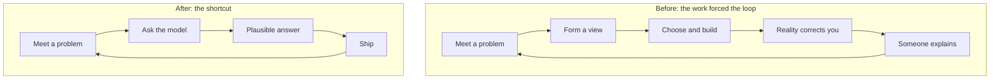

# Growing Judgment

Think about where your own judgment came from. Not the courses, not the books.

What the old entry-level job did, reliably and without meaning to, was force a sequence. You were put inside a problem whose end you could not see. You had to form a view before anybody would tell you whether it was right. You chose. Then reality corrected you, slowly or at three in the morning, and somebody further along was near enough to explain what you had missed. Judgment was the residue of running that loop a few hundred times.

AI does not remove difficulty; anyone who has debugged code they did not write knows it invents plenty. What it does is let you go from the problem to a plausible answer without passing through the part where you had to form a view. The loop does not get harder. It gets shorter at exactly the point where the learning was.

!!! tip "The one-liner"
    The work used to run an apprenticeship for free. Now it has to be put on the plan.

---

## What problem this solves

Several of the people I mentor are changing careers into software, and the conversation we have now is not the one we had two years ago. Back then it was about getting good enough. Now it is quieter and harder to answer: the roles they were told to aim for do not seem to be opening.

They are not imagining it. Stanford's Digital Economy Lab, updating its *Canaries in the Coal Mine?* analysis of ADP payroll data in August 2026, found employment for workers aged 22 to 25 in the most AI-exposed occupations about 19% below where it would be had it kept pace with similarly aged workers in less-exposed jobs, up from about 15% a year earlier. The adjustment runs primarily through fewer hires rather than more departures. The authors are careful that these are descriptive patterns, not causal estimates. A separate Harvard working paper by Seyed Hosseini and Guy Lichtinger, using résumé and job-posting data from around 285,000 US firms, found junior employment in firms adopting generative AI declining sharply relative to non-adopters from early 2023, while senior employment kept rising, again driven mainly by slower hiring. The authors call it seniority-biased technological change.

None of this proves AI replaced anyone, and firms are making different choices with the same technology. IBM's chief HR officer, Nickle LaMoreaux, said in February 2026, as reported by Bloomberg, that the company would triple entry-level hiring in the United States in 2026, after rewriting junior developer roles to spend less time on routine coding and more with clients. IBM declined to give numbers. That is one company's choice, not a trend, but it shows the decision is a decision.

Inside teams, the same shift appears in smaller form. The small, safe tasks that used to teach junior engineers a codebase are the ones agents find easiest. Some organisations hire fewer juniors; others hire them and put them downstream of agents, reviewing output. Anthropic's study of its own engineers captures the texture of this well. One senior engineer said it had been "sad that more junior people don't come to me with questions as often, though they definitely get their questions answered more effectively and learn faster." Others worried about skill atrophy, and the study names a "paradox of supervision": using AI well requires supervising it, and supervising it requires the skills that heavy use may erode.

The pipeline that produces senior engineers is quietly changing shape, and nobody will notice the consequences for years.

---

## When to use this

**Use it when:**

- You have junior or early-career engineers, or career changers.
- You plan to have senior engineers in five years.
- Your engineers increasingly review rather than build.

That is, almost always.

**Lighten it when:**

- The team is entirely senior and stable. Even then, the [no-AI time](#protect-no-ai-time) and review practices below protect the judgment you already have.

---

## Roles and ownership

| Role                     | Responsibility                                                                          |
| ------------------------ | --------------------------------------------------------------------------------------- |
| **Engineering managers** | Design learning into the work; protect it from throughput pressure; keep hiring juniors |
| **Senior engineers**     | Make reasoning visible; ask before answering                                            |
| **Tech leads**           | Put less experienced people inside decisions, not downstream of them                    |
| **Juniors**              | Commit to a view before asking the model                                                |

---

## The loop, before and after

The clearest way to see what changed is to draw the loop.



The "after" loop is faster and often produces a perfectly good result. What it skips is the step where you had to form a view, and the step where somebody explained what you missed. Those were the two steps that produced judgment.

The same model can also run the original loop far more often than the old job ever did: form a view, have it challenged, compare three designs, build one, find out why it was wrong, go again, all before lunch. The difference is whether anybody has to commit to a view before the plausible answer arrives. That used to be enforced by the work. Now it has to be enforced by us.

---

## The ideas that help

### Desirable difficulties

Learning research has a name for conditions that slow you down now and produce more durable learning later: *desirable difficulties*, a term Robert Bjork introduced in the 1990s and developed with Elizabeth Bjork. Spacing study instead of massing it, interleaving topics instead of blocking them, and using tests as learning events rather than re-reading are the classic examples. The key distinction is between performance, which can be measured directly during the work, and learning, which can only be inferred and measured at a delay. The conditions that maximise one routinely damage the other, and learners themselves tend to prefer the conditions that feel fluent.

A small 2026 controlled study put that distinction to work on programming. Twenty-two novice and intermediate programmers, working as 11 pairs, did timed Python tasks, once with a human teammate and once with GitHub Copilot as the teammate. With Copilot, the team score was roughly 14 points higher out of 100, the work went faster, and participants reported lower mental demand and effort. A week later, retested alone, their scores on the Copilot-learned tasks had fallen further from where they started (about 19 points, against a smaller drop for human-paired tasks), though their retest scores ended up similar and the difference in the drop was only marginally significant on such a small sample. The authors titled it *Fast and Forgettable*. It is one study, it is small, and it should not carry more weight than that. It is also exactly what the desirable-difficulties literature would predict.

### The irony of automation

In 1983, Lisanne Bainbridge pointed out that automating the routine parts of a system leaves the operator mainly with monitoring and with the exceptional cases, while removing the everyday practice that made exceptions handleable. Physical skills deteriorate when they are not used, she wrote, and the most successful automated systems, the ones that rarely need a human to step in, may need the greatest investment in operator training. The conclusion runs against intuition: more automation means more need for deliberate training, not less. We are running that experiment on a whole profession.

### Confidence in the tool versus confidence in yourself

A Microsoft Research survey of 319 knowledge workers, presented at CHI 2025, found that higher confidence in generative AI was associated with less critical thinking, and higher self-confidence with more. It also found that AI shifts critical thinking toward verifying information, integrating responses, and stewarding the task. That is a useful description of what a junior engineer now spends their day doing, and a warning: the confidence that sustains critical thinking comes from having formed views and watched some of them survive contact with reality. If nobody forms views, nobody builds that confidence.

### Which difficulties were load-bearing?

Plenty of grunt work deserved to go. Nobody learned anything durable from the fourth hour of a dependency conflict, and three years of build-system work mostly leaves somebody expert at build systems. Difficulty on its own is not educational. Some of it is only cost.

AI did not start this, either. Better tooling, better documentation, and good abstractions had already shortened the loop. So had kind habits: senior engineers taking pride in unblocking people fast, pairing that drifts into taking over, review as the place somebody hands you the answer. Each of those is locally correct. Together they compressed the interval between meeting a problem and being told the answer, which is the interval the loop was made of.

We never had to separate the difficulty that taught something from the difficulty that merely cost something, because the two arrived bundled. That bundle has been unbundled. The question now is which difficulties were load-bearing, and how to keep those on purpose.

---

## Practices

### Commit to a view before the plausible answer arrives

The single highest-leverage habit, for juniors and seniors alike:

**Write your approach before asking the agent for one.** Two or three sentences are enough. Then compare.

**Predict what the agent will get wrong,** then check.

**Debug first, for a fixed time,** then compare with the agent's diagnosis.

None of this slows delivery much. It changes what the engineer gets out of the same work.

### Stop doing outcome-only review

Work arrives, it gets reviewed for whether it functions, it ships. Nobody asks how the person arrived at this shape rather than another. I call this **outcome-only review**: evaluating what was produced while never surfacing the reasoning that produced it.

Nobody is rescuing anyone in outcome-only review. The work is good, the review is competent, and nothing gets transmitted, because the reviewable artifact and the learnable thing stopped being the same object the moment a model could generate the artifact. A diff shows what someone produced. It cannot show whether they considered another path, why they rejected it, or whether they would notice when this one stopped being right.

The counterweight is small:

**Ask what else was considered before commenting on what was chosen,** and sit through the pause. The first few times, the answer is that nothing else was, and that silence is most of the diagnosis.

**Ask which part they would defend in six months,** and which part they are unsure of.

**Let them run the investigation when something breaks,** instead of watching you run it.

The goal is not more review. It is review that stops ending at the artifact.

There is a harder version of this question coming. Review has always been one of the ways people learn a codebase, and at agent volume most of the reading is moving to machines. The Claude Code team is candid about it: no one on the team holds a full mental model of the codebase, they have no formal mechanism to replace what reading diffs used to teach, and when someone needs to understand a part of the code they ask Claude for an explainer of exactly that slice. Their argument is that an explainer of the module you are about to change teaches more than a one-line copy diff ever did, and for an experienced engineer that is probably right. I am less sure it works for someone still forming judgment. An explainer delivers understanding already digested; the loop above needs a view formed first and then corrected. If your team adopts explainers, use them the same way as the agent's plan: write down what you expect the module to do, then read the explainer and see where you were wrong.

### Use human gates as teaching positions

A harness's [human gates](../harness/human-gates.md) are, among other things, a written list of every decision in the process that requires judgment, with the evidence it needs and the reason it cannot be delegated. I designed the gates in my team's harness as a question about control. It took me a while to see that they are also a curriculum.

That matters because hiring alone will not fix this. Enrique Ide's economic model of intergenerational knowledge transfer predicts that improvements in entry-level automation can raise output while lowering long-run growth, even if entry-level employment does not fall, when automation pulls novices away from the most productive experts. Tacit knowledge passes between people solving the same problem at the same time. If your juniors sit downstream of the gate, reviewing what the system produced, the headcount looks fine and the transmission is still broken.

So put less experienced engineers *inside* those decisions while they are being made, close enough to hear the reasoning form rather than meeting it after it has hardened. The approach review, before any code exists, is the best place to start: it is cheap, it is where the most consequential choices are made, and nothing has hardened yet.

### Protect no-AI time

Some thinking only happens when the AI is not in the loop: slower, less polished, and exercising the ability to form your own judgment without an assist. Make it normal, not nostalgic. For juniors in particular, some tasks each sprint should be done without generation, as practice, the way a musician practises scales they will never perform. See [Human Latency](human-latency.md) for the team-level version.

---

## Worked example: a junior engineer inside the approach review

A hypothetical team runs an approach review for any change touching more than one service: before implementation, the agent drafts a plan, and a senior engineer approves or redirects it. Maya joined six months ago. Until now she has seen approach reviews only as the approved plan that arrives in the ticket.

**Week 1: the change.** The team decides she will sit inside the next three approach reviews. The rule, agreed with the gate owner: Maya writes her own approach (half a page at most) before reading the agent's plan or hearing the senior engineer's view.

**The first review.** The task is to add idempotency to a payment webhook handler. Maya's draft proposes storing processed event IDs in the service's database. The agent's plan proposes the same thing, plus a cleanup job. The senior engineer, Rafael, does not say which is right. He asks what else she considered. Silence. Then: "I didn't consider anything else." He asks what happens if the webhook provider retries after the cleanup job has run. Neither plan handles it. They look at the provider's retry window together and set retention accordingly.

**What went wrong.** In the second review, under deadline pressure, Rafael forgot the order and opened with his own view. Maya agreed with it immediately. Her written draft, it turned out, had a different and arguably better idea about where to put the validation, which she abandoned without mentioning. The team noticed only because the retro asked whether the junior's view had been heard. The fix was mechanical: the gate template now has a "junior view" field that must be filled before the senior's comments section.

**The third review.** Maya's draft disagrees with the agent's plan on where to split a migration. She defends it, Rafael pushes back, and she turns out to be half right: her split is safer, his ordering is better. The final plan uses both. She also asks the question Rafael asked in the first review, unprompted: "What happens on retry?"

**After a quarter.** Maya owns a small approach review herself, with Rafael inside it as the second voice. The team's throughput did not change measurably. What changed is that someone new can now hold one of the team's judgment gates, which is a capacity the team did not have before.

---

## What good looks like

| Signal                      | What you observe                                                       |
| --------------------------- | ---------------------------------------------------------------------- |
| **Juniors in the room**     | Less experienced engineers participate at framing and approach gates   |
| **Views before answers**    | Engineers write their approach before prompting                        |
| **Reasoning in review**     | Reviews ask what was considered, not just what was done                |
| **Investigations shared**   | Juniors lead incident investigations with support                      |
| **Hiring continues**        | Entry-level roles exist, with designed learning                        |
| **Learning is on the plan** | Who is forming a view about what, next to whom, is a planning question |

---

## Failure modes and mitigations

These failures are easy to miss because they all look like competence. The junior who never asks questions looks autonomous. The senior who unblocks everyone instantly looks generous. The review that approves good work quickly looks efficient. The cost only shows up years later, as a team that cannot produce its next generation of tech leads and has to hire them from somewhere else that paid to form them.

| Failure mode             | What it looks like                          | Mitigation                                          |
| ------------------------ | ------------------------------------------- | --------------------------------------------------- |
| **No juniors**           | "Agents do junior work now"                 | Hire, and design learning positions                 |
| **Juniors as reviewers** | New engineers only check agent output       | Put them inside decisions                           |
| **Outcome-only review**  | Approved because it works                   | Ask about alternatives and doubts                   |
| **Rescue culture**       | Seniors unblock instantly, every time       | Let productive struggle happen, for a bounded time  |
| **Silent unblocking**    | Juniors stop asking anyone anything         | Ask what they worked out alone this week            |
| **Senior speaks first**  | Juniors agree with whatever they hear first | Junior writes their view before the gate discussion |

!!! warning "The silent unblocking trap"
    A junior engineer who starts asking fewer questions and shipping cleaner PRs reads as growth, and it may be. It reads exactly the same when every question has moved to a model nobody else can see. In one-on-ones, "what did you get stuck on?" surfaces almost nothing now. Try "what did you work out alone this week that you would have asked someone about a year ago?"

---

## Copy this: a teaching-position gate addendum

Add this to any judgment gate in the [Human Gate Definition](../templates/human-gate-definition.md) template.

```markdown
## Teaching position
- Learner at this gate: [name]
- Learner's view (written before reading the agent's plan or any senior comment):
  - Approach:
  - What I considered and rejected:
  - What I am unsure about:
- Gate owner's first question (before giving any view):
  "What else did you consider?"
- After the decision:
  - Where the learner's view differed from the final decision, and why
  - One thing the learner will check after this ships
```

---

## Further reading

- **[How the Claude Code team does code review](https://claude.dev/blog/solving-code-review-at-anthropic/)** by Addy Osmani, Morgan Westlee Lunt and Qing Wang (Anthropic) — How a team that reads few diffs learns its codebase, and what it has not solved. (Vendor post.)
- **[Growing engineering judgment without the grunt work](https://dreamingecho.es/blog/growing-engineering-judgment-without-grunt-work)** by Iván González Sáiz — The essay this page is built on: the loop, outcome-only review, and gates as teaching positions.
- **[Canaries in the Coal Mine? (August 2026 update)](https://digitaleconomy.stanford.edu/news/canariesaug26/)** by Erik Brynjolfsson, Bharat Chandar and Ruyu Chen (Stanford Digital Economy Lab) — Employment of young workers in AI-exposed occupations. Descriptive, not causal.
- **[Generative AI as seniority-biased technological change](https://digitaleconomy.stanford.edu/event/seyed-m-hosseini-and-guy-lichtinger-generative-ai-as-seniority-biased-technological-change-evidence-from-u-s-resume-and-job-posting-data)** by Seyed Hosseini and Guy Lichtinger (Harvard) — Junior versus senior employment in adopting firms. (Working paper; seminar abstract.)
- **[Automation, AI, and the intergenerational transmission of knowledge](https://arxiv.org/abs/2507.16078)** by Enrique Ide — Why keeping junior headcount is not enough. (Preprint.)
- **[Introducing desirable difficulties into practice and instruction](https://www.unh.edu/teaching-learning-resource-hub/sites/default/files/media/2023-06/itow-introducing-desirable-difficulties-into-practice-and-instruction-bjork-and-bjork.pdf)** by Elizabeth Bjork and Robert Bjork — Performance versus learning, from the people who named the idea.
- **[Fast and forgettable](https://arxiv.org/html/2604.18538v1)** by Nicholas Gardella and colleagues — Novices with Copilot versus a human partner, and a retest a week later. (ICER 2026; 22 participants.)
- **[IBM to triple entry-level hiring as AI rewrites junior roles](https://www.pymnts.com/artificial-intelligence-2/2026/ibm-to-triple-entry-level-hiring-as-ai-rewrites-junior-roles/)** by PYMNTS — Summary of Bloomberg's reporting.
- **[Ironies of automation](https://ckrybus.com/static/papers/Bainbridge_1983_Automatica.pdf)** by Lisanne Bainbridge (Automatica, 1983) — The original argument that automation increases the need for training. A readable summary is [The Morning Paper's](https://blog.acolyer.org/2020/01/08/ironies-of-automation/).
- **[The impact of generative AI on critical thinking](https://www.microsoft.com/en-us/research/publication/the-impact-of-generative-ai-on-critical-thinking-self-reported-reductions-in-cognitive-effort-and-confidence-effects-from-a-survey-of-knowledge-workers/)** by Hao-Ping Lee and colleagues (Microsoft Research, CHI 2025) — Confidence in AI versus confidence in yourself.
- **[How AI is transforming work at Anthropic](https://www.anthropic.com/research/how-ai-is-transforming-work-at-anthropic)** by Anthropic — Skill atrophy, the paradox of supervision, and fewer questions from juniors. (Vendor study of its own staff.)

## Related pages

- [Roles & the Shape of Work](roles-and-the-shape-of-work.md) — What the judgment is for, and how to recognise it in promotions.
- [Human Gates](../harness/human-gates.md) — Designing the gates that double as teaching positions.
- [Intent Before Code](../workflow/intent-before-code.md) — The approach review, the cheapest place to put a junior inside a decision.
- [Growth Plans](https://dreamingecho.es/playbooks/engineering-leadership/people/growth-plans/) — Structuring individual development (Engineering Leadership Playbook).
