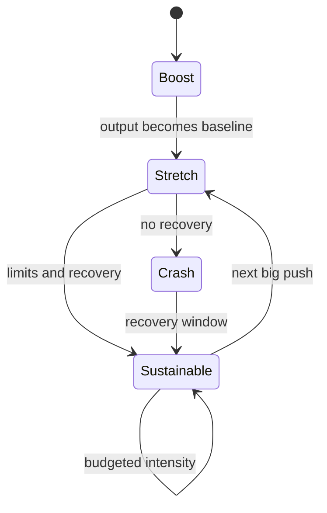

# Human Latency & Sustainable Intensity

Monday felt like a breakthrough. The drafts were flowing, the PR queue was shrinking, and features that would have taken three days were landing in one.

By Thursday, you were approving pull requests you had not really read.

The one you approved a little too quickly comes back with an edge case nobody caught. A design decision you made on Tuesday feels wrong by Thursday, and you cannot say why. You are still shipping. But the decisions feel thinner, the patience shorter, and the gap between "this is good enough" and "I genuinely reviewed this" is widening in a way you do not notice until the consequences arrive.

AI shrinks cycle time. It does not shrink the time it takes people to understand, trust, and integrate change. I call that gap **human latency**: the friction you cannot ship away. And the work AI leaves us with is not lighter. It is different: less writing, more evaluating, deciding, and curating. Judging at speed, as I have argued before, is one of the most depleting forms of cognitive work.

!!! tip "The one-liner"
    AI compresses production. It does not compress judgment, and judgment is what decides the quality of what ships.

---

## What problem this solves

Teams adopt agents, output rises, and a few months later something feels wrong. Reviews are thinner. Decisions are quicker but worse. People are irritable for no clear reason. Nobody is burned out in the dramatic sense, but the quality of attention has degraded, and with it the quality of everything that depends on it.

This is not a wellbeing side topic. Tired reviewers are one of the main routes by which plausible-but-wrong code reaches production. Qodo's 2026 survey (a vendor that sells AI code review) found 36% of developers saying reviews take the same time as before but need more mental effort to catch subtle bugs. DX's Q2 2026 benchmarks found its developer experience index down about 2% over two quarters, while more than half of merged code was AI-authored. Neither number proves fatigue. Both are consistent with a workload that has shifted from producing to judging without anyone resizing it.

---

## When to use this

**Use it when:**

- Agents run in parallel for most of the day.
- Output has risen noticeably and review quality is hard to tell.
- A team is coming out of a big launch and straight into the next one.
- People describe being tired in a way weekends do not fix.

**Keep it light when:**

- AI use is occasional and mostly drafting. The curve still exists, but it is shallow.

---

## Roles and ownership

| Role                     | Responsibility                                                              |
| ------------------------ | --------------------------------------------------------------------------- |
| **Engineering managers** | Watch for the signals; set and protect limits; go first in naming their own |
| **Engineers**            | Notice their own curve; use the limits without guilt                        |
| **Tech leads**           | Size work to include recovery; avoid continuous parallel-agent intensity    |
| **Leadership**           | Do not convert every efficiency gain into more scope                        |

---

## The AI fatigue curve

AI-accelerated work tends to follow the same pattern across sprints, quarters, and individuals, and it rarely gets named. I call it the AI fatigue curve.

```text
 output and
 apparent
 energy
   │        ┌──── Boost
   │       ╱ ╲
   │      ╱   ╲──────── Stretch: output holds,
   │     ╱      ╲        judgment quietly thins
   │    ╱        ╲
   │   ╱          ╲
   │──╱            ╲____ Crash: "fine, whatever"
   │                      (still shipping, no longer careful)
   └──────────────────────────────────────────► weeks
```

**Boost.** The first days of heavy AI-assisted work feel genuinely powerful. The friction that used to slow you down (boilerplate, test scaffolding, documentation) is gone. Capacity feels unlocked, and for a while it is.

**Stretch.** The increased output becomes the new baseline. You take on more, or the team expects more. But cognitive load has not decreased; it has moved. Instead of spending energy on writing, you spend it on evaluating, deciding, and curating, and every evaluation requires holding context, applying criteria, and resisting the gravitational pull of "looks fine".

**Crash.** Not a dramatic collapse. Something quieter: a day where everything feels slightly irritating, a review where you approve because you do not have the energy to push back, a conversation where your patience is thinner than the situation warrants. Still functional. Still delivering. No longer careful.

The curve is not a failure of discipline. It is the predictable cost of sustained high-intensity judgment, amplified by a toolchain that removes the natural pauses where recovery used to happen by accident.



The point of the diagram is the exit. A team does not have to ride the curve to the bottom every cycle. The limits later on this page are how you move from stretch to sustainable instead of from stretch to crash.

### The signals before the crash

AI fatigue rarely announces itself as exhaustion. It wears the costume of other things, and five signals show up reliably:

**Irritability that does not match the trigger.** A reasonable follow-up question produces a flash of impatience. The cause is not the question. It is a depleted capacity for deliberate processing.

**Impulsive decisions that feel like decisiveness.** One kind of quick call comes from clarity; another comes from depletion. They feel the same in the moment and look different in retrospect.

**Less real review, more rubber-stamping.** Comments get shorter. "Looks good" replaces "I have a question about this edge case." The review still exists in form; its substance has thinned.

**The "fine, whatever" threshold drops.** Standards relax without anyone deciding to lower them, because holding them costs energy that is no longer there.

**Procrastination on high-judgment tasks.** AI-heavy tasks keep moving. Architecture decisions, difficult feedback, and planning get delayed, because they need exactly the resource the rest of the day has drained.

---

## Why tired reviewers approve wrong code

There is a well-established body of human-factors research behind the rubber-stamping signal, and it predates coding agents by decades.

In 1983, Lisanne Bainbridge observed that automation tends to leave the human with monitoring, and, drawing on vigilance research from 1950, that even a highly motivated person cannot maintain effective visual attention on a source where very little happens for more than about half an hour. In 2010, Raja Parasuraman and Dietrich Manzey reviewed the research on *automation complacency* and *automation bias*. Their findings read uncomfortably like a description of agent review:

**Complacency appears under multiple-task load,** when manual work competes with the automated work for attention. A reviewer with three agents running and their own task open is the textbook case.

**It affects experts as well as novices,** and it cannot be overcome with simple practice. Seniority is not a defence.

**Automation bias produces both omission and commission errors** when the aid is imperfect: missing the problem the tool did not flag, and accepting the wrong thing the tool confidently produced.

**It affects teams as well as individuals.** A second reviewer who knows the first one approved is not an independent check.

The practical conclusion is that "review more carefully" is not a fix. Attention is a budget. If the system asks for more judgment per hour than people can sustain, the system has to change, not the people.

---

## Decision velocity and meaning velocity

**Decision velocity** is how fast a team makes choices and acts on them. AI raises it, by shrinking the gap between intention and execution.

**Meaning velocity** is how fast a team can cognitively and emotionally integrate what is happening: understand why a decision was made, process the consequences of a change, reach shared understanding of a new direction, and recover from friction.

When decision velocity outruns meaning velocity, teams ship things they do not collectively understand, and accumulate a kind of debt no dashboard shows. It surfaces in two quiet signals. The first is **moving fast without feeling progress**: the metrics look fine, but ask someone what they accomplished last month and the pause lasts a beat too long. The second is **diffuse tension**: no incident, no conflict, just a low-grade weight that does not resolve between sprints, usually the residue of decisions that moved faster than people could absorb.

Those pauses in the old process were not empty. When a feature took two days to write, part of that time was thinking about trade-offs. When a review took a day, part of the delay was a reviewer building a mental model. AI did not remove the thinking. It removed the container that held it.

People also do not process change at the same speed. A senior engineer who has been through four reorgs absorbs a direction change in the meeting; someone else needs a day. The week between "we decided" and "we're building" used to absorb that variance. When it shrinks to three hours, the people who needed the week are expected to move at the speed of the meeting, and silence gets mistaken for agreement.

---

## Three operational limits

If the curve is predictable, it can be managed, not through willpower but through structure.

### An intensity budget

Not every task costs the same cognitive energy. Writing a utility function with AI help is cheap. Reviewing a complex change for architectural implications is expensive. So is a scope trade-off, or difficult feedback. An intensity budget means naming a rough cap on high-judgment tasks per person per day. Three or four is a reasonable starting point; past that, each evaluation gets worse.

The budget is less a rule than a vocabulary. A team that can say "I've done two deep reviews today, so I'll take the architecture discussion tomorrow morning" without it being read as low performance has made the cost of judgment visible.

This applies directly to parallel agents. Microsoft's 2025 Work Trend Index, written by a company that sells agents, warns that too many agents per person overwhelms the human capacity for applying judgment and decision making, introducing business risk and potential employee burnout. Starting work is cheap; evaluating it is not. Run only as many agents as you can meaningfully review.

### No-LLM blocks

There is a kind of thinking that only happens without the AI in the loop. It is slower and produces less, but it exercises the ability to form your own judgment. When every decision starts with "let me ask the model", that skill does not disappear. It drifts. Blocking 60 to 90 minutes a day for unassisted work (a review done by hand, a design sketched on paper, a planning session without generated options) protects the capacity to know what good looks like without a second opinion from a machine.

### Recovery after shipping

The most depleting moment in an AI-accelerated cycle is often the transition between cycles. A team that ships and immediately loads the next batch carries the residue forward. Build in recovery: half a day of lower-intensity work after a major launch, documentation cleanup, a [retrospective](https://dreamingecho.es/playbooks/engineering-leadership/team-ops/rituals/), time to look back. This is not rest as a luxury. It is rest as maintenance.

---

## Fewer conversations, less context

There is a quieter effect too. Asking an AI instead of a teammate solves the problem instantly, while removing the small interactions through which teams built context and trust.

Help-seeking used to be two-way telemetry. The person asking learned the answer. The person asked learned what you were working on, where you were stuck, and which part of the system was confusing. An agent preserves the first channel and drops the second. In Anthropic's study of its own engineers, one said: "I work way more with Claude than with any of my colleagues." In Stack Overflow's 2025 survey, 68.7% of respondents agreed AI agents had increased their productivity, while 17.3% agreed they had improved collaboration within their team, the lowest-rated effect by a wide margin. That is not proof that agents damage collaboration. It is a picture of where the benefits are legible.

Teams can talk constantly and still become less interdependent. Make some of those interactions deliberate again: pairing on judgment calls, walkthroughs of significant changes, and asking a person first for some kinds of question, especially "why is it like this?".

---

## Worked example: a team notices the curve

A hypothetical platform team of six adopted parallel agents for migration work in January.

**Weeks 1–3: boost.** Throughput roughly doubles. The team is energised; the manager mentions the numbers in the leadership update. Leadership responds by adding a second migration to the quarter.

**Weeks 4–7: stretch.** Output holds. The manager notices three things that do not appear on any dashboard. Review comments have become shorter: the share of PRs approved with no comments has gone from about one in five to over half. Two architecture discussions have been postponed twice. And in a one-on-one, a senior engineer snaps at a perfectly reasonable question, then apologises and says she does not know why.

**Week 8: the naming.** In the retro, instead of the usual "what went well", the manager adds one question: "What happened in the last few weeks that we haven't fully processed yet?" She goes first: she agreed to the second migration without asking the team and has felt uneasy about it since. After a pause, people name the postponed architecture decisions, a near-miss where an agent-written change almost removed a rate limit, and a general sense of "approving things I'd normally argue with".

**What they changed.** They agreed an intensity budget of three deep reviews per person per day, with "out of budget" as an acceptable thing to say in standup. They capped parallel agents at what each person could review that day. They blocked two mornings a week for unassisted design work, and used the first one for the postponed architecture decisions. The manager went back to leadership and moved the second migration's deadline by three weeks, explaining why in terms of review quality and the near-miss.

**What went wrong.** The first week, the intensity budget became a competition: people started reporting their count as a badge of how hard they worked. The manager reframed it in the next standup: the budget is a ceiling to protect judgment, not a target to hit.

**After a month.** Throughput settled at about 60% above the January baseline rather than double. Review comments recovered. The architecture decisions got made, one of them reversing a choice that would have made the second migration much harder. The team had not slowed down. It had stopped borrowing against its own attention.

---

## What good looks like

| Signal                                   | What you observe                                    |
| ---------------------------------------- | --------------------------------------------------- |
| **Expensive work is protected**          | Reviews and decisions get fresh attention           |
| **Intensity is named**                   | "Out of budget" is an acceptable thing to say       |
| **Recovery is normal**                   | Lighter periods after launches                      |
| **Review quality holds**                 | Comments stay substantive over time                 |
| **People talk to people**                | Walkthroughs and pairing on judgment calls          |
| **Gains are not all converted to scope** | Some time saved goes back to understanding and rest |

---

## Failure modes and mitigations

Fatigue failures are hard to see because they are slow and because they look like other things. Irritability gets read as interpersonal friction. Thin reviews get read as a process problem. Impulsive decisions get read as individual recklessness. Leaders respond with more clarity on goals and more accountability, which adds load to a system that was already over budget.

| Failure mode                 | What it looks like                        | Mitigation                                       |
| ---------------------------- | ----------------------------------------- | ------------------------------------------------ |
| **Scope absorbs every gain** | Faster delivery leads to more commitments | Explicitly reinvest some gains                   |
| **Always-on parallelism**    | Five agents running all day per engineer  | Review budgets; notifications, not monitoring    |
| **Invisible crash**          | Rubber-stamping read as efficiency        | Watch review depth and decision quality          |
| **Budget as badge**          | Deep-review counts become a competition   | Treat the budget as a ceiling, not a target      |
| **Isolation**                | Everyone talks to models, not each other  | Deliberate human interactions                    |
| **Silence as agreement**     | Fast decisions, quiet dissent             | Separate the decision from the time to absorb it |

!!! warning "The always-on trap"
    Agents do not get tired, so it is easy to design a workday around their pace. Every hour an agent works produces something a person has to judge. Size the work to the human, not to the agent.

---

## Copy this: a latency check

Add one question to an existing weekly meeting or retro. Not a new ritual.

```markdown
## Latency check (5 minutes)
Question: "What happened last week that we haven't fully processed yet?"

- The lead answers first, honestly.
- Surface, don't solve. Follow-ups get scheduled separately.
- Nothing came up? That is useful too.
- Once the habit forms, every two weeks is enough.

## Intensity check (in standup, optional)
- Deep reviews/decisions I've done today: _ / budget _
- Agents I have running that I can actually review today: _
```

---

## Further reading

- **[The AI fatigue curve: why intensity is not free](https://dreamingecho.es/blog/the-ai-fatigue-curve)** by Iván González Sáiz — Boost, stretch, crash, and the three operational limits.
- **[AI shrinks cycle time. Humans don't.](https://dreamingecho.es/blog/ai-shrinks-cycle-time-humans-dont)** by Iván González Sáiz — Human latency, decision versus meaning velocity, and the latency check.
- **[When asking AI means asking people less](https://dreamingecho.es/blog/asking-ai-means-asking-people-less)** by Iván González Sáiz — Help-seeking as two-way telemetry, and what leaves with the questions.
- **[Leading without forcing alignment](https://dreamingecho.es/blog/leading-without-forcing-alignment)** by Iván González Sáiz — Why people absorb change at different speeds, and what leaders can do about it.
- **[Complacency and bias in human use of automation](https://depositonce.tu-berlin.de/items/0c787d91-6021-480b-a333-009e0d1d0092/full)** by Raja Parasuraman and Dietrich Manzey (Human Factors, 2010) — The research on why experts rubber-stamp automated output.
- **[Ironies of automation](https://blog.acolyer.org/2020/01/08/ironies-of-automation/)** by Adrian Colyer (The Morning Paper), on Lisanne Bainbridge's 1983 paper — Monitoring, vigilance, and skill decay.
- **[2025 Developer Survey: AI](https://survey.stackoverflow.co/2025/ai)** by Stack Overflow — Productivity versus collaboration effects of AI agents.
- **[How AI is transforming work at Anthropic](https://www.anthropic.com/research/how-ai-is-transforming-work-at-anthropic)** by Anthropic — Collaboration and mentorship changes inside a heavy-AI organisation. (Vendor study of its own staff.)
- **[2025: The year the Frontier Firm is born](https://www.microsoft.com/en-us/worklab/work-trend-index/2025-the-year-the-frontier-firm-is-born)** by Microsoft (Work Trend Index) — The warning that too many agents per person overwhelms judgment. (Vendor report.)

## Related pages

- [Building with Agents](../workflow/building-with-agents.md) — Running agents in a way people can actually review.
- [Growing Judgment](growing-judgment.md) — No-AI time as a learning practice, not only recovery.
- [Review at Agent Speed](../workflow/review-at-agent-speed.md) — Keeping review substantive as volume rises.
- [Sustainable Pace & Burnout](https://dreamingecho.es/playbooks/engineering-leadership/people/sustainable-pace-and-burnout/) — The general treatment of pace and burnout (Engineering Leadership Playbook).
