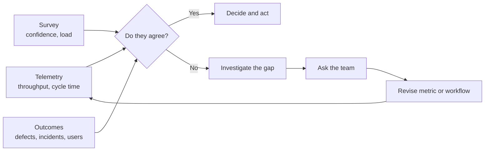

# Measuring Impact Honestly

!!! note "Last reviewed"
    October 2026. The frameworks here should hold. The study figures will date quickly, and several come from vendors who sell measurement.

Almost every organisation can now produce a slide showing that AI is working. Far fewer could tell you what would have to be true for that slide to be wrong.

Picture the quarterly review. The adoption chart goes up and to the right. Pull requests per engineer are up. A survey says people feel faster. Everyone in the room wants the story to be true, including the people who paid for the tools and the people who championed them, and nobody has been asked to look for the evidence that would contradict it. That is not a measurement. It is a ritual with charts.

Measuring AI impact honestly is hard for structural reasons. Self-reports are biased in a known direction. Activity metrics inflate by construction, because agents produce activity. Quality costs arrive late, often after the review that declared success. And many of the tools that measure are sold by companies with an interest in the answer. None of that makes measurement pointless. It makes it something to design carefully, the way you would design any experiment whose result you have a stake in.

!!! tip "The one-liner"
    Feeling faster and being faster are different measurements. You need both, and you need to investigate when they disagree.

---

## What problem this solves

Without honest measurement, organisations make large decisions on the strength of feelings and vendor dashboards: tool budgets, headcount plans, how much code to stop reading, which teams to hold up as examples. Qodo's 2026 survey of 500 US developers and 300 US engineering leaders found that 90% of leaders said they could report AI's engineering impact to executives, while only 45% had traceability linking AI activity to the code it produced. Most organisations, in other words, are reporting on something they cannot see. (Qodo sells AI code review, which is worth keeping in mind; the gap it describes is still a familiar one.)

The cost of getting this wrong is not only a bad slide. It is a feedback loop. If the numbers say AI is working, the organisation pushes harder: more parallel agents, less review, bigger scope per engineer. If the numbers were measuring activity rather than value, the push amplifies exactly the failure modes the rest of this section describes.

---

## When to use this

**Use it when:**

- You are deciding on significant spend or process change.
- You are promoting a workflow to more autonomy, as in [Risk Tiers & Autonomy](../factories/risk-tiers-and-autonomy.md).
- Leadership expects a number, and will get one whether or not it means anything. Better that it be one you designed.

**Skip it, or keep it light, when:**

- Individuals are experimenting with tools. Measurement at the individual level distorts behaviour and is rarely meaningful at that sample size.

**Never** use AI metrics to rank individuals. DX, which sells developer-productivity measurement, is unusually blunt about this in its own frameworks: its Core 4 says throughput metrics must never be used at the individual level or tied to performance evaluations, and its AI Measurement Framework cautions against top-down mandates and individual evaluation. When the people selling the dashboards tell you not to point them at people, believe them.

---

## Roles and ownership

| Role                          | Responsibility                                                                                  |
| ----------------------------- | ----------------------------------------------------------------------------------------------- |
| **Engineering leadership**    | Decides what questions measurement must answer; protects against misuse                         |
| **Engineering managers**      | Interpret team-level data in context; run surveys; bring the team's explanation into the review |
| **Platform / harness owners** | Instrument workflows; provide telemetry on acceptance, rework, and cost                         |
| **Teams**                     | Own their own baselines and interpretations                                                     |

The split matters. If the platform team owns the numbers and the delivery teams only receive them, the numbers become something done to people. If the teams own the interpretation, the numbers become something they use.

---

## Start with a baseline

The most common measurement failure is not a wrong metric. It is not having a before. Before rolling out a tool or workflow, capture at least:

**Delivery:** Lead time, deployment frequency, change failure rate, time to restore (the DORA four keys).

**Flow:** Pull request cycle time, review wait time, PR size.

**Quality:** Escaped defects, incidents, reverts, rework within 30 days.

**Experience:** A short developer survey on friction, confidence in the codebase, and focus.

Without a baseline, every later number is a story. A team that reports "we're 30% faster" with no before is reporting a feeling with a percentage sign on it.

If you have already rolled out without one, all is not lost. Use the period before rollout from your existing delivery data, and if that does not exist, compare teams that adopted at different times. A staggered rollout is not a randomised trial, but it is far better than a single before-and-after on a team that was also reorganised that quarter.

---

## A measurement model, not a metric

No single number can answer "is AI helping?". The research on developer productivity has said so for years. The SPACE framework (Forsgren, Storey and colleagues, 2021) argues that productivity cannot be captured by one metric or dimension, and recommends combining dimensions with at least one perceptual measure such as survey data. DX's Core 4, built by Abi Noda and Laura Tacho with input from several of the SPACE authors, compresses that into four dimensions with a headline metric each: speed (diffs per engineer), effectiveness (a developer experience index), quality (change failure rate), and impact (share of time on new capabilities). DX's AI Measurement Framework then layers AI-specific questions on top: utilisation, impact, and cost.

You do not need to buy any of these to use their shape. What they share is the idea of counterweights: every metric that can be gamed or inflated sits next to one that would expose the inflation.



The important branch is the "No". Most organisations treat disagreement between sources as noise and report whichever number is most flattering. Disagreement is the most informative thing measurement can give you, because it means one of your assumptions is wrong.

---

## The metrics that matter

Combining the frameworks above with what [Warp](https://www.warp.dev/articles/coding-agents-to-software-factory) recommends for agent workflows specifically (acceptance, intervention, cost per merged PR), this is the set I would track:

| Category                | Metrics                                                                               | Why                                      |
| ----------------------- | ------------------------------------------------------------------------------------- | ---------------------------------------- |
| **Outcome**             | Change failure rate, escaped defects, incidents, user-facing outcomes of shipped work | The point of the whole exercise          |
| **Flow**                | Lead time, review wait time, cycle time, PR size                                      | Where the bottleneck sits                |
| **Agent effectiveness** | Acceptance without rework, intervention rate, rework within 30 days                   | Whether agent output is actually usable  |
| **Cost**                | Cost per accepted change, spend per workflow                                          | Whether it is worth it                   |
| **Experience**          | Confidence in the codebase, cognitive load, sense of ownership                        | The leading indicator of everything else |
| **Utilisation**         | Share of work touched by agents                                                       | Context only, never a goal               |

Two of these deserve a word. **Acceptance without rework** is the metric that most directly answers "did the agent's output help?", because it counts only the work that survived contact with review and with production. **Confidence in the codebase** sounds soft, but it is the earliest warning of what DX calls cognitive debt: AI reducing understanding while increasing output. A team whose confidence is falling while its throughput rises is borrowing against the future.

A third is missing from most dashboards: **human time, counted on both sides.** The Claude Code team measures the human effort each change costs — median and 95th-percentile human approvals per pull request, human review comments, and how long a pull request waits on a person — and treats revert and incident rates as guardrails. Their reasoning is the important part: time spent reviewing and time spent fixing what review missed are the same budget. If review time falls and revert or incident rates rise, you have not saved human time. You have moved it somewhere it costs more.

### Metrics to distrust

**Lines of code.** Meaningless before AI; actively misleading now.

**Pull request count.** DX warns about *false velocity*: more code does not necessarily mean more business value, and teams can raise PR counts without meaningfully accelerating roadmap delivery. DX's Q2 2026 benchmarks also show average PR size rising from 42 to 72 lines, so even a stable PR count can hide a lot more code to review.

**"Time saved" estimates.** Self-reported and systematically optimistic, for reasons the next section explains.

**Suggestion acceptance rate in isolation.** An accepted suggestion can still be wrong.

**Adoption (seats, sessions, tokens).** Tells you the tool is running, not that it helps.

---

## The perception gap

METR's 2025 randomised trial is still the most important cautionary tale in this field. Sixteen experienced open-source developers worked on 246 real issues from their own repositories, each randomly assigned to allow or disallow AI. With AI allowed, they took 19% longer. Before starting, they had predicted a 24% speedup; afterwards, they still believed AI had sped them up by about 20%.

Tools and models have moved since. In February 2026 METR published an update explaining why its follow-up study had become unreliable: developers were declining to participate because they did not want to work without AI, and many were withholding tasks they did not want to do unassisted. METR thinks developers are probably faster now than in early 2025, while calling its evidence for that "very weak". The measurement problem got harder precisely as the tools got more useful.

The lesson is not that AI makes you slower. It is that a person's sense of their own speed is a poor instrument, and it is poor in a predictable direction. Fluency feels like progress. Waiting for an agent feels like rest. Neither is the same as elapsed time to a working change. So when your survey and your telemetry disagree, the disagreement is not a nuisance to average away. It is the finding.

!!! info "What we know / what we don't"
    **We know:** self-reported speedups can diverge sharply from measured ones (METR 2025); throughput gains measured at scale are modest compared with the claims (DX found most organisations up 10–15% in PR throughput, median closer to 8%); and AI is described by DORA's 2025 research, from nearly 5,000 respondents, as an amplifier of existing strengths and weaknesses rather than a uniform boost.

    **We don't know:** what happens to codebases that few people read closely over two or more years; how much of the measured throughput gain survives once rework and incidents are netted out; or how to run a clean controlled study now that so many developers refuse to work without AI.

---

## Quality arrives late

Speed shows up in weeks. Quality costs show up in quarters.

Faros AI's Q2 2026 report (it has since published a Q3 follow-up), built on two years of telemetry from about 22,000 developers, compares the same organisations at low and high AI adoption. It reports epics completed up about 66% and PR merge rate up about 16%, but also bugs per PR up about 29%, median review time roughly five times longer, and incidents per PR more than tripling. Faros sells engineering analytics and the figures are correlational, but the shape matches what DX says more cautiously: the full impact of AI-generated code may not become apparent until months later.

Measure on a horizon long enough to see the bill. Two quarters is a reasonable minimum for quality metrics after any significant rollout. If your review cycle declares success in week six, you will be declaring it before the evidence has arrived.

---

## Worked example: when the dashboard and the survey disagree

This is a hypothetical, but every part of it is a pattern I would expect a real team to hit.

**The setup.** A product team of eight rolled out a shared agent workflow at the start of the quarter. They had a baseline: three months of DORA metrics, PR telemetry, and a ten-question survey.

**The review.** At the end of the quarter, the dashboard looks excellent. Merged PRs per engineer are up 40%. Median cycle time is down by a third. But the survey has moved the other way: confidence in the codebase dropped from 4.1 to 3.4 out of 5, and "I understand the changes my teammates ship" fell further. Change failure rate is flat. Two people mention, in free text, that reviews feel "lighter than they should".

**The wrong move.** The tempting summary is "throughput up 40%, some adjustment pains". It is accurate and it buries the finding.

**What they did instead.** The engineering manager put the contradiction at the top of the review and asked three questions.

1. **Where did the extra PRs come from?** Splitting PRs by workflow showed that most of the increase was small dependency and test-maintenance changes from the new agent workflow. Feature work throughput had barely moved. The headline number was real but it was not measuring what the slide implied.
2. **Is review keeping up?** Review wait time was down, but comments per 100 changed lines had fallen by half, and the share of PRs approved with no comments had doubled. Review had become faster by becoming thinner.
3. **Is quality already moving?** Change failure rate was flat, but rework within 30 days on agent-heavy feature PRs was nearly twice the team's baseline. The bill was starting to arrive, just not yet as incidents.

**What the team said.** In the retro, the explanation took one sentence from a senior engineer: "We're approving the dependency bumps on autopilot, and that habit leaked into feature reviews." No dashboard would have produced that sentence.

**The decisions.** They kept the dependency workflow (high acceptance, low risk) and moved it to a lighter review path, so attention could go where it mattered. They added a written "what I checked" note to feature PRs, borrowed from [Review at Agent Speed](../workflow/review-at-agent-speed.md). They agreed to report feature throughput and rework separately from maintenance throughput. And they kept the confidence question in the survey, with a target of getting it back above 4 before expanding agent use to feature work.

The next quarter's throughput gain was smaller, about 15%. It was also the first number they could defend.

---

## Reading the numbers

**Look for convergence.** One metric moving is a hint. Delivery, quality, and experience moving together is evidence.

**Look at distributions, not averages.** AI benefit is uneven. DORA's 2025 report groups teams into seven profiles, including "harmonious high-achievers" and teams caught in a "legacy bottleneck", precisely because averages hide that spread. An organisation-wide median can be flat while one team doubles and another struggles.

**Separate the workflow from the tool.** If a team improved after changing its process and its tool at the same time, you do not know which helped. DX's Q2 2026 benchmarks include a case where reducing unnecessary meetings produced roughly twice the PR-throughput gain that AI did. Sometimes the cheapest productivity tool is a calendar.

**Ask the team.** The people doing the work can usually explain a number in a sentence that no dashboard can.

For the general case of choosing engineering metrics that do not turn into targets, see [Engineering Metrics](https://dreamingecho.es/playbooks/engineering-leadership/metrics/engineering-metrics/) in the Engineering Leadership Playbook.

---

## What good looks like

| Signal                         | What you observe                                                 |
| ------------------------------ | ---------------------------------------------------------------- |
| **Baselines exist**            | Every rollout has a before                                       |
| **Outcomes next to activity**  | Throughput is never reported without quality                     |
| **Disagreement investigated**  | Contradictions between sources lead the review, not the appendix |
| **Agent metrics per workflow** | Acceptance, intervention, and cost known per workflow            |
| **Long horizon**               | Quality tracked for quarters, not weeks                          |
| **No individual ranking**      | Metrics used for team learning only                              |

---

## Failure modes and mitigations

These failures rarely look like failures while they are happening. They look like good news. A team gets a new dashboard, the numbers go up, leadership is pleased, and the first sign of trouble is an incident review six months later where nobody can explain why the change was approved. By then the metric that celebrated it has been in three board decks.

| Failure mode               | What it looks like                      | Mitigation                                         |
| -------------------------- | --------------------------------------- | -------------------------------------------------- |
| **The adoption dashboard** | Seats and sessions presented as impact  | Outcome and effectiveness metrics                  |
| **No baseline**            | "We're 30% faster" with no before       | Baseline before rollout; staggered rollout if late |
| **Perception as proof**    | Survey says faster; telemetry disagrees | Report both; investigate the gap                   |
| **Short horizon**          | Quality checked a month after rollout   | Track for at least two quarters                    |
| **Blended throughput**     | Maintenance PRs inflate the headline    | Report throughput per workflow                     |
| **Metric weaponisation**   | AI usage in performance reviews         | Team-level only, stated in writing                 |

!!! warning "The false velocity trap"
    PR counts rise, cycle time falls, and the roadmap moves no faster. If throughput goes up and lead time for the things customers asked for does not, you are measuring the agents' activity, not the team's delivery.

---

## Copy this: a quarterly AI impact review

The full version lives in the [Impact Review](../templates/impact-review.md) template. This is the minimal shape.

```markdown
## Period

## Baseline vs now
| Metric | Baseline | Now | Notes |
| --- | --- | --- | --- |
| Lead time | | | |
| Change failure rate | | | |
| Escaped defects | | | |
| Review wait time | | | |
| PR size (median lines) | | | |
| Acceptance without rework (per workflow) | | | |
| Rework within 30 days | | | |
| Cost per accepted change | | | |
| Developer confidence in the codebase (survey) | | | |

## What converges
## What contradicts (lead with this)
## What the team says
## Decisions
## What would make us wrong next quarter
```

---

## Further reading

- **[How the Claude Code team does code review](https://claude.dev/blog/solving-code-review-at-anthropic/)** by Addy Osmani, Morgan Westlee Lunt and Qing Wang (Anthropic) — Measuring human effort per change, with reverts and incidents as guardrails. (Vendor post.)
- **[Early-2025 AI and experienced open-source developer productivity](https://metr.org/blog/2025-07-10-early-2025-ai-experienced-os-dev-study/)** by METR — The randomised trial behind the perception gap.
- **[We are changing our developer productivity experiment design](https://metr.org/blog/2026-02-24-uplift-update/)** by METR — Why measuring AI uplift got harder in 2026.
- **[The current impact of AI on engineering velocity](https://newsletter.getdx.com/p/the-current-impact-of-ai-on-engineering)** by DX — Throughput gains at scale, false velocity, and cognitive debt. (Vendor.)
- **[AI in engineering: Q2 2026 benchmarks](https://newsletter.getdx.com/p/ai-in-engineering-q2-2026-benchmarks)** by DX — Spend, PR size, and where saved time goes. (Vendor.)
- **[Measuring AI code assistants and agents](https://getdx.com/research/measuring-ai-code-assistants-and-agents/)** by DX — The AI Measurement Framework: utilisation, impact, cost. (Vendor.)
- **[Introducing the DX Core 4](https://newsletter.getdx.com/p/introducing-the-dx-core-4)** by Abi Noda and Laura Tacho (DX) — Four dimensions with counterweights, and the warning against individual use. (Vendor.)
- **[The SPACE of Developer Productivity](https://www.microsoft.com/en-us/research/publication/the-space-of-developer-productivity-theres-more-to-it-than-you-think/)** by Nicole Forsgren, Margaret-Anne Storey and colleagues (ACM Queue, 2021) — Why productivity cannot be one number.
- **[State of AI-assisted Software Development 2025](https://dora.dev/research/2025/dora-report/)** by DORA — AI as an amplifier, and team profiles.
- **[The 2026 State of AI Code Quality](https://www.qodo.ai/blog/state-of-ai-code-quality-report-2026/)** by Qodo — The reporting-versus-traceability gap. (Vendor report.)
- **[The Acceleration Whiplash](https://www.faros.ai/research/ai-acceleration-whiplash)** by Faros AI — Telemetry on throughput versus bugs, review time, and incidents. (Vendor report.)

## Related pages

- [The State of the Evidence](../principles/state-of-the-evidence.md) — What the research does and does not show, across the whole playbook.
- [Cost & Token Economics](cost-and-token-economics.md) — How to compute the cost side of cost per accepted change.
- [Impact Review](../templates/impact-review.md) — The full quarterly review template.
- [Engineering Metrics](https://dreamingecho.es/playbooks/engineering-leadership/metrics/engineering-metrics/) — General guidance on metrics that do not become targets (Engineering Leadership Playbook).
