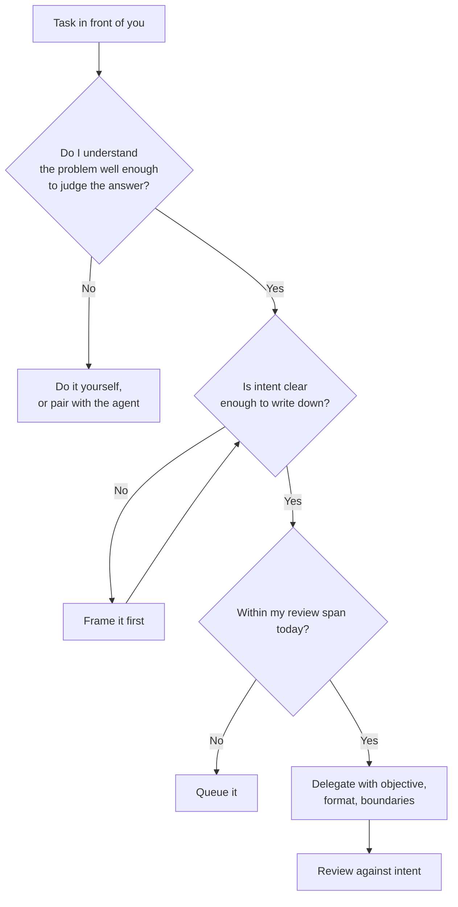

# Roles & the Shape of Work

More and more, my development sessions start somewhere that does not feel much like engineering. Before writing anything myself, I am deciding which of the problems in front of me is worth handing off at all, giving one of them enough background that the work will not start from a wrong assumption, stopping something that turned out to be solving the wrong shape of problem, and leaving another alone because its plan was going somewhere reasonable. Then I review what arrived while I was doing all that.

That is not how I would have described a morning of engineering a few years ago. It is much closer to how my mornings looked when I was leading a team.

Producing a first version of code is becoming cheap. So is gathering information from several systems, drafting documentation, preparing a rollout plan, or tracing an unknown across repositories. What has not become cheaper is understanding users, talking to stakeholders, challenging assumptions, finding valuable problems, navigating trade-offs, and helping shape a product before anyone builds it. The engineer's job is moving towards the second list. Not away from engineering. Towards the half of it that was always there and rarely assigned.

!!! tip "The one-liner"
    When producing plausible software gets cheap, the scarce work is deciding what deserves to exist, and being answerable for it afterwards.

---

## What problem this solves

Teams adopt agents and keep the same role definitions, the same promotion criteria, and the same idea of what a productive day looks like. The result is engineers who produce more code and feel less useful, and organisations that reward the part of the job that is getting cheaper.

The mismatch shows up in three places. In **daily work**, engineers drift into supervising agent output without anyone deciding that this is the job, and without anyone teaching the skills supervision needs. In **career frameworks**, the evidence for seniority (shipped features, technical depth demonstrated through execution) gets cheaper to produce, so it carries less information about the judgment behind it. And in **recognition**, the work that has become more valuable (framing problems, improving the shared harness, teaching) leaves no commit, so it stays invisible.

None of this means engineering is shrinking. It means its centre of gravity is moving, and the structures around it have not moved yet.

---

## When to use this

**Use it when:**

- You are updating a career framework, a promotion rubric, or an interview loop.
- Engineers on your team say some version of "I ship more and feel less useful".
- You are deciding whether to create new AI-specific roles.

**Skip the restructuring when:**

- The team has not yet changed how it works. Rewriting role definitions ahead of practice produces titles without substance. Change the work first, then describe it.

---

## Roles and ownership

| Role                     | Responsibility                                                                 |
| ------------------------ | ------------------------------------------------------------------------------ |
| **Engineering managers** | Update expectations and career frameworks; recognise judgment and harness work |
| **Tech leads**           | Model and teach intent, verification, delegation, and harness improvement      |
| **Engineers**            | Practise product judgment; make their reasoning visible                        |
| **Leadership**           | Reward outcomes and decisions, not output volume                               |

---

## What changes in the work

The clearest way I have found to describe the shift is as two lists that are moving in opposite directions.

| Becoming cheaper                            | Becoming more valuable                                |
| ------------------------------------------- | ----------------------------------------------------- |
| **Writing a first implementation**          | Deciding what is worth building                       |
| **Boilerplate, scaffolding, routine tests** | Defining what "correct" means for this product        |
| **Collecting context from many systems**    | Interpreting that context with users and stakeholders |
| **Drafting plans and docs**                 | Choosing between plausible plans                      |
| **Tracing code paths**                      | Understanding why the system is the way it is         |
| **Producing many options**                  | Taste: choosing well among them                       |

Anthropic's December 2025 study of its own engineers gives a rare look at this shift in progress. Between February and August 2025, the share of sampled Claude Code transcripts involving new-feature implementation rose from 14% to 37%, and code design or planning from 1% to 10%. More than half of the engineers surveyed said they could fully delegate only 0–20% of their work. Delegation grew, but the part of the job that stayed human was the part that required knowing what good looked like. (It is a vendor studying its own staff, with unusually heavy access to its own tools; the direction is more transferable than the numbers.)

The goal of all this was never to produce more code. It is to change what sits at the centre of the engineer's day: less time producing the inputs to product decisions, more time taking part in them.

---

## Delegation becomes daily engineering work

When I moved back into an individual contributor role after years of leading teams, I assumed the management skills would show up as perspective. Instead they show up several times a day, in decisions I once made only about other people's work. Not because agents are colleagues (they are not, and that matters), but because a familiar set of problems appears whenever execution can be handed off: what to delegate, how much context to give, how much room to grant, and how to tell good work from work that merely looks plausible.

The industry has noticed. Microsoft's 2025 Work Trend Index describes an "agent boss" (someone who builds, delegates to, and manages agents) and proposes a human-agent ratio as a new organisational metric. The same report also warns about overloading people with agents, a point [Human Latency](human-latency.md) picks up.

Three parts of delegation matter most for engineers who never managed anyone:

**Deciding what is worth handing off.** Capability is a poor criterion on its own. Some work is where your own understanding of the system gets built, and handing it off buys an afternoon at the price of not knowing what you are looking at next week. Delegating execution saves time. Doing the work yourself sometimes buys understanding. Those are not the same currency.

**What the handoff carries.** Anthropic's write-up of its multi-agent research system describes subagents given short instructions duplicating each other's work and leaving gaps. The fix was to give each one an objective, an output format, guidance on tools and sources, and clear task boundaries. Anyone who has split work between two people with one sentence in a planning call knows that failure by another name. [Intent Before Code](../workflow/intent-before-code.md) is the team-level version of this skill.

**Span of control.** Starting parallel work is cheap; evaluating it is not. The signal I watch for in myself is the quality of my own questions. Inside my span, I ask about specific decisions. Past it, the questions turn generic, the kind you could ask about any diff.



The analogy with management breaks in an important place. Agents do not have careers, do not need purpose, and do not grow from a stretch assignment. A correction you give an agent holds for that session; unless it is captured in an instruction, a test, or a tool, there is no reason to assume it shapes the next one. The learning you can rely on lives in the [harness](../harness/what-a-harness-is.md), not in the agent. And you can delegate execution, but not accountability. Being answerable for output you did not personally produce used to be one of the defining discomforts of the manager's job. It is now part of every engineer's.

---

## Product judgment: the half nobody assigns you

A conventional week for a competent engineer at a functioning company often begins after the important decisions are made. Somebody in product decided the problem mattered. Somebody in design decided what it looks like. Somebody in marketing will decide how it gets described, and somebody in finance decided what it costs. By the time the work arrives, it has been framed, scoped, priced, and named, and the engineer's part begins at "build this well".

I call this the **inherited brief**: treating a framed problem as the beginning of your work rather than the middle of it. Specialisation is not the problem; splitting the loop lets each part be done by someone good at it. The problem is that the inherited brief gives you implementation reps and almost no judgment reps. You can spend years becoming excellent at execution and get very few repetitions at the decisions around it.

That gap matters more now, because the leverage that compressed implementation also lets one engineer reach further around the product loop. The principle that has helped me is small enough to carry around: **move one step upstream or one step downstream from where your role normally begins and ends.**

```text
   upstream                                                downstream
  ─────────►                                              ─────────►
  Problem  →  Framing  →  [ Inherited brief: build it well ]  →  Ship  →  Usage  →  Learning
  framing     and scope                                                  and
  with users                                                             outcomes
```

Upstream looks like asking to be in the conversation where the problem gets framed rather than the one where it gets assigned, or spending twenty minutes with someone in support who talks to unhappy users all day. Downstream looks like agreeing what success means before implementation starts, and then going back to look. Treating the work as unfinished when it ships, rather than at merge.

A harness can help directly. When it arrives at a [judgment gate](../harness/human-gates.md) with the evidence already gathered, the engineer's job is to leave the tool and have the conversation.

---

## Taste

When plausible software is easy to produce, the scarce skill shifts from making things to choosing well. The danger of AI-generated software is rarely that it fails obviously. It is that it succeeds plausibly: a large volume of output that is locally reasonable, individually defensible, and collectively shapeless.

Taste is what keeps a system coherent under that pressure. It is not personal preference. It is the ability to recognise which of two plausible options will create less drag over time, which abstraction is warranted by the problem and which is solving a future that has not arrived, which API teaches the domain and which exposes the implementation. It shows up as rejecting an abstraction because it is early, not because it is broken. As simplifying something that already works. As choosing consistency over cleverness.

It is also very hard to delegate, because it is made of delayed feedback: living with your own decisions long enough to start anticipating their consequences. That is why taste connects directly to [Growing Judgment](growing-judgment.md). If nobody on the team lives with their decisions anymore, nobody develops it.

---

## The work that leaves no commit

Engineering culture trained us to look for proof of contribution in visible output: pull requests, tickets, features. A team also changes when someone explains a pattern that saves three people from repeating the same mistake, turns private learning into shared language, or creates space to discuss what good looks like before everyone builds a different version of it.

That work rarely leaves a neat trace. You notice it later, in the residue: PR descriptions carry clearer intent, planning surfaces assumptions earlier, retros stop recycling the same friction. Not a commit. A better default.

AI makes this sharper. If everyone experiments privately with tools, prompts, and agents, the team accumulates uneven practices quickly. One person moves with confidence, another feels behind, and a third quietly distrusts generated code because nobody knows which parts were inspected carefully. The engineer who turns that private learning into shared practice, often by improving the team's harness, is doing some of the most valuable work on the team. If your recognition system cannot see it, it will stop happening.

---

## Emerging roles, and a caution

Consultancies and vendors are busy naming new roles: agent orchestrators, AI reliability engineers, spec authors, agent managers. Some describe real work that teams need. Most are still the same engineering job with a different emphasis.

The more durable shift is in **what we expect from every engineer**:

**Framing problems with evidence,** before a solution exists.

**Writing intent precisely enough to delegate,** to a person or an agent.

**Designing verification that does not share the implementer's assumptions.**

**Reviewing for risk and ownership,** not syntax.

**Improving the team's harness when something fails,** so the same failure does not recur.

For some engineers there is a real specialisation: **harness and platform work**, building the shared system the rest of the team works inside. It is a natural home for people who like building tools for other builders, and it deserves to be planned, staffed, and recognised as real work rather than done in the gaps.

---

## What this means for hiring and promotion

AI is breaking our proxies for seniority. Technical depth still matters, and the technical rounds still have to establish it. What changed is that producing a plausible solution, or a fluent account of how you would produce one, got cheaper. So execution is weaker evidence of the judgment behind it. Two engineers can produce the same pull request, one because they understood the problem and the other because the model did.

The same thing happens inside interviews. I call it **scoring fluency**: taking the shape of an answer as evidence of the judgment behind it. It over-rewards the rehearsed account of work somebody mostly watched happen, and under-rewards the engineer who has the scars and narrates them badly. The useful question for any interviewer or promotion committee is which evidence is still expensive. The answer is usually the wreckage around a real decision: the constraint that took the good option off the table, the information that arrived after the commitment, the person who disagreed and whether they were right.

Interviews, promotions, and performance reviews need to look for that directly:

**What did they consider and reject, and why?**

**Which decisions did they make that the data could not?**

**What would they defend in six months, and what are they unsure about?**

**If an agent tells them it has found the cause, how do they decide that it has?** Weak answers are about the tool. Strong ones are about evidence: reproduce, explain the mechanism, prove the fix, watch the metric.

**What did they change in the team's system when something failed?**

One caution. Every signal above rewards people who were given room: scope, ownership, a seat where problems got framed. Plenty of capable engineers spent years inside the frame because that is what their organisation handed them. If your rubric starts rewarding "across the frame" judgment, your managers also have to start creating those opportunities, or the rubric turns an opportunity gap into a verdict about a person.

---

## Worked example: two engineers, one promotion cycle

A hypothetical promotion committee is looking at two mid-level engineers on the same team, both candidates for senior.

**On paper they are identical.** Both shipped roughly the same number of PRs over the cycle, both delivered their major projects on time, both have positive peer feedback. Under the old rubric, which leaned on delivered scope and technical complexity, the committee would promote both or neither.

**The committee has updated its rubric** to ask for evidence of judgment, not only delivery. Each candidate's manager is asked to bring two decisions with their context.

**Engineer A** delivered a reporting feature exactly as specified, cleanly, with agent assistance throughout. When asked what she considered and rejected, the answer is thin: the ticket was clear, so she built it. Adoption of the feature after launch was poor, and she had not looked.

**Engineer B** delivered less new feature work. One of his decisions was to push back on the same kind of reporting request in his area: he spent a week with support and two customers, found that the underlying need was an export, not a dashboard, and shipped a much smaller change that was used by most of the target accounts within a month. His other decision was improving the team's verification gate after an agent-written change slipped through review, which removed a class of rework for everyone.

**The committee's first instinct** is to promote B and not A. That is probably right on the evidence. But the rubric's own caution applies: when the committee asks A's manager whether A was ever in the room where problems were framed, the answer is no. Her projects arrived as finished briefs.

**The outcome.** B is promoted. A is not, yet, and the feedback is specific: the gap is product judgment, not technical skill. Her manager commits to putting her in two framing conversations next cycle and pairing her on the downstream review of her next launch. The rubric did its job, and it also exposed a gap in how the team distributed opportunity.

**What went wrong first.** In the committee's previous cycle, an earlier version of the rubric had added "uses AI effectively" as a criterion. Every packet claimed it, none could evidence it, and it rewarded volume. It was removed and replaced with the decision-based questions above.

---

## What good looks like

| Signal                                 | What you observe                                              |
| -------------------------------------- | ------------------------------------------------------------- |
| **Engineers in product conversations** | More time with users and stakeholders                         |
| **Reasoning is visible**               | PRs and approach docs explain what was rejected and why       |
| **Judgment is recognised**             | Promotions cite decisions, not volume                         |
| **Harness work is valued**             | Improving the shared system counts as real work               |
| **Opportunities distributed**          | Every engineer gets reps upstream and downstream of the brief |

---

## Failure modes and mitigations

These failures arrive quietly because each one is locally reasonable. Agent-assisted output goes up, so it gets counted. Engineers start reviewing more, so they review more. Someone volunteers to fix the harness, so they fix it in the evenings. A year later the team has a career framework that rewards the cheapest part of the work and a harness maintained by one burned-out volunteer.

| Failure mode               | What it looks like                             | Mitigation                                   |
| -------------------------- | ---------------------------------------------- | -------------------------------------------- |
| **Output as performance**  | Agent-assisted PR counts in reviews            | Evaluate decisions and outcomes              |
| **Supervisor drift**       | Engineers only review agent output             | Keep engineers in framing and design         |
| **Blind fan-out**          | More parallel agents than anyone can review    | Delegate within your review span             |
| **Role inflation**         | New titles without new responsibilities        | Change expectations, not names               |
| **Invisible harness work** | The person improving the system gets no credit | Make it planned, recognised work             |
| **Scoring fluency**        | Polished answers mistaken for judgment         | Ask about real decisions and their aftermath |

!!! warning "The inherited brief trap"
    An engineer can spend years executing well-framed problems and never practise framing one. With agents carrying more of the execution, that gap becomes the main thing between a mid-level and a senior engineer.

---

## Copy this: questions for a promotion packet

```markdown
## Two decisions this cycle
For each:
- What was the situation, and who framed the problem?
- What options were considered and rejected, and why?
- What did the data not settle, and how was it decided?
- What happened after it shipped? Did they go back and look?
- What would they do differently?

## Delegation and verification
- Where did they delegate to agents, and where deliberately not?
- How did they decide agent output was correct?

## Work that leaves no commit
- What did they change in the team's harness, docs, or practices?
- Who did they teach, and what changed as a result?

## Opportunity check (for the manager)
- Was this engineer given chances to work upstream and downstream of the brief?
```

---

## Further reading

- **[The half of product engineering nobody assigns you](https://dreamingecho.es/blog/half-product-engineering-nobody-assigns-you)** by Iván González Sáiz — The inherited brief, and getting reps upstream and downstream.
- **[The return of taste in software engineering](https://dreamingecho.es/blog/the-return-of-taste-in-software-engineering)** by Iván González Sáiz — Why selection becomes the constraint when plausible software is cheap.
- **[AI is breaking our proxies for engineering seniority](https://dreamingecho.es/blog/ai-breaking-proxies-engineering-seniority)** by Iván González Sáiz — Two seniorities under one title, and scoring fluency.
- **[The engineering work that leaves no commit](https://dreamingecho.es/blog/engineering-value-beyond-code)** by Iván González Sáiz — Knowledge sharing, catalysis, and hidden silos.
- **[The management skills I brought back to IC](https://dreamingecho.es/blog/management-skills-brought-back-to-ic)** by Iván González Sáiz — Delegation, span of control, and where the management analogy breaks.
- **[2025: The year the Frontier Firm is born](https://www.microsoft.com/en-us/worklab/work-trend-index/2025-the-year-the-frontier-firm-is-born)** by Microsoft (Work Trend Index) — The "agent boss", the human-agent ratio, and its warning about judgment overload. (Vendor report.)
- **[How we built our multi-agent research system](https://www.anthropic.com/engineering/multi-agent-research-system)** by Anthropic — What a good handoff to an agent has to carry.
- **[How AI is transforming work at Anthropic](https://www.anthropic.com/research/how-ai-is-transforming-work-at-anthropic)** by Anthropic — How the mix of delegated work shifted between February and August 2025. (Vendor study of its own staff.)

## Related pages

- [Growing Judgment](growing-judgment.md) — Where the judgment these roles depend on comes from.
- [Human Gates](../harness/human-gates.md) — The decisions that stay with people, written down.
- [Intent Before Code](../workflow/intent-before-code.md) — Writing intent precisely enough to delegate.
- [Performance Management](https://dreamingecho.es/playbooks/engineering-leadership/people/performance-management/) — The general mechanics of evaluating engineers (Engineering Leadership Playbook).
