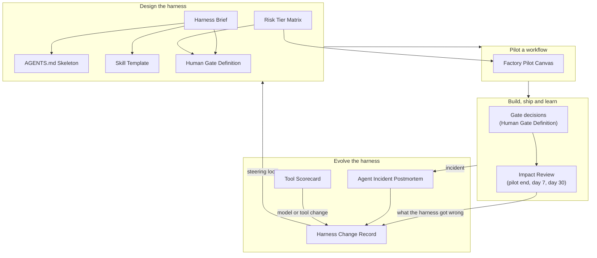

# Templates

Most of the ideas in this playbook only become real when somebody writes something down. A team does not have risk tiers because it discussed them in a meeting; it has them when a matrix says which paths are tier 3 and who stands behind an auto-merged change. A gate is not a gate until someone has defined what the person at it sees. A harness is not a team's harness until the people who do the work have challenged a description of it.

These templates are the documents I would want a team to write. Each one protects a specific decision, and each comes with guidance on when to use it, who owns it, how to fill it in, and a complete worked example. Copy them into your own repository or docs and adapt them. They are deliberately short. A template nobody fills in is worse than none, because it creates the feeling of a process without the substance of one.

!!! tip "The one-liner"
    Each template protects one decision; fill in the ones whose decisions your team is currently making by accident.

---

## How the templates fit together

The templates follow the life of a team harness rather than the order of the chapters. Some are written once and revisited occasionally: the brief that describes a step, the instruction file, the risk tiers. Some are written for each piece of work that passes through: the gate decisions, the impact review. And some are written when something changes or goes wrong: the change record, the postmortem, the scorecard. Together they form a loop. What you learn after shipping, or after an incident, flows back into the design of the harness, with a record of why.

**Designing the harness.** The [Harness Brief](harness-brief.md) comes first: it describes one workflow step precisely enough for an agent to execute and for the team to challenge. What the team agrees then becomes concrete components — always-on context in an [`AGENTS.md`](agents-md-skeleton.md), procedures as [skills](skill-template.md), and stopping points as [gate definitions](human-gate-definition.md). The [Risk Tier Matrix](risk-tier-matrix.md) sits alongside, deciding which gates each kind of change must pass and how much autonomy it gets.

**Piloting a workflow.** Before anything runs in the background, the [Factory Pilot Canvas](factory-pilot-canvas.md) sets the baseline, the checks, the human gate and — most importantly — the promotion threshold, agreed before anyone has seen the results.

**Building, shipping and learning.** Gates turn into decisions on every piece of work. After release, the [Impact Review](impact-review.md) returns to the hypothesis at the end of the pilot, at 7 days and at 30 days, and ends with keep, iterate or reconsider.

**Evolving the harness.** When something goes wrong, the [Agent Incident Postmortem](agent-incident-postmortem.md) asks what the harness allowed. When a new model or tool arrives, the [Tool Scorecard](tool-scorecard.md) evaluates it on your own work. Every resulting change — and every removal — gets a [Harness Change Record](harness-change-record.md) with its reason and its expiry. That record is what lets the loop run in both directions: adding controls when failures recur, and removing them when they stop earning their place.

---

## The templates

| Template                                                      | Use it when                                                        | The decision it protects                                     | Related chapter                                                          |
| ------------------------------------------------------------- | ------------------------------------------------------------------ | ------------------------------------------------------------ | ------------------------------------------------------------------------ |
| **[Harness Brief](harness-brief.md)**                         | Designing or extending a team harness, one workflow step at a time | What the team actually agrees on                             | [Designing a Team Harness](../harness/designing-a-team-harness.md)       |
| **[AGENTS.md Skeleton](agents-md-skeleton.md)**               | Writing or rewriting a repository's instruction file               | What deserves to be in front of the agent on every task      | [Instructions & AGENTS.md](../foundations/instructions-and-agents-md.md) |
| **[Skill Template](skill-template.md)**                       | Turning a recurring procedure into a skill                         | Whether a procedure is worth packaging, and whether it works | [Skills](../foundations/skills.md)                                       |
| **[Human Gate Definition](human-gate-definition.md)**         | Defining where the harness stops for a person                      | What the person sees, decides and adds                       | [Human Gates](../harness/human-gates.md)                                 |
| **[Risk Tier Matrix](risk-tier-matrix.md)**                   | Deciding how much autonomy each kind of change gets                | How far a change is trusted before a person looks            | [Risk Tiers & Autonomy](../factories/risk-tiers-and-autonomy.md)         |
| **[Factory Pilot Canvas](factory-pilot-canvas.md)**           | Planning your first (or next) factory workflow                     | When a workflow earns more autonomy                          | [Your First Factory Workflow](../factories/first-factory-workflow.md)    |
| **[Impact Review](impact-review.md)**                         | Reviewing what shipped work achieved at 7 and 30 days              | Keep, iterate or reconsider                                  | [Rollout & Learning](../workflow/rollout-and-learning.md)                |
| **[Agent Incident Postmortem](agent-incident-postmortem.md)** | Learning from an incident involving agent-built or agent-run work  | What the harness should change                               | [Accountability & Audit Trail](../security/accountability-and-audit.md)  |
| **[Tool Scorecard](tool-scorecard.md)**                       | Evaluating a tool or model on your own work                        | Adopt, trial further or reject                               | [Evaluating a Tool on Your Own Work](../tools/evaluating-tools.md)       |
| **[Harness Change Record](harness-change-record.md)**         | Recording any change to the harness, with its reason and expiry    | Whether a control can later be kept or removed               | [Testing & Evolving the Harness](../harness/testing-and-evolving.md)     |

---

## One imagined team, ten documents

The worked examples follow a single hypothetical team: seven engineers, a product manager and an engineering manager building a subscription-billing product. Marta, a staff engineer, owns the harness; Lena owns the billing area; Daniel is the team's most constructive sceptic. None of them are real, and the numbers in their documents are invented for illustration. What is meant to be realistic is how the documents connect. An August incident produces a postmortem, which produces five harness changes — among them a skill, a CI check and a tier change, each with its own change record — and a new eval task. A rollout gate catches something no metric showed, and the 30-day impact review credits it. Reading the examples in order is a reasonable way to see the whole loop in motion.

---

## Where to start

If you only use one, use the **Harness Brief**. Writing one part of your workflow down precisely enough for an agent to execute — and then taking it to your team — is the highest-leverage exercise in this playbook. It will tell you which of the other templates you need next.

If your team already uses agents heavily and has no written risk tiers, the **Risk Tier Matrix** is the most urgent: it turns review decisions that are currently improvised under pressure into ones the team has made on purpose. And if you have already had an incident involving agent-written code, start with the **Agent Incident Postmortem** — the harness changes it produces are usually the most valuable ones you will make.

---

## Related pages

- [Designing a Team Harness](../harness/designing-a-team-harness.md) — The process most of these templates support.
- [Testing & Evolving the Harness](../harness/testing-and-evolving.md) — How the loop on the right of the diagram works in practice.
- [Engineering Leadership Playbook — Resources](https://dreamingecho.es/playbooks/engineering-leadership/resources/) — ADRs, postmortems, working agreements and more, in the same format.
