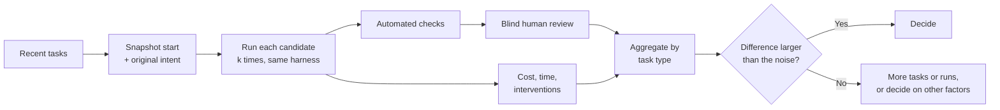

# Evaluating a Tool on Your Own Work

!!! note "Last reviewed"
    October 2026. The method is durable; the benchmark details and the vendor guidance cited here are not. Check the sources before quoting the numbers.

A new model ships on a Tuesday. By Wednesday someone on the team has posted a screenshot of it building a feature from a paragraph, and someone else has linked a leaderboard where it sits four points higher than what you use. By Friday the question in the channel is not whether to switch but when.

I understand the pull. But the screenshot is one run of one task chosen because it went well, and the leaderboard is a set of tasks from someone else's repositories, graded by someone else's tests. Neither describes the codebase you work in on a Tuesday afternoon.

The good news is that you already have a better benchmark than either. It is your own recent work.

!!! tip "The one-liner"
    Replay your own recent tasks, several times each, with your own harness, and let reviewers who do not know which tool wrote the change decide what is acceptable.

---

## What problem this solves

Teams choose tools by leaderboard, demo, or the loudest engineer's preference, then discover months later that the tool struggles with their stack, costs more than expected, or does not fit how they work. Switching is expensive, so they live with it, or churn again next quarter.

There is a quieter version of the same problem with harness changes. Someone rewrites the `AGENTS.md`, adds a skill, swaps a model in a subagent. It feels better. Nobody can say whether it is, because nobody ran the same tasks before and after.

Evaluation on your own work replaces both with evidence: a fixed set of real tasks, run the same way, graded the same way, compared honestly.

---

## When to use this

**Use it when:**

- Choosing a primary agent, IDE, or cloud agent for the team.
- A new model or major version arrives and someone proposes switching.
- You make a significant harness change and want to know whether it helped.
- A significant contract is up for renewal.

**Skip it when:**

- The decision is cheap to reverse and personal — one engineer trying a tool for a week. Let them.
- The candidate cannot run your harness at all. That is a disqualification, not an evaluation.

---

## Why public benchmarks cannot decide for you

Public benchmarks are genuinely useful. They track the field, and they are how we know agents improved as quickly as they did. They are also designed to answer a different question from yours.

**SWE-bench** is the one most people mean. The original paper (Jimenez et al., ICLR 2024) built 2,294 tasks from real GitHub issues and their pull requests across 12 popular Python repositories; a model is given the codebase and the issue and must change the code so that the tests pass. When it was published, the best model resolved 1.96% of them. That is a remarkable baseline to have watched move. It is also 12 Python repositories, scored by tests written for the original fix.

**Terminal-Bench** measures something closer to agent work: 89 hard tasks in terminal environments, each with its own environment, a human-written reference solution and tests for verification. At publication in early 2026 frontier agents scored below 65%. It has since moved on to newer versions, which is what a living benchmark should do, and also a reminder that a score is only comparable within one version.

The limits show up when people check benchmark passes against human judgment. In a March 2026 note, METR reported that roughly half of SWE-bench-passing patches from 2024–2025 agents would not have been merged. It asked four active maintainers of scikit-learn, Sphinx and pytest to review AI-generated patches that had *passed* the SWE-bench Verified grader, without telling them which patches came from an AI. After normalising against the maintainers' verdicts on the original human patches — only about 68% of which they would merge — the gap between grader and maintainer was about 24 percentage points (about 35 points before normalising). METR is careful to say this is not a fundamental capability limit: the agents got one attempt and no review feedback, unlike a human contributor. But it is exactly the gap your team cares about: "the tests pass" and "we would merge this" are different measurements.

So use public benchmarks the way you would use a car magazine: to decide what is worth test-driving. Then test-drive it on your roads.

---

## Golden-task replay

The method is simple to describe and takes discipline to run.

1. **Pick 20–50 recent tasks** your team completed: a mix of bug fixes, small features, refactors and tests, across the areas you care about. Include some that went badly for humans. Anthropic's guide to agent evals suggests the same range and recommends drawing tasks from real failures.
2. **Snapshot the starting point** for each: the commit before the change, and the original issue or intent as it was written at the time — not a cleaned-up version.
3. **Write down what "done" meant**: the acceptance criteria and any checks that must pass. Keep the change that was actually merged as a reference, but do not require the candidate to match it.
4. **Run each candidate on each task several times**, with the same harness: your `AGENTS.md`, skills, hooks and checks. Agents are non-deterministic; a single run is an anecdote.
5. **Grade the outcome, not the path.** Do the checks pass? Does it meet the criteria? Would a reviewer accept it without rework? Anthropic's guide makes the same point: grade what the agent produced, because rigid step-by-step checks penalise valid approaches you did not anticipate.
6. **Record cost and effort** per run: tokens or spend, wall-clock time, and how many times a human had to intervene.
7. **Read the transcripts** for a sample of runs, especially surprising passes and failures. Graders are wrong more often than you expect, and you only find out by reading.
8. **Compare in aggregate and by task type**, with the statistics below in mind.

---

## Statistical honesty

This is the part most internal evaluations skip, and the part that decides whether the result means anything.

### Variance is the default

Run the same agent on the same task three times and you will often get three different diffs, and sometimes different verdicts. Anthropic's guide puts it plainly: agent behaviour varies between runs, which makes results harder to interpret than they first appear. That variance is not a flaw in your evaluation. It is a property of the thing you are buying, and it belongs in the result.

### pass@k and pass^k answer different questions

The same guide distinguishes two metrics that are easy to confuse.

- **pass@k** is the probability that *at least one* of k attempts succeeds. It rises with k. It is the right metric when a human will pick the best of several attempts, or when an automated check can discard failures cheaply.
- **pass^k** is the probability that *all* k attempts succeed. It falls with k. It is the right metric when you need the agent to be reliable every time, as in an unattended background workflow.

The guide's own example: an agent with a 75% per-trial success rate passes all three of three trials only about 42% of the time (0.75³). The same agent looks excellent under pass@3 and mediocre under pass^3. Decide which question you are asking before you look at the numbers, because it will change the answer.

### Small task sets have wide error bars

With 40 tasks, a success rate of around 55% has a standard error of about 8 percentage points, so a rough 95% interval spans about ±15 points. Two tools at 62% and 48% on 40 independent tasks are not clearly different.

You can do better than that because both tools ran on the *same* tasks. Compare them pairwise: count the tasks where one succeeded and the other did not. Those discordant tasks carry the information; the ones where both succeeded or both failed tell you nothing about the difference. A simple sign test on the discordant tasks is honest and easy to explain to anyone.

### Practical rules

- **At least three runs per task per candidate**, more for tasks that look borderline.
- **Report the spread, not just the mean.** "Accepted on 24–27 of 40 tasks across runs" is more honest than "62%".
- **Pre-register the comparison.** Write down the metric and the threshold for "better" before you look at the results.
- **Stratify by task type.** A tool that wins on refactors and loses on bug fixes is a different decision from one that is mediocre at both.

---

## Blind review mechanics

The most valuable grader is a reviewer who would actually have to live with the change. The most common way to waste that reviewer is to let them know which tool wrote it. People have favourites, and they recognise styles.

Making review blind takes a little mechanical work:

- **Strip the fingerprints.** Remove agent trailers and co-author lines from commit messages, rename branches, and drop any generated pull request description. Present the diff and the original task only.
- **Normalise formatting.** Run your formatter over every candidate's output so whitespace and import order do not give the game away.
- **Include the human change as a control.** Mix the change that was actually merged into the pool, unlabelled. METR did the same with its maintainers, and it gives you the reviewers' own noise floor: if they would only accept 70% of what your team really merged, a candidate at 60% is closer than it looks.
- **Randomise order and assignment.** Each reviewer sees changes in a random order, and no reviewer grades only one candidate.
- **Use a fixed scale.** Accept as is / accept after minor changes / needs significant rework / reject. Ask for one sentence of reason for anything below "accept as is".
- **Double-grade a sample.** Have two reviewers grade the same 20% and look at where they disagree. Large disagreement means your acceptance criteria are not as clear as you thought, which is useful to know before you trust any number.

If you use a model as a grader to scale this up, calibrate it against these human verdicts first. Anthropic's guide is direct about it: model-based graders should be closely calibrated with human experts.

---

## A worked example

What follows is a hypothetical evaluation. The numbers are invented to show the mechanics, not taken from any real comparison.

A team of ten wants to decide whether to move its default agent from tool A to tool B, after B's new model topped a public leaderboard.

**Building the set.** The harness owner picks 40 tasks merged in the last two months: 14 bug fixes, 12 small features, 8 refactors, 6 test-writing tasks. Each gets its starting commit, the original ticket text, the acceptance criteria and the merged change.

**First run, and the first mistake.** Both tools run three times on every task. B looks clearly better on automated checks: 31 tasks pass in at least one run against A's 26. Then someone reads a sample of transcripts and notices that B never loaded the repository's pre-commit hooks or its two testing skills. B's configuration lived in a different directory, and the team's hook setup had only ever been wired for A. The comparison was harness against no harness. They fix the wiring and re-run both tools from scratch, so neither result depends on the broken first pass.

**Second run.** With the same harness for both, the automated picture tightens:

| Metric (40 tasks, 3 runs each) | Tool A  | Tool B  |
| ------------------------------ | ------- | ------- |
| **pass@3 on automated checks** | 29 / 40 | 31 / 40 |
| **pass^3 on automated checks** | 18 / 40 | 15 / 40 |
| **Mean interventions per run** | 0.6     | 0.4     |
| **Median cost per run**        | 1.0×    | 1.4×    |

B is slightly more likely to get there eventually; A is more consistent. That is already a more interesting finding than the leaderboard offered.

**Blind review.** Taking one run per task per tool, plus the 40 human changes as controls, gives 120 diffs. They are stripped, formatted, shuffled and split across five reviewers, with a 20% overlap for double-grading. Results, counting "accept as is" and "accept after minor changes" as accepted:

| Accepted by blind reviewers | Count   |
| --------------------------- | ------- |
| **Human-merged controls**   | 33 / 40 |
| **Tool A**                  | 25 / 40 |
| **Tool B**                  | 22 / 40 |

**The honest comparison.** Pairing by task: both accepted on 19, neither on 12. A accepted and B not on 6; B accepted and A not on 3. Nine discordant tasks, split 6 to 3. A two-sided sign test on that split gives p ≈ 0.51. There is no evidence of a real difference in acceptance. By task type, B's three wins are all refactors; A's six are spread across bug fixes and features.

**What went wrong a second time.** One reviewer flagged that a B diff for a bug fix was nearly identical, line for line, to the merged change — including a variable name the team had since renamed. The original fix had been in a public repository for six weeks. Contamination of your own tasks is possible whenever your code is public; the team marks the task and reruns the analysis without it, which changes nothing material.

**The decision.** Acceptance is indistinguishable, A is more consistent, B costs about 40% more per run, and B's strength on refactors is suggestive but rests on three tasks. The team stays on A, adds B as an optional tool for large refactors, and puts a re-run in the calendar for the next model release. The write-up reads: "On our 40 tasks, acceptance was 25 vs 22 with no meaningful difference; A was more consistent and cheaper. Re-evaluate on the next release."

That sentence is worth more than the leaderboard, and it took about two days of one person's time plus a few hours from each reviewer.

---

## What else to evaluate

Acceptance rate is necessary but not sufficient. A tool can win on the replay and still be the wrong choice.

| Dimension                 | Questions                                                                                             |
| ------------------------- | ----------------------------------------------------------------------------------------------------- |
| **Harness compatibility** | Does it read `AGENTS.md` and skills natively? Support your hooks and MCP servers?                     |
| **Workflow fit**          | Foreground, background, parallel — does it support how you work? Triggers from your tracker and chat? |
| **Security**              | Sandboxing model? Permission boundaries outside the model? Data retention and training terms?         |
| **Observability**         | Transcripts, telemetry export, cost attribution per workflow?                                         |
| **Cost model**            | Seat, usage, or both? Predictable at your volume? Cost per *accepted* change?                         |
| **Ergonomics**            | Do engineers actually like using it? Ask them, after they have used it for real work.                 |

---

## Re-evaluating

Run the same set when a new model or major version arrives, when you make a significant harness change, and quarterly as a regression check. Anthropic's guide makes a useful distinction here between *capability* evals, which should start with low pass rates and show you where the agent is weak, and *regression* evals, which should stay near 100% and protect what already works. Your golden set will drift from the first kind to the second as tools improve. When it saturates, add harder tasks.

Keep the set fresh by rotating in recent work, otherwise you will optimise for last year's problems — and, if your code is public, for tasks whose answers may already be in a model's training data.

---

## Roles and ownership

| Role                         | Responsibility                                                               |
| ---------------------------- | ---------------------------------------------------------------------------- |
| **Harness / platform owner** | Maintains the task set, runs evaluations, writes up results                  |
| **Engineers**                | Contribute tasks; act as blind reviewers                                     |
| **Engineering leadership**   | Decides, with cost and security input, and pre-agrees the decision threshold |
| **Security**                 | Reviews the security and data model of each candidate                        |

---

## What good looks like

| Signal                           | What you observe                                                           |
| -------------------------------- | -------------------------------------------------------------------------- |
| **Decisions cite your own data** | "On our 40 tasks, acceptance was 25 vs 22 with no meaningful difference"   |
| **Variance reported**            | Results include runs per task, spread, and pass@k or pass^k as appropriate |
| **Blind review with controls**   | Reviewers do not know the source; human-merged changes are in the pool     |
| **Cost included**                | Cost per accepted change compared, not just quality                        |
| **Regular re-runs**              | The set is run on every major upgrade and rotated quarterly                |

---

## Failure modes and mitigations

Evaluations usually fail in the same way. The first run produces a striking difference, someone shares the chart, and by the time anyone reads the transcripts the decision has been made. The second-most common failure is quieter: the evaluation is run carefully once, never again, and becomes the justification for a tool long after the tool has changed.

| Failure mode             | What it looks like                              | Mitigation                                          |
| ------------------------ | ----------------------------------------------- | --------------------------------------------------- |
| **Leaderboard choice**   | Picked from a public benchmark                  | Shortlist from benchmarks; decide on your own tasks |
| **Single-run verdicts**  | One impressive demo                             | Several runs per task; report spread                |
| **Unfair comparison**    | One candidate runs without your harness         | Same harness for all; verify from transcripts       |
| **Noise read as signal** | A 14-point gap on 40 tasks declared a win       | Pair by task; test the discordant ones              |
| **Recognisable outputs** | Reviewers know which tool wrote what            | Strip trailers, normalise formatting, add controls  |
| **Contaminated tasks**   | A candidate reproduces a public fix from memory | Prefer private or recent tasks; flag near-copies    |
| **Ignoring humans**      | Tool wins on paper; engineers dislike it        | Include ergonomics after real use                   |

---

## Copy this

Use the [Tool Scorecard](../templates/tool-scorecard.md) to record each evaluation. It already records runs per task; add two fields if it does not have them yet: the metric you pre-registered (pass@k or pass^k), and the human-control acceptance rate.

---

## Further reading

- **[Demystifying evals for AI agents](https://www.anthropic.com/engineering/demystifying-evals-for-ai-agents)** by Anthropic — pass@k versus pass^k, grading outcomes, capability versus regression evals, and reading transcripts. (Vendor, but broadly applicable.)
- **[Many SWE-bench-passing PRs would not be merged into main](https://metr.org/notes/2026-03-10-many-swe-bench-passing-prs-would-not-be-merged-into-main/)** by METR — Blind maintainer review of benchmark-passing patches; a model for your own blind review.
- **[SWE-bench: Can Language Models Resolve Real-World GitHub Issues?](https://arxiv.org/abs/2310.06770)** by Jimenez et al. (ICLR 2024) — The original benchmark and its construction.
- **[Terminal-Bench: Benchmarking Agents on Hard, Realistic Tasks in Command Line Interfaces](https://arxiv.org/abs/2601.11868)** by Merrill et al. — Terminal-Bench 2.0's design and error analysis. (Preprint.)
- **[From coding agents to a software factory](https://www.warp.dev/articles/coding-agents-to-software-factory)** by Warp — Measuring cost per merged pull request and intervention rates. (Vendor.)

---

## Related pages

- [Testing & Evolving the Harness](../harness/testing-and-evolving.md) — Using the same task set to test changes to your own harness.
- [Landscape by Category](landscape.md) — Which category a candidate belongs to, before you compare it.
- [Measuring Impact Honestly](../team/measuring-impact.md) — The same statistical caution applied to team-level metrics.
- [Tool Scorecard](../templates/tool-scorecard.md) — A template for recording the result.
