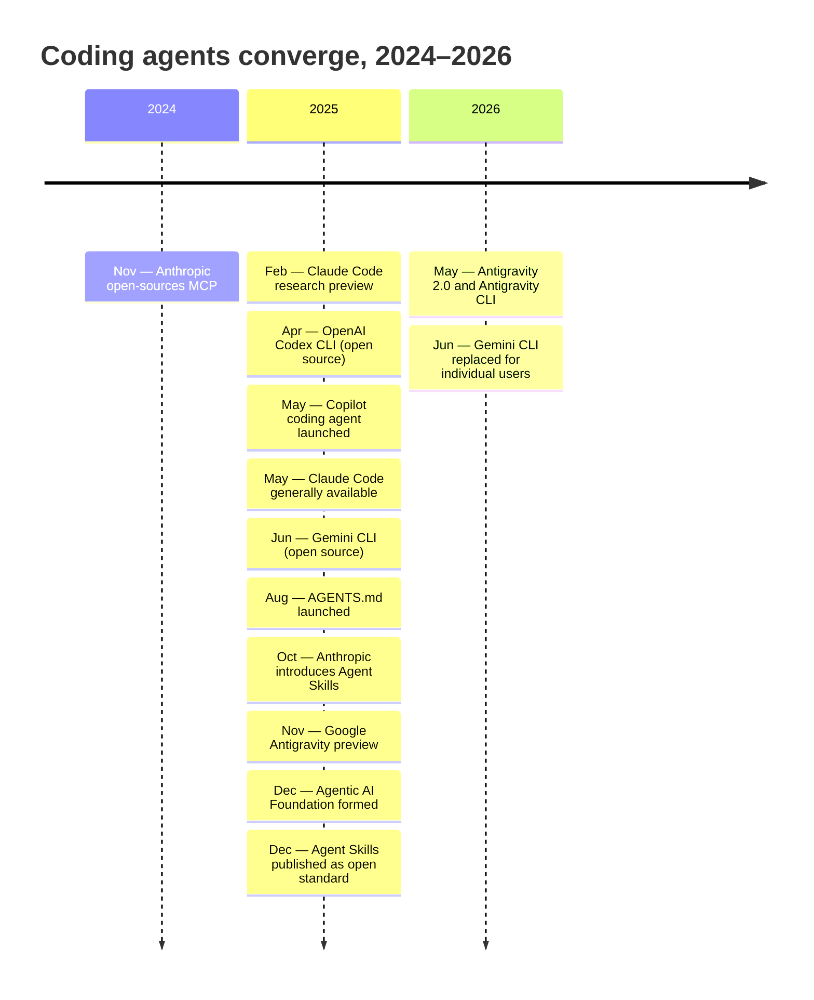
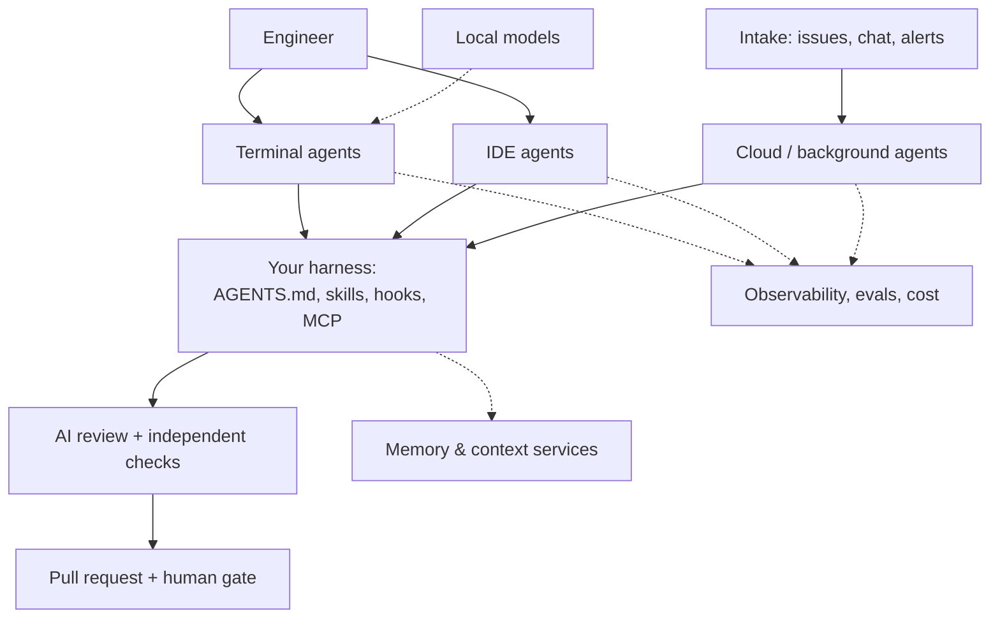

# Landscape by Category

!!! note "Last reviewed"
    October 2026. Product names are examples, not recommendations, and the list is not exhaustive. Every capability claim below was checked against the vendor's own documentation in October 2026. Expect some of it to be wrong by spring.

In early 2025, choosing a coding agent felt like choosing an editor. Each one had its own instruction file, its own way of calling tools, its own idea of what a "command" was. Moving from one to another meant rewriting your setup.

By late 2026 it feels more like choosing a laptop. They broadly read the same instruction file, load the same skill format, and speak the same protocol to the outside world. They differ in feel, in ecosystem, in price, in how good their inner loop is on your kind of work. Those differences matter, but they are no longer differences in kind.

This page is a map of that landscape. It is deliberately not a ranking.

!!! tip "The one-liner"
    The categories are stable. The products inside them are not. Choose the category by your workflow, then choose the product by evidence from your own work.

---

## What problem this solves

Someone new to building with AI meets a wall of product names and launch posts, each claiming to be the agent. Someone experienced has the opposite problem: they know three tools well and have not noticed that the other categories have quietly become good enough to change how their team works.

A category map helps both. It tells the newcomer what kinds of tools exist and what each is for, so the names have somewhere to land. It tells the experienced builder where the gaps in their setup are. And it separates the decisions that last — "we want background agents triggered from the issue tracker" — from the ones that will be revisited next quarter — "we use vendor X for that".

---

## When to use this

**Use it when:**

- You are building or revising a team's tool strategy and want to see the whole field.
- You are new to the area and want to know what kinds of tools exist before comparing products.
- A new product launches and you want to know which category it competes in, and therefore what to compare it against.

**Skip it when:**

- You already know the category and need to choose between two products. Go to [Evaluating a Tool on Your Own Work](evaluating-tools.md); this page will not settle it.

---

## How the categories converged

The convergence did not happen by accident. It happened through a handful of open formats, each started by one vendor and adopted by the others, and then handed to neutral governance.

Three things in that timeline are worth slowing down for.

**The protocol came first.** Anthropic open-sourced the Model Context Protocol (MCP) on 25 November 2024, as a standard way to connect assistants to tools and data. It arrived before most of today's agents existed, which is part of why it spread: by the time the terminal agents shipped through 2025, there was already one obvious way to plug in a tool. When the Linux Foundation announced the Agentic AI Foundation a year later, it cited more than 10,000 published MCP servers.

**The instruction file was a coordination problem, solved socially.** For most of 2025 every agent had its own file: `CLAUDE.md`, `GEMINI.md`, `.cursorrules`, `.github/copilot-instructions.md`. `AGENTS.md` emerged in August 2025 from a group that included OpenAI Codex, Amp, Google's Jules, Cursor and Factory. Amp's announcement of the switch is a nice small piece of history: it had shipped `AGENT.md`, singular, and agreed to move to the plural "if OpenAI can get the agents.md domain". It did. By December the Linux Foundation counted "more than 60,000 open source projects and agent frameworks" using it.

**Governance moved to neutral ground.** On 9 December 2025 the Linux Foundation announced the Agentic AI Foundation (AAIF), with three founding projects: MCP from Anthropic, goose from Block, and AGENTS.md from OpenAI. Its platinum members included AWS, Anthropic, Block, Bloomberg, Cloudflare, Google, Microsoft and OpenAI. Nine days later Anthropic published Agent Skills — the `SKILL.md` folder format it had introduced in October — as an open standard. By October 2026 the format is documented by Codex, Cursor, GitHub Copilot and opencode as well as Claude Code, and Google's Antigravity ships its own skills support.

The last two entries in the timeline are a different kind of milestone, and an instructive one. At Google I/O on 19 May 2026, Google launched Antigravity 2.0 and the Antigravity CLI and encouraged Gemini CLI users to migrate. The Gemini CLI repository now states that for "unpaid tier and Google One users" it "was replaced by Antigravity CLI on June 18th, 2026". A widely used, open-source terminal agent was superseded within a year of launch. If your harness had lived in that tool's proprietary configuration, you would have had a month to move it. If it lived in `AGENTS.md`, skills and MCP, you mostly had to install a new binary. That is the practical argument for [Portability](portability.md).

---

## The shared primitives

Because of that convergence, the useful way to compare agents is no longer "which features does it have?" but "how well does it implement the primitives everyone now shares?"

| Primitive                | Open format                                                 | Steward (Oct 2026)                              |
| ------------------------ | ----------------------------------------------------------- | ----------------------------------------------- |
| **Project instructions** | [`AGENTS.md`](https://agents.md)                            | Agentic AI Foundation (Linux Foundation)        |
| **Skills**               | [Agent Skills](https://agentskills.io) (`SKILL.md` folders) | Open standard originated by Anthropic           |
| **Tools and data**       | [Model Context Protocol](https://modelcontextprotocol.io)   | Agentic AI Foundation (Linux Foundation)        |
| **Hooks**                | No common standard                                          | Each tool's own config; event names are similar |
| **Background execution** | No common standard                                          | Each vendor's own cloud                         |

The two rows without a standard are where lock-in now lives. Hook events look alike across tools — Claude Code, Codex and Cursor all document a pre-tool-use event and a session-start event — but their configuration files and payloads differ. Cloud execution is entirely vendor-specific. Neither is a reason to avoid them. Both are a reason to keep the logic in scripts and the trigger in thin, per-tool config.

---

## The categories

### Terminal (CLI) agents

Agents that run in your terminal, read and edit your repository, and run commands on your behalf. This is where the agentic shift started, and where most serious agent work still happens, because the terminal composes: an agent that runs in a shell can be scripted, piped, run headless in CI, and wrapped in other tools.

Representative products: Claude Code, OpenAI's Codex CLI, Google's Antigravity CLI (`agy`, the successor to Gemini CLI), GitHub Copilot CLI, and opencode, an open-source agent that works with any LLM provider you configure.

**Good for:** deep agentic sessions, scripting and automation, headless and CI use, composing with other command-line tools.

**Look for:** a permission and sandbox model you understand; hooks; subagents; a headless mode; telemetry export; native `AGENTS.md` and skills support rather than a workaround.

### IDE agents

Agents embedded in an editor, combining inline completion, chat, and an agent mode that edits several files. Cursor is the most prominent editor built around an agent; GitHub Copilot lives inside VS Code, JetBrains and other editors; Claude Code and Codex both ship editor extensions that wrap their terminal engines.

**Good for:** interactive work where you want to see and steer each change in context, and for people who think better with the code visible.

**Look for:** the same primitives as terminal agents, plus the quality of the diff review experience and multi-file editing. An IDE agent that ignores your `AGENTS.md` will behave differently from the terminal agent on the same repository, which is a quiet source of "it works for me".

### Cloud and background agents

Agents that run asynchronously in remote environments, are triggered from wherever work arrives, and return a branch or a pull request. Most major vendors now have one, and they look strikingly similar in October 2026:

- **GitHub Copilot's cloud agent** (launched in May 2025 as the "coding agent") takes an assigned issue and works in an ephemeral cloud environment, opening a pull request per task.
- **Codex Cloud** gives each task its own workspace that "can keep working while your computer is asleep".
- **Claude Code cloud sessions** run in isolated, Anthropic-managed VMs, can be started from the browser, phone, desktop app or `claude --cloud`, and can watch a pull request to fix CI failures and review comments.
- **Cursor's cloud agents** (formerly background agents) run in isolated VMs and can be started from Slack, Linear, GitHub comments, the web or mobile.
- **Antigravity** runs background subagents and scheduled jobs from its desktop app and CLI — closer to background execution than to a cloud agent that returns pull requests.

**Good for:** well-specified, verifiable tasks; parallel work; the first steps toward [factory workflows](../factories/what-a-factory-is.md).

**Look for:** environment setup speed and fidelity (does the cloud environment build and test your project the way CI does?), isolation and network controls, where credentials live, triggers from your issue tracker and chat, cost controls, and full run transcripts.

### AI code review

Tools that review pull requests automatically, either inside the code host or as standalone services. GitHub's Copilot code review, Claude Code's GitHub Code Review and Codex's code review are examples from the agent vendors; there are also dedicated review products, several of which publish their own research on AI code quality and are worth reading with that interest in mind.

**Good for:** a first pass that catches pattern and consistency issues before a human looks.

**Look for:** configurable rubrics written as plain files; low noise; a way to measure which comments engineers accept; independence from the authoring agent. A reviewer that runs the same model with the same context as the author shares its blind spots. See [Review at Agent Speed](../workflow/review-at-agent-speed.md).

### Spec-driven development tools

Tools that structure work into specifications, plans and tasks before implementation. GitHub's Spec Kit is an open-source toolkit that writes its artefacts as Markdown files and can be pointed at different coding agents. AWS's Kiro turns prompts into "requirements, architectural designs, and sequenced tasks" and comes as an IDE and a CLI. OpenSpec, which ThoughtWorks' Technology Radar assessed in April 2026, works in the same space.

**Good for:** teams that want a guided structure for intent and planning, and a record of it.

**Look for:** plain-file outputs you own, agent-agnosticism, and low ceremony for small changes. A tool that demands a full specification for a one-line fix will be bypassed within a week. See [Intent Before Code](../workflow/intent-before-code.md).

### Orchestration and agent management

Tools for running, monitoring and coordinating several agents at once — from terminal multiplexers that show each agent's state, to desktop apps with a "manager" view, to platforms that run fleets of background agents. The vendors are moving here too: Claude Code's desktop app runs several sessions side by side, and Antigravity's desktop app was built around a manager surface from its first preview.

**Good for:** parallel work at scale and factory workflows.

**Look for:** visibility into each agent's state, isolation per agent (separate worktrees or VMs), and notification rather than supervision. The aim is to be told when an agent needs you, not to watch it.

### Observability, evals, and cost

Tools for tracing agent runs, evaluating harness changes and tracking spend. Some agents now export telemetry directly: Claude Code, for example, emits OpenTelemetry metrics and events, including session counts and cost. Engineering analytics platforms have added AI measurement on top.

**Good for:** knowing whether your harness and workflows work, and what they cost per accepted change.

**Look for:** OpenTelemetry support, attribution per workflow rather than per seat, and eval tooling that runs on your own tasks. See [Testing & Evolving the Harness](../harness/testing-and-evolving.md) and [Cost & Token Economics](../team/cost-and-token-economics.md).

### Memory and context services

Persistent memory stores and context servers, usually exposed over MCP, that carry decisions and knowledge across sessions and across agents. Several agents now also keep their own local memory — Claude Code's auto memory, for instance, writes per-repository notes it loads at the start of each session.

**Good for:** continuity across sessions and tools.

**Look for:** self-hosting options, data control, easy inspection and pruning, and a clear answer to which store wins when a shared memory and a tool's local notes disagree. See [Memory & Continuity](../harness/memory-and-continuity.md).

### Local models

Open-weight models run on your own hardware. Ollama is the common entry point: it runs models locally, exposes an API compatible with OpenAI and Anthropic clients, and can launch coding agents against them. It now also offers hosted models for people without a capable GPU, which is worth knowing if "local" is the reason you chose it.

**Good for:** private data, offline work, cheap high-volume simple tasks, experimentation.

**Look for:** model quality on your task type, and tool-calling reliability. A local model that writes good code but calls tools inconsistently will make a capable agent look broken.

---

## Representative products and what they support

The table below records what each product's own documentation said in October 2026. "Yes" means the vendor documents it; a blank means I could not confirm it from official sources, not that it is missing.

| Product            | Surfaces                                       | AGENTS.md | Skills | MCP | Hooks                    | Cloud / background                   |
| ------------------ | ---------------------------------------------- | --------- | ------ | --- | ------------------------ | ------------------------------------ |
| **Claude Code**    | Terminal, IDE, desktop, web, mobile            | Yes       | Yes    | Yes | Yes                      | Yes (cloud sessions)                 |
| **OpenAI Codex**   | CLI, IDE extension, ChatGPT desktop app, cloud | Yes       | Yes    | Yes | Yes                      | Yes (Codex Cloud)                    |
| **Antigravity**    | CLI (`agy`), desktop app, IDE, SDK             |           | Yes    | Yes | Yes                      | Background subagents, scheduled jobs |
| **GitHub Copilot** | IDE, CLI, github.com                           | Yes       | Yes    | Yes | Yes                      | Yes (cloud agent)                    |
| **Cursor**         | Editor, CLI, web, mobile                       | Yes       | Yes    | Yes | Yes                      | Yes (cloud agents)                   |
| **opencode**       | Terminal, desktop, IDE                         | Yes       | Yes    | Yes | Plugins with event hooks |                                      |
| **Ollama**         | Local runtime and API                          | n/a       | n/a    | n/a | n/a                      | Hosted models available              |

Two details from that research are worth knowing because they change how you lay out files:

- **Claude Code reads `AGENTS.md` natively** from v2.1.277, but by default only when there is no `CLAUDE.md` in the working directory or above it. A setting lets it read both. Before that version, the documented approach was a `CLAUDE.md` containing `@AGENTS.md`.
- **Codex** reads a global `~/.codex/AGENTS.md`, honours an `AGENTS.override.md`, and stops adding (and may truncate) instructions once the combined size reaches 32 KiB by default.

The details will change. The fact that every vendor now documents the same three columns is the durable part.

---

## How the categories fit together

The harness in the middle is the part you own. Everything around it is replaceable, and in 2026 at least one piece of it was replaced for a lot of people whether they wanted it or not.

---

## A worked example: reading the map for a real decision

Consider a hypothetical product team of eight engineers. Today they use one IDE agent each, with personal settings. Their lead wants agents to pick up small, well-described bugs from the issue tracker overnight. Here is how the map helps, step by step.

**1. Name the workflow, not the product.** "Small bugs from the tracker, overnight, returned as pull requests that a human reviews in the morning." That is the cloud and background category, plus AI review, plus observability. It is not a reason to change everyone's editor.

**2. Check the shared primitives first.** The team's conventions live in personal settings in one IDE. A background agent will not see them. The first piece of work is therefore not choosing a cloud agent but writing a repository `AGENTS.md` and moving the two or three rules people keep repeating into it. This is the step most teams skip, and it is why their first background agent "does not follow our conventions".

**3. Shortlist by trigger and environment.** The team's issues live in a tracker that only some cloud agents can be triggered from directly; the others need a small webhook. Their test suite needs a database and a seeded fixture, so environment setup fidelity matters more than raw model quality. That narrows four candidates to two.

**4. Decide what must stay independent.** If the background agent and the AI reviewer are the same product with the same model, the review shares the author's assumptions. The team keeps human review mandatory and adds deterministic checks before any AI review.

**5. Hand over to evaluation.** Two candidates, one workflow, a clear definition of done. Now the [golden-task replay](evaluating-tools.md) has something precise to measure.

What usually goes wrong in this sequence is step 2. The team runs a trial, the agent ignores conventions that only existed in someone's editor, and the conclusion becomes "background agents are not ready" when the real finding was "our instructions were not in the repository".

---

## What the wider field says

Two independent signals are worth having alongside vendor documentation.

**Practitioner usage.** The Stack Overflow 2026 Developer Survey (over 30,000 responses, self-selected) reports that coding assistants and agents are the most common AI use case, that 73% of those answering use them daily, and that Claude Code (66%) and GitHub Copilot (59%) lead among coding agents (of those who answered that question; the survey page does not state the base). Its 2025 edition is a useful contrast on trust: 46% of respondents distrusted the accuracy of AI tools against 33% who trusted it, and 66% named "almost right, but not quite" as their top frustration. Usage has grown faster than trust, which is exactly why verification and review get so much space in this playbook.

**Technique, not just tools.** ThoughtWorks' Technology Radar (Volume 34, April 2026) is more interesting on practices than on products. It places *curated shared instructions for software teams* in Adopt, explicitly citing files such as `AGENTS.md`, and *Agent Skills* in Trial. It also puts *agent instruction bloat* and *MCP by default* in Caution: long instruction files whose rules start to conflict, and reaching for an MCP server where a well-designed command-line tool would serve the agent better. Both cautions are reminders that the open formats are a means, not a goal.

!!! info "What we know / what we don't"
    **We know** that the major agents converged on `AGENTS.md`, Agent Skills and MCP during 2025, that two of those now sit under neutral governance, and that most major vendors offer a cloud agent that returns pull requests. These are documented by the vendors and by the Linux Foundation.

    **We don't know** whether hooks and background execution will standardise, or stay the place where vendors compete. Nor do we know how stable any individual product is: the Gemini CLI's replacement in 2026 shows how quickly a popular tool can be superseded. Plan for the categories; hold the products loosely.

---

## Roles and ownership

| Role                         | Responsibility                                                                        |
| ---------------------------- | ------------------------------------------------------------------------------------- |
| **Harness / platform owner** | Keeps this map current for the team; tracks which tools support the shared primitives |
| **Engineering leadership**   | Decides which categories the team invests in, and why                                 |
| **Engineers**                | Report where a tool's behaviour diverges from the shared harness                      |
| **Security**                 | Reviews each category's data and execution model, especially cloud agents             |

---

## What good looks like

| Signal                            | What you observe                                                |
| --------------------------------- | --------------------------------------------------------------- |
| **Category before product**       | Tool discussions start from the workflow they must support      |
| **Shared primitives in the repo** | `AGENTS.md`, skills and MCP config are versioned with the code  |
| **Known gaps**                    | The team can name which categories it deliberately does not use |
| **Dated claims**                  | Internal tool notes carry a "last reviewed" date                |

---

## Failure modes and mitigations

Most teams do not fail by choosing a bad tool. They fail by choosing a tool for one category and expecting it to cover another, or by building their setup inside the one part of a product that has no open format.

| Failure mode                     | What it looks like                                                  | Mitigation                                        |
| -------------------------------- | ------------------------------------------------------------------- | ------------------------------------------------- |
| **Category confusion**           | An IDE agent bought to solve an overnight-automation problem        | Name the workflow first                           |
| **Proprietary setup**            | Conventions live in one tool's settings; the next tool ignores them | Move them into `AGENTS.md` and skills             |
| **Feature-list shopping**        | Choosing by which checklist is longest                              | Compare on your own tasks                         |
| **Stale map**                    | Decisions based on last year's capabilities                         | Review the map quarterly; date every claim        |
| **Same model, same blind spots** | AI review by the authoring agent's twin                             | Keep review independent; add deterministic checks |

---

## Further reading

- **[Introducing the Model Context Protocol](https://www.anthropic.com/news/model-context-protocol)** by Anthropic — The November 2024 announcement where the convergence starts.
- **[Linux Foundation announces the formation of the Agentic AI Foundation](https://www.linuxfoundation.org/press/linux-foundation-announces-the-formation-of-the-agentic-ai-foundation)** by the Linux Foundation — Founding projects, members and adoption figures.
- **[AGENTS.md](https://agents.md)** by the Agentic AI Foundation — The format, its origins and the list of supporting agents.
- **[From AGENT.md to AGENTS.md](https://ampcode.com/news/AGENTS.md)** by Amp — A short first-hand account of how the file name was settled.
- **[Agent Skills](https://agentskills.io)** by the Agent Skills project (originated by Anthropic) — The open specification for `SKILL.md` folders.
- **[Equipping agents for the real world with Agent Skills](https://www.anthropic.com/engineering/equipping-agents-for-the-real-world-with-agent-skills)** by Anthropic — The original design, with the December 2025 note on the open standard. (Vendor.)
- **[Developer highlights from I/O 2026](https://blog.google/innovation-and-ai/technology/developers-tools/google-io-2026-developer-highlights/)** by Google — Antigravity 2.0, the Antigravity CLI and the Gemini CLI migration. (Vendor.)
- **[Stack Overflow Developer Survey 2026: AI](https://survey.stackoverflow.co/2026/ai)** by Stack Overflow — Usage of coding agents; a large but self-selected sample.
- **[Technology Radar, Volume 34](https://www.thoughtworks.com/radar)** by ThoughtWorks — Independent assessments of agent techniques, including the Caution on instruction bloat.

---

## Related pages

- [Evaluating a Tool on Your Own Work](evaluating-tools.md) — How to choose between two products once you know the category.
- [Portability](portability.md) — Keeping your harness independent of any one product.
- [My Stack](my-stack.md) — How one builder wires several of these categories together.
- [Tools & MCP](../foundations/tools-and-mcp.md) — How MCP works and when a CLI is the better tool.
