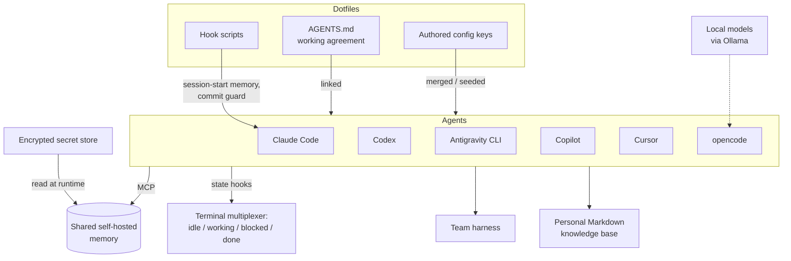

# My Stack

!!! note "Last reviewed"
    October 2026. This will be out of date soon. The shape of it should last longer than the names.

People ask what I use, so here it is — with the caveat that the interesting part is not the list of tools but how they are wired together. Much of what this playbook says about portability, memory and harnesses was shaped by this setup.

If you take one thing from this page, take the shape rather than the product names. Several agents, one working agreement, one memory, a few deterministic guards, and harnesses that sit on top of all of it. The products in each slot will change. In 2026 one of them already did.

!!! tip "The one-liner"
    Several agents, one set of instructions, one memory. Each tool is replaceable because nothing important lives inside it.

---

## The agents

I use several coding agents, deliberately.

| Agent                       | What it is                                                                                 |
| --------------------------- | ------------------------------------------------------------------------------------------ |
| **Claude Code**             | Anthropic's agent; terminal-first, with IDE, desktop and cloud surfaces                    |
| **Codex**                   | OpenAI's agent: an open-source CLI, IDE extension, the ChatGPT desktop app and cloud tasks |
| **Antigravity CLI (`agy`)** | Google's terminal agent, successor to Gemini CLI                                           |
| **GitHub Copilot**          | GitHub's assistant across editors, the CLI and a cloud agent that works from issues        |
| **Cursor**                  | An editor built around an agent, with a CLI and cloud agents                               |
| **opencode**                | An open-source terminal agent that works with any model provider you configure             |
| **Local models (Ollama)**   | Open-weight models run on my own hardware                                                  |

All six agents read the same instructions, connect to the same memory, and report their state to the same terminal. That is what makes it possible to use several without the setup becoming a second job.

---

## Why several, and not one

Using several agents is not indecision. There are three reasons, and they matter more than any individual tool.

**Portability stays honest.** It is easy to believe your setup is portable. It is much harder to keep it so when you only ever use one tool, because tool-specific habits creep in unnoticed: a rule that only exists in one tool's settings, a skill written in a format only one tool reads. Using several agents regularly is a continuous test of the claim. When one of them behaves differently from the others, the first thing to check is whether something lives in the wrong place.

**Independent reviewers are worth having.** A model reviewing its own work shares its assumptions. One of the [core principles](../principles/core-principles.md) of this playbook is that the agent that wrote the change does not get to be the only thing that checks it. A second agent from a different vendor, with a different model and a different inner harness, is not a perfect independent reviewer — different models can still share blind spots — but it is more independent than the same agent asked twice.

**Vendor risk is real, not theoretical.** In May 2026 Google encouraged Gemini CLI users to move to its new Antigravity CLI, and in June the Gemini CLI repository said it had been replaced for "unpaid tier and Google One users". For a setup like this one, where the instructions and the memory connection live outside each tool, that kind of change means installing a new binary and registering the same shared files and memory server with it. A vendor change becomes an inconvenience, not a rewrite. That is the outcome the whole design aims for.

---

## How it fits together

Read it from the top. The dotfiles own everything I author. The agents are interchangeable boxes in the middle. Memory, the secret store and the terminal are shared services on the outside. Two of the hooks are wired into Claude Code only. The harnesses sit on top and use whichever agent fits.

---

## One set of working agreements

All of them read **the same instruction file**. My personal working agreement — language, documentation standards, verification rules, Git conventions, what I never want — lives in one `AGENTS.md` in my dotfiles and is linked into each agent's expected location. One place to change, no chance of drift.

The agents' own configuration files are not symlinked, because the tools write into them: workspace details, trust entries, caches. My dotfiles own the keys I author and deep-merge them on top of the live files; formats that are hard to merge safely are seeded on new machines only. The mechanics, and why the obvious approach can leak internal details into Git, are in [Portability](portability.md).

---

## Shared memory

Every agent connects to **one self-hosted memory store** over MCP. It holds decisions and preferences from earlier sessions. In Claude Code, a session-start hook also loads relevant context from it automatically; the other agents reach it through the same MCP connection when they need it. The secret it needs is read at runtime from an encrypted store, never from a plaintext file, and if it cannot be read the connection fails loudly rather than falling back to each tool's local memory.

My instruction file is explicit about precedence: the shared store outranks any tool's local notes, and a contradicting local note gets corrected in the same session. The reason is simple. Tool-local memory loads automatically, which makes it feel authoritative, and a stale local note can keep steering an agent against a decision that was changed elsewhere. It should not win unless you say so.

---

## Hooks

A few deterministic guards, where they earn their place:

- **Agent state reporting (all six agents):** each agent reports whether it is idle, working, blocked, or done to my terminal multiplexer, so I get notified instead of supervising.
- **Session start (Claude Code):** load relevant memory context.
- **Before shell commands (Claude Code):** a guard that refuses commits carrying an agent attribution trailer, because an instruction alone was not enough.

The commit guard is the best illustration of why hooks exist. The rule was already written in the instruction file. That was not enough for something that ends up in a permanent history, so the rule moved from a sentence the model reads to a script the tool runs. Commit-message conventions themselves are enforced separately, by a commit hook and CI, which apply to humans and agents alike. See [Hooks & Deterministic Guards](../foundations/hooks-and-guards.md).

---

## What happens when a session starts

To make the diagram concrete, here is the sequence when an agent starts in a repository:

1. **Instructions load.** Every agent reads my user-level working agreement (the linked `AGENTS.md`) and the repository's own instructions.
2. **Memory connects.** The MCP launcher reads its credential from the encrypted store and connects to the shared memory backend. This is the same for all six agents.
3. **State is reported.** A hook tells the terminal multiplexer the agent is working; later events report when it is blocked on me or done.
4. **Context arrives (Claude Code).** The session-start hook pulls relevant decisions and preferences from memory into the session.
5. **Guards are armed (Claude Code).** Before a shell command runs, the commit guard checks for an attribution trailer.

The first three steps do not depend on which agent it is. The last two are where the setup is still uneven, and they are the natural next step: the hook logic lives in scripts, so wiring it into another agent means one more thin wrapper rather than one more copy of the rule.

---

## Harnesses

- **A team harness** that covers most of the path from an early product idea to what happens after it reaches real users: research, definition, implementation, quality checks, review, rollout, measuring impact and learning, with human gates and evaluations around that flow. It is the system much of the [AI Harness](../harness/index.md) section is drawn from, and I wrote about building it in [The AI Harness Should Follow the Conversation](https://dreamingecho.es/blog/the-ai-harness-should-follow-the-conversation).
- **A personal knowledge base** in plain Markdown, maintained by an agent with a handful of skills for capture, triage, linking, and digests. See [Personal Knowledge Systems](../frontier/personal-knowledge-systems.md).
- **[DX Toolkit](https://github.com/dreamingechoes/dx-toolkit)**, a public collection of agents, prompts, instructions, skills, hooks, and workflows I published earlier in the year as a starting reference. It reflects an earlier, more catalogue-shaped stage of my thinking than the rest of this playbook.

---

## What I would tell someone starting

1. **Pick one primary agent and learn it properly.** Its permission model, its hooks, how it loads instructions. Depth beats breadth at the start.
2. **Write a short personal `AGENTS.md` and grow it from real failures.** Every line should exist because something went wrong without it.
3. **Add one hook for the rule you care most about.** The one you have already asked for three times.
4. **Add a second agent when you want an independent reviewer.** Using two will show you how portable your setup really is.
5. **Only then think about memory, multiple agents in parallel, and harnesses.**

---

## Failure modes and mitigations

A multi-agent setup fails in predictable ways, mostly by slowly turning back into several single-agent setups.

| Failure mode          | What it looks like                           | Mitigation                                             |
| --------------------- | -------------------------------------------- | ------------------------------------------------------ |
| **Drift**             | One agent quietly follows older rules        | One linked `AGENTS.md`; check what each agent loaded   |
| **Tool collecting**   | Seven agents, none learned well              | One primary; add others for a reason                   |
| **Hidden dependency** | A rule only works in one tool                | Move it to the shared file, a skill or a hook script   |
| **Uneven guards**     | A hook protects one agent but not the others | Keep hook logic in scripts; add thin wrappers per tool |
| **Supervision creep** | Watching agents instead of working           | State reporting and notifications                      |

---

## Further reading

- **[DX Toolkit](https://github.com/dreamingechoes/dx-toolkit)** by Iván González Sáiz — The public reference collection mentioned above.
- **[The AI Harness Should Follow the Conversation](https://dreamingecho.es/blog/the-ai-harness-should-follow-the-conversation)** by Iván González Sáiz — What building the team harness taught me about working agreements.
- **[Developer highlights from I/O 2026](https://blog.google/innovation-and-ai/technology/developers-tools/google-io-2026-developer-highlights/)** by Google — The Gemini CLI to Antigravity CLI migration referred to on this page. (Vendor.)
- **[Gemini CLI repository](https://github.com/google-gemini/gemini-cli)** by Google — The notice that Gemini CLI was replaced for unpaid tier and Google One users in June 2026.

---

## Related pages

- [Portability](portability.md) — The link, merge and seed mechanics behind this setup.
- [Landscape by Category](landscape.md) — Where each of these tools sits in the wider field.
- [Memory & Continuity](../harness/memory-and-continuity.md) — What belongs in shared memory.
- [Hooks & Deterministic Guards](../foundations/hooks-and-guards.md) — Turning instructions into enforced rules.
