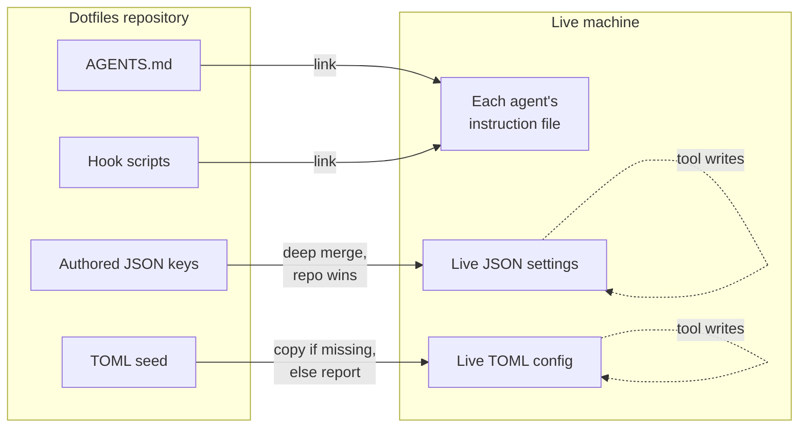
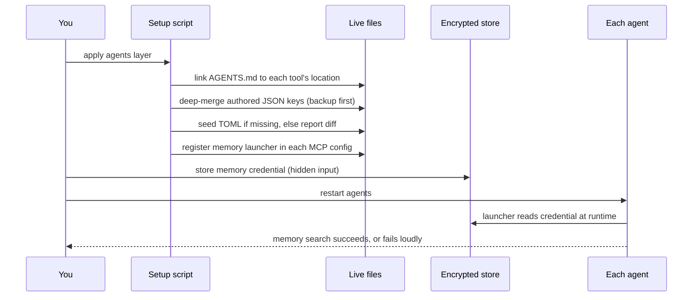

# Portability

Many builders now use more than one coding agent: one in the terminal, one in the editor, a background agent triggered from the issue tracker, a local model for private work. Each wants its own instruction file, its own skills directory, its own MCP configuration, its own hook format.

Left alone, that becomes several copies of your working agreements, slowly drifting apart. You fix a rule in one place and forget the other four. The agent you use least follows last quarter's conventions. A teammate on a different tool gets different behaviour from the same repository and assumes the tool is worse.

Portability is about keeping one copy. It sounds like housekeeping. In 2026 it turned out to be risk management too.

!!! note "Last reviewed"
    October 2026. File locations and loading rules below come from each vendor's documentation at that date, and they change often. Verify before relying on them.

!!! tip "The one-liner"
    Link what tools only read. Merge what tools also write. Seed what you cannot merge safely. Keep everything else in shared scripts and services.

---

## What problem this solves

When instructions are duplicated per tool, they diverge, and divergence is invisible until it bites. Worse, a stale copy in one tool can quietly contradict the current decision — and because tool-local notes load automatically, they feel authoritative to the agent reading them.

There is also a less obvious problem. The configuration files agents use are not only *read* by those agents; they are *written* by them. Settings accumulate workspace details, trust decisions, caches and approval records. If you treat those files like ordinary dotfiles and symlink them into a Git repository, you will eventually commit something that should never have left the machine.

And there is the vendor problem. In May 2026 Google encouraged Gemini CLI users to migrate to its new Antigravity CLI, and by June the Gemini CLI repository said it had been replaced for unpaid-tier and Google One users. Anyone whose setup lived entirely in one tool's proprietary format had weeks to rebuild it. Anyone whose setup lived in open formats had an afternoon.

---

## When to use this

**Use it when:**

- You use, or expect to use, more than one coding agent.
- Your team uses different agents on the same repositories.
- You maintain personal working agreements you want every agent to follow.
- You set up new machines more than once a year.

**Skip it when:**

- You use one agent, on one machine, and have no plans to change. Even then, put the instructions in `AGENTS.md`; it costs nothing and buys you the option.

---

## What is already portable

The open formats that emerged in 2025 cover most of what you need. The gaps are where the work is.

| Primitive                | Standard                                            | Status in October 2026                                                                    |
| ------------------------ | --------------------------------------------------- | ----------------------------------------------------------------------------------------- |
| **Project instructions** | [`AGENTS.md`](https://agents.md)                    | Read natively by Codex, Cursor, GitHub Copilot, opencode and, since v2.1.277, Claude Code |
| **Skills**               | [Agent Skills](https://agentskills.io) (`SKILL.md`) | Documented by Claude Code, Codex, Cursor, Copilot and opencode                            |
| **Tools and data**       | [MCP](https://modelcontextprotocol.io)              | Supported by every major agent; configuration format differs per tool                     |
| **Hooks**                | No common standard                                  | Similar events everywhere; different files and payloads                                   |
| **Memory**               | No common standard                                  | Each tool has its own; an MCP-based store can be shared                                   |
| **Tool settings**        | No common standard                                  | JSON or TOML, and written to by the tools themselves                                      |

The table explains the shape of the rest of this page. The first two rows are solved by *linking* one file. The MCP row is solved by *configuring* one shared server in each tool. The last three rows need actual design.

---

## Repository layout

At repository level, the goal is that any agent opening the repository finds the same instructions and the same skills, whatever its preferred file names.

```text
repo/
├── AGENTS.md                 # the real instructions
├── CLAUDE.md                 # optional: "@AGENTS.md" plus Claude-only notes
├── services/
│   └── billing/
│       └── AGENTS.md         # nested instructions for one area
└── .agents/
    └── skills/
        └── release-notes/
            └── SKILL.md      # one skill, readable by several agents
```

A few details from the vendors' documentation decide how this works in practice.

**Claude Code.** From v2.1.277 Claude Code reads `AGENTS.md` itself, but by default only when there is no `CLAUDE.md` in the working directory or above it. If you need Claude-specific instructions, Anthropic's documented pattern is a `CLAUDE.md` that starts with `@AGENTS.md` and adds the extras below. A symlink also works, with two caveats the docs call out: Claude's edit tools refuse to write through a symlink, and Git on Windows checks symlinks out as plain text files unless configured otherwise.

There is a trap in the layout above. Once a root `CLAUDE.md` exists, Claude Code's default setting (`claude-md-or-agents-md`) reads `CLAUDE.md` files only, so the nested `services/billing/AGENTS.md` is never read by Claude. Either set **Project instructions** to `claude-md-and-agents-md`, which loads both, or put a `CLAUDE.md` containing `@AGENTS.md` beside each nested `AGENTS.md`.

**Codex** walks from the repository root to the current directory, takes at most one instruction file per directory, and stops adding (and may truncate) instructions once the combined size reaches a 32 KiB default limit. A long root file plus a few nested ones can push the most specific instructions out. Keep the root short.

**GitHub Copilot** uses the nearest `AGENTS.md` in the directory tree. **Cursor** reads `AGENTS.md` in the project root and subdirectories.

**Skills.** The directories overlap more than the names suggest. Codex reads `.agents/skills/`. Cursor reads `.agents/skills/` and `.cursor/skills/`, and also loads `.claude/skills/` for compatibility. opencode reads `.opencode/skills/`, `.claude/skills/` and `.agents/skills/`. GitHub Copilot reads `.github/skills/`, `.claude/skills/` and `.agents/skills/`. Claude Code reads `.claude/skills/` and nothing under `.agents/`. So `.claude/skills/` reaches every tool here except Codex, and `.agents/skills/` reaches every tool except Claude Code. Pick one as the real directory and link the other to it, or link individual skill folders, rather than copying; a copied skill is a fork waiting to happen.

---

## User-level layout: one working agreement, many names

The same idea applies to your personal working agreements — language, documentation standards, verification rules, Git conventions, the things you never want. Each agent looks for a user-level file in a different place under a different name. Keep one file in a dotfiles repository and link it to each of them.

This is the layout I use, as of October 2026:

```text
dotfiles/agents/AGENTS.md
  → ~/.claude/CLAUDE.md
  → ~/.codex/AGENTS.md
  → ~/.gemini/GEMINI.md
  → ~/.cursor/AGENTS.md
  → ~/.copilot/copilot-instructions.md
  → ~/.config/opencode/AGENTS.md
```

The file names disagree because each destination is the one that tool uses for user-level instructions. That is the whole trick: you do not need the tools to agree on a name, only to read Markdown.

Not all of these destinations are documented. Claude Code's `~/.claude/CLAUDE.md` and Codex's `~/.codex/AGENTS.md` are; Cursor does not document a user-level `AGENTS.md` path, and I have not found official confirmation that Antigravity CLI reads `~/.gemini/GEMINI.md`. Treat those two links as assumptions to verify on each machine, not as facts.

Two more caveats. Some tools read `AGENTS.md` only inside a repository, so their user-level file has a different name; check each tool's documentation rather than assuming. And a few surfaces deliberately ignore symlinked user files for safety — Claude Code's documentation notes, for example, that its Cowork sessions skip a `~/.claude/CLAUDE.md` that is itself a symlink. Test that each agent actually loaded the file; most have a command that lists the instruction files in context.

---

## Link what tools only read; merge what tools write

This is the lesson I would most like someone to have told me earlier.

Everywhere else in a dotfiles repository, symlinking is the right answer: the tool reads the file and never writes to it. Coding agents break that assumption. They rewrite their own configuration as you use them:

- **Settings files** gain blocks describing the current workspace, which can include internal repository names and CI details from a work context.
- **TOML configs** gain per-project trust entries keyed by absolute path, hashes of approved hooks, and marketplace timestamps.
- **CLI configs** gain authentication and server caches.

A symlink into Git would have committed all of it. So the model is different: **the repository owns the keys you author, and applies them on top of whatever is live.**

| Strategy   | Used for                                                          | How                                                          |
| ---------- | ----------------------------------------------------------------- | ------------------------------------------------------------ |
| **Link**   | Files tools only read: `AGENTS.md`, shared scripts, skills        | Symlink from the repository                                  |
| **Merge**  | JSON settings the tools also write                                | Deep-merge repo keys over the live file                      |
| **Seed**   | TOML and other formats that are hard to merge safely              | Copy on a new machine; report differences on an existing one |
| **Ignore** | Sessions, history, credentials, vendor-managed skills and plugins | Never tracked                                                |



### The merge, concretely

For JSON, `jq` does the work in one line. The live file is the base, so the tool's own additions survive; the repository file is the overlay, so the values you authored win:

```bash
#!/usr/bin/env bash
set -euo pipefail

live="$HOME/.claude/settings.json"
repo="$DOTFILES/agents/claude/settings.json"
backup_dir="$HOME/.dotfiles-backup/$(date +%Y%m%d-%H%M%S)"

mkdir -p "$(dirname "$live")"
[ -s "$live" ] || echo '{}' > "$live"
merged="$(mktemp)"
trap 'rm -f "$merged"' EXIT
jq -s '.[0] * .[1]' "$live" "$repo" > "$merged"

if cmp -s "$merged" "$live"; then
  echo "already correct: $live"
  rm -f "$merged"
else
  mkdir -p "$backup_dir"
  cp "$live" "$backup_dir/"
  mv "$merged" "$live"
  echo "merged: $live (backup in $backup_dir)"
fi
```

Three properties make this safe to run every time you apply your dotfiles:

- **It is idempotent.** Merging the repository keys into an already-merged file produces the same file, so the second run reports "already correct".
- **It is non-destructive.** The previous file is copied to an obvious backup path before anything changes. One side effect to know: because the merged file comes from `mktemp`, it ends up with mode `0600`, which is right for a settings file but worth knowing if another user or process needs to read it.
- **It is deterministic,** with one sharp edge: `jq`'s `*` merges *objects* recursively but *replaces arrays* wholesale. If the repository defines `permissions.allow`, the live list is overwritten, not extended. That is usually what you want for an allow-list you author, and exactly what you do not want for a list the tool maintains. Keep tool-maintained arrays out of the overlay.

### Why TOML is seeded, not merged

TOML has no equivalent of `jq` in most toolchains, and its tables are easy to corrupt by naive text manipulation. Merging it safely is not something to improvise. So the repository holds a seed: on a new machine with no config, it is copied into place; on an existing machine, the setup reports which tracked lines are missing and leaves the file alone. Where a tool provides its own writer for a specific entry — some CLIs can add an MCP server for you — use that rather than editing the file yourself.

### Paths inside these files

Store paths as `$HOME`, never as `/Users/<name>`, so the same configuration works on macOS and Linux. Hook and status-line commands usually run through a shell, so `$HOME` expands — but only if it is double-quoted or unquoted. A tilde is stricter: it expands only when unquoted at the start of a word, so inside either kind of quotes use `$HOME`. A hook command with a tilde inside quotes fails silently, every time. TOML has no expansion at all, so the seed step substitutes the real path on the way out.

---

## Hooks as shared scripts

Hook configuration is tool-specific; the logic does not have to be. Claude Code, Codex and Cursor all document a pre-tool-use event and a session-start event, and opencode exposes `tool.execute.before` through its plugins. The event names are close enough that one script can serve them all.

Keep the logic — "refuse a commit message that does not follow our convention", "load memory context at session start" — in a script in your dotfiles or repository. Keep each tool's hook configuration a thin wrapper that calls it. When a sixth agent arrives, you write one more wrapper, not one more copy of the rule.

Some hook scripts are installed by third-party tools into the agents' own directories and versioned with those tools. Upgrading the tool can leave every hook stale without any error. Declare which integrations should exist and have your setup check and refresh them, rather than installing them once and forgetting.

---

## Memory through a shared service

If you use persistent memory across sessions, run one store that every agent connects to over MCP, rather than relying on each tool's own local memory. My setup works like this:

- **One backend.** A self-hosted memory service holds decisions and preferences.
- **One launcher.** A small wrapper script starts the MCP bridge to that backend. Every agent's MCP configuration points at the same launcher, so the connection details live in one place.
- **The secret is read at runtime.** The launcher reads the credential from an encrypted store when it starts, not from an environment variable exported by a shell profile and not from a plaintext file. That also means it works when an agent is started from a desktop launcher that never ran your shell profile.
- **It fails closed.** If the credential is missing, the launcher stops with an error rather than silently falling back to each tool's local memory. A silent fallback is how two agents end up remembering different things.
- **Registration is per tool, but scripted.** Each agent stores MCP servers somewhere different — a JSON key in one, a TOML table in another, a `mcp` block in a third. One script updates only the memory entry in each, preserves every other server, backs up what it changes, and reports "already correct" on a second run.

Then decide explicitly which wins when the shared store and a tool's local notes disagree. My answer is the shared store, and the local note gets corrected in the same session. Write that rule into your `AGENTS.md`, because the agent cannot guess it.

---

## A worked example: a new machine

Picture a new laptop, a dotfiles repository, and six agents to wire up. Here is the sequence, including the two things that typically go wrong.



**1. Link the working agreement.** The setup script links `AGENTS.md` to each tool's user-level location. Without this step, it is common to find those files absent or empty: several agents installed and not one of them told how to work.

**2. Merge settings.** The script deep-merges the authored keys into each JSON settings file, backing up what it changes. On a new machine most files do not exist yet, so the merge starts from an empty object.

**3. Seed the TOML.** No existing config, so the seed is copied into place with `$HOME` substituted.

**4. Register memory.** The script points each agent's MCP configuration at the shared launcher. You store the credential in the encrypted store with hidden input, never as a command-line argument, where it would land in shell history and the process list.

**5. Verify.** Restart each agent and ask it to search memory. Ask each to show which instruction files it loaded.

**What goes wrong, first version.** Suppose someone "simplifies" step 2 by symlinking the settings file into the repository. A week later, a commit could contain a workspace block with internal repository names. The fix is the merge strategy above, a `.gitignore` entry for the live file, and a history rewrite if the commit was pushed.

**What goes wrong, second version.** Suppose one agent cannot reach memory, but nothing complains, because an earlier configuration had a fallback to local memory. The agent could keep working on stale preferences for days. The fix is the fail-closed launcher, and a verification step that actually exercises the connection rather than checking the config file exists.

---

## Roles and ownership

| Role                         | Responsibility                                                        |
| ---------------------------- | --------------------------------------------------------------------- |
| **Individual builder**       | Owns their personal working agreement and dotfiles layout             |
| **Harness / platform owner** | Owns the repository `AGENTS.md`, shared skills and hook scripts       |
| **Tech lead**                | Decides which conventions belong in shared files versus personal ones |
| **Security**                 | Reviews where credentials live and what tool-written files might leak |

---

## What good looks like

| Signal                          | What you observe                                             |
| ------------------------------- | ------------------------------------------------------------ |
| **One source of truth**         | Changing a convention means editing one file                 |
| **Same behaviour across tools** | Agents follow the same rules regardless of which one you use |
| **No tool state in Git**        | Tool-written settings are merged, never symlinked            |
| **Idempotent setup**            | Running the setup twice reports "already correct"            |
| **Easy to add a tool**          | A new agent is wired in with a few links and one wrapper     |
| **Vendor change is boring**     | Replacing an agent is an install, not a rewrite              |

---

## Failure modes and mitigations

Portability failures rarely announce themselves. The usual story is that someone notices one agent behaving "differently", spends an afternoon assuming the model is worse, and eventually finds a stale instruction file nobody remembered existed.

| Failure mode                              | What it looks like                                               | Mitigation                                            |
| ----------------------------------------- | ---------------------------------------------------------------- | ----------------------------------------------------- |
| **Copy per tool**                         | Five instruction files, five versions of the truth               | One file, many links                                  |
| **Symlinking writable config**            | Workspace details and trust entries end up in Git                | Merge authored keys; ignore live files                |
| **Array clobbering**                      | A deep merge wipes a list the tool maintains                     | Keep tool-maintained arrays out of the overlay        |
| **Silent fallback**                       | An agent quietly uses local memory when the shared store is down | Fail closed; verify by exercising the connection      |
| **Local notes override shared decisions** | A stale tool-local memory wins                                   | Decide precedence in `AGENTS.md`; correct local notes |
| **Stale hook integrations**               | A tool upgrade leaves hook scripts outdated                      | Declare integrations; check them on every setup run   |
| **Proprietary-only harness**              | Skills or rules written in a vendor-specific format              | Use the open standards                                |

---

## Further reading

- **[AGENTS.md](https://agents.md)** by the Agentic AI Foundation — The format and the list of agents that read it.
- **[Agent Skills specification](https://agentskills.io)** by the Agent Skills project (originated by Anthropic) — The `SKILL.md` folder format and progressive disclosure.
- **[Model Context Protocol](https://modelcontextprotocol.io)** by the Agentic AI Foundation — The protocol every agent uses to reach tools and shared services such as memory.
- **[How Claude remembers your project](https://code.claude.com/docs/en/memory)** by Anthropic — When Claude Code reads `AGENTS.md`, and the import versus symlink trade-offs. (Vendor docs.)
- **[Custom instructions with AGENTS.md](https://learn.chatgpt.com/codex/agent-configuration/agents-md)** by OpenAI — Codex's discovery order, overrides and size limit. (Vendor docs.)
- **[Curated shared instructions for software teams](https://www.thoughtworks.com/radar/techniques/summary/curated-shared-instructions-for-software-teams)** by ThoughtWorks — Why shared instruction files are now an Adopt-ring practice.

---

## Related pages

- [Instructions & AGENTS.md](../foundations/instructions-and-agents-md.md) — What to put in the file you are about to share everywhere.
- [Hooks & Deterministic Guards](../foundations/hooks-and-guards.md) — Designing the scripts your hook wrappers call.
- [Memory & Continuity](../harness/memory-and-continuity.md) — What belongs in shared memory and what does not.
- [My Stack](my-stack.md) — The setup this page's layouts are drawn from.
