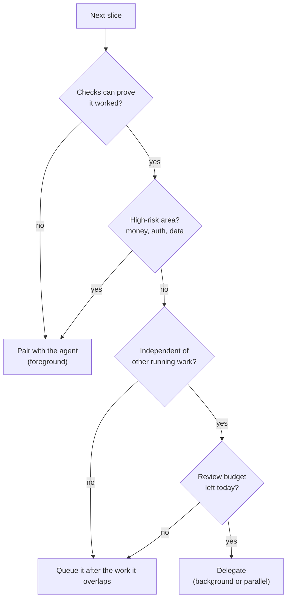

# Building with Agents

This is the phase everyone thinks of first, and the one that needs the least design once the others are in place. If intent is settled, research is accurate, the plan is small, and the agent can check its own work, implementation mostly takes care of itself.

Mostly. It is also the phase where it is easiest to feel productive while making things worse. Five agents running in five terminals looks like leverage. At the end of the afternoon it is five pull requests of a few hundred lines each, two of which touched the same file, one of which quietly changed a test to make it pass, and all of which now sit in front of a reviewer who did not watch any of them being built. The output arrived. The understanding did not.

The interesting decisions here are about **shape** — how big a unit of work is — and **mode** — whether a person is watching, and how many agents are running at once.

!!! tip "The one-liner"
    The less you watch, the more you rely on what was designed before the run. Delegate only what you could verify from the output alone.

---

## What problem this solves

Agents can produce code faster than anyone can understand it. Left unshaped, that produces large diffs, tangled changes, parallel work that collides, and a review queue that grows faster than the team can drain it. Building well with agents is mostly about keeping output digestible.

The public evidence on agent-authored pull requests points the same way. A study of about 33,000 agent-authored PRs on GitHub, from five coding agents, found that PRs that were not merged tended to involve larger changes, touch more files, and fail the project's CI more often; its qualitative analysis of 600 rejected PRs added reasons the numbers miss, including unwanted feature implementations and agents misaligned with what the maintainers wanted. A separate MSR 2026 study of agent-authored PRs found that larger changes and force pushes were associated with lower odds of merging, while reviewer engagement had the strongest association with success. These are open-source repositories, and correlation is not cause — a large PR may be large because the task was hard — but the direction is consistent with what every reviewer already knows. Small, focused changes get merged. Large ones get abandoned.

---

## When to use this

**Use the practices on this page when** an agent will write more than a few lines that someone else must review, or when more than one agent is running at once.

**Relax them when** you are prototyping to learn and will throw the result away. A spike does not need slices, worktrees or evidence. It needs a time box and the discipline to delete it.

---

## Roles and ownership

| Role              | Responsibility                                                                  |
| ----------------- | ------------------------------------------------------------------------------- |
| **Engineer**      | Directs the work; decides mode and parallelism; intervenes when needed          |
| **Agent**         | Implements the plan; runs checks; records progress and what it could not verify |
| **Harness owner** | Provides environments, worktrees, sandboxes, and the checks agents run          |

---

## Shape: thin vertical slices

Each unit of work should be:

**Vertical.** A thin path through the whole stack that delivers something observable, rather than "all the backend first". Horthy describes how he used to build before AI — API contract with mock data, then a frontend against it, then services, then the database, then business logic, then error handling — testing in a browser or with `curl` at each step. Agents default to the opposite order unless you ask.

**Small.** Reviewable in one sitting. Horthy's rule of thumb is that checking 100–200 lines and re-steering is much cheaper than ending up on the other side of 2,000 lines with no idea what is broken.

**Independently verifiable.** With its own acceptance check.

**Reversible.** Can be rolled back or flagged off on its own.

```text
Horizontal (what agents propose)        Vertical (what you want)

  1. migrations      ┐                    1. ── thin path: event → state → visible ──
  2. services        │ nothing runs       2. ── next path: UI action → state cleared ──
  3. API             │ until step 4       3. ── next path: legacy flow → same state ──
  4. frontend        ┘                    each step runnable and checkable on its own
```

If a plan has more than five or six steps, it is usually several slices. Split them and consider stacking the pull requests, so each layer is reviewed on its own while later layers keep moving. GitHub's native stacked pull requests entered private preview in April 2026 and public preview at the end of July 2026, with a CLI extension that rebases the whole stack after a change lower down and an agent skill that teaches coding agents to work with stacks. Tools such as Graphite have offered the same workflow for longer.

---

## Mode: foreground, background, or parallel

| Mode                       | What it looks like                                                       | Best for                                                                        | Watch out for                                         |
| -------------------------- | ------------------------------------------------------------------------ | ------------------------------------------------------------------------------- | ----------------------------------------------------- |
| **Pairing (foreground)**   | You watch the agent work and steer in real time                          | Unfamiliar areas, tricky design, high-risk code, learning a codebase            | Your attention is the bottleneck; fatigue             |
| **Delegated (background)** | The agent runs in a cloud or local sandbox and returns a PR or report    | Well-specified tasks with clear checks: fixes, upgrades, refactors, tests, docs | Output arrives as a black box if verification is weak |
| **Parallel**               | Several agents on independent tasks, each in its own worktree or sandbox | Independent slices, exploring alternatives, batches of similar changes          | Merge conflicts; review load; cost                    |

Most major coding tools now offer background or cloud agents alongside interactive use. The capability is no longer the question. The question is which work you trust to which mode.



Anthropic's study of its own engineers, published in late 2025 and based on a survey of 132 engineers and researchers in August 2025, is a useful reality check. Although its engineers used Claude frequently, more than half said they could "fully delegate" only 0–20% of their work; the rest involved active supervision and validation. The report also names a "paradox of supervision": using the agent well requires supervising it, and supervising it requires the very coding skills that may atrophy from overuse. Pairing is not the beginner's mode. For the hard parts, it is the professional one.

---

## Parallel work in practice

Mitchell Hashimoto's account of his adoption journey ends with a step he calls "always have an agent running". The details are more modest than the slogan, and more useful. He describes it as "still just a goal": at the time of writing he had a background agent running maybe 10 to 20% of a working day, he was not running multiple agents, and he did not want to run agents for their own sake — only when there was a task that would genuinely help. He also gives advice that runs against most tool defaults: turn off agent desktop notifications. "It was my job as a human to be in control of when I interrupt the agent, not the other way around."

What makes parallel work hold up:

**Isolation.** Each agent in its own Git worktree or sandbox. Stripe's Minions run in pre-warmed, isolated dev environments that spin up in about ten seconds, isolated from production and the internet, and a run gets at most two rounds of CI before it ends in a pull request for human review.

**Independence.** Tasks that touch separate files or services. Parallel agents on overlapping code produce conflicts that eat the gains.

**You choose when to look.** Check at natural breaks in your own work, instead of being pulled into every agent's every question.

**A review budget.** Parallel agents multiply your review load. Run only as many as you can review properly, and count the review, not the generation, as the cost.

!!! warning "The parallelism trap"
    Running several agents feels productive. It is also cognitively expensive: constant context switching, more decisions per hour, more output to judge. If your review queue grows every day you run agents in parallel, you are not going faster. You are borrowing. See [Human Latency & Sustainable Intensity](../team/human-latency.md).

---

## When to intervene

Stop the agent and step in when:

- It is going in circles — the same failure, three attempts.
- It starts changing tests to make them pass.
- It touches files outside the plan, or adds a dependency the plan did not mention.
- It begins making product decisions the plan did not cover.
- Its context is visibly degraded — repeating itself, forgetting constraints.

Intervening usually means one of three things: answer the question it should have asked, restart the phase with a fresh context and a sharper plan, or take the task back. Restarting is underrated. A new session that starts from the plan and a two-line note about what went wrong is usually faster than arguing with a session that has already talked itself into a corner.

---

## Leave evidence behind

Every implementation run should end with:

- What changed, and why.
- How each acceptance criterion was verified, with output.
- **What could not be verified.**
- Any assumptions made.

That summary becomes the pull request description, and it is the difference between a reviewer reconstructing intent and a reviewer judging evidence.

---

## Worked example: five slices, three modes, one intervention

This continues the illustrative billing-team story. Marta has an approved five-slice plan: record the failed-payment state from the modern webhook handler; show the admin banner; clear it on card update and trigger a retry; record the same state from the legacy handler; add analytics events. The team's CI has already told her each slice's risk tier from the paths it will touch: slices 1, 3 and 4 change `services/billing/`, so they are tier 3; slices 2 and 5 live in `apps/web/` and are tier 2.

**Choosing modes.** The tier 3 slices are the riskiest code in the feature, in the area Lena owns, so nobody delegates them blind. Marta pairs with an agent on slices 1 and 4 in the foreground; Daniel does the same for slice 3. Slice 2, the banner, reuses an existing component and an existing permission helper and has clear criteria; Marta delegates it to a background agent in its own worktree. Slice 5, analytics, is independent of everything else, so it runs in parallel in a third worktree.

**Stacking.** Slices 1, 2 and 3 form a stack: each PR targets the branch below it. Lena can review slice 1 — the handler change, about 120 lines — without waiting for the UI. Daniel waits until slice 2 has been reviewed before starting slice 3, because both touch the account settings page and he would rather build on a reviewed layer than rebase onto a moving one.

**The intervention.** On slice 2, the background agent hits a failing test. An existing component test asserts that `AccountAlert` only ever renders the trial-expiry message; the new banner breaks it. The agent's fix is to edit the test's expectation. Its summary says, accurately but unhelpfully, "updated test to reflect new behaviour". It has also added a date-handling library to show "payment failed 3 days ago", which nobody asked for.

Marta catches both in the end-of-run summary rather than in the diff, because the harness lists changed test files and new dependencies at the top. Changing a test's expectation is sometimes correct — here the old assertion really did encode an assumption that no longer holds — but it is a decision for a person, not an agent trying to get to green. She restarts slice 2 in a fresh session with two additions to the instructions: existing tests may not be edited without stopping to ask, and no new dependencies. The second run asks about the test, Marta confirms the change and asks for a new test alongside it that covers the payment message explicitly, and the "3 days ago" text disappears because nobody wanted it.

**What it cost.** One wasted background run, about twenty minutes of agent time, and ten minutes of Marta's. **What it saved.** A test silently rewritten to agree with the code, and a dependency nobody had decided to own.

**Review budget.** Marta ran at most two agents at once. A third would have finished sooner and waited longer — for her.

---

## What good looks like

| Signal                     | What you observe                                                   |
| -------------------------- | ------------------------------------------------------------------ |
| **Small PRs**              | Most changes reviewable in one sitting                             |
| **Evidence attached**      | PRs include verification output and known gaps                     |
| **Mode matches risk**      | Background agents on well-specified work; pairing on hard problems |
| **Parallel work isolated** | No collisions; a worktree or sandbox per agent                     |
| **Review keeps up**        | Agent throughput does not outrun review capacity                   |
| **Restarts are normal**    | Engineers restart degraded runs instead of arguing with them       |

---

## Failure modes and mitigations

Most teams meet these failures in the same order. First the mega-PR, because the agent could do it all in one go. Then the background PR merged on trust, because it was green. Then, once parallel agents are common, the collisions and the review queue. Each step feels like progress until the queue makes it visible.

| Failure mode             | What it looks like                   | Mitigation                                                       |
| ------------------------ | ------------------------------------ | ---------------------------------------------------------------- |
| **The mega-PR**          | 3,000-line agent diff                | Slice thinner; stack PRs                                         |
| **Black-box delegation** | Background PRs merged on trust       | Delegate only what can be verified from evidence                 |
| **Parallel collisions**  | Agents fighting over the same files  | Partition work; worktrees; queue overlapping slices              |
| **Test tampering**       | Tests weakened to pass               | Block test edits without asking; list changed tests in summaries |
| **Dependency creep**     | New libraries nobody chose           | Deny new dependencies by default; surface them in summaries      |
| **Supervision fatigue**  | Engineer watches five agents all day | Fewer, better-specified runs; check in at your own breaks        |

---

## Copy this: end-of-run summary

```markdown
## What changed
<2–4 lines>

## Changed tests and new dependencies
- <test files modified, and why> / <dependencies added, and why> (or "none")

## Verification
| Criterion | How verified | Result |
| --- | --- | --- |
| <criterion> | <command / check / walkthrough> | pass / fail |

## Not verified
- <what could not be checked, and why>

## Assumptions
- <anything decided without explicit guidance>

## Follow-ups
- <anything left for later>
```

---

## Further reading

- **[Where do AI coding agents fail? An empirical study of failed agentic pull requests in GitHub](https://arxiv.org/abs/2601.15195)** by Ramtin Ehsani et al. — 33k agent PRs: what gets merged and what does not. (Preprint.)
- **[When AI teammates meet code review](https://arxiv.org/abs/2602.19441)** by Costain Nachuma and Minhaz Zibran — Change size, force pushes and reviewer engagement as merge predictors. (MSR 2026.)
- **[Why software factories fail](https://github.com/humanlayer/advanced-context-engineering-for-coding-agents/blob/main/wsff.md)** by Dex Horthy (HumanLayer) — Vertical slices and reviewing as you go. (Vendor.)
- **[My AI adoption journey](https://mitchellh.com/writing/my-ai-adoption-journey)** by Mitchell Hashimoto — An honest account of background agents, including turning notifications off.
- **[Minions: Stripe's one-shot, end-to-end coding agents](https://stripe.dev/blog/minions-stripes-one-shot-end-to-end-coding-agents)** by Stripe — Isolated environments and capped CI rounds at scale.
- **[How AI is transforming work at Anthropic](https://www.anthropic.com/research/how-ai-is-transforming-work-at-anthropic)** by Anthropic — How much engineers can really delegate, and the paradox of supervision. (Vendor research.)
- **[Stacked pull requests are now in public preview](https://github.blog/changelog/2026-07-30-stacked-pull-requests-are-now-in-public-preview/)** by GitHub — The public preview announcement. (Vendor changelog.)
- **[GitHub targets large merge problem with stacked PRs](https://www.infoq.com/news/2026/04/github-stacked-prs/)** by InfoQ — Native stacking and agent support.

---

## Related pages

- [Subagents & Orchestration](../foundations/subagents-and-orchestration.md) — Parallel agents and their limits.
- [Research & Planning](research-and-planning.md) — The previous chapter: the plan these slices come from.
- [Verification](verification.md) — The next chapter: checks that do not share the agent's assumptions.
- [Review at Agent Speed](review-at-agent-speed.md) — Where the review budget gets spent.
- [Human Latency & Sustainable Intensity](../team/human-latency.md) — The cost of running too many agents.
