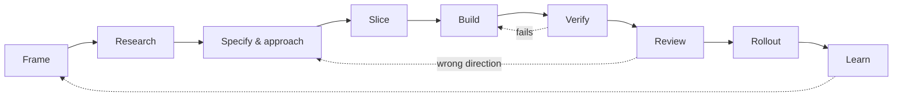

# Workflow

When writing code stops being the slow part, everything around it is exposed.

A ticket could be two lines long because whoever picked it up would walk over and ask what you meant. Review was a person reading a diff they could hold in their head. The pauses that slow tools forced on us — three days to implement a feature, a day for a review — were not empty. They were time to reconsider an approach, to notice a requirement was vague, for the brain to catch up with the hands. Nobody designed those checkpoints. They came free with the friction.

Agents remove the friction, and the checkpoints go with it. What is left underneath is the process you actually have, which for most teams turns out to be less structured than they assumed. Speed does not create bad process. It reveals the absence of good process, and then it makes that absence louder.

This section is about designing the process deliberately: what each phase protects against, what agents can carry, and where a person has to decide.

!!! tip "The one-liner"
    The model is a component. The workflow is the product — and its two ends, intent and verification, are where a team's judgment enters the work.

---

## The lifecycle



Each phase exists because something specific goes wrong without it. The dotted arrows matter as much as the solid ones: verification that fails sends work back to the build, and a review that discovers the wrong direction sends it back to the approach — which is exactly the expensive loop the earlier phases exist to prevent.

| Phase                  | What it protects against                       | Agents carry                                         | People decide                         |
| ---------------------- | ---------------------------------------------- | ---------------------------------------------------- | ------------------------------------- |
| **Frame**              | Solving the wrong problem                      | Gathering metrics, tickets, prior decisions          | Whether it is worth solving, for whom |
| **Research**           | Building on wrong assumptions about the system | Tracing code, mapping dependencies, finding patterns | Whether the understanding is sound    |
| **Specify & approach** | Late design debates in PR review               | Drafting acceptance criteria and approach options    | The approach and the trade-offs       |
| **Slice**              | Big, unreviewable changes                      | Proposing thin vertical slices                       | The order and the scope cuts          |
| **Build**              | Unshaped, unattended output                    | Implementation, tests, iteration against checks      | Mode, parallelism, when to intervene  |
| **Verify**             | Plausible-but-wrong output                     | Running checks, walkthroughs, evidence collection    | Whether the evidence is enough        |
| **Review**             | Unowned, ununderstood code                     | First-pass review, risk classification               | What merges, and who owns it          |
| **Rollout**            | Harm to users at full exposure                 | Drafting rollout plans and comms, watching signals   | Each exposure step                    |
| **Learn**              | Repeating mistakes; features nobody revisits   | Comparing outcomes to intent at 7 and 30 days        | Keep, iterate, or reconsider          |

The point is not this specific sequence. The point is having *any* deliberate sequence, because the alternative is not "no process". It is an invisible process that runs on instinct, degrades under pressure, and cannot be inspected or improved.

---

## Where the effort goes now

The most striking change in agentic workflows is where human attention concentrates. Every's compound engineering loop runs from ideation through planning, work, review and polish to a final "compound" step that feeds lessons back into the system. Trevin Chow's image for it, quoted by Kieran Klaassen, is a sandwich: "AI is the stuff in the middle. Humans are the bread on either end, holding it together."

```text
  Human:  frame → decide the approach → agree what done means
  Agent:  research → plan → build → run checks → collect evidence
  Human:  judge the evidence → own the merge → decide what the result means
```

That matches my experience. The middle gets fast. The ends get more important. DORA's 2025 research puts the same idea in organisational terms: AI acts as an amplifier, and teams that adopt it without a user-centric focus can see their performance get worse, because faster code generation "can simply propel a team faster in the wrong direction". Small batches turn out to matter more, not less: DORA reports that working in small batches amplifies AI's positive effect on product performance and acts as a countermeasure to the delivery instability AI adoption often brings.

So the workflow should be designed around its ends. **Intent** decides whether the speed is pointed anywhere useful. **Verification** decides whether the output can be trusted without reading every line. Everything in between is increasingly the agent's job.

---

## One piece of work, followed all the way through

Advice about workflow is easy to agree with and hard to picture. So every page in this section follows the same illustrative piece of work from end to end. It is a composite, not a report of a real team, and the numbers in it are invented to make the mechanics visible.

**The setting.** The same hypothetical team whose documents fill the [Templates](../templates/index.md) section: seven engineers, a product manager and an engineering manager building a subscription-billing product for B2B customers. Marta is the staff engineer who picks up the work, and she also owns the team's harness. Aisha is the product manager. Lena owns the billing area. Tomás is the engineering manager, and Daniel and Kofi are engineers on the team. Noor leads customer support. The team uses coding agents for most implementation, inside a harness with read-only research tools, isolated worktrees, CI that classifies every PR by risk tier, a preview environment and a feature-flag system. The story starts in late October 2026, a few days after the team's 30-day review of the invoice-reminder feature described in the templates.

**The request.** It arrives from finance as one line: *"We keep losing customers to failed card payments — can we add retries?"*

```text
Intent        "add retries" becomes "the person who can fix the card never finds out"
Research      the agent maps two webhook handlers; one surprise, one wrong claim
Build         five vertical slices, three modes, one intervention
Verification  an independent test catches a bug the agent's own tests could not
Review        three tiers in one feature; a walkthrough for the area owner
Rollout       a hold at 5% and a fix, before anyone needed a rollback
Learning      the 30-day review says "iterate", and the harness learns too
```

You can read the pages in any order, but the story reads best in sequence.

---

## What this section covers

| Page                                                  | What it covers                                                                              |
| ----------------------------------------------------- | ------------------------------------------------------------------------------------------- |
| [**Intent Before Code**](intent-before-code.md)       | Framing, specifications, and approach review — settling what and how before a patch exists. |
| [**Research & Planning**](research-and-planning.md)   | Understanding the system and producing a plan a person can review in minutes.               |
| [**Building with Agents**](building-with-agents.md)   | Thin slices, worktrees, foreground and background agents, and when to intervene.            |
| [**Verification**](verification.md)                   | Independent checks that do not share the implementing agent's assumptions.                  |
| [**Review at Agent Speed**](review-at-agent-speed.md) | Risk-tiered review, AI reviewers, and what humans should actually read.                     |
| [**Rollout & Learning**](rollout-and-learning.md)     | Deliberate exposure, and closing the loop between delivery and product learning.            |

---

## Proportionality

Not every change goes through every phase in full. A typo fix does not need framing. A dependency patch does not need an approach review. Dex Horthy at HumanLayer, describing his own team's distribution in mid-2026, estimated that around 40% of tasks are one-shot with at most light feedback, medium tasks get one combined plan document, and only large work gets every step. That seems about right as a shape, even if your numbers differ.

What should not vary is the set of questions. In the harness I built for my team, every change passes through the same questions, and when a phase does not apply, the harness records why rather than skipping it silently. Consistency belongs to the questions, the boundaries and the quality bar — not to the size of the answers.

| Change size                             | Typical path                                                   |
| --------------------------------------- | -------------------------------------------------------------- |
| **Trivial** (copy, config, typo)        | Build → Verify → Review                                        |
| **Small, well understood**              | Slice → Build → Verify → Review                                |
| **Feature in a known area**             | Research → Specify → Slice → Build → Verify → Review → Rollout |
| **New product surface or risky change** | Every phase, every gate                                        |

---

## What good looks like

| Signal                            | What you observe                                            |
| --------------------------------- | ----------------------------------------------------------- |
| **Arguments move earlier**        | Design debates happen on approaches, not in PR threads      |
| **Small diffs**                   | Changes are sliced thin enough to review                    |
| **Evidence travels with changes** | PRs arrive with verification output, not just code          |
| **Late phases happen**            | Rollouts are deliberate; impact is reviewed                 |
| **Proportional process**          | Small work moves fast; big work gets the attention it needs |

---

## Failure modes and mitigations

| Failure mode          | What it looks like                           | Mitigation                                    |
| --------------------- | -------------------------------------------- | --------------------------------------------- |
| **Straight to build** | Prompt → code → PR, nothing before           | Intent and research phases scaled to the work |
| **Buried ends**       | Fast middle; planning and review overwhelmed | Invest in intent and verification capacity    |
| **Ship and forget**   | No one looks at outcomes                     | Scheduled impact reviews in the harness       |
| **One-size ceremony** | Every change gets the full lifecycle         | Same questions, proportional answers          |

---

## Further reading

- **[The real AI advantage is the workflow, not the model](https://dreamingecho.es/blog/real-ai-advantage-is-the-workflow)** by Iván González Sáiz — Why speed exposes process, and a lifecycle as a thinking tool.
- **[AI shrinks cycle time. Humans don't.](https://dreamingecho.es/blog/ai-shrinks-cycle-time-humans-dont)** by Iván González Sáiz — The pauses that slow tools gave us, and what replaces them.
- **[The AI harness should follow the conversation](https://dreamingecho.es/blog/the-ai-harness-should-follow-the-conversation)** by Iván González Sáiz — Same questions for every change, proportional answers.
- **[Compound engineering gets an upgrade](https://every.to/source-code/compound-engineering-gets-an-upgrade)** by Kieran Klaassen (Every) — The loop and the sandwich image.
- **[State of AI-assisted Software Development 2025](https://dora.dev/research/2025/dora-report/)** by DORA — AI as an amplifier of existing strengths and weaknesses.
- **[Working in small batches](https://dora.dev/capabilities/working-in-small-batches/)** and **[User-centric focus](https://dora.dev/capabilities/user-centric-focus/)** by DORA — The two capabilities this section leans on most.
- **[Why software factories fail](https://github.com/humanlayer/advanced-context-engineering-for-coding-agents/blob/main/wsff.md)** by Dex Horthy (HumanLayer) — A practitioner's case for planning up front and reading the code. (Written by a vendor of agent tooling.)

---

## Related pages

- [AI Harness](../harness/index.md) — The system that carries this workflow.
- [Software Factories](../factories/index.md) — What happens when the middle of the workflow runs mostly unattended.
- [Human Gates](../harness/human-gates.md) — Where the workflow stops for a person, and why.
