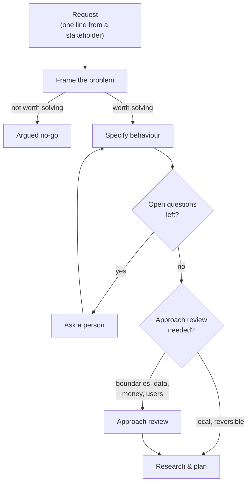

# Intent Before Code

The hardest pull requests often look reasonable at first. The diff is clean, the tests pass, the description explains the change. Then the comments start drifting somewhere else. Why are we changing this service instead of that one? Should this live behind a flag? Did Product expect this edge case? None of those are bad questions. They are often the right ones. The problem is timing: the team is not reviewing code any more. It is reviewing the approach after the implementation has started defending itself.

Agents make this worse in a specific way. A person who receives a vague request usually asks what you meant, because building the wrong thing costs them days. An agent does not pay that cost. It fills the gaps with plausible choices and returns something complete-looking in minutes. The conversation that used to happen at someone's desk — what is the problem, what should happen, what does done mean — is the first thing agents removed, and the most important thing to put back.

Once agents do most of the implementation, intent is where a team's judgment enters the work. Settle it while disagreement is cheap and review afterwards is short. Skip it and every pull request becomes a design debate held at the most expensive possible moment.

!!! tip "The one-liner"
    Uncertainty should become a question, not a confident-looking assumption — and the cheapest place to ask it is before a patch exists.

---

## What problem this solves

An agent given a vague request does not ask clarifying questions by default. The gaps surface later: in review ("that's not what I meant"), in QA, or in production. The cost of that discovery has an unusual shape with agents. The code was cheap, so throwing it away feels cheap. But the review that found the problem was not cheap, the reviewer's patience is not infinite, and the second attempt will be built on the same unexamined request unless someone changes it.

There is a practitioner story that makes the stakes concrete. Dex Horthy, founder of HumanLayer, wrote in 2026 that his team went fully "lights-off" in July 2025: specs and tickets in, background agents doing the small and medium work, nobody reading the code. It worked until it did not. Hard bugs surfaced that agents could not solve, the site went down, and engineers had to dig through code nobody had read in months. By around the third incident, in November, the team decided a rewrite was easier, and his cofounder spent two weeks re-establishing patterns by hand. His conclusion was not "stop using agents". It was to front-load alignment — product behaviour, system architecture, program design, vertical slices — with a person in the loop for each, so that review afterwards is short. He illustrates the trade with a diagram in which roughly half an hour to an hour of planning cuts review from six hours to twenty minutes. That is one team's estimate, from a company that sells human–agent collaboration tooling, so treat the numbers as an illustration rather than a measurement. The direction is the useful part.

DORA's 2025 research adds an organisational version of the same warning. Teams with a strong user focus that adopt AI see their performance grow; teams without one can see it get worse, because "AI's ability to accelerate code generation can simply propel a team faster in the wrong direction". Intent is the steering.

---

## When to use this

**Invest in intent when:**

- The change affects users, money, data, permissions, or other teams.
- More than one reasonable approach exists.
- The work will be delegated to an agent running unattended.
- The requester and the builder are not the same person.
- Disagreement would be expensive if discovered late.

**Keep it light when:**

- The change is trivial, local, reversible and fully specified by its title.
- You are prototyping to learn and will throw the result away.
- The pull request itself is the best exploration surface — a small refactor where the approach is easier to judge in code than in prose.

The trigger is not size alone. It is the cost of discovering disagreement late.

---

## Roles and ownership

| Role                       | Responsibility                                                                          |
| -------------------------- | --------------------------------------------------------------------------------------- |
| **Product partner**        | Owns the problem framing and success criteria                                           |
| **Engineer**               | Owns the approach; co-owns acceptance criteria; takes the framing into conversations    |
| **Tech lead / area owner** | Reviews approaches that touch their area                                                |
| **Agent**                  | Gathers evidence, drafts options and criteria, lists open questions instead of guessing |

---

## Three layers of intent

Intent has three layers, and each answers a different question. Skipping one tends to show up in the next phase as a vague plan, a contested review or a feature nobody uses.



### 1. Frame the problem

Before anything is specified: is this worth solving, and for whom?

The harness gathers what it can — usage data, support tickets, previous decisions, related incidents — and drafts a problem statement with explicit unknowns. Then a person takes it into the conversations no agent can have: with users, with stakeholders, with other teams. The framing that comes back is often different from the request that went in.

When I documented this phase for my team's harness, describing it precisely enough for an agent to execute exposed questions we had never answered. What counts as enough evidence? What should happen when a signal is weak? How far should the agent investigate before asking someone? The rule we kept returning to was that uncertainty should become a question, not a confident-looking assumption. A plausible guess makes a workflow look efficient while quietly moving it away from reality.

A useful framing answers:

- What problem, for whom, and how do we know?
- What would change if we solved it, and how would we see that?
- What are we explicitly not trying to solve?
- What would make us stop?

PostHog's argument applies here: agents need the same inputs good engineers use — how the product is used, who the customers are, what they complain about. A harness that only sees the repository makes repository-shaped decisions.

This is also the part of product engineering nobody assigns you. Most engineers begin their work after someone else has framed, scoped and named the problem. As agents carry more of the implementation, the leverage moves one step upstream — into the conversation where the problem gets framed rather than the one where it gets assigned.

### 2. Specify the behaviour

Turn the framing into behaviour that can be checked:

**Acceptance criteria as observable outcomes.** "An account admin whose card payment fails sees an update-payment banner on their next login" — not "handle failed payments". A criterion that cannot fail a test is not a criterion.

**Edge cases and non-goals, listed explicitly.** Non-goals are the pressure valve. They tell the agent, and later the reviewer, where not to expand the work.

**Contracts.** APIs, events and schemas that other parts of the system depend on.

These become the input for independent verification (see [Verification](verification.md)). If the agent drafts them, a person must approve them. Criteria written by the same agent that will implement them only move the guess one step earlier.

### 3. Review the approach

Before implementation, agree on *how*: which modules change, which patterns are followed, what the data model looks like, how it will be rolled out and rolled back.

An approach review is a short note, reviewed by the right person, before code makes the decision expensive to change. The artifact can be this plain:

```text
Problem:
Proposed approach:
Main trade-off:
Files/services affected:
Known edge cases:
What I am intentionally not solving:
Where I want feedback:
```

The **main trade-off** line forces honesty: every approach gives something up. **Where I want feedback** turns review from a vague invitation into a targeted one — "does this boundary feel right?" is easier to answer than "thoughts?". And the review group should be the smallest useful one. Horthy's version of the same advice is sharp: if you want to save time in review, pick the person who would review the PR and run the plan past them first.

An approach review is working when the feedback arrives while the author still feels curious instead of defensive. Small comments, early comments, comments that change the next few hours instead of reopening the last few days.

!!! warning "The pre-approval theatre trap"
    The failure mode of approach review is turning it into an approval gate. The note becomes a performance of certainty and reviewers start acting like a committee. You can spot the drift by the verbs: sign-off, blocking, escalation, consensus from people who will not carry the work. The goal is not to make every approach safe. It is to make expensive disagreement visible early enough to handle well.

---

## Worked example: "can we add retries?"

This is the first chapter of the illustrative billing-team story that runs through this section. The people and numbers are invented.

**The request.** In late October 2026, finance sends Aisha, the product manager, a one-liner: *"We keep losing customers to failed card payments — can we add retries?"* It would be easy to hand that straight to an agent. It would produce a retry scheduler, tests, and a tidy PR by the afternoon.

**The harness frames it first.** Marta, the engineer, asks the framing agent for evidence before anything else. It pulls cancellation data, support tickets tagged *billing*, and the payment provider's dashboard. Its draft says that in the last quarter a meaningful share of cancellations followed a failed payment, that the provider already retries failed charges on its own schedule, and — listed under *unknowns* — that it cannot tell from the data whether customers ever saw the failure emails.

That unknown is the important line. A less careful harness would have filled it with an assumption.

**The conversation the agent cannot have.** Marta takes the draft to Noor, who leads support. Noor recognises the pattern immediately, because she has seen it before: in the team's 30-day [impact review](../templates/impact-review.md) of invoice reminders, a few days earlier, the reminders worked far better where they reached a named billing contact and barely moved where they landed in a finance inbox nobody read. Failed-payment emails go to the same place. They reach the billing contact on file, who is often someone who left the company, or an unmonitored finance inbox. The admins who use the product every day never find out until access is suspended. Retrying the card more often would not help; the card is usually expired, not temporarily declined. This is what "learning feeds framing" looks like in practice: last month's review changes this month's problem statement.

**The framing changes.** The problem is no longer "retries". It is: *the person who can fix the card does not find out it failed.* Success is defined before any code exists: the share of failed-payment accounts that recover within 14 days should rise from its current baseline, and billing-related support tickets should not increase. Non-goals: changing payment provider, redesigning the dunning emails, changing retry timing beyond configuration.

**Acceptance criteria, approved by Aisha.**

- Any account admin sees an update-payment banner on login while the account has an unresolved failed payment.
- Non-admin users never see the banner.
- Updating the card from the banner clears the banner and triggers a retry.
- The banner disappears if the payment recovers by itself.

**The approach review.** Marta's note proposes recording a `payment_failed` state from the provider's webhook and showing the banner from that state. Main trade-off: relying on webhooks means a missed event leaves a stale banner. Where she wants feedback: *should the state live in the billing service or the accounts service?* Lena, who owns the billing area, answers in ten minutes: billing service, and there are two webhook handlers — a legacy one still serves annual plans — so the research phase should map both. One comment, before any code. In a PR, the same comment would have arrived after the agent had wired the state into the wrong service.

**What went wrong, and was caught.** The first draft of the criteria, written by the agent, said "users" rather than "admins". Aisha caught it at the gate. That one word becomes important again on the [Verification](verification.md) page.

---

## Spec-driven development: useful, with caveats

A category of tools has grown around this idea. GitHub's open-source Spec Kit walks an agent through a constitution, a specification, a plan, tasks and implementation, and had passed 140,000 GitHub stars by October 2026. Kiro, from AWS, generates `requirements.md`, `design.md` and `tasks.md` for each feature or bug fix, and Tessl, still in private beta in late 2025, aimed furthest, treating the specification rather than the code as the maintained artifact.

In October 2025, Birgitta Böckeler compared Kiro, Spec Kit and Tessl on martinfowler.com, and her article is still the most useful map of the space. She distinguishes three levels: **spec-first** (a spec written before the task), **spec-anchored** (the spec kept and evolved with the feature) and **spec-as-source** (humans edit only the spec). She found all the SDD approaches she examined to be spec-first, but not all of them spec-anchored or spec-as-source; of the three tools, only Tessl explicitly aspired to spec-anchored and spec-as-source. Her caveats deserve to be read in full:

**One workflow does not fit all sizes.** For a small bug the workflow "was like using a sledgehammer to crack a nut".

**Markdown is not cheaper to review than code.** "I'd rather review code than all these markdown files."

**Specs do not guarantee control.** Agents sometimes ignored the spec — re-creating classes that the spec described as existing — or over-applied it.

**Spec-as-source rhymes with model-driven development.** It risks "the downsides of both MDD and LLMs: Inflexibility and non-determinism."

Thoughtworks placed spec-driven development in *Assess* on its November 2025 Technology Radar, noting that the workflows "remain elaborate and opinionated"; it appeared as a single blip and has not been re-assessed in a later edition. Both Kiro and Spec Kit have since added lighter paths — Kiro's Quick Spec and bugfix specs, Spec Kit's bug-fixing and idea-assessment extensions alongside its implement-and-converge loop — which answers part of the size objection. My own cautions are smaller and more practical:

**A folder of generated Markdown is not intent.** If the agent that would have guessed the code now guesses the spec, you have moved the guess, not removed it. The value comes from a person deciding.

**Specs drift.** A specification that is not kept in sync with code becomes wrong information — the most damaging kind of context.

**Ceremony scales badly downwards.** Full spec flows are worth it for substantial features and wasteful for small changes.

Use the tools if they help your team think. Do not mistake their output for the thinking.

---

## What good looks like

| Signal                                         | What you observe                                                            |
| ---------------------------------------------- | --------------------------------------------------------------------------- |
| **Problems framed with evidence and unknowns** | Framing docs list what is not known, not just what is                       |
| **Criteria before implementation**             | Written or approved by a person before the build starts                     |
| **Approaches reviewed before code**            | Short notes, quick reviews, early disagreement                              |
| **Fewer PR design debates**                    | Review comments are about details, not direction                            |
| **Agents ask instead of guess**                | Plans include open questions, and they get answered                         |
| **Framings change**                            | Some requests come back reframed after a conversation with users or support |

---

## Failure modes and mitigations

The pattern is familiar. A request arrives under time pressure, it looks small, and "it's quick to build, let's just try it" wins. The agent produces something plausible. The review turns into a debate about direction, or worse, it does not, and the feature ships solving a problem nobody had. The team concludes the agent was wrong. The agent did what it was asked.

| Failure mode                    | What it looks like                                  | Mitigation                                                  |
| ------------------------------- | --------------------------------------------------- | ----------------------------------------------------------- |
| **The two-line ticket**         | Agents receive a title and a sentence               | Minimum intent template for delegated work                  |
| **Generated specs, unread**     | A spec folder nobody decided anything in            | Human gate on acceptance criteria                           |
| **Framing skipped for speed**   | "It's quick to build, let's just try it"            | Cheap to build is not cheap to maintain or explain to users |
| **Approach decided in PR**      | Reviewer rejects the direction after implementation | Approach review before build for non-trivial work           |
| **Repository-shaped decisions** | Agent never sees user or product context            | Feed product signals and support into framing               |
| **Pre-approval theatre**        | Approach notes need committee sign-off              | Smallest useful reviewer group; feedback, not approval      |

---

## Copy this: minimum intent for delegated work

```markdown
## Problem
<who has what problem, and how we know>

## Outcome
<what will be observably different when this is done, and how we will measure it>

## Acceptance criteria
- [ ] <observable behaviour>
- [ ] <observable behaviour>

## Non-goals
- <what we are deliberately not doing>

## Constraints
- <contracts, performance, security, areas not to touch>

## Approach (agreed)
<two to five lines; link to the approach review if one happened>

## Stop and ask if
- <conditions under which the agent must not proceed on its own>
```

---

## Further reading

- **[Approach review before the pull request gets expensive](https://dreamingecho.es/blog/approach-review-before-pull-request)** by Iván González Sáiz — The approach note, when to skip it, and pre-approval theatre.
- **[The half of product engineering nobody assigns you](https://dreamingecho.es/blog/half-product-engineering-nobody-assigns-you)** by Iván González Sáiz — Moving one step upstream of the inherited brief.
- **[The AI harness should follow the conversation](https://dreamingecho.es/blog/the-ai-harness-should-follow-the-conversation)** by Iván González Sáiz — Why uncertainty should become a question.
- **[Why software factories fail](https://github.com/humanlayer/advanced-context-engineering-for-coding-agents/blob/main/wsff.md)** by Dex Horthy (HumanLayer) — The lights-off experiment and the four alignment phases. (Written by a vendor of agent tooling.)
- **[Understanding spec-driven development: Kiro, spec-kit, and Tessl](https://martinfowler.com/articles/exploring-gen-ai/sdd-3-tools.html)** by Birgitta Böckeler (martinfowler.com) — The clearest taxonomy and critique of SDD tools.
- **[Spec-driven development](https://www.thoughtworks.com/radar/techniques/spec-driven-development)** by Thoughtworks Technology Radar — Assess, with reservations.
- **[Spec Kit](https://github.com/github/spec-kit)** by GitHub and **[Kiro specs](https://kiro.dev/docs/specs/)** by AWS — The tools themselves. (Vendor documentation.)
- **[User-centric focus](https://dora.dev/capabilities/user-centric-focus/)** by DORA — Why AI without user focus can make teams worse.
- **[Software factories](https://posthog.com/newsletter/software-factories)** by PostHog — Agents need product context, not just code.

---

## Related pages

- [Human Gates](../harness/human-gates.md) — Approach review as the cheapest gate.
- [Research & Planning](research-and-planning.md) — The next chapter: understanding the system before changing it.
- [Verification](verification.md) — Where acceptance criteria become independent checks.
- [Roles & the Shape of Work](../team/roles-and-the-shape-of-work.md) — How product work moves closer to engineering.
