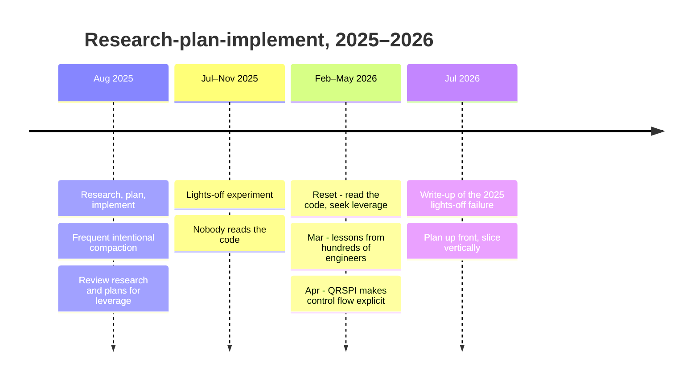
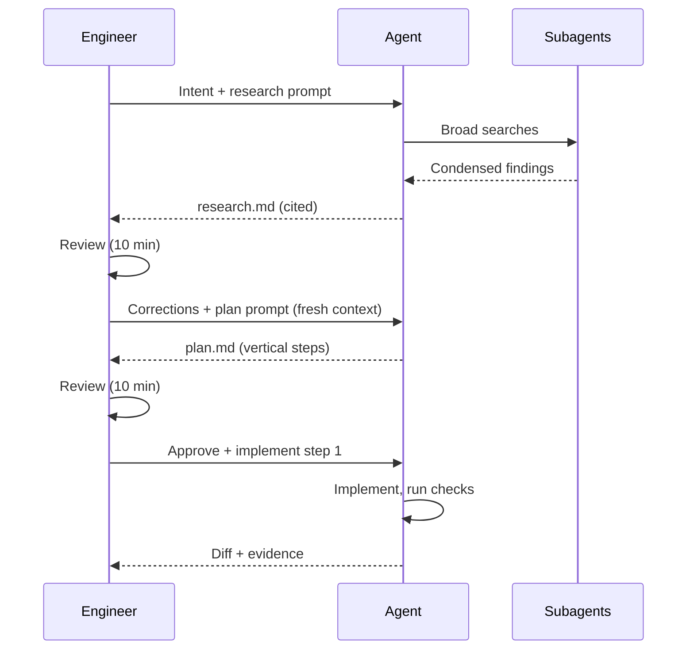

# Research & Planning

The cheapest bug to fix is a wrong assumption caught before any code exists. Research and planning are where you catch it.

Picture an agent asked to add a feature to a seven-year-old codebase. It reads the first file that looks relevant, forms a theory, and starts writing. The theory is plausible. It is also missing the second handler that a legacy flow still depends on, the helper that already does half the job, and the feature flag that disables the whole area for enterprise customers. None of this shows up until review — or until production. The agent was not careless. It committed to the first understanding that fit, which is exactly what it was asked to do.

With agents, research and planning become much cheaper to do well, because an agent can read far more of a codebase than any of us would in the same time. They also become much more important, because an agent building on a wrong understanding will build quickly and confidently in the wrong direction.

!!! tip "The one-liner"
    A bad line of code is a bad line of code. A bad line of a plan is hundreds of them, and a bad line of research is thousands.

---

## What problem this solves

Agents left to explore and implement in one session tend to commit to the first plausible understanding of the system and start changing code. In a small, clean codebase that is often fine. In a large or old one, it produces changes that miss callers, duplicate existing helpers, break conventions, and fail in ways that take longer to diagnose than the original task.

There is a second, quieter problem: context. Anthropic's engineering team describes context as "a finite resource with diminishing marginal returns" — as the number of tokens in a window grows, a model's ability to recall what is in it degrades. A long session that explored twenty files, tried three approaches and read two stack traces is a worse place to implement from than a fresh session that starts from a one-page summary of what was learned.

Separating research and planning from implementation solves both. It gives you two review points where mistakes are cheap, and it lets each phase start from a short, deliberate artifact rather than a crowded conversation.

---

## When to use this

**Use separate research and planning when:**

- The change touches more than a couple of files.
- The area is unfamiliar to the agent or to you.
- The codebase is large, old, or inconsistent.
- The work will run unattended.

**Skip or compress when:**

- The change is local and well understood.
- A previous research document for the area is still accurate.
- For medium work, one combined document covering research and plan is usually enough.

---

## Roles and ownership

| Role           | Responsibility                                                            |
| -------------- | ------------------------------------------------------------------------- |
| **Engineer**   | Reviews research for accuracy and plans for direction and shape           |
| **Agent**      | Produces research and plan artifacts; cites sources; lists open questions |
| **Area owner** | Consulted when research reveals surprises in their area                   |

---

## Where the pattern came from, and how it changed

The clearest public version of this practice comes from Dex Horthy and the HumanLayer team, and it is worth following how their advice evolved, because the evolution is the lesson.



In August 2025, HumanLayer published *Getting AI to work in complex codebases*. It described a research → plan → implement workflow built around what they called **frequent intentional compaction**: designing the whole process around context management, distilling each phase into a file, and keeping context utilisation in roughly the 40–60% range. It made an argument about leverage that still holds up: "A bad line of code is… a bad line of code. But a bad line of a plan could lead to hundreds of bad lines of code." A misunderstanding in research could produce thousands. So human attention belongs on research and plans: "When you review the research and the plans, you get more leverage than you do when you review the code." The same write-up was honest about failures — a seven-hour attempt to remove Hadoop dependencies from parquet-java "did not go well", and the diagnosis was that the research "didn't go deep enough through the dependency tree".

Between July and November 2025, the same team ran the lights-off experiment described on [Intent Before Code](intent-before-code.md): background agents on all small and medium work, nobody reading the code. In HumanLayer's own chronology, the period from February to May 2026 is the reset that followed — after five months of a lights-off factory and "unmaintainable slop", the advice became: read the code, seek leverage, and break skills into workflows. In March, after rolling the framework out to hundreds of engineers, their summary describes moving "from giant RPI prompts to smaller workflows with more structure and human ownership". In April, a talk titled *Everything we got wrong about research-plan-implement* argued that RPI had become a way to outsource thought, and introduced a revised version, QRSPI, that turns it into explicit control flow. In July 2026, Horthy published the full write-up of the 2025 failure, with the bluntest version of the advice: plan up front, slice vertically, and "read the dang code".

I read this arc as a correction rather than a reversal. Reviewing research and plans is still the highest-leverage review you can do. It is just not a substitute for reviewing what ships. Plans catch direction; code review catches what the plan did not say.

---

## Research

**Goal:** an accurate, concise picture of how the relevant part of the system works today.

**Output:** a short research document with:

- How the flow works, in plain language.
- Files, functions, and line references for every claim.
- Existing patterns and components to reuse, with an example of each.
- Constraints: callers, feature flags, migrations, tests, performance limits.
- Open questions the code could not answer.

**Practices:**

**No code changes during research.** Make it an explicit rule, and enforce it with read-only tools where your harness allows. "While I was looking, I fixed…" is how research quietly becomes an unreviewed implementation.

**Delegate broad searches to subagents.** Anthropic describes sub-agents that may explore with tens of thousands of tokens but return a condensed summary of 1,000–2,000. The main context stays clean for the decisions.

**Require citations.** "The retry logic is in `queue/worker.ts:142`" can be checked. "There is retry logic somewhere" cannot. An uncited claim in a research document is the most likely place for a confident error to hide.

**Review it.** Ten minutes reading research catches the misunderstandings that would cost hours later. Read it as a sceptic: what would have to be true for this to be wrong?

---

## Planning

**Goal:** a sequence of small, verifiable steps that a person can review in minutes.

**Output:** a plan with:

- The intended change in two or three sentences.
- Ordered steps, each small enough to verify on its own.
- For each step: what changes, and how it will be verified.
- What will *not* change.
- Risks and how they are handled.
- Open questions that block the plan.

**Practices:**

**Keep plans short.** A plan that grows to hundreds of lines will not get a careful review. If the plan is long, the slice is too big.

**Ask for vertical steps.** Horthy observes that models love "horizontal plans" in stack order — migrations, then services, then API, then frontend — which means nothing can be touched until the end. Ask for steps that each deliver a thin, runnable path you can check in a browser or with `curl`. Most models will not structure a plan this way without being asked.

**Plan verification, not just implementation.** Every step says how you will know it worked, with the exact command or check.

**Review the plan, then still review the code.** Implementation drifts from plans; the code is what ships.

---

## The rhythm



Each arrow back to the engineer is a fresh, cheap opportunity to catch a wrong turn. Each new phase starts from the previous artifact, not from a crowded conversation. That is what intentional compaction means in practice: you decide what the next phase needs to know, write it down, and start clean.

---

## Worked example: the second webhook

This continues the illustrative billing-team story. The framing is settled: account admins should see a banner when a card payment fails. Lena, who owns the billing area, has warned that there are two webhook handlers.

**The research prompt.** Marta asks the research agent, running with read-only tools, to map how payment-failure events flow from the provider into the product: every handler, every state they write, every place the UI reads account status, and any existing component for account-level alerts. Citations required. No code changes.

**What comes back.** The research document is about eighty lines. Most of it is right and useful:

- The modern handler in the billing service processes `invoice.payment_failed` for monthly plans and logs it, but stores nothing (`services/billing/webhooks/handler.ts:88`).
- The legacy handler, still routed for annual plans, receives the same event and **discards it with a no-op** (`services/billing/legacy/hooks.ts:212`). That is a surprise. Without it, annual-plan admins would never see the banner, and annual plans are the largest contracts.
- A feature flag, `account_alerts_enabled`, is off for enterprise workspaces (`config/flags.ts:41`).

And one claim is wrong: *"There is no reusable component for account-level alerts; a new banner component will be needed."* It has no citation. Marta notices the missing reference, searches the shared design-system package (`packages/ui`) herself, and finds an `AccountAlert` component already used for trial expiry. The agent had searched the application directory and never looked in the shared package.

**The correction.** Marta adds two lines to the research document — the component's location, and a note that the enterprise flag behaviour needs Aisha's decision — and sends it back as the input to planning. Aisha decides enterprise workspaces should get the banner too, behind the same rollout flag. That question would otherwise have surfaced in review.

**The first plan is horizontal.** The planning agent proposes: add a `payment_status` column; update both handlers; add an API field; build the banner; wire the card-update flow. Nothing is visible until step four.

**The second plan is vertical.** Marta asks for slices that each produce something checkable. The revised plan, about fifty lines:

```text
1. Modern handler records payment_failed on the account (flagged); verify with a sandbox event + DB read
2. Admin banner reads the state, using AccountAlert; verify in preview with a test account
3. Card update from the banner clears the state and triggers a retry; verify end to end in sandbox
4. Legacy handler records the same state for annual plans; verify with an annual-plan fixture
5. Analytics events for banner shown / clicked / card updated; verify events in the staging pipeline
Will not change: provider retry schedule, dunning emails, enterprise flag defaults
Open question: what happens if two admins update the card at once? (answer: provider is idempotent — confirm)
```

**What it cost.** Two ten-minute reviews and one question to Aisha. **What it saved.** A banner that would have silently missed the largest customers, a duplicate component, and a horizontal build where nothing could be tried until the end. The research document is kept: the next piece of billing work starts from it rather than from zero, as long as someone marks it stale when the handlers change.

---

## What good looks like

| Signal                                   | What you observe                                              |
| ---------------------------------------- | ------------------------------------------------------------- |
| **Research cites sources**               | Every claim has a file and line                               |
| **Plans fit on a screen**                | Reviewable in minutes                                         |
| **Plans are vertical**                   | Each step produces something you can run                      |
| **Open questions answered before build** | Not discovered during review                                  |
| **Fewer surprises in review**            | The diff matches the plan                                     |
| **Research is reused**                   | Accurate research docs for an area save time on the next task |

---

## Failure modes and mitigations

The usual story: the research step exists, but under time pressure it becomes a formality. The agent writes a confident document, nobody reads it carefully because "it looked right", and the plan inherits its one wrong sentence. Two days later a reviewer asks why the change duplicates an existing helper, and the answer is in the research document's only uncited claim.

| Failure mode                   | What it looks like                                | Mitigation                                                     |
| ------------------------------ | ------------------------------------------------- | -------------------------------------------------------------- |
| **Research that changes code** | "While I was looking, I fixed…"                   | Explicit no-change rule; read-only tools for research          |
| **Unread research**            | Generated, never reviewed                         | It is a review artifact; budget ten minutes                    |
| **Uncited claims**             | Confident descriptions that are wrong             | Require file and line references; distrust claims without them |
| **Plan novels**                | Hundreds of lines nobody reads                    | Smaller slices, shorter plans                                  |
| **Horizontal plans**           | Nothing runnable until the last step              | Ask for vertical, independently checkable steps                |
| **Plan as proof**              | "The plan was approved, so the code is fine"      | Plans catch direction; review still checks code                |
| **Outsourced thinking**        | The engineer approves whatever the agent proposes | The engineer owns the shape; the agent drafts it               |

---

## Copy this: a planning prompt

```text
Using research.md, write plan.md for: <intent>.

Constraints:
- Max 60 lines.
- Vertical steps: each step delivers a thin, runnable path that can be checked
  on its own (browser, curl, test). Do not order steps by stack layer.
- For each step: files to change, what changes, how we verify it (exact command or check).
- List what will NOT change.
- List risks and how each is handled.
- List open questions that must be answered before implementation. Do not guess.

Do not write any code yet.
```

---

## Further reading

- **[Getting AI to work in complex codebases](https://github.com/humanlayer/advanced-context-engineering-for-coding-agents/blob/main/ace-fca.md)** by HumanLayer — The original research-plan-implement write-up, frequent intentional compaction, and the leverage argument. (Written by a vendor of agent tooling.)
- **[Why software factories fail](https://github.com/humanlayer/advanced-context-engineering-for-coding-agents/blob/main/wsff.md)** by Dex Horthy (HumanLayer) — The 2026 revision: vertical slices and reading the code. (Vendor.)
- **[HumanLayer resources](https://www.humanlayer.dev/blog/humanlayer-resources)** by HumanLayer — A chronology of the talks, including the RPI-to-QRSPI material.
- **[Effective context engineering for AI agents](https://www.anthropic.com/engineering/effective-context-engineering-for-ai-agents)** by Anthropic — Context as a finite resource; compaction, notes and sub-agents. (Vendor post.)
- **[Agentic Engineering Patterns](https://simonwillison.net/guides/agentic-engineering-patterns/)** by Simon Willison — Practical patterns from a careful practitioner, updated over time.

---

## Related pages

- [Context Engineering](../foundations/context-engineering.md) — Why fresh, curated context beats long sessions.
- [Subagents & Orchestration](../foundations/subagents-and-orchestration.md) — Delegating broad searches.
- [Intent Before Code](intent-before-code.md) — The previous chapter: framing and approach.
- [Building with Agents](building-with-agents.md) — The next chapter: building the slices.
