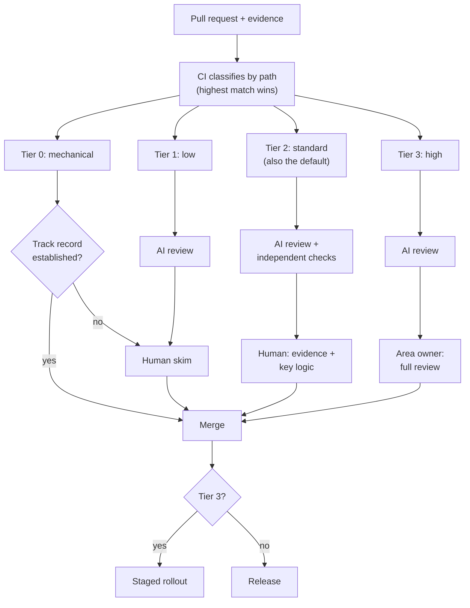

# Review at Agent Speed

Code review was designed for a world where a colleague wrote a diff you could hold in your head, and would be around to explain it during the next incident. Now the diffs are larger and more frequent, the author will never be paged, and the reviewer has twelve of them waiting before lunch.

You can see what happens next on any team that adopted agents without changing review. The first week, reviewers read everything carefully and the queue grows. The second week, they read the description and skim the diff. By the end of the month, approvals take ninety seconds regardless of size, and the team has quietly converted review from an act of understanding into a formality. Nobody decided that. It happened one tired approval at a time.

Review is where most teams feel the agent transition first. It is also where some of the most important design decisions sit: what humans read, what machines check, and who stands behind what merges.

!!! tip "The one-liner"
    You do not have too many pull requests. You have too many pull requests that ask a person to do work the system should have done first.

---

## What problem this solves

Agent throughput rises faster than review capacity. In Gergely Orosz's September 2026 report from inside OpenAI's agentic software factory, Venkat Venkataramani, VP of Engineering for Applied Infra, describes the number of pull requests per engineer "growing like a hockey stick", and the article concludes that with that volume "it simply wouldn't be possible for humans to review all code without assistance". The predictable results follow wherever capacity does not adapt: queues grow, reviewers skim, approvals become reflexive, and code merges that nobody really understands.

Dex Horthy puts the reframe well: "You don't have too many PRs. You have too many bad PRs." A PR that needs heavy rework is an intellectual and emotional burden on both sides, and he estimates that most one-shot AI PRs trend towards needing around half of their content reworked — one practitioner's guess, but a recognisable one. The rest of this section's workflow — intent, research, slicing, verification — exists largely so that what reaches review is worth reviewing.

The most detailed first-hand account of what that change looks like comes from the team that builds Claude Code, where, by their own account, Claude writes about 90% of the code. In an October 2026 post, Addy Osmani, Morgan Westlee Lunt and Qing Wang describe how review changed as Anthropic's monorepo went from about 2,500 changes landing per day in May to more than 30,000 in September. On the Claude Code repositories, merged pull requests more than doubled between June and September while the share that had to be reverted fell by more than 40%. They did not stop reviewing. They moved most of the reading to machines and spent human attention where it bought the most. It is a vendor describing its own product, and the numbers are theirs; the reasoning is worth borrowing regardless.

Their central reframe is the one I would put on the wall. "Did someone read the code?" is an imprecise proxy for a better question: *what could go wrong with this change, and which check — automated or human — is the right one to catch it?* And human time is a cost on both sides: the time people spend reviewing, and the time people spend fixing what review let through. Cut the first without cutting the second, and you have not saved anything. You have moved it.

You cannot solve this by asking people to review harder. You solve it by changing what review is for.

---

## When to use this

**Use risk-tiered review when** agents author a meaningful share of your changes, or when review wait time has become the longest stage of your cycle.

**Keep classic full review when** the team is small, volume is modest, and everyone still reads everything without strain. Tiers solve a capacity problem; if you do not have one yet, introduce them deliberately rather than pre-emptively.

---

## Roles and ownership

| Role                  | Responsibility                                                              |
| --------------------- | --------------------------------------------------------------------------- |
| **Reviewer**          | Judges evidence and the riskiest logic; owns the merge decision             |
| **Area owner**        | Reviews high-tier changes in their area; maintains the review rubric        |
| **Author (engineer)** | Ensures evidence and the "not verified" list exist before requesting review |
| **Harness owner**     | Assigns tiers mechanically; runs AI reviewers; tracks review metrics        |
| **AI reviewer**       | First pass for patterns, inconsistencies and missing cases                  |

---

## What review is for now

Traditional review served several purposes at once: catch bugs, enforce conventions, share knowledge, check design, and create shared ownership. With agents, those split:

| Purpose                                | Who does it now                                                                  |
| -------------------------------------- | -------------------------------------------------------------------------------- |
| **Conventions and style**              | Linters, formatters, structural tests                                            |
| **Common bug patterns**                | Static analysis, AI reviewers                                                    |
| **Behaviour correctness**              | Independent verification — see [Verification](verification.md)                   |
| **Design direction**                   | Approach review, *before* code — see [Intent Before Code](intent-before-code.md) |
| **Judgment on risk and evidence**      | **Humans**                                                                       |
| **Shared understanding and ownership** | **Humans**                                                                       |

Human review becomes narrower and more important: *is the evidence enough to trust this change, and do we understand it well enough to own it?*

There is a second reason the human part matters, and it is easy to miss when the conversation is about throughput. Agent-authored code is not just more voluminous; on the evidence available, it carries more problems per change. CodeRabbit, which sells AI code review, analysed 470 open-source pull requests and found AI-co-authored ones averaged 10.83 issues per PR against 6.45 for human-only ones, with logic and correctness issues about 75% more common. The study is small and identifying AI authorship was inexact — CodeRabbit says so itself — but it lines up with the independent follow-up-fix study cited on the [Verification](verification.md) page. Review is not becoming less necessary. It is becoming more targeted.

---

## Layers, not one gate

The other shift is in timing. Classic review is a check performed after the fact: the code is written, the pull request is filed, and someone waits for someone else. At agent volume, review works better as a series of layers, most of which run before a person is asked to look — closer to a spell checker that runs while you write than to an exam at the end.

The Claude Code team describes six layers, with a rollback mechanism under all of them:

```text
Pre-PR verification → AI review → Security review → Required CI → Human approval by risk → Merge queue, flags, staged rollout
                                                                                          ↓
                                                                          Fast detection and one-step rollback
```

**Pre-PR verification** is where most of their review happens. The agent is asked to produce something runnable — tests, a build, a screenshot compared with the design — rather than to declare the task done, and a subagent with fresh context reviews the diff. Boris Cherny, who created Claude Code, estimates that giving the agent a way to verify its work makes the result two to three times better. **AI review** runs on every pull request against the whole codebase and the stated intent, with findings vetted by several agents and a vote before a human sees them. **Security review** runs separately, and open findings from either review block the merge until they are fixed or closed with a reason. **Required CI** does what it always did. **Human approval** is scaled by risk. **Merge queue, feature flags and staged rollouts** limit the damage of whatever still gets through, and **fast rollback** is the last line of defence.

Each layer misses things. The point is that few problems get through all of them, and the expensive layer — a person — is reserved for what the cheaper layers cannot judge. It is the same idea as the verification layers on the [previous page](verification.md), applied to the whole path from laptop to production.

---

## Risk-tiered review

Not every change needs the same scrutiny. In the OpenAI workflow Orosz describes, "code changes are classified by risk", high-risk changes can go through stricter processes, and areas of the codebase can opt in to an agent that auto-approves low-risk PRs. Deciding where those lines sit is a decision about people as much as about code.



The model this playbook uses everywhere — the same one as the [Risk Tier Matrix](../templates/risk-tier-matrix.md) template:

| Tier               | Examples                                                                                     | Review                                                                                                                                                  |
| ------------------ | -------------------------------------------------------------------------------------------- | ------------------------------------------------------------------------------------------------------------------------------------------------------- |
| **0 — Mechanical** | Formatting, generated files, lockfile-only patch upgrades in low-risk services               | Automated checks; auto-merge only after a track record                                                                                                  |
| **1 — Low**        | Internal tools, tests, docs, isolated UI copy, small fixes behind flags                      | AI review + light human skim                                                                                                                            |
| **2 — Standard**   | Feature work in well-harnessed areas                                                         | Implement after an approved plan (approach review for larger changes, ~200+ lines); independent acceptance checks; human reviews evidence and key logic |
| **3 — High**       | Money, auth, personal data, migrations, public APIs, infrastructure, security-sensitive code | Approach review before build; full review by the area owner; staged rollout                                                                             |

Tiers should be assigned mechanically — by path and change type, outside the agent, with the highest matching rule winning and anything unmatched defaulting to tier 2 — so the classification itself is not a judgment call made under pressure, and so an agent cannot talk its own change into a lower tier. See [Risk Tiers & Autonomy](../factories/risk-tiers-and-autonomy.md) for how changes earn their way down a tier and lose it again.

The Claude Code team's approval rules are a useful set to copy, because each one closes a specific gap:

**The tier is set by the change, not the author.** A classifier decides the risk level, and some paths — anything owners mark as sensitive, and every CI workflow file — always need a person.

**An agent's approval never counts as a person's.** Automated review can clear a low-risk change. It cannot stand in when a human approval is required.

**The operator answers for the agent.** When an agent authors a pull request, the person who ran it counts as one of the required reviewers.

**An approval is good for one commit.** If new commits land that the system cannot vouch for — an agent's push, a merge someone resolved by hand — the approval has to be given again.

---

## AI reviewers

AI code review is now mainstream. GitHub reported in March 2026 that Copilot code review accounted for more than one in five code reviews on the platform, after tenfold growth in usage since its launch the previous April. GitHub also says that in 71% of reviews it surfaces actionable feedback and in the rest it says nothing, with a design principle worth stealing: "Silence is better than noise." Those are a vendor's own product metrics, not an audit.

Used well, an AI reviewer adds real capacity:

**First pass, not last word.** It catches patterns, inconsistencies and missing edge cases before a human looks.

**Independent context.** It sees the requirement and the diff, not the author's reasoning.

**Tuned to your codebase.** Feed it your review rubric and your most common human review comments. The Claude Code team uses a `REVIEW.md` for this: a short file in which code owners tell the reviewer what matters in their part of the code — what counts as a failure ("the docs should not lie; the config should not misroute"), what not to nitpick, which paths to ignore, and that every finding needs a file and line reference rather than a guessed filename. They check separately whether the reviewer actually follows it. When the reviewer keeps flagging the same issue, they fix it at the source instead: in the skill, a lint rule, or the instruction file.

**Measured.** Track how often its comments are accepted. A reviewer whose comments are mostly dismissed is noise, and noise trains people to ignore the whole channel.

And be careful with volume. A 2026 study of 7,416 reviewer-bot comments on agent-authored PRs found that more bot comments per PR were associated with longer resolution times and lower average feedback quality. Reviewers inside an agent's own loop are not reliably additive either: in the revised version of the NLAH paper, adding a verifier to a coding agent's harness barely moved its score on SWE-bench Verified (73.0 to 73.2), though it helped considerably on a computer-use benchmark. Confident, wrong feedback has a cost, and it is paid in the attention of the human who has to dismiss it.

The cost is higher when the author is an agent. A person dismisses a nit in a second. An agent that receives the same comment makes another commit, which triggers another review, which may produce another comment. The Claude Code team ranks its reviewer's priorities in exactly that order: first, find real bugs; second, reduce the number of review cycles.

### When agents review agents: convergence

A review loop between an agent author and an agent reviewer has to converge, and nothing guarantees that it will. The Claude Code team saw one pull request go through more than fifty rounds of review and fixes overnight before its author stopped it. When they ran `git blame` on what the reviewer kept flagging, about 59% of it was code that had been there since the reviewer's first pass. The reviewer was rarely finding new bugs; it was finding a few more old ones on every round. They had made it worse by running several review rounds by default, because each round can surface something different.

Their fixes are simple and worth copying:

- **Cap the rounds.** After three, the reviewer asks the author to step back and reconsider the approach.
- **Re-review only the new diff** after the first few passes.
- **Name the class of bug,** so the author can fix every instance rather than one line.
- **Do not re-report** findings already raised.
- **Track rounds-to-pass next to recall.** A reviewer that finds slightly more bugs but doubles the number of cycles is not obviously better.

Long review loops are an early sign of a different problem too: if a change needs many rounds, the approach is probably wrong, and the conversation belongs back at [intent](intent-before-code.md), not in round seven. Because code is now cheap to write, closing a pull request and starting again is cheap as well. The skill is to change course early in the thread, not with a blocking comment on a finished PR.

!!! info "What we know / what we don't"
    We know agent PR volume outruns human review without changes to the process, and that AI reviewers are widely used. We have vendor metrics on how often their feedback is actionable, and early independent evidence that more bot comments are not better. We do not yet know which tiering schemes hold up over a year, how often auto-approved low-risk changes cause incidents, or how much shared understanding a team loses when humans skim most diffs. Merge outcomes alone are a poor proxy: one 2026 study found only about a third of rejected agent PRs reflected a clear agent failure. Last reviewed: October 2026.

---

## What humans should read

When a person reviews an agent-built change, the highest-value reading order is:

1. **The intent and acceptance criteria.** Is this the right change?
2. **The verification evidence and the "not verified" list.** Is the evidence enough?
3. **Changes to tests.** Were any weakened or rewritten?
4. **The riskiest part of the diff.** Data handling, auth, money, concurrency, external calls.
5. **Anything surprising.** Files outside the plan; new dependencies; new permissions.

Skimming the rest is a legitimate choice once the above is solid — and it is a choice you should make deliberately, by tier, rather than by fatigue.

---

## Keeping ownership real

Review is also where ownership is created. If nobody reads a module carefully for six months, nobody owns it — and Horthy's lights-off story on [Intent Before Code](intent-before-code.md) shows what that costs the first time something breaks badly. Some practices that help:

**Named owner per merge.** The approver owns the change through its first weeks in production.

**Walkthroughs for significant changes.** Simon Willison's linear walkthrough pattern — asking the agent to present a structured, step-by-step walkthrough of the code — is a fast way to build understanding of code you did not write. When he used it on an app he had vibe coded, the walkthrough revealed that the agent had implemented the web server with raw socket programming and no library — something he had not known.

**Rotate review across areas.** So knowledge does not concentrate in one person, and so less experienced engineers build judgment by reading changes in the riskiest areas alongside someone who knows them.

**Review stacks, not monoliths.** Stacked, sliced PRs let the area owner read the 120 lines that matter instead of finding them inside 1,500 that do not.

---

## Worked example: three tiers in one feature

This continues the illustrative billing-team story. Five slices are ready, each with evidence attached. CI has labelled each PR by path, using the team's [risk tier matrix](../templates/risk-tier-matrix.md); nobody, human or agent, chose the labels.

**Slices 1, 3 and 4 — webhook handlers and card update — tier 3.** All three touch `services/billing/**`, which the matrix puts in tier 3. Lena, the billing area owner, saw the approach two weeks ago, so this review is about the code, not the direction. Before reading the diff, she asks the agent for a linear walkthrough of slice 4: how an annual-plan event moves through the legacy handler now, step by step, with line references. The walkthrough surfaces something the diff alone hid — the legacy handler acknowledges the webhook *before* writing the state, so a crash between the two would lose the event. She asks for the order to be swapped and for a test that covers it. That is the kind of comment only a person who owns the area makes. She reviews slice 3, Daniel's card-update change, in full as well, because it triggers a charge.

**Slices 2 and 5 — banner and analytics — tier 2.** Both live in `apps/web/`. The banner's role check calls the existing `isWorkspaceAdmin` helper without changing it, so nothing under `**/permissions/**` is in the diff and the path rules leave it at tier 2 rather than 3. Had the slice modified the helper, CI would have put it in tier 3 automatically. The AI reviewer leaves nine comments on slice 2. Marta accepts two (a missing loading state, an unhandled error from the card form), dismisses six as style the linter already covers, and one as wrong. The harness records the acceptance rate; if it stays this low, the rubric needs tuning. Kofi, the human reviewer, reads the evidence: the criteria-derived test matrix, the screenshots, the "not verified" list. He reads the role check line by line, because that is where the bug was, and skims the rest. On slice 5, Aisha checks that the event names match the ones the 30-day review will query, and Kofi reviews the rest.

**The copy change — tier 1.** A one-line wording fix on the banner, made after Noor read the screenshot, is an isolated UI copy change behind the feature flag. The AI reviewer has nothing to say; Aisha gives it a light skim and approves.

**The ownership line.** Lena is the named owner for slices 1, 3 and 4 through the rollout. Marta owns the rest. Neither of them read every line. Both can explain what they own.

---

## What good looks like

| Signal                                   | What you observe                                       |
| ---------------------------------------- | ------------------------------------------------------ |
| **Review queues stable**                 | Throughput rises without queue growth                  |
| **Human review time focused**            | Most time spent on evidence and risky logic            |
| **Tiers applied consistently**           | Low-risk changes flow; high-risk changes get attention |
| **AI review accepted at a healthy rate** | Comments are useful, not noise                         |
| **Ownership clear**                      | Every merge has a named human who can explain it       |

---

## Failure modes and mitigations

These failures tend to arrive together. Volume rises, seniors become the bottleneck, and the team responds by approving faster rather than by changing what reaches review. The metric that would reveal it — share of large diffs approved in under two minutes — is rarely on anyone's dashboard.

| Failure mode                | What it looks like                              | Mitigation                                                      |
| --------------------------- | ----------------------------------------------- | --------------------------------------------------------------- |
| **Review heroics**          | Seniors drown in agent PRs                      | Tiers, smaller PRs, better evidence                             |
| **Rubber stamps**           | Approval in seconds on large diffs              | Track review depth signals; tier by risk                        |
| **Design in review**        | PR rejected for direction                       | Approach review before build                                    |
| **Unreviewed merges creep** | Share of merges with no review rises unnoticed  | Monitor it explicitly                                           |
| **AI review noise**         | Dozens of low-value comments per PR             | Tune; measure acceptance; prefer silence                        |
| **Tier gaming**             | Changes classified low to skip review           | Assign tiers mechanically by path and type                      |
| **Endless review loops**    | Agent author and agent reviewer cycle overnight | Cap rounds; diff-only re-review; track rounds-to-pass           |
| **Bot approvals as human**  | An agent's approval satisfies a required review | Agent approvals never count; re-approve after untrusted commits |

---

## Copy this: reviewer's checklist for agent-built PRs

```text
[ ] I understand what problem this solves (intent linked)
[ ] Acceptance criteria are met — evidence attached, not asserted
[ ] I read the "not verified" list and accept those gaps
[ ] I reviewed every change to tests
[ ] I read the highest-risk part of the diff in full
[ ] No unexpected files, dependencies, or permissions
[ ] I can explain this change to someone else
[ ] I am willing to own this in production
```

---

## Further reading

- **[How the Claude Code team does code review](https://claude.dev/blog/solving-code-review-at-anthropic/)** by Addy Osmani, Morgan Westlee Lunt and Qing Wang (Anthropic) — Layered review, risk-based approval, convergence, and incidents as the reviewer's eval set. (Vendor post.)
- **[Inside OpenAI's agentic software factory](https://newsletter.pragmaticengineer.com/p/openai-software-factory)** by Gergely Orosz (The Pragmatic Engineer) — PR volume, risk classification and auto-approval at OpenAI. (Partly paywalled.)
- **[Why software factories fail](https://github.com/humanlayer/advanced-context-engineering-for-coding-agents/blob/main/wsff.md)** by Dex Horthy (HumanLayer) — "Too many bad PRs", and why to keep reading the code. (Vendor.)
- **[60 million Copilot code reviews and counting](https://github.blog/ai-and-ml/github-copilot/60-million-copilot-code-reviews-and-counting/)** by GitHub — Adoption of AI review and "silence is better than noise". (Vendor post.)
- **[State of AI vs human code generation](https://coderabbit.ai/blog/state-of-ai-vs-human-code-generation-report)** by CodeRabbit — Issue rates in AI-co-authored versus human PRs. (Vendor report.)
- **[On the footprints of reviewer bots feedback on agentic pull requests](https://arxiv.org/abs/2604.24450)** by Syeda Kaneez Fatima et al. — More bot comments, slower resolution. (Preprint.)
- **[Why are agentic pull requests merged or rejected?](https://arxiv.org/abs/2605.22534)** by Sien Reeve O. Peralta et al. — Why merge outcomes alone mislead. (Preprint.)
- **[Agentic Engineering Patterns](https://simonwillison.net/guides/agentic-engineering-patterns/)** by Simon Willison — The linear walkthrough pattern.
- **[Natural-language agent harnesses](https://arxiv.org/abs/2603.25723)** by Linyue Pan et al. (NLAH) — Module-by-module ablations of an agent harness, including a verifier. (Preprint; see the revised version.)

---

## Related pages

- [Verification](verification.md) — The previous chapter: the evidence review depends on.
- [Rollout & Learning](rollout-and-learning.md) — The next chapter: merging is not shipping.
- [Risk Tiers & Autonomy](../factories/risk-tiers-and-autonomy.md) — How tiers are earned and taken back.
- [The Bottleneck Moves](../factories/the-bottleneck-moves.md) — Why review becomes the constraint.
- [Growing Judgment](../team/growing-judgment.md) — Review as a place to build judgment.
