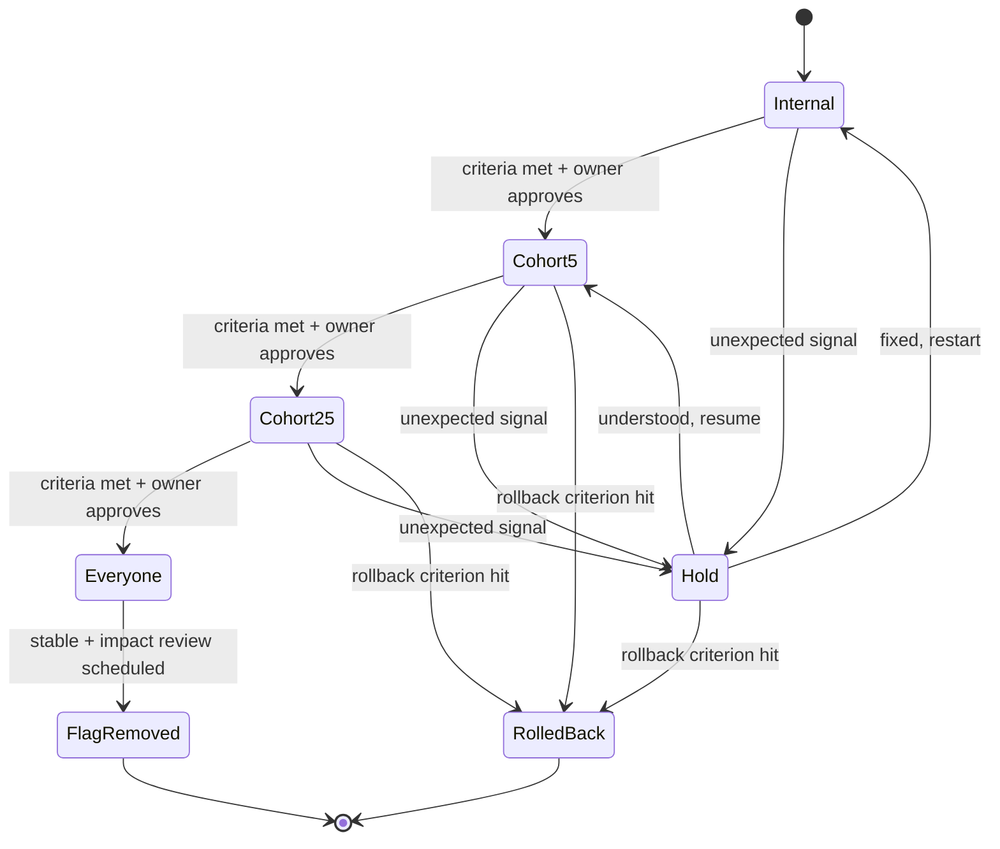

# Rollout & Learning

At 16:42, the deployment turns green. The dashboard settles. Someone adds a check mark to the thread, a few messages arrive — nice work, onto the next one — and the board already has another ticket waiting at the top. By the next morning the team is estimating again.

The work shipped. Whether it worked is a question nobody has scheduled.

Merging is not shipping, and shipping is not done. The work is done when the team knows whether it achieved what it was meant to — and has decided what to do about it. This is the phase teams skip most often, and the one agents can help with most quietly. Not by making it faster, but by making sure it happens at all.

!!! tip "The one-liner"
    Automation is most valuable here not because it makes an urgent step faster, but because it protects a valuable step that has no natural urgency at all.

---

## What problem this solves

Two problems, one at each end of the release.

**Rollouts that are not deliberate.** Changes reach every user at once, with no plan for what to watch or when to stop. With agents increasing the volume of change, the number of things reaching production without a plan goes up. DORA's research on small batches makes the point at the level of the whole delivery system: AI adoption often brings more delivery instability, and small batches are "a critical countermeasure". Exposure is a batch size too.

**Learning that never happens.** Once a feature ships, urgency disappears. There is no deployment waiting, no pull request blocking anyone. By the time the thirty-day mark arrives, the next piece of work is louder. The review that would have told you the feature was not used — or was used in a way nobody expected — never takes place. Most teams agree this review is important. Few do it consistently. The reason is rarely a lack of care. It is that nothing reminds them.

DORA's user-centric focus research names what is at stake: a team optimising for output rather than outcomes can use AI to "accelerate the production of low-value software, leading to high activity but low impact". The learning step is how you find out which of those you are doing.

---

## When to use this

**Use a deliberate rollout when:**

- Users will notice the change.
- The change touches revenue, data, or reliability.
- You are not sure it will work as intended.

**Ship directly when:**

- The change is internal, invisible, and trivially reversible.

**Always** schedule a learning step for anything that had a hypothesis.

---

## Roles and ownership

| Role                | Responsibility                                                            |
| ------------------- | ------------------------------------------------------------------------- |
| **Engineer**        | Owns the rollout plan and each exposure step                              |
| **Product partner** | Owns the success signals and the impact decision                          |
| **Agent**           | Drafts plans and communications; watches signals; prepares impact reviews |
| **On-call / SRE**   | Consulted on risky rollouts; owns rollback execution if needed            |
| **Support lead**    | Feeds early user signals back during the care window                      |

---

## Rollout

### A plan before exposure

Every non-trivial rollout has:

**Exposure stages.** Internal, a small cohort, a percentage, everyone.

**Signals per stage.** What to watch: errors, latency, the metric the change was meant to move, support volume.

**Advance, hold and rollback criteria.** Decided in advance, not in the moment.

**An owner for each step.**

Agents can draft this from the intent document and the change itself. A person approves it.



**Hold** is the state most rollout plans forget. Not every surprise is a rollback. Often the right move is to stop advancing, understand what you are seeing, and decide — which is a different decision from "it's broken, undo it", and should not be made under the same pressure.

### Flags and canaries, briefly

Two well-established practices carry most of the mechanics. Pete Hodgson's article on feature toggles, on Martin Fowler's site, separates **release toggles** (dormant code shipped before it is ready), **experiment toggles**, **ops toggles** and **permissioning toggles**, and describes a canary release as turning a feature on for a small, randomly chosen cohort while watching key metrics for both groups. Google's SRE workbook defines canarying as "a partial and time-limited deployment of a change in a service and its evaluation", and its advice transfers directly to agent-built changes: compare the canary population with a control rather than looking at service-wide averages, which can hide a canary's failures; choose a small set of metrics that map to user-facing problems; and check absolute SLOs too, because both groups can degrade together.

Hodgson also warns that toggles are "inventory which comes with a carrying cost". Release toggles should be short-lived, with a removal task created alongside each one. Agents are good at that cleanup — it is a well-specified, verifiable change — but someone has to decide the flag is done.

### Agents watching, people deciding

During rollout, an agent can watch the signals, compare them to the criteria, and prepare a short status at each stage: what moved, what did not, what looks unusual. The decision to advance — a [human gate](../harness/human-gates.md) — stays with a person who interprets those signals in the context of real users. In the harness I built for my team, a rollout cannot advance without explicit ownership, and that default is a statement about how we want to work rather than a technical detail.

### Communications as drafts

Agents are good at drafting release notes, help articles, customer emails, internal announcements and status updates. Keep outward-facing communication as drafts that a person sends. A message to customers is an irreversible action, and it speaks in the company's voice.

---

## Learning

### The care window

The first days after a release are not quiet because nothing is happening. They are quiet because the signals are subtle. A user hesitates on a step that looked obvious in design. A support ticket reveals a mental model nobody anticipated. A metric moves just enough to make you wonder. I call the deliberate response a **care window**: a short period after launch where the team keeps the pace light enough to notice what changed once the product became real, and makes one or two meaningful adjustments — not a cleanup sprint, not a list of everything postponed.

### Return to the hypothesis

At the end of the pilot, again at seven days, and again at thirty, the harness returns to what the work was meant to achieve:

```text
Ship ──▶ care window (first few days) ──▶ 7-day check ──▶ 30-day impact review ──▶ decision
           notice, adjust 1–2 things   early signal     expected vs observed     keep / iterate / reconsider
```

- What did we expect to change?
- What actually changed?
- What else changed that we did not expect?
- What do users say?
- **Keep, iterate, or reconsider?**

The agent assembles the evidence and the comparison. A person interprets it and makes the decision. The agent's job is to make sure the question is asked on time, with the original hypothesis and the measurement plan in hand, so nobody has to reconstruct them from memory.

### Close the loop

The output of learning is not a report that sits in a folder. It feeds the next piece of work: a new framing, a scope adjustment, a decision about where the team invests next. This is where delivery and product learning connect — and where a team that ships more because of agents can also *learn* more because of them.

### Learn about the way you work, too

A delivery produces two outputs. One is the thing that shipped. The other is evidence about the system that shipped it: where judgment was strong, where context arrived late, where the harness guessed. The second output disappears fastest.

A **shipping debrief** — twenty minutes after a meaningful delivery — asks a short chain of questions: what surprised us, which assumption did that challenge, what in our way of working amplified or reduced it, what should be different next time, and what signal will tell us whether the change helped. The output is one operating change with an owner and a review date, not a list of observations. The failure mode is the retro without a diff: honest conversation, nothing changed.

With agents, this is also the moment to ask what the harness got wrong on this piece of work. Where did agents guess? Which checks missed something? Which gate was a rubber stamp? Every's compound engineering loop makes this its final step — feeding lessons back "so it wouldn't make the same mistake next time" — and it feeds the [steering loop](../harness/guides-and-sensors.md#the-steering-loop) in your own harness.

---

## Worked example: a hold at 5%, and a 30-day "iterate"

This closes the illustrative billing-team story. The five slices are merged behind a release flag, `payment_alert_banner`. The numbers are invented.

**The plan.** The rollout agent drafts a plan from the intent document and the merged changes, and Marta edits it. Stages: the team's own internal workspace; 5% of workspaces; 25%; everyone. Signals at every stage: webhook processing errors, a count of `payment_failed` states written per handler compared with the provider's own event count, banner shown → card updated conversion, billing-related support tickets. Because the verification "not verified" list flagged that the legacy handler had only been tested with a recorded fixture, the plan adds a specific check that annual-plan events are being recorded. Rollback criterion: webhook errors above baseline or any mismatch between recorded states and provider events. Owner for each step: Marta, with Lena consulted on anything in the handlers. Because slices 1, 3 and 4 are tier 3, a staged rollout is required, not optional.

**Comms.** The agent drafts a help-centre article and a short note for the support team. Noor rewrites the support note's first paragraph — the draft explained the feature; her version explains what customers will ask — and sends it herself.

**Internal, then 5%.** Internally, everything behaves. At 5%, the agent's day-two status reports that recorded states match provider events for both handlers, conversion looks healthy, and one unusual signal: a small cluster of support tickets from a handful of workspaces, all large ones. Noor reads them. In workspaces with fifteen or twenty admins, every admin sees the banner, and several of them contact support to ask whether they are supposed to act. In one workspace two admins update the card within a minute of each other — the case the plan had listed as an open question. The idempotency held: the provider treated the second update as a no-op and only one retry ran.

**Hold.** Marta moves the rollout to *hold* rather than rolling back: nothing is broken, the behaviour matches the criteria, and the criteria were incomplete. Aisha decides the banner should name who last managed billing and tell other admins they can ignore it if that person is handling it. The change goes through the same workflow at a smaller scale — a tier 2 slice, criteria-derived tests updated with a multi-admin case — and the rollout resumes at 5%, then 25%, then everyone, a week later than planned.

**The care window.** In the first week at full exposure, the team keeps the board light. Noor forwards a handful of tickets; the team makes one adjustment, tightening the banner copy on small screens.

**Seven days.** The impact agent compares early numbers with the baseline recorded during framing: the share of failed-payment accounts that have recovered so far is up against the baseline at the same point after failure; billing tickets are flat after the multi-admin fix. The 14-day recovery measure the team agreed on cannot be read yet. Too early to decide anything, and the report says so.

**Thirty days.** The impact review lands on Aisha's desk without anyone scheduling it. Recovery is up meaningfully against the baseline, though less than the team hoped. The surprise is in the breakdown: a large share of card updates happen on phones, from the banner, even though the card form was designed for desktop and has a visibly higher abandonment rate on mobile. Aisha's decision: **iterate** — fix the mobile card form, then review again in thirty days. The decision and its reasons are recorded next to the original hypothesis.

**The shipping debrief.** Twenty minutes, five people. The surprise worth acting on is not the mobile finding; it is that the multi-admin case reached production, even though the team had the role matrix in its criteria-derived tests. The assumption it challenged: that "admins" was a single case. The operating change: criteria-derived tests for account-level features now include a multi-admin case by default, and the research prompt now searches shared design-system packages, after the missed `AccountAlert` component. Steward: Marta. Review date: after the next two account-level features. Marta, as harness owner, also notes that the AI reviewer's comment acceptance on this feature was low, and opens a change to its rubric with a [change record](../templates/harness-change-record.md).

---

## What good looks like

| Signal                      | What you observe                                                            |
| --------------------------- | --------------------------------------------------------------------------- |
| **Rollouts are staged**     | Exposure grows with evidence                                                |
| **Criteria set in advance** | Advance, hold and rollback decisions are not improvised                     |
| **Holds are normal**        | Teams pause to understand rather than choosing between "push on" and "undo" |
| **Impact reviews happen**   | At 7 and 30 days, without anyone remembering to schedule them               |
| **Decisions are explicit**  | Keep / iterate / reconsider recorded with reasons                           |
| **Learning feeds framing**  | Next initiatives cite previous impact reviews                               |
| **Flags get removed**       | Release flags have owners and removal dates                                 |

---

## Failure modes and mitigations

The usual path is gentle. The first few launches get a 30-day review because someone is enthusiastic. Then a busy month skips one. Then the reviews that do happen become reports nobody discusses. A year later the team ships twice as much and knows less about what any of it did.

| Failure mode             | What it looks like                           | Mitigation                                        |
| ------------------------ | -------------------------------------------- | ------------------------------------------------- |
| **Merge = ship = done**  | No rollout plan; no follow-up                | Rollout plan and impact review as defined phases  |
| **Moving goalposts**     | Success criteria redefined after launch      | Record signals and baseline before exposure       |
| **Rollback or nothing**  | Every surprise forces an all-or-nothing call | A defined hold state with its own owner           |
| **Agent-sent comms**     | Customer messages go out unreviewed          | Drafts only; a person sends                       |
| **Reports nobody reads** | Impact analysis produced, never discussed    | Impact review is a human gate with a decision     |
| **Retro without a diff** | Thoughtful debrief, nothing changes          | One operating change, a steward and a review date |
| **Flag graveyard**       | Release toggles live for years               | Removal task and date created with each flag      |

---

## Copy this

Use the [Impact Review](../templates/impact-review.md) template at 7 and 30 days. For the shipping debrief, this is enough:

```text
Evidence from delivery:
Operating change:
Signal to watch:
Steward:
Review date:
```

---

## Further reading

- **[Shipping debrief: the work is not done when it ships](https://dreamingecho.es/blog/shipping-debrief-work-not-done)** by Iván González Sáiz — The 20-minute debrief and the retro without a diff.
- **[Post-launch care windows](https://dreamingecho.es/blog/post-launch-care-windows)** by Iván González Sáiz — Listening to the quiet signals after release.
- **[The AI harness should follow the conversation](https://dreamingecho.es/blog/the-ai-harness-should-follow-the-conversation)** by Iván González Sáiz — Protecting the work that loses urgency.
- **[Feature toggles (aka feature flags)](https://martinfowler.com/articles/feature-toggles.html)** by Pete Hodgson (martinfowler.com) — Toggle categories, canary releases and toggle debt.
- **[Canarying releases](https://sre.google/workbook/canarying-releases/)** by Google SRE (The Site Reliability Workbook) — Canary versus control, metric selection and rollback.
- **[Working in small batches](https://dora.dev/capabilities/working-in-small-batches/)** by DORA — Small batches as a countermeasure to AI-driven instability.
- **[Compound engineering gets an upgrade](https://every.to/source-code/compound-engineering-gets-an-upgrade)** by Kieran Klaassen (Every) — The "compound" step: feeding lessons back into the system.

---

## Related pages

- [Impact Review](../templates/impact-review.md) — The template for the 7- and 30-day reviews.
- [Measuring Impact Honestly](../team/measuring-impact.md) — What to measure, and what not to claim.
- [Human Gates](../harness/human-gates.md) — Rollout and impact decisions as judgment gates.
- [Memory & Continuity](../harness/memory-and-continuity.md) — How the harness remembers the hypothesis 30 days later.
- [Review at Agent Speed](review-at-agent-speed.md) — The previous chapter.
