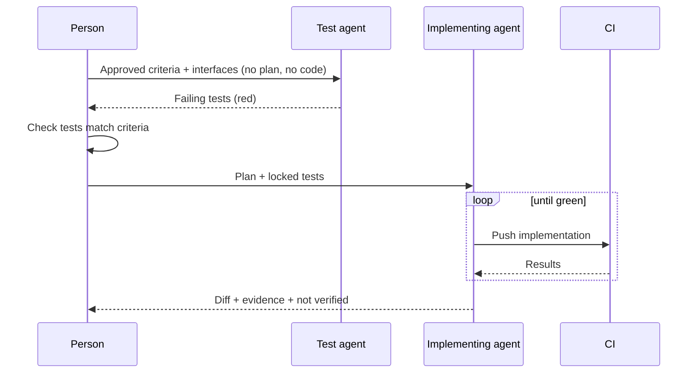

# Verification

The check cannot come from the same place as the code.

Imagine an agent that misreads "admins" as "users" in a requirement. It writes the feature for all users. Then it writes tests — for all users — and they pass. Then it writes a summary that says every acceptance criterion is met, and from where it stands, that is true. The tests are not wrong. They are faithful. They encode exactly the misunderstanding the code was built on, and they will keep encoding it, green, until a customer notices.

Tests written by the agent that implemented a change are useful. They catch real regressions. But they share the agent's understanding, so they cannot catch the agent's misunderstanding. As more of the implementation moves away from human hands, independent verification stops being a nice-to-have and becomes the thing that makes the rest trustworthy.

!!! tip "The one-liner"
    Agent-written tests check the code against the agent's understanding. Verification checks the code against yours.

---

## What problem this solves

The characteristic failure of agent-built software is not code that does not compile. It is code that compiles, passes its tests, looks reasonable, and does the wrong thing. Plausible-but-wrong is invisible to any check that shares the agent's assumptions.

The surveys and the repository data agree on the shape of the problem. In Qodo's 2026 survey of US developers and engineering leaders, reviewing and validating AI-generated code was the most-named primary constraint in the delivery pipeline — 26% of developers and 26% of leaders — and 36% of developers said reviewing AI code takes the same time as before but demands more cognitive effort to catch subtle bugs. Qodo sells AI code review, so read that as a vendor describing the problem its product addresses. A 2026 study of open-source repositories offers a measured counterpart: following 6,774 merged agent PRs into their aftermath, it found they attracted verified follow-up fixes at 1.62 times the odds of merged human PRs in the same repositories over the same period. Merged is not the same as done.

Better verification is how you buy confidence back without reading every line.

---

## When to use this

**Invest heavily when:**

- The change affects users, money, data, permissions or security.
- Work is delegated to background agents.
- You want to reduce how much code humans read.

**Keep it light when:**

- It is a throwaway prototype.
- The change is fully covered by existing, independent tests.

---

## Roles and ownership

| Role              | Responsibility                                                      |
| ----------------- | ------------------------------------------------------------------- |
| **Product / QA**  | Owns acceptance criteria and behaviour checks                       |
| **Engineer**      | Ensures verification evidence exists before review                  |
| **Harness owner** | Environments, browser tooling, and independent check infrastructure |
| **Agent**         | Runs checks, collects evidence, reports what it could not verify    |

---

## Layers of verification

Think of verification in layers, from cheapest and fastest to most realistic. The column that matters most is the last one: whether the layer can see something the implementing agent could not.

| Layer                      | Examples                                                                         | Independent of the agent?                      |
| -------------------------- | -------------------------------------------------------------------------------- | ---------------------------------------------- |
| **Static**                 | Types, linters, structural tests, security scanners                              | Yes — computational                            |
| **Agent-written tests**    | Unit and integration tests from the implementation run                           | No — shares assumptions                        |
| **Criteria-derived tests** | Tests written from acceptance criteria, before or separately from implementation | Yes, if written separately                     |
| **Running system**         | Agent or script drives the app: browser walkthroughs, API calls, screenshots     | Partly — depends on who wrote the script       |
| **Independent review**     | A separate agent or person checks the change against the requirement             | Yes, if it does not see the author's reasoning |
| **Production-like**        | Preview environments, realistic data, contract tests against real dependencies   | Yes                                            |
| **Runtime**                | Feature-flagged exposure, error rates, SLOs, sampled outputs                     | Yes                                            |

```text
  cheap, fast, shares nothing ──▶  Static checks
                                   Agent-written tests        ◀── shares the agent's assumptions
                                   Criteria-derived tests     ◀── first layer that can disagree with the agent
                                   Running system
                                   Independent review
                                   Production-like
  slow, realistic, shares nothing ▶ Runtime (flags, SLOs)
```

The upper layers are cheap and catch most mistakes. The lower layers catch the ones that matter most. A change that only has the first two has been checked for consistency with itself.

!!! info "What we know / what we don't"
    The behaviour harness is the least solved part of harness engineering. Birgitta Böckeler calls it "the elephant in the room": most people giving agents high autonomy check whether the AI-generated test suite is green and combine that with manual testing, which "puts a lot of faith into the AI-generated tests, that's not good enough yet". Some teams see good results with approved fixtures, selectively. We know running-system checks help. We do not yet have a reliable way to trust AI-generated tests enough to retire manual testing on critical paths. Last reviewed: October 2026.

---

## Making verification independent

**Write acceptance criteria before implementation.** Or at least have a person approve them before the agent starts. They become the specification for checks the implementing agent did not write. This is where the work on [Intent Before Code](intent-before-code.md) pays off.

**Separate test-writing from implementation.** One pattern: a first agent writes tests from the acceptance criteria and public interfaces only; a second implements until they pass and is not allowed to edit them. Simon Willison's red/green TDD pattern pushes in the same direction — write the tests first, confirm they fail, then implement — and he notes that test-first development helps agents write more succinct and reliable code with minimal extra prompting. His companion advice is blunter: if the code has never been executed, "it's pure luck if it actually works when deployed to production".



**Let the agent run the app.** An agent that can see actual behaviour catches what a unit test never will. In Ryan Lopopolo's February 2026 harness-engineering post for OpenAI, the team made the application startable per Git worktree and gave Codex its own ephemeral logs, metrics and traces for each one, so the agent could reproduce a bug, apply a fix and watch the result. Browser automation makes the same thing practical for web products: the agent drives the preview environment, takes screenshots, and records what it did.

**Give reviewers the requirement, not the reasoning.** An independent review agent should see the acceptance criteria and the diff — not the author's chain of thought, which it will tend to agree with.

**Use approved fixtures for hard-to-specify outputs.** Snapshots, golden files and examples a person signed off.

**Grade outcomes, not paths.** Anthropic's guidance on agent evaluations makes a point that transfers directly: check what the agent produced, not whether it followed the steps you expected, and read the transcripts when results surprise you.

---

## How much is enough

Verification has a cost, and the honest answer to "how much?" is: enough that the reviewer can make a decision without re-deriving the change. That threshold moves with risk, so it is worth tying to the same tiers used for [review](review-at-agent-speed.md).

**Mechanical and low-risk changes.** Static checks and the existing test suite are usually enough. Adding criteria-derived tests to a copy change is ceremony.

**Standard feature work.** At least one check the implementing agent did not write, plus a running-system walkthrough for anything a user can see. This is where most of the value is, because it is where most of the volume is.

**High-risk changes.** Criteria-derived tests with explicit role and state matrices, a production-like environment, and a rollout plan that treats the first exposure stage as part of verification rather than as the end of it. Some teams add mutation testing here; Böckeler notes that some people giving agents high autonomy "might even monitor its quality with mutation testing" — the quality of the AI-generated suite. It tells you whether the tests would notice a change in the code, which is a different question from whether they test the right behaviour.

Two signals tell you the calibration is off. If reviewers keep finding behaviour bugs that verification should have caught, the independent layers are too thin. If verification regularly takes longer than the build and rarely finds anything, it has become ritual for that tier, and the effort belongs somewhere else. Either way, the fix belongs in the harness, not in the reviewer's patience.

---

## Evidence, not assertions

The simplest way to get it is to stop accepting "done". The Claude Code team asks the agent to do something runnable — run the tests or the build, compare a screenshot with the design — and to show the result rather than claim the task is finished, then has a subagent with fresh context review the diff. Boris Cherny, who created Claude Code, estimates that giving the agent a way to verify its own work makes the result two to three times better. That is one person's estimate from a vendor, but it matches the direction of everything on this page.

The output of verification is evidence a reviewer can judge:

- Test output, not "tests pass".
- Screenshots or recordings of walkthroughs.
- The exact commands run.
- **A list of what could not be verified.**

That last item matters most. An honest "I could not test email delivery because the sandbox has no SMTP" is worth more than a confident summary that hides it. A harness that rewards clean summaries will get clean summaries; one that treats a "not verified" section as normal will get honest ones.

---

## Worked example: the banner non-admins should never see

This continues the illustrative billing-team story. Slice 2 — the update-payment banner — is built by a background agent. Its own tests pass and its summary says all criteria are met.

**Criteria-derived tests, written separately.** Before the slice was built, a test agent received only the four approved acceptance criteria and the public interfaces of the account and session modules. It never saw the plan or the code. It wrote a small matrix for the three criteria this slice owns: admin with failed payment, admin without, non-admin with failed payment, failed payment that recovers by itself. They were red before implementation, as they should be. The remaining criterion — updating the card clears the banner and triggers a retry — belongs to slice 3, where Daniel's session got its own criteria-derived tests, run against the payment provider's sandbox.

**The failure.** After implementation, three of the four pass. *Non-admin with failed payment* fails: the banner is shown to every user in the workspace. The implementing agent's own tests had all used the default `admin` fixture, so the role check was never exercised. Recall that the first draft of the criteria said "users"; Aisha corrected it to "admins". The implementing agent had read the corrected criteria and still reached for the first fixture that worked.

**The running-system check.** The harness also gives the agent a preview environment wired to the payment provider's sandbox. It logs in as an admin, triggers a failure with a test card number, screenshots the banner and, once slice 3 is in place, updates the card and screenshots the banner disappearing. It does the same as a non-admin — after the fix — and attaches the screenshot of nothing.

**The "not verified" list.** The final evidence includes three honest gaps: the provider's real retry timing cannot be reproduced with the sandbox clock; the legacy handler is only exercised with a recorded fixture, not a live annual-plan event; and the dunning emails are out of scope and untouched. Marta reads the list and decides the second gap matters: the rollout plan will include watching legacy-handler events specifically.

**What it cost.** One extra agent run to write tests, and a few minutes of a person checking them against the criteria. **What it saved.** A banner nagging every user in every affected workspace — at full exposure, a support problem and an embarrassment in front of the largest customers.

---

## What good looks like

| Signal                       | What you observe                                                        |
| ---------------------------- | ----------------------------------------------------------------------- |
| **Criteria before code**     | Acceptance criteria exist and were approved before implementation       |
| **Independent checks exist** | At least one check per change was not written by the implementing agent |
| **Running-system evidence**  | Screenshots, walkthroughs or API traces in PRs                          |
| **Gaps reported**            | PRs list what was not verified, and someone reads the list              |
| **Fewer escaped defects**    | Defects caught before review, not after release                         |

---

## Failure modes and mitigations

These failures compound quietly. CI is green, so review gets lighter. The agent's summary says "all criteria met", so nobody checks the criteria. The first escaped defect is treated as bad luck; by the third, the team has started reading every line again and the delegation has bought nothing.

| Failure mode                  | What it looks like                          | Mitigation                                        |
| ----------------------------- | ------------------------------------------- | ------------------------------------------------- |
| **Self-graded homework**      | The agent's tests are the only proof        | Criteria-derived tests and independent review     |
| **Green means good**          | CI passes, so approve                       | Verify behaviour, not just builds                 |
| **Echo-chamber review**       | Reviewer agent reads the author's reasoning | Requirement + diff only                           |
| **Fixture blindness**         | Every test uses the same happy-path user    | Role and state matrices in criteria-derived tests |
| **Hidden gaps**               | Summaries omit what was not tested          | Mandatory "not verified" section                  |
| **Verification after review** | Testing happens once humans approved        | Evidence before review                            |

---

## Copy this: verification checklist for agent-built changes

```text
[ ] Acceptance criteria approved by a person before implementation
[ ] Static checks pass (types, lint, structural, security)
[ ] At least one check derived from criteria, not written by the implementing agent
[ ] Running-system check performed (walkthrough / API trace / screenshot attached)
[ ] Tests modified in this change reviewed explicitly
[ ] Independent review against the requirement (agent or person)
[ ] "Not verified" section present and read by a person
[ ] Rollback or flag-off path confirmed
```

---

## Further reading

- **[Harness engineering for coding agent users](https://martinfowler.com/articles/harness-engineering.html)** by Birgitta Böckeler (martinfowler.com) — The behaviour harness as "the elephant in the room".
- **[Agentic Engineering Patterns](https://simonwillison.net/guides/agentic-engineering-patterns/)** by Simon Willison — Red/green TDD and "first run the tests".
- **[Who finishes the job? Follow-up fixes on AI coding agent pull requests](https://arxiv.org/abs/2609.26847)** by Wannita Takerngsaksiri, Nhat Duong and Scott Barnett — Merged agent PRs need fixing more often than human ones. (Preprint.)
- **[OpenAI introduces harness engineering: Codex agents power large-scale software development](https://www.infoq.com/news/2026/02/openai-harness-engineering-codex/)** by Leela Kumili (InfoQ) — Secondary report on agents validating their own work with logs, metrics and spans.
- **[Harness engineering](https://openai.com/index/harness-engineering/)** by Ryan Lopopolo (OpenAI) — The original write-up. (Vendor post.)
- **[Demystifying evals for AI agents](https://www.anthropic.com/engineering/demystifying-evals-for-ai-agents)** by Anthropic — Grading outcomes and reading transcripts. (Vendor post.)
- **[The 2026 State of AI Code Quality](https://www.qodo.ai/blog/state-of-ai-code-quality-report-2026/)** by Qodo — Survey of 500 US developers and 300 US leaders. (Vendor report.)

---

## Related pages

- [Guides & Sensors](../harness/guides-and-sensors.md) — Verification as the sensor side of the harness.
- [Building with Agents](building-with-agents.md) — The previous chapter: where the evidence comes from.
- [Review at Agent Speed](review-at-agent-speed.md) — The next chapter: what humans do with the evidence.
- [Intent Before Code](intent-before-code.md) — Where the criteria come from.
